# P101：L13.4- 卷积滤波器和权重共享 👁️

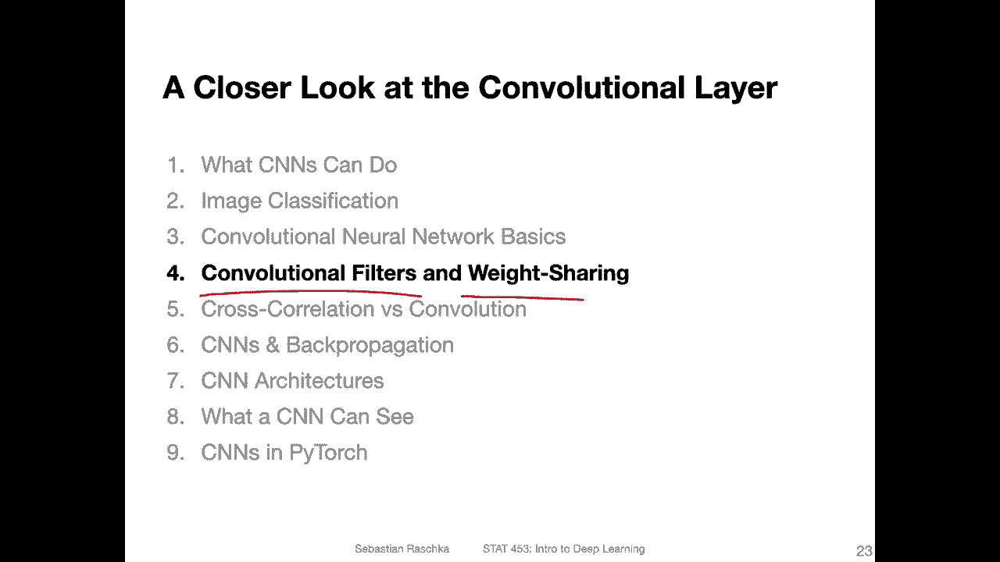

## 概述

在本节课中，我们将详细探讨卷积神经网络中的核心概念：**卷积滤波器**和**权重共享**原理。我们将一步步拆解滤波器如何应用于输入图像以生成特征图，并解释这种设计为何高效且有效。

---

## 卷积滤波器与权重共享详解

上一节我们简要提到了卷积层的基本思想，本节中我们来看看其核心机制——卷积滤波器和权重共享——是如何具体运作的。

卷积网络中有一个被称为**特征检测器**的组件，我们也称之为**滤波器**或**卷积核**。我个人更喜欢“特征检测器”这个术语，因为它更直观地描述了其功能：我们将其在输入数据上滑动，以生成一张**特征图**。


如图所示，中心部分展示了一个手写数字“5”的图像。我们有一个3x3的特征检测器（卷积核），将其应用于图像上以计算特征图。当我们将这个卷积核覆盖到图像的某个区域时，该区域被称为**感受野**。感受野就是与卷积核重叠的那部分图像像素。

特征图中的每个值是如何计算出来的呢？其计算过程非常简单，就是计算**加权和**。

我们可以将卷积核视为一个权重矩阵。假设卷积核的权重为 `W1, W2, ..., W9`，而感受野中的像素值为 `X1, X2, ..., X9`。那么，输出特征值就是这两组值对应相乘再求和的结果。

**公式表示：**
`输出特征值 = Σ (Wi * Xi)`，其中 `i` 从 1 到 9。

---

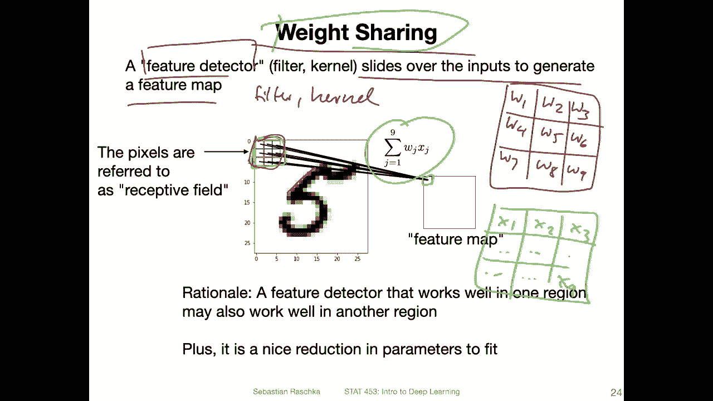

## 权重共享的优势

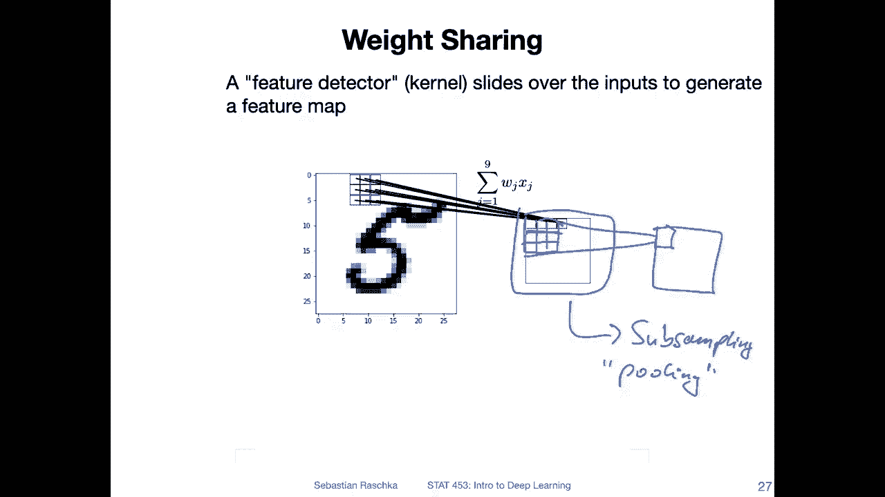

那么，为什么要采用权重共享呢？这主要有两大优势：

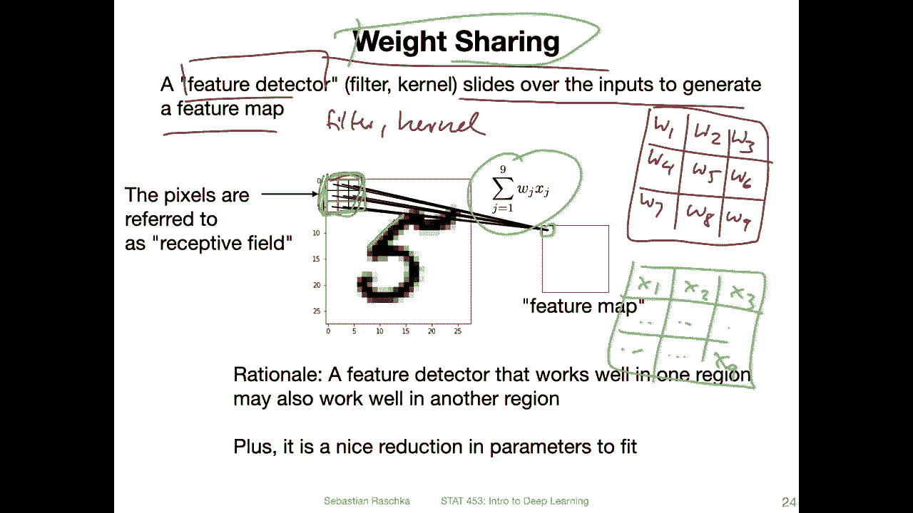

1.  **参数效率高**：如果为图像中的每个区域都使用一个独立的特征检测器，计算成本将非常高昂，模型参数会急剧增加，使其更接近一个全连接网络，从而变得非常“昂贵”。
2.  **特征普适性**：使用同一个滤波器滑动扫描整张图像的理念在于，如果某个特征检测器学会了识别一种特定模式（例如边缘），那么这个检测器在图像的不同部位都是有用的。没有必要为识别同一种边缘而在不同位置开发不同的检测器。

---

## 滑动卷积操作过程

为了更清晰地展示如何应用滤波器，让我们一步步观察滑动过程。

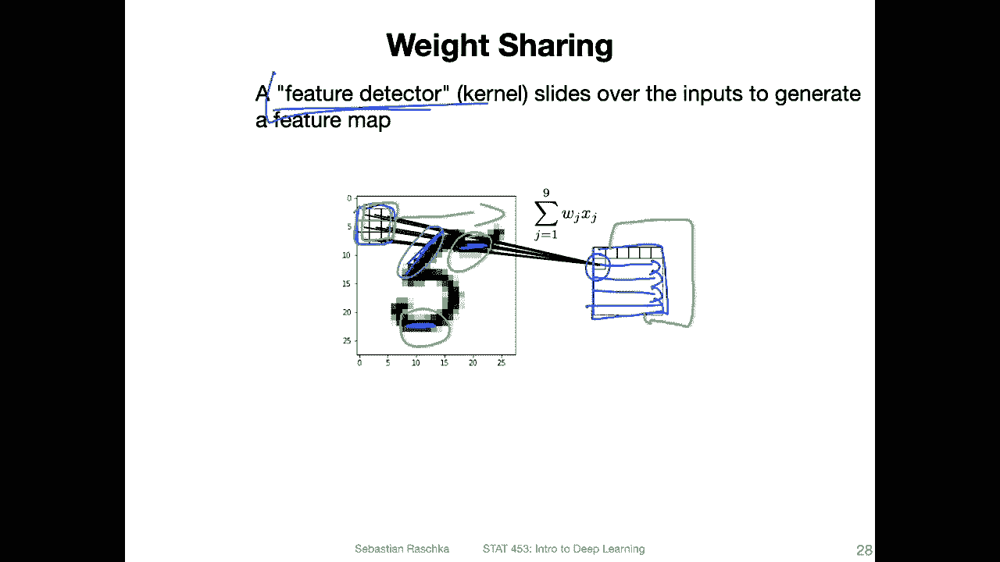


我们从左上角开始，将3x3的卷积核与第一个感受野对齐，计算得到特征图的第一个值。然后，我们将卷积核**向右移动一个像素**（步长为1），计算下一个值。如此重复，从左到右填充完第一行。


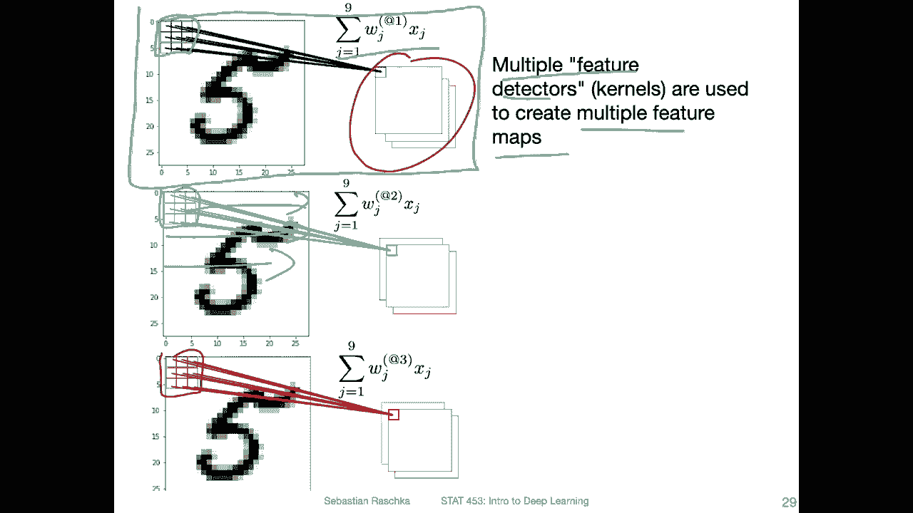


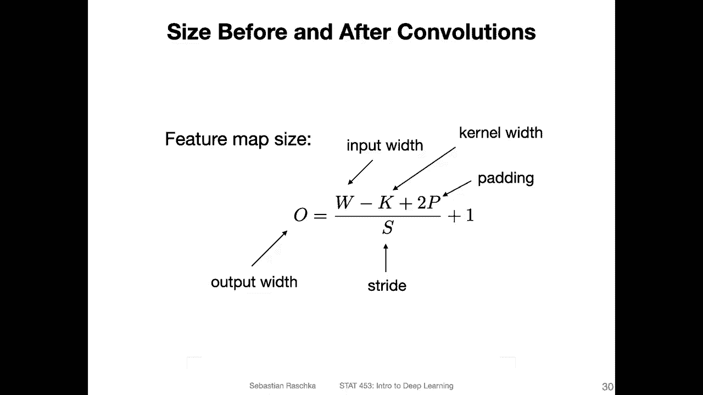

当第一行处理完毕后，我们将卷积核**向下移动一个像素**，回到最左侧，开始处理第二行。重复此过程，直到遍历完整张图像，最终生成完整的特征图。

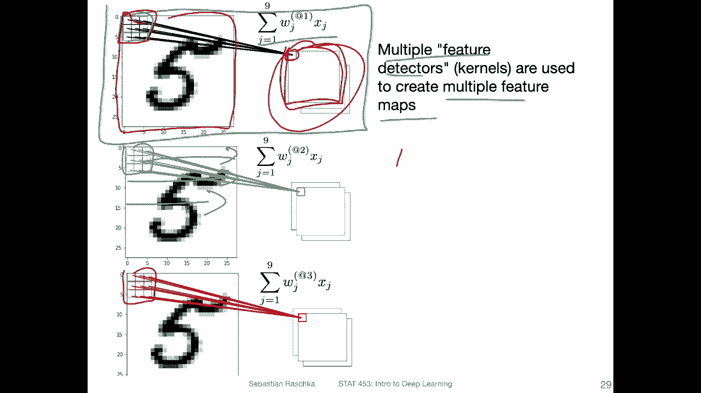

生成特征图后，我们可以对其应用**下采样**（也称为**池化**），或者再叠加另一个卷积层，进一步提取更高级的特征。

---

## 使用多个滤波器

上面介绍的是使用单个滤波器生成一张特征图的情况。但一个卷积层通常包含多个不同的滤波器，用于提取多种类型的特征。

以下是使用多个特征检测器的示意图：


其原理非常简单：我们独立地应用多个不同的滤波器。如图所示，除了绿色的滤波器，我们还可以同时应用一个蓝色的滤波器和一个橙色的滤波器。每个滤波器都有自己的权重矩阵，它们以相同的方式在输入图像上滑动，但各自生成**不同的特征图**。


这样，通过使用三个不同的滤波器，我们就可以得到三张不同的特征图，每张图专注于捕捉输入中某种特定的模式。

---

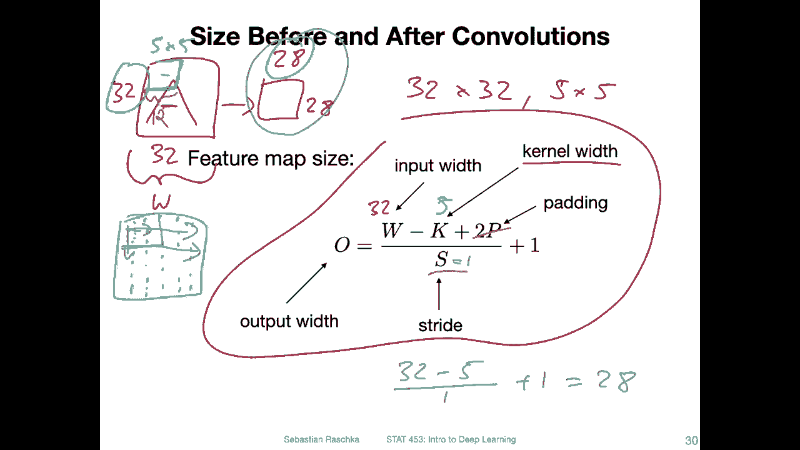

## 卷积输入输出尺寸计算

在应用卷积时，输入和输出的尺寸会发生变化。这里有一个公式可以计算输出特征图的大小。

**公式：**
`输出尺寸 = (输入尺寸 - 卷积核尺寸 + 2 * 填充) / 步长 + 1`

假设我们有一个32x32的输入图像，使用一个5x5的卷积核，步长为1，并且没有填充（填充=0）。那么输出特征图的宽度计算如下：
`(32 - 5) / 1 + 1 = 28`

因此，输出是一个28x28的特征图。尺寸缩小的原因在于，当卷积核滑动到图像边缘时，为了不超出边界，我们无法进行完整的重叠计算。

*   **步长**：指每次滑动卷积核时移动的像素数。步长为1是最常见的情况。
*   **填充**：指在输入图像边缘周围添加额外的像素（通常是0），以控制输出尺寸。这将在后续课程中详细讨论。

---

## 卷积层的参数量

卷积层以其参数效率高而著称。让我们通过一个代码片段来理解其参数量。

**代码示例：**
```python
# 假设输入是MNIST图像，尺寸为 1x28x28 (通道x高x宽)
conv_layer = nn.Conv2d(in_channels=1, out_channels=8, kernel_size=5, stride=1)
```

在这个例子中：
*   `in_channels=1`：输入是灰度图，只有一个通道。
*   `out_channels=8`：我们希望得到8个不同的特征图。
*   `kernel_size=5`：使用5x5的卷积核。
*   `stride=1`：步长为1。

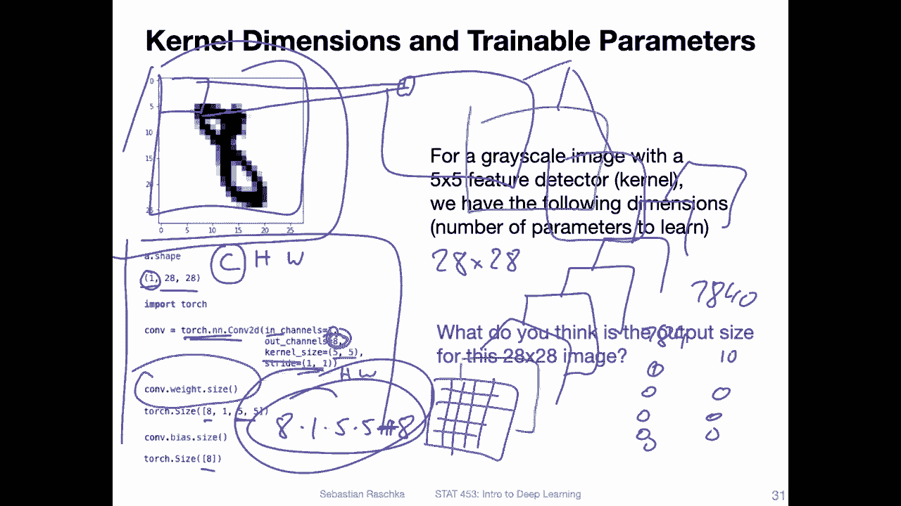

这个卷积层的可训练参数量计算如下：
*   **权重参数**：每个5x5的卷积核有25个权重。我们需要8个这样的核来处理1个输入通道，所以权重总数为 `8 * 1 * 5 * 5 = 200`。
*   **偏置参数**：每个输出特征图有一个偏置值，共8个。
*   **总参数量**：`200 (权重) + 8 (偏置) = 208`。

相比之下，一个连接784个输入像素到10个神经元的全连接层，仅权重就需要 `784 * 10 = 7840` 个参数。可见，卷积层在参数使用上要高效得多。

---

## 关于平移、旋转与尺度不变性的说明

卷积网络具有一定程度的平移、旋转和尺度不变性，但这并非完全不变。

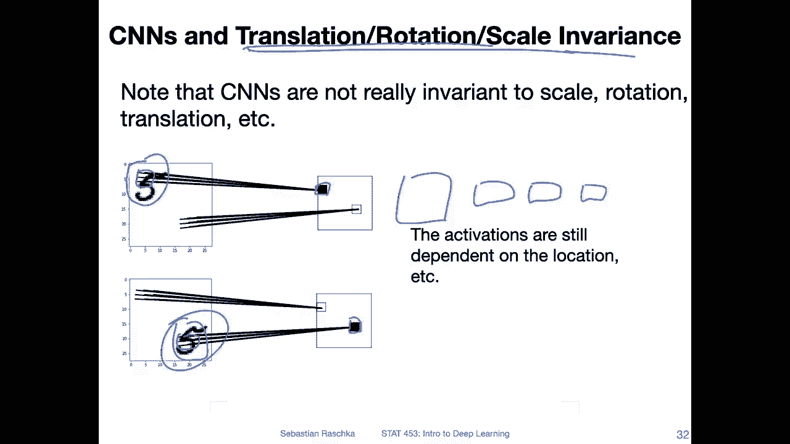

*   **不变性的来源**：由于使用相同的滤波器扫描整个图像，无论目标出现在图像的哪个位置，相同的特征检测器都能对其做出响应。
*   **局限性**：然而，响应的**位置**信息仍然保留在特征图中。目标在图像中的不同位置，会导致其对应特征在特征图中出现在不同位置。
*   **深层网络的改善**：通过堆叠多个卷积层，网络可以逐渐将信息汇总到更小的特征区域中，从而在更高层次上获得更强的位置不变性。

此外，**最大池化层**也有助于提升这种局部不变性。

---

## 最大池化层简介

传统上，最大池化层常用于卷积层之间，用于降低特征图的尺寸，并提供一定的平移不变性。

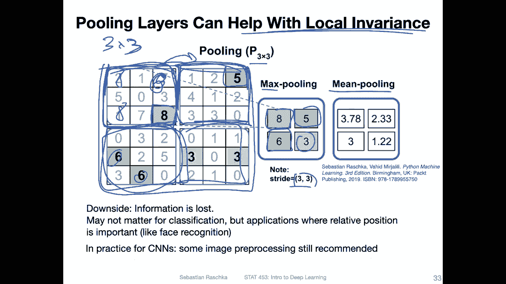

最大池化操作非常简单：它在一个小窗口（例如2x2或3x3）内滑动，并只保留该窗口内的最大值。例如，使用一个3x3的池化窗口，步长为3，它会取每个3x3区域中的最大值作为输出。

*   **作用**：它不在乎最大值在窗口内的具体位置，只关心其是否存在。这使其对特征的小幅平移不那么敏感。
*   **参数量**：标准的池化层（如最大池化、平均池化）**没有可训练的参数**。
*   **现代架构**：值得注意的是，并非所有现代卷积网络都使用池化层。一些架构通过使用步长大于1的卷积来直接实现下采样。

---


## 总结

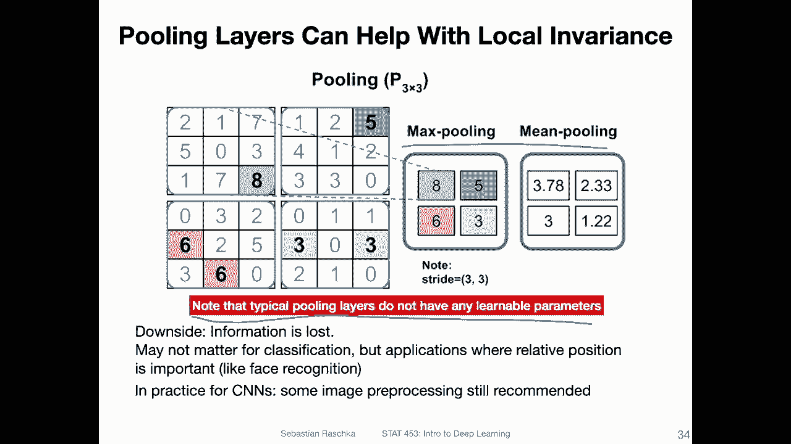

本节课中我们一起学习了卷积神经网络的两个基石：
1.  **卷积滤波器**：作为特征检测器，通过在输入上滑动来生成特征图，其核心计算是局部区域的加权和。
2.  **权重共享**：同一个滤波器在整个输入上重复使用，这极大地减少了模型参数，并使得网络能够检测图像中任何位置出现的相同特征。

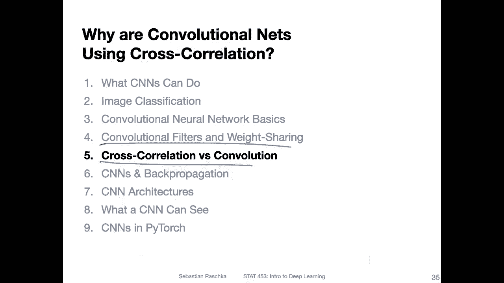

我们还了解了如何计算卷积后的输出尺寸、估算卷积层的参数量，并简要探讨了卷积网络所具备的有限平移不变性以及池化层的作用。在接下来的课程中，我们将深入更多细节，并动手构建一个完整的卷积网络。