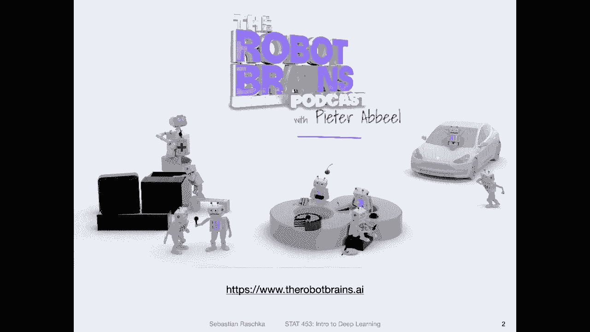
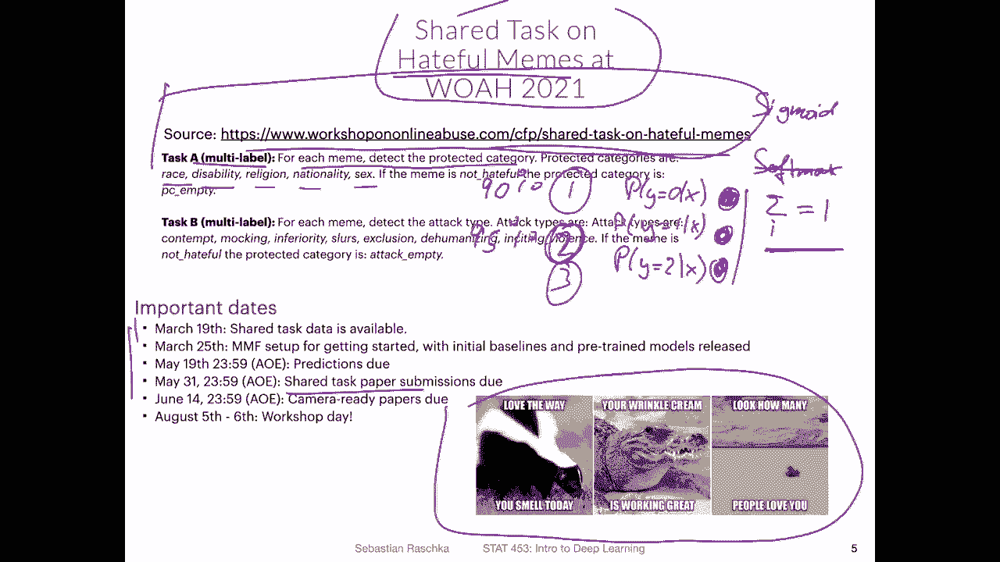
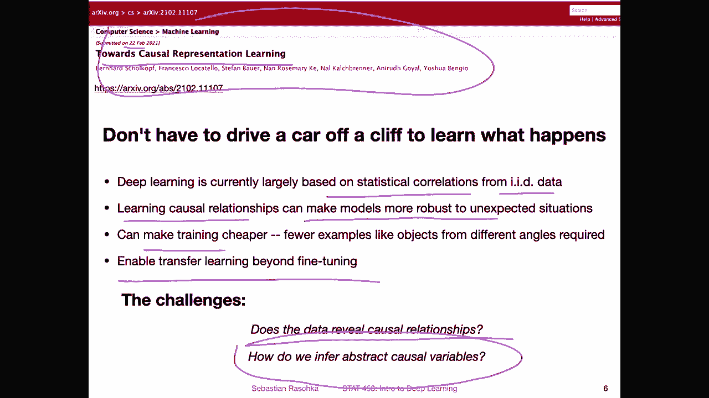
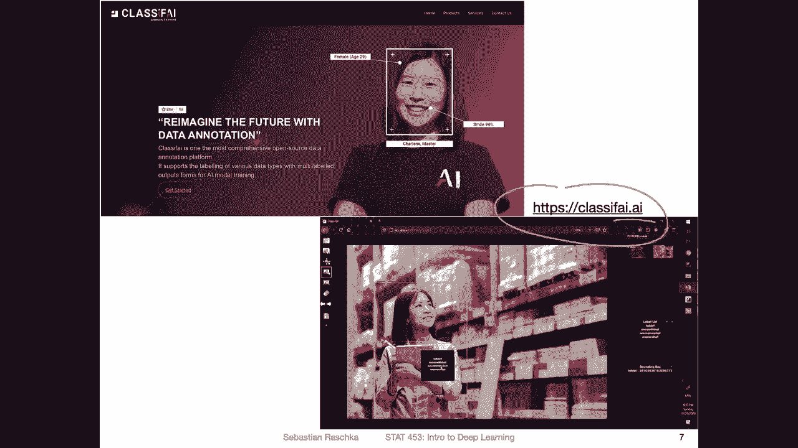
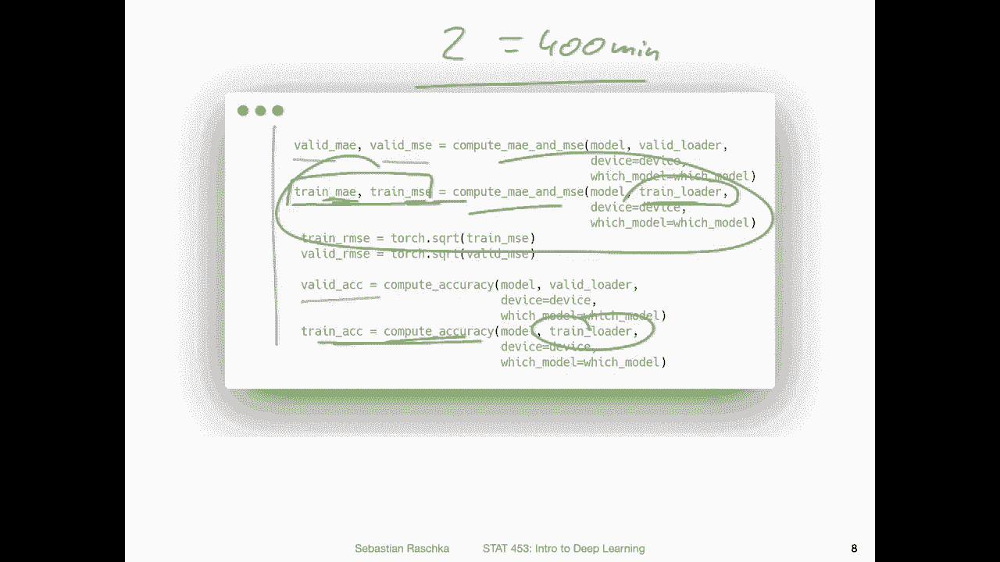
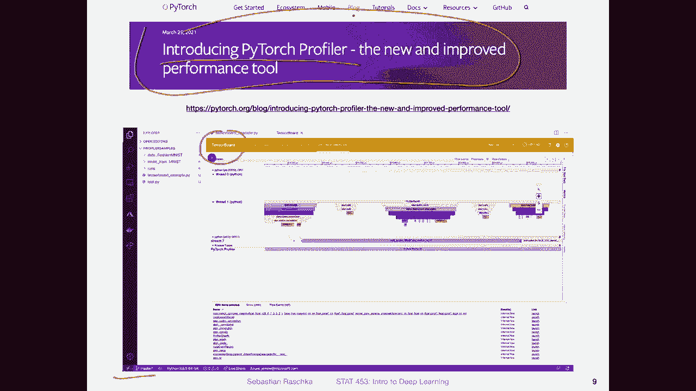
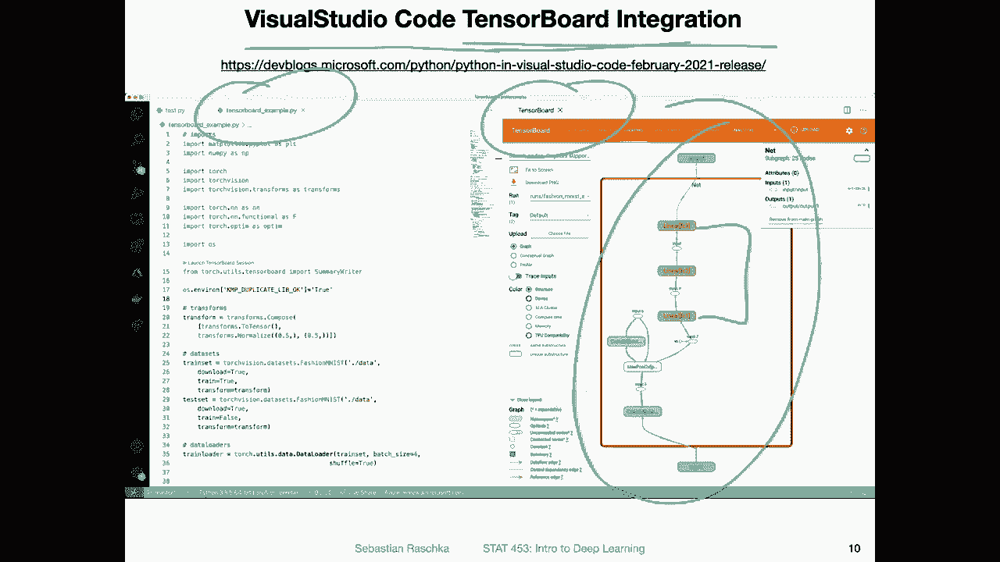
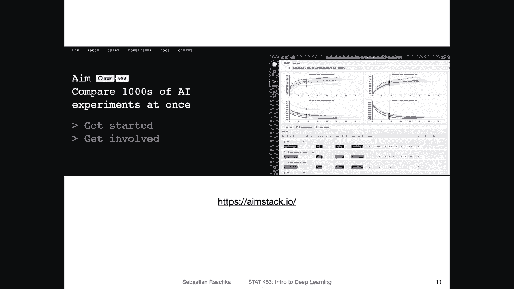
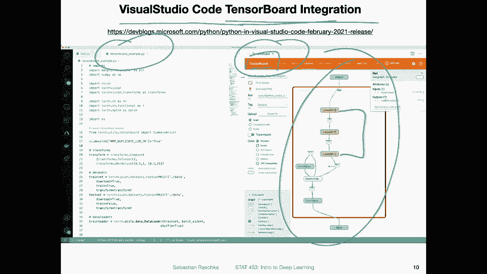
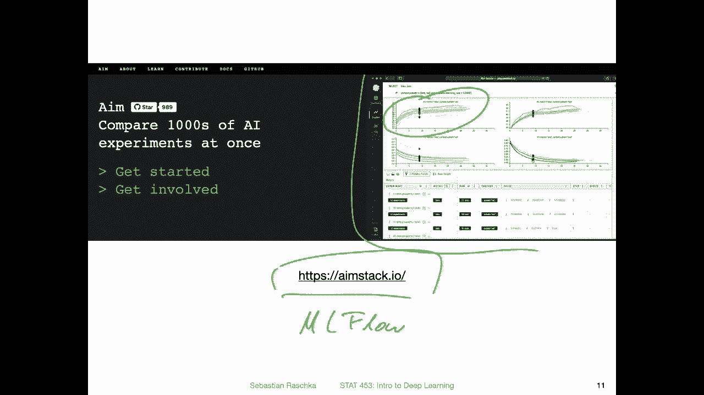

# 深度学习新闻 #9，2021年3月27日 📰

在本节课中，我们将一起回顾2021年3月27日发布的深度学习新闻。主要内容包括一个新的自监督学习方法、深度学习在因果关系理解方面的挑战、以及一些实用的工具介绍。这些内容旨在拓宽视野，了解领域内的最新动态，但请注意，它们并非考试内容。

---

## 🎙️ 新发现的机器学习播客

上一节我们介绍了课程概述，本节中我们来看看一个有趣的播客。

本周我发现了一个很棒的播客，由知名深度学习研究员Peter Abiil主持。在第一期节目中，他采访了特斯拉的AI总监Andrej Karpathy。他们主要讨论了机器学习和深度学习在工业界的实际应用，特别是在特斯拉自动驾驶系统中的应用。



以下是该播客的一些关键要点：
*   特斯拉的自动驾驶系统主要依赖车载摄像头和卷积神经网络。
*   在工业实践中，**专注于收集更多、质量更好的数据**，往往比单纯地微调模型更能有效提升性能。这与学术界专注于在固定基准数据集上优化模型的做法有所不同。

---

## 🧠 新的自监督学习方法：Barlow Twins

上一节我们了解了一个关于工业实践的播客，本节中我们来看看一个新颖的自监督学习技术。

本周我发现了一个名为 **Barlow Twins** 的自监督学习方法。其核心思想是通过减少数据表征中的冗余信息来学习有效的特征，而无需使用人工标注的标签。

该方法的工作原理如下：
1.  对同一张图像生成两个不同的增强版本（例如，改变亮度、颜色或轻微旋转）。
2.  使用**同一个**卷积神经网络（这种结构称为孪生网络）分别处理这两个增强图像，得到两个特征向量。
3.  计算这两个特征向量之间的互相关矩阵。
4.  设计一个损失函数，迫使这个互相关矩阵接近单位矩阵。

**核心公式/目标**：
网络的目标是**最小化**以下损失函数，它衡量了互相关矩阵 `C` 与单位矩阵 `I` 的差异：
`损失 = Σ(1 - Cᵢᵢ)² + λ * ΣΣ_{i≠j} Cᵢⱼ²`
其中，第一项鼓励对角线元素（自相关）接近1，第二项惩罚非对角线元素（互相关），迫使它们接近0。`λ` 是一个控制惩罚权重的超参数。

**代码风格描述**：
```python
# 伪代码示意
def barlow_twins_loss(z1, z2, lambda_param):
    # z1, z2: 两个增强视图的特征向量，已标准化
    batch_size = z1.size(0)
    c = torch.mm(z1.T, z2) / batch_size # 计算互相关矩阵C
    on_diag = (torch.diag(c) - 1).pow(2).sum() # 对角线接近1
    off_diag = (c.flatten()[:-1].view(batch_size-1, batch_size+1)[:, 1:].pow(2).sum() # 非对角线接近0
    loss = on_diag + lambda_param * off_diag
    return loss
```

训练完成后，这些学到的特征可以用于下游任务。例如，在ImageNet数据集上，冻结特征提取器，仅训练一个简单的线性分类器（如逻辑回归），就能达到73.2%的Top-1准确率。这个方法因其简洁性和有效性而颇具吸引力。

---

## 🛡️ 仇恨言论检测与多标签分类挑战

上一节我们探讨了自监督学习，本节中我们来看看一个具有社会意义的AI应用挑战。

Facebook AI Research等机构组织了一个关于检测网络仇恨言论的研讨会和竞赛，特别关注仇恨表情包（Meme）的识别。这可以作为一个有趣的多标签分类项目。

多标签分类与我们在课程中常见的多类别分类（如MNIST手写数字识别）不同：
*   **多类别分类**：每个样本只属于一个类别（互斥），输出层使用Softmax函数，所有类别概率之和为1。
    `P(class=i | x) = exp(z_i) / Σ_j exp(z_j)`
*   **多标签分类**：一个样本可以同时属于多个类别（例如，一个表情包可能同时攻击种族和宗教）。输出层通常为每个类别使用独立的Sigmoid函数，判断其是否存在。
    `P(has_label=i | x) = 1 / (1 + exp(-z_i))`

以下是该竞赛的一些信息：
*   任务包括预测受保护的类别（如种族、残疾、宗教等）。
*   这是一个典型的多标签分类问题，可以使用卷积神经网络等模型解决。
*   竞赛提供了参与和提交论文的机会。



---

## ⚙️ 深度学习的因果推理挑战

上一节我们讨论了具体的应用挑战，本节中我们来看看深度学习面临的一个更基础的理论挑战。

当前深度学习模型主要依赖于独立同分布的数据，并学习输入与输出之间的**统计相关性**，而非**因果关系**。一篇近期的论文探讨了推动深度学习向因果表征学习发展的挑战和方向。

理解因果关系的重要性体现在：
1.  **增强模型鲁棒性**：使模型对对抗性攻击（如干扰交通标志的激光）或分布外数据更稳健。
2.  **提升数据效率**：人类无需从所有角度观察一把椅子就能识别它，因为理解了“椅子”的因果概念。具备因果理解的AI可能也需要更少的训练样本。
3.  **促进模型迁移与复用**：在强化学习中，一个学会玩《帝国时代》的智能体，如果理解了战略游戏的因果逻辑，可能更容易迁移到《星际争霸》中。



然而，实现因果学习面临巨大挑战，例如如何从数据中推断出抽象的因果变量。这仍然是未来研究的重要方向。



---

## 🛠️ 实用工具推荐

上一节我们探讨了理论挑战，本节中我们来看看一些能提升开发效率的实用工具。

以下是本周发现的一些有用工具：



**1. 图像标注工具：Label Studio**
这是一个开源的图像数据标注工具，特别方便进行目标检测等任务的标注，界面友好，功能强大。

**2. 代码性能分析：PyTorch Profiler 与 TensorBoard**
在优化代码时，找到性能瓶颈至关重要。新发布的PyTorch Profiler与TensorBoard集成，可以可视化地分析模型训练过程中各环节的时间消耗和内存使用，帮助快速定位瓶颈（例如，低效的数据遍历或计算）。



**3. 实验追踪与管理：Weights & Biases**
这是一个用于比较不同实验（如不同超参数配置）结果的工具。只需添加几行代码，它就能自动记录实验指标并生成可视化对比面板，非常适合模型调优和实验管理。类似的工具还有MLflow等。





---



## 📚 总结与预告



本节课中我们一起学习了以下内容：
*   一个探讨工业界AI实践的播客，强调了数据质量的重要性。
*   一种名为Barlow Twins的简洁有效的自监督学习方法。
*   仇恨言论检测竞赛中涉及的多标签分类问题。
*   当前深度学习在因果推理方面面临的挑战与未来展望。
*   三个提升工作效率的实用工具：Label Studio、PyTorch Profiler/TensorBoard和Weights & Biases。

这些内容展示了深度学习领域的活跃发展与多元应用。最后提醒，本周二有考试，祝大家好运。此外，我将在周三进行一次线上讲座，感兴趣的同学可以通过Piazza获取详细信息。