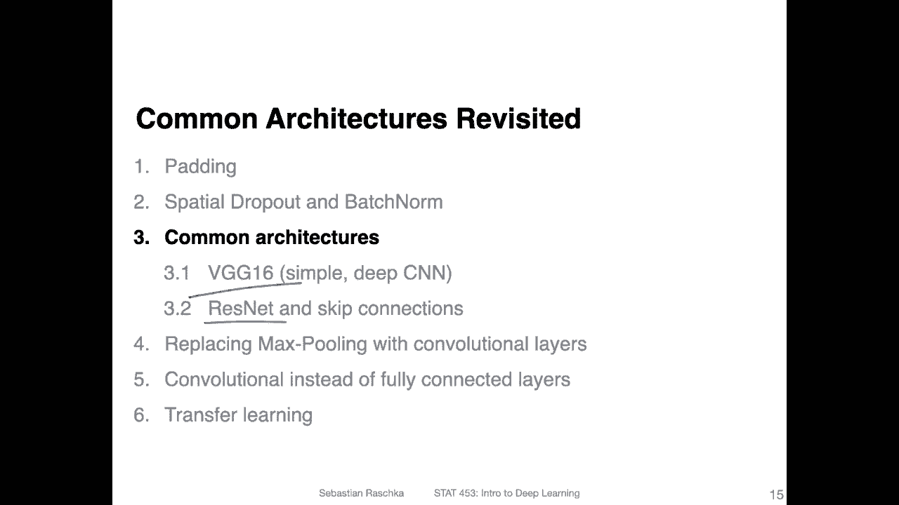
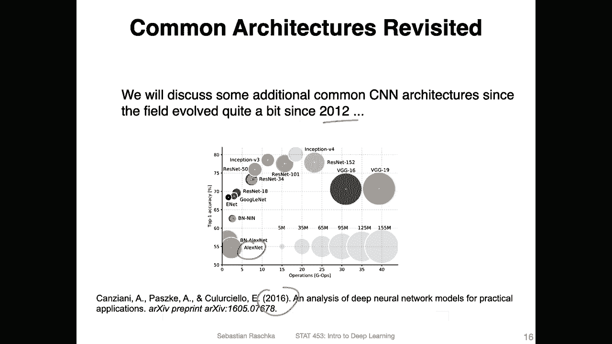
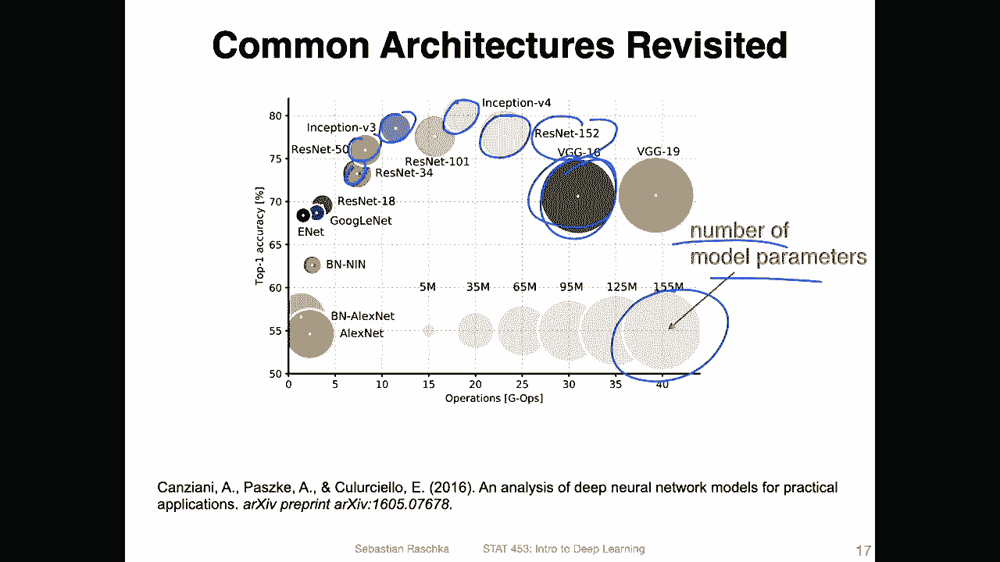
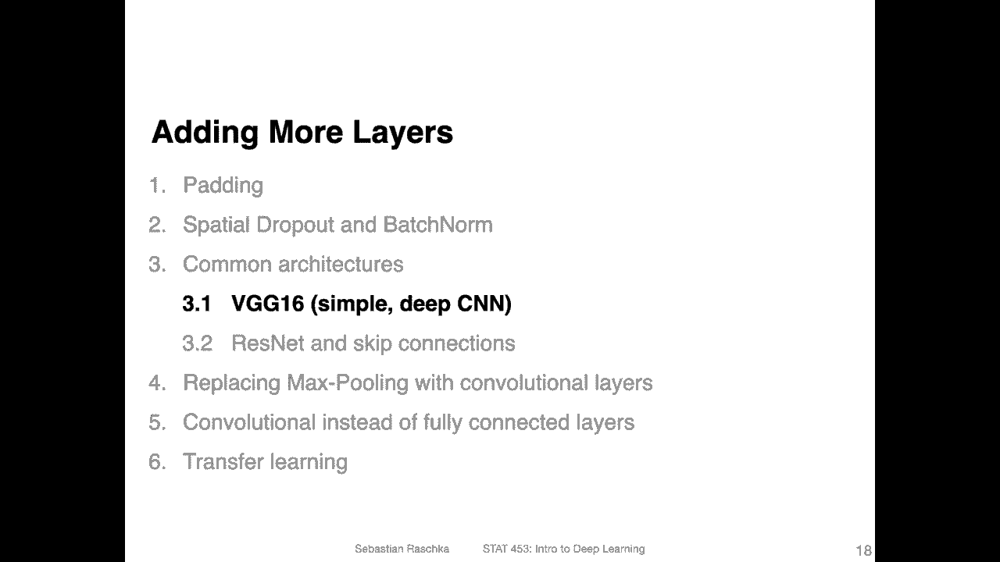

# 🏗️ 课程 P114：L14.3 - 架构概述

在本节课中，我们将回顾几种经典的卷积神经网络架构，并了解它们的发展历程与核心特点。通过对比不同架构的参数规模与性能，我们可以理解设计高效网络不仅依赖于层数，还需要借助各种技巧。

上一节我们回顾了AlexNet，本节中我们来看看更多后续发展的网络架构。

以下是2016年一篇论文中展示的当时几种常见架构的概览图。这张图清晰地展示了该领域快速发展的态势。

图中列出的架构并不全面，仅是当时部分常见的选择。好消息是，架构数量并未呈指数级增长。直至2021年，VGG和ResNet等架构因其优秀的基线性能，仍被广泛用作各种方法的骨干网络。

然而，如今还有一些其他流行的架构未在图中列出。需要说明的是，图中架构主要针对图像分类任务，其他任务则有另一套不同的架构体系。

以下是其他一些常见的架构示例：
*   MobileNet
*   Wide Residual Networks
*   EfficientNet
*   DenseNet
*   Highway Networks

尽管如此，原图仍是一个很好的入门概览。如果你想开始尝试不同的架构，我推荐也考虑上述这些。

从该图中可以得到的一个重要启示是：网络性能并非只与参数量有关。

例如，VGG16参数量相对较大，但其性能却不如Inception网络或残差网络。这是因为后者融入了一些特殊的设计技巧。

我们将要讨论的残差网络（ResNet）就采用了残差连接。这种连接有助于构建更深的网络，同时缓解梯度消失问题。

而Inception网络则采用了独特的方式，在同一层中组合不同尺寸的卷积核。我原本计划更详细地讲解Inception，但由于时间关系，我们将跳过这部分。它的技巧包括将不同大小的卷积组合到一层中，以及在网络中间层添加辅助损失函数。这类技巧都能帮助提升架构性能。

VGG16本质上只是一个16层的卷积网络，层数已经很多。但设计网络不能只看层数，还需要各种技巧。例如，ResNet-152拥有152层。在普通的VGG架构背景下，直接堆叠152层是不可能的，因为会遇到严重的梯度消失问题。

不过最近，也有一些研究致力于开发不使用残差连接的极深网络。例如，有趣的无归一化ResNet（Normalizer-Free ResNet）甚至去除了批归一化层。这表明该领域仍在持续产生有趣的发展。

总而言之，这些仍是基础且重要的架构。

在下一个视频中，我将首先讨论VGG16架构。

本节课中我们一起回顾了从AlexNet到ResNet等经典CNN架构的发展脉络，理解了网络性能的提升不仅依赖于增加深度和参数量，更得益于残差连接、多尺度卷积融合等核心设计技巧。这些基础架构为后续更复杂的模型奠定了重要基础。