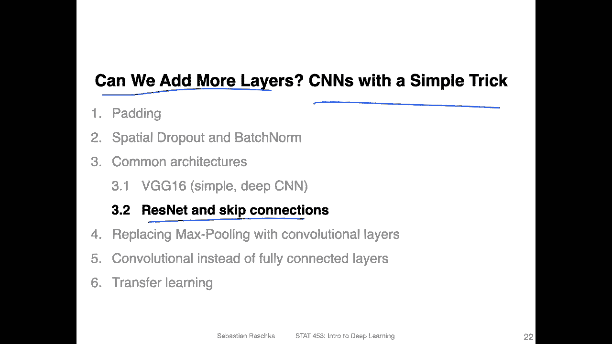
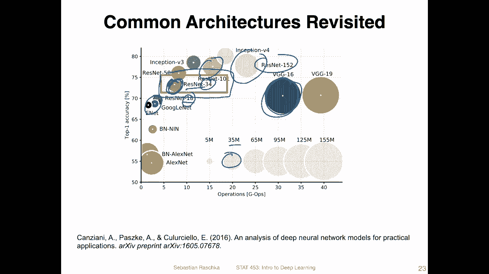
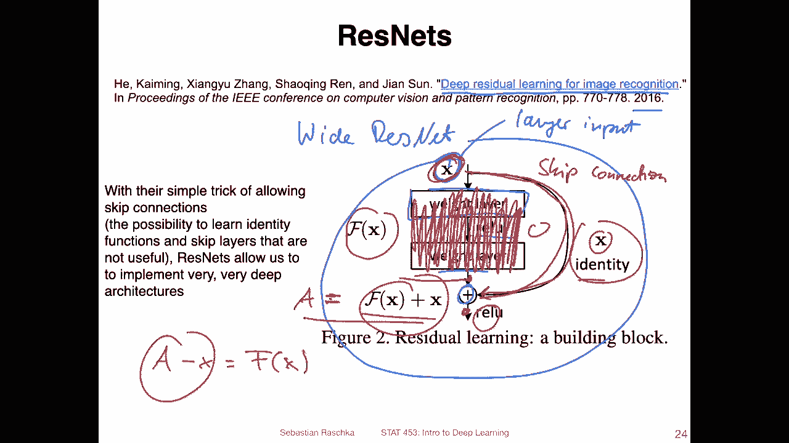
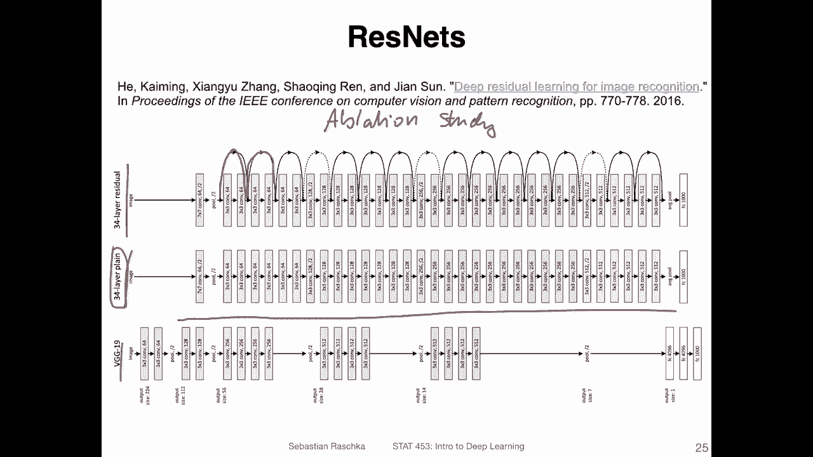
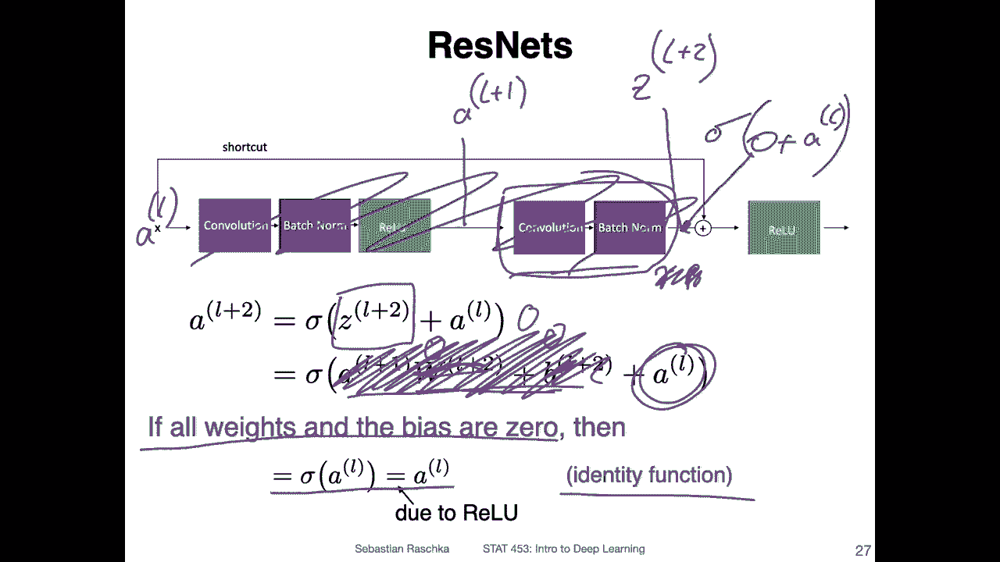
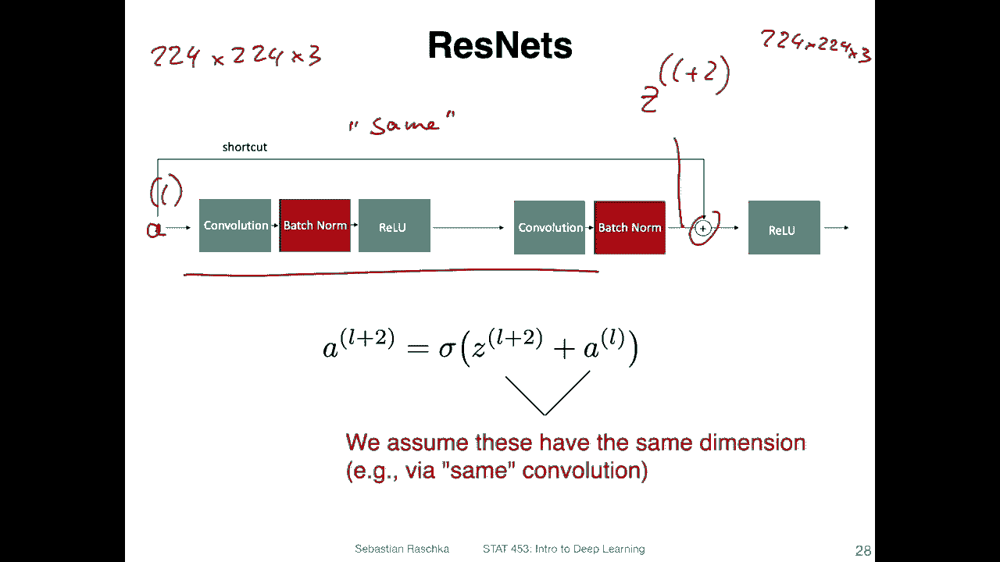
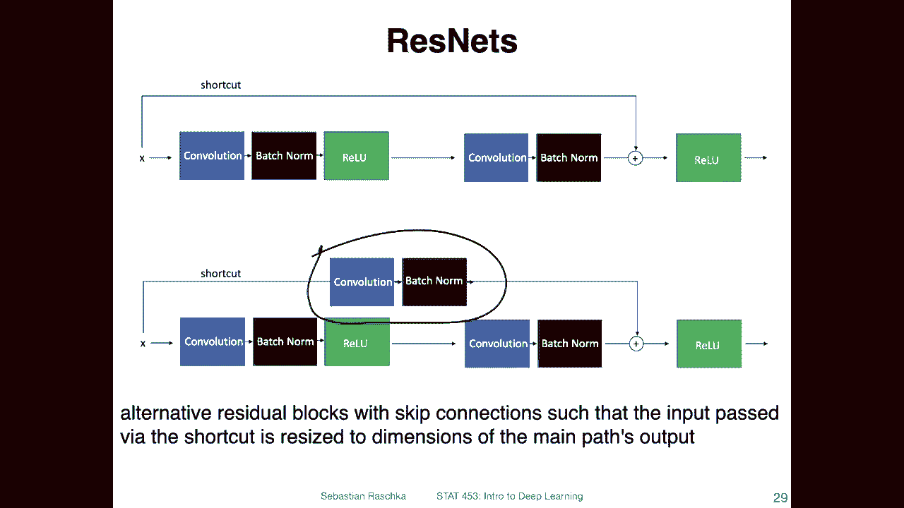

# 课程 P117：L14.3.2.1 - ResNet 概述 🧠

## 概述

在本节课中，我们将要学习一种名为**残差网络**的深度神经网络架构。我们将探讨为什么简单地增加网络层数并不总能提升性能，以及残差网络如何通过一种巧妙的“捷径连接”来解决深层网络训练中的梯度消失问题。

---

## 从VGG16到更深层的网络

在之前的课程中，我们讨论了VGG16架构。一个很自然的问题是：我们能否添加更多层，并期望性能得到进一步提升？

理论上，增加层数应该有所帮助。但在实践中，我们之前讨论过的**梯度消失**等问题可能会出现。在反向传播中，我们使用链式法则，它本质上是多个导数的乘积。如果其中某个导数值非常小，即使是在网络早期，它也可能抵消掉反向传播中所有后续的信号。因此，我们不能仅仅通过增加层数就期望性能变得更好，这在实验中也得到了证实。

---

## 残差网络的核心思想

为了解决上述问题，研究人员提出了**残差网络**。残差网络依赖于所谓的**捷径连接**，它本质上可以让网络学会跳过某些对性能有害的层。这是一种应用于卷积神经网络的简单技巧。

让我们来看看它的结构。

### 残差块的结构

假设有一个输入 `X`，这可以是网络中任意一层的输入。我们称之为该层的输入 `A^[l]`。

一个基础的残差块包含以下步骤：
1.  一个权重层（例如卷积层）。
2.  一个ReLU激活函数。
3.  另一个权重层。
4.  一个**加法操作**，将第3步的输出与原始的输入 `A^[l]` 相加。
5.  最后再经过一个ReLU激活函数。

用公式表示这个过程：
`A^[l+2] = ReLU( F(A^[l]) + A^[l] )`

其中，`F(A^[l])` 代表经过两个权重层和第一个ReLU后的输出。这个加法操作就是**捷径连接**。

### 为什么叫“残差”网络？

之所以称为“残差”，是因为如果我们重新排列上述公式，可以将 `F(A^[l])` 看作是学习**输出与输入之间的残差**。即，网络学习的是 `A^[l+2]` 与 `A^[l]` 的差值。但这更多是一个概念上的理解。

更重要的是，这种结构允许网络学习**恒等映射**。如果网络发现这两个权重层是有害的，它可以通过将权重和偏置学习为接近零的值，使得 `F(A^[l]) ≈ 0`。这样，输出就近似等于输入 `A^[l]`，相当于跳过了这两个层。这确保了即使某些层效果不佳，信号也能通过捷径连接顺畅地传递，缓解了梯度消失问题。

---

## 残差网络架构全景

以下是残差网络架构的一个可视化概览。研究人员对比了一个34层的“普通”网络和一个34层的“残差”网络。

他们发现，没有捷径连接的普通深层网络性能较差。而添加了捷径连接的残差网络显著提升了性能。这种实验通常被称为“消融研究”，即通过移除网络的某个部分来观察其影响。

---

## 深入残差块：维度匹配问题

在基础残差块中，我们做了一个重要假设：输入 `A^[l]` 和经过变换后的输出 `F(A^[l])` 必须具有**相同的维度**，因为加法操作要求两者形状一致。

这意味着在使用捷径连接时，我们需要通过适当的填充来确保卷积操作不改变特征图的空间尺寸。然而，这会导致一个问题：如果网络始终不进行下采样，那么最终的特征图尺寸会非常大，计算效率低下且不实用。

### 解决方案：带投影的捷径连接

在实践中，有一种特殊的残差块可以解决维度不匹配的问题。当需要下采样（即减少特征图尺寸或增加通道数）时，我们可以在捷径连接上也应用一个操作。

这个操作通常是一个 `1x1` 的卷积层（可能还包含批归一化）。这个 `1x1` 卷积可以同时改变特征图的通道数和空间尺寸，使其与主路径的输出 `F(A^[l])` 维度匹配，从而能够进行相加操作。

通过这种方式，我们可以在构建深层网络的同时，灵活地控制特征图的尺寸。

---

## 总结

本节课中，我们一起学习了残差网络的核心概念。我们了解到：
1.  简单地堆叠更多网络层会遇到梯度消失等训练难题。
2.  残差网络通过引入**捷径连接**，允许信号直接从一层跳跃到后面几层。
3.  其核心组件是**残差块**，其公式为 `A^[l+2] = ReLU( F(A^[l]) + A^[l] )`。
4.  这种结构使网络能够轻松地学习**恒等映射**，从而可以选择性地跳过无用的层，稳定了深层网络的训练。
5.  当输入输出维度不匹配时，可以通过在捷径连接上使用 `1x1` 卷积进行投影来解决。

残差网络的思想非常强大，为训练成百上千层的超深度神经网络奠定了基础。在下一节课中，我们将通过代码实现来具体构建一个残差网络。