# 深度学习新闻 #1，2021 年 1 月 27 日 📰

在本节课中，我们将一起回顾2021年1月27日这一周内，深度学习领域的一些有趣新闻和应用。这些内容涵盖了从医疗健康到社交媒体分析等多个方面，旨在帮助你了解深度学习技术的最新动态和实际应用。

---

## 🩺 深度学习助力COVID-19资源需求预测

上一节我们介绍了本课程的目标，本节中我们来看看一个将深度学习应用于医疗领域的实际案例。

Facebook AI Research与纽约大学的医学专家合作，开发了一个利用X光片预测COVID-19患者病情恶化和资源需求的系统。这个案例强调了与领域专家合作的重要性，尤其是在医疗等关键应用中。

研究人员训练了三个模型：
*   第一个模型仅基于单张X光片预测患者病情是否会恶化。
*   第二个模型基于一系列X光片（视为时间序列）完成同样的预测任务。
*   第三个模型基于单张X光片预测患者所需的氧气供应量。

他们的建模方法采用了**自监督学习**。首先，在一个大型非COVID胸部X光数据库上进行预训练，以利用更多数据。然后，在一个包含5000名患者的27000张COVID-19 X光片的小型数据集上进行微调。

有趣的是，在某些指标上，这些模型的表现超过了人类专家。这并非要取代医生，而是为了在医疗资源紧张时，为医生提供辅助工具，帮助减少可能的失误。

你可以在arXiv上找到完整的论文，相关预训练模型也已开源在GitHub上。

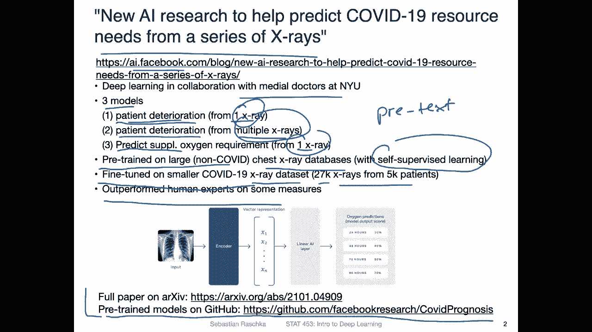

---

## 📚 探索arXiv上的COVID-19研究

上一节我们看到了一个具体的医疗应用，本节中我们来看看如何寻找更多相关研究。

arXiv是一个机器学习预印本服务器，每天都有大量新论文上传。其中包含了数千篇与COVID-19相关的研究。你可以使用搜索功能来查找特定主题，例如结合“deep learning”和“chest x-ray”等关键词。

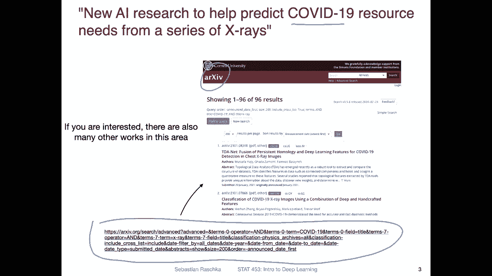

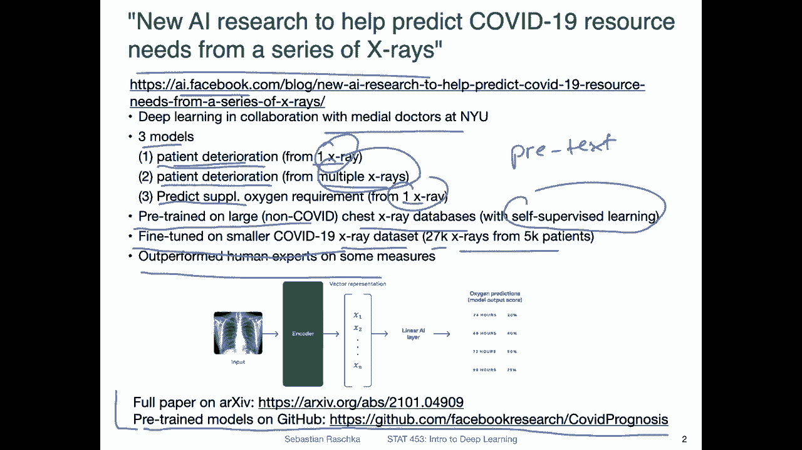

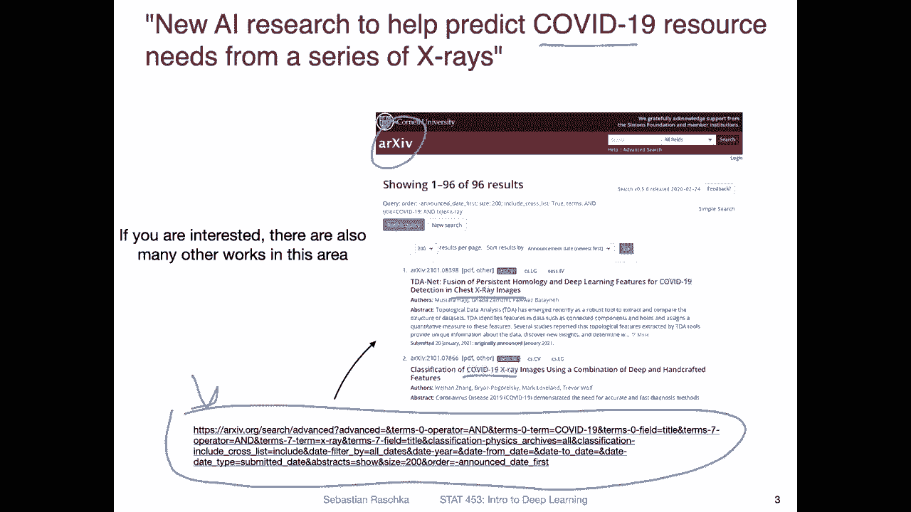

需要注意的是，arXiv上的论文尚未经过同行评审，因此对其发现应持审慎态度。不过，这仍然是获取最新研究思路和用于课程项目参考的宝贵资源。

---

## 🧬 学习病毒进化的“语言”

除了医学影像分析，深度学习还能从其他角度助力抗疫。本节介绍一项将序列数据视为“语言”的有趣研究。

有研究者训练了一个**双向LSTM**模型来研究病毒的进化与免疫逃逸。LSTM是一种循环神经网络，我们将在后续课程中详细讨论。

在这项研究中，他们将病毒对应的氨基酸序列视为一种“语言”：
*   将“语法正确”类比为生物学上的序列合理性。
*   将“语义含义”类比为序列是否会引起免疫反应。

他们取得了不错的性能，AUC（ROC曲线下面积）达到了0.85。AUC是衡量模型性能的指标，0.5相当于随机猜测，1.0是完美模型，因此0.85表明这是一个相当好的预测模型。

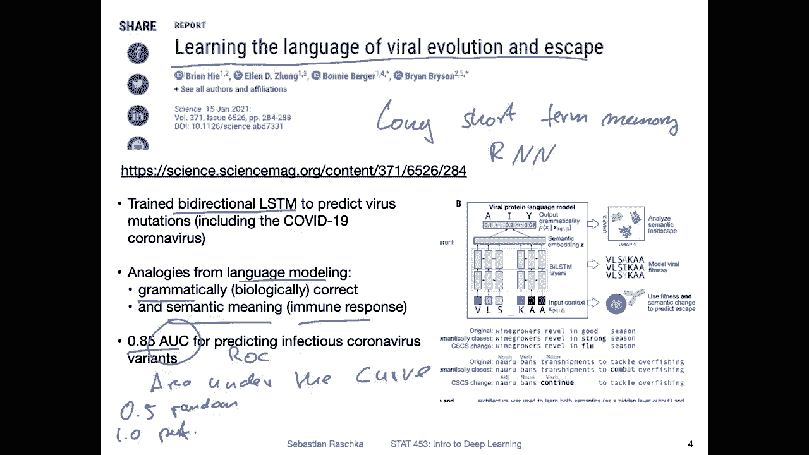

---

## 🧠 商业前沿：个人AI与“第二大脑”

深度学习不仅在学术界蓬勃发展，在商业领域也催生了大胆的构想。本节我们转向一个更偏向商业应用的新闻。

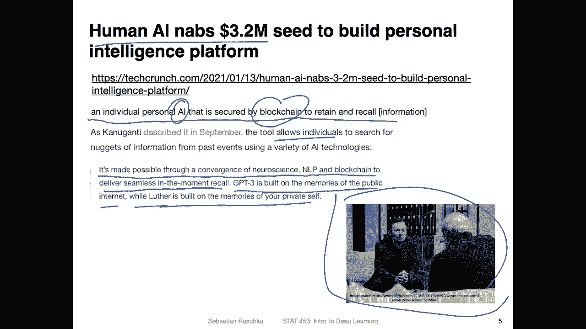

一个名为“Human AI”的项目获得了320万美元融资，旨在构建一个基于区块链技术的个人智能平台。其目标是利用神经科学、自然语言处理和区块链技术，打造一个属于个人的、安全的“第二大脑”或数字记忆库，这与仅基于公共互联网信息的通用AI（如GPT-3）形成对比。

---

## 🐦 数据获取：Twitter向学术研究者开放全量档案

要训练好的模型，通常需要大量数据。本节介绍一个对研究者利好的消息。

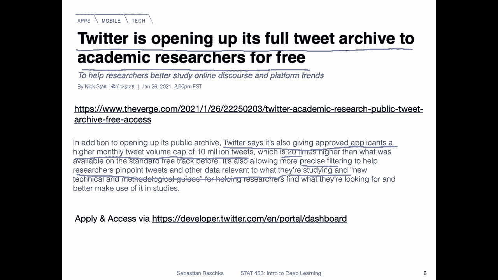

Twitter宣布向学术研究人员免费开放其全量推文档案。获批的研究者每月可访问的推文量上限提升至1000万条，是以前的20倍，并且允许更精确的数据过滤。这使得基于社交媒体数据的研究，如舆情分析、危机管理等，变得更加便利。

例如，有研究就利用推文等社交媒体数据，通过开发噪声过滤机制，来更有效地定位和管理洪水、暴风雪等极端天气事件的受灾区域。

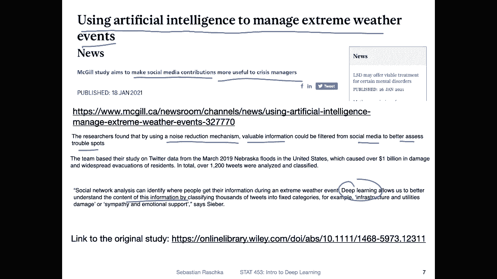

---

## 🖼️ 数据集革新：重新标注ImageNet

我们常用的大型基准数据集本身也在不断进化。本节介绍一个改进经典数据集的工程。

ImageNet是深度学习领域最著名的图像数据集之一，包含约1400万张图片，常用于评估图像分类模型。但它也存在标签错误或不完整的问题（例如一张图中有多个物体，却只标了一个标签）。

为了解决这个问题，研究者们正在对ImageNet进行重新标注，为图像添加多标签。他们利用从Instagram获取的10亿张图片训练了一个EfficientNet模型，作为“机器标注器”。该模型通过裁剪图像的不同区域并分别分类，来为ImageNet中的每张图片生成更准确、丰富的多标签。

---

## ♿ 技术向善：用AI为视障人士描述照片

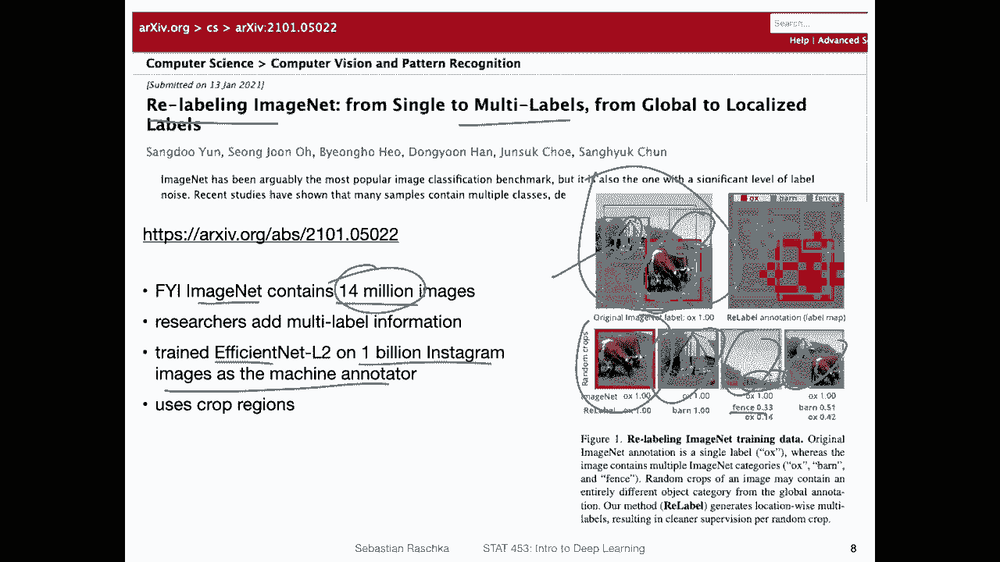

最后，我们来看一个体现技术人文关怀的应用。本节介绍Facebook AI如何利用深度学习改善无障碍服务。

Facebook利用AI改进了一款智能手机应用，旨在为盲人或视障人士提供更好的照片描述服务。该系统通过音频描述图片内容。

他们在一个包含35亿张Instagram照片及对应标签的数据集上训练了一个ResNeXt模型，并结合Fast R-CNN目标检测器来描述图像的不同方面。例如，对于一张照片，系统可能会生成这样的描述：“这可能是一张一个人站在马丘比丘的照片。”

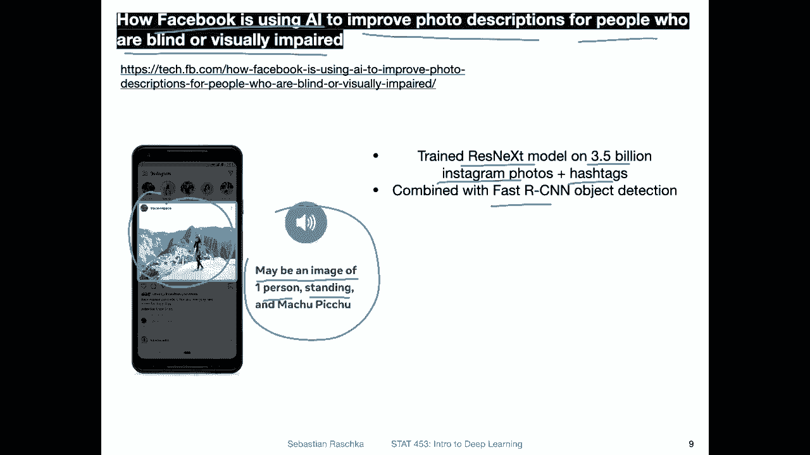

---

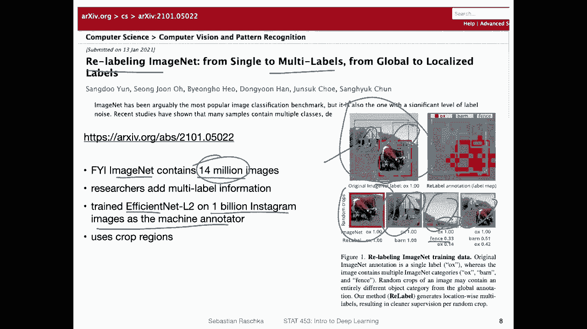

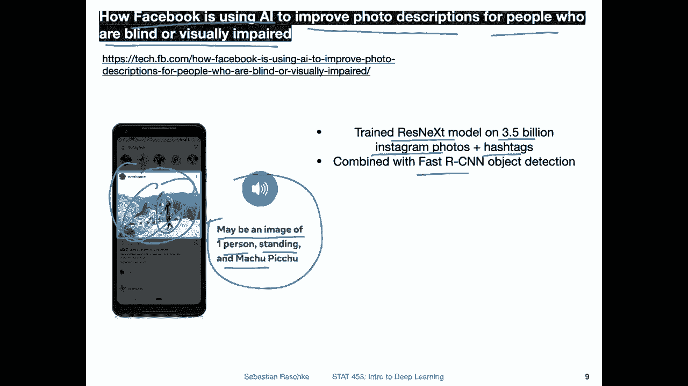

本节课中我们一起学习了2021年1月底深度学习领域的多个新闻与应用。我们看到了深度学习在医疗诊断（COVID-19预测）、基础科研（病毒序列分析）、商业构想（个人AI）、数据基础设施（Twitter数据开放、ImageNet改进）以及社会公益（辅助视障人士）等方面的广泛影响和快速发展。保持对行业动态的关注，有助于我们更好地理解技术的潜力和方向。