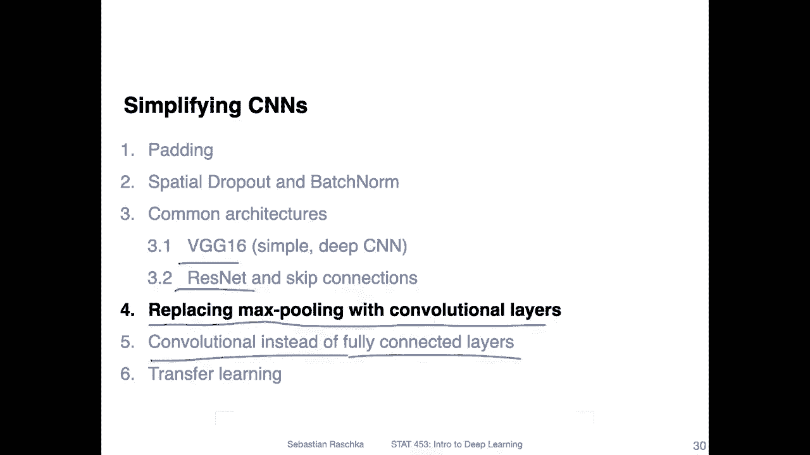
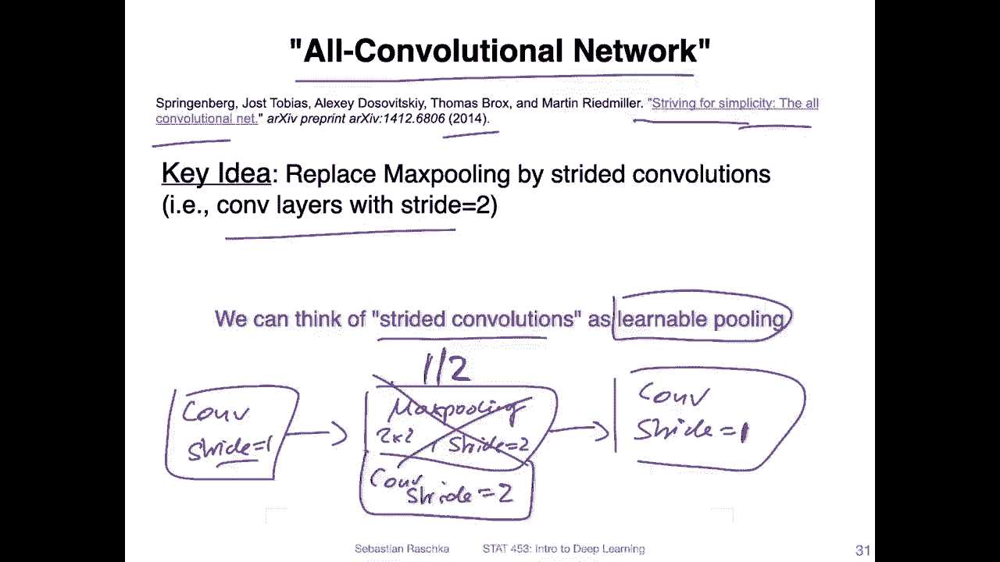
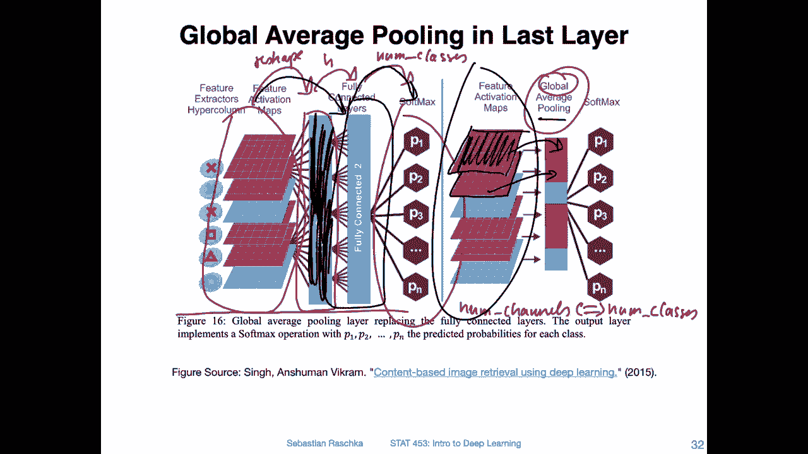
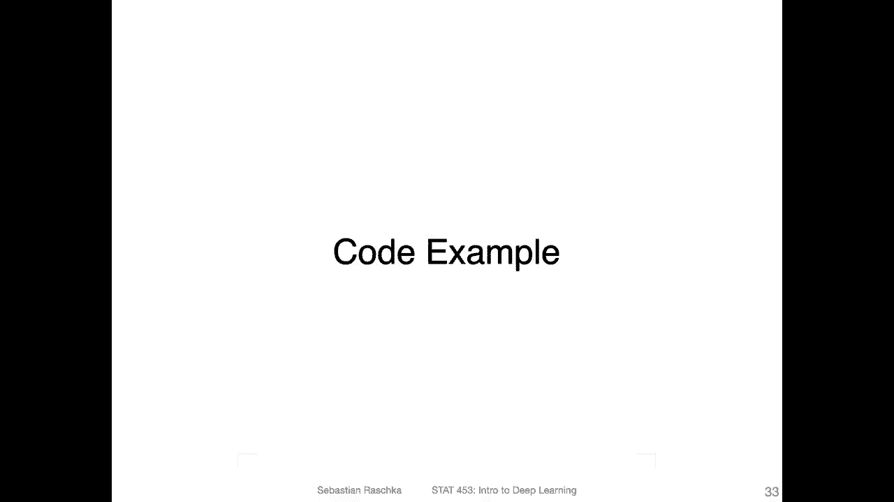
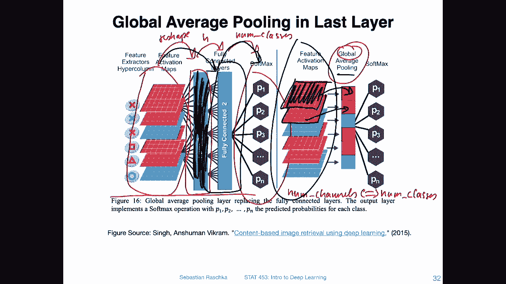

# 课程 P120：L14.4.1 - 用卷积层代替最大池化 🧠

在本节课中，我们将学习一个与卷积神经网络架构相关的主题：如何用卷积层替代传统的最大池化层。这虽然不一定会显著提升网络性能，但能帮助我们更深入地理解卷积操作的本质，并探索简化网络架构的可能性。



## 概述

上一节我们介绍了VGG16和残差网络等架构。本节中，我们来看看如何对经典架构进行一种简化：用带步长的卷积层替换最大池化层。这种思路源于一篇名为《Striving for Simplicity: The All Convolutional Net》的论文。

## 传统架构 vs. 全卷积网络

在传统的卷积神经网络中，我们通常交替使用卷积层和池化层。

以下是典型的模式：
*   一个步长为1的卷积层。
*   一个步长为2的2x2最大池化层。
*   重复此模式。

最大池化层的主要作用是**将特征图的尺寸减半**，同时提供一定的平移不变性。

## 用卷积层替代最大池化

全卷积网络的核心思想是移除最大池化层，并通过增大后续卷积层的步长来实现下采样。

具体做法如下：
*   移除最大池化层。
*   将紧随其后的卷积层的步长设置为2（即使用**步长卷积**）。



这样，步长为2的卷积层同样能将特征图尺寸减半。论文作者认为，这相当于一种“可学习的池化”，因为卷积层带有可训练的参数。虽然这会引入更多参数，但能使网络结构更统一（仅使用卷积操作）。

> 注：有观点认为最大池化并非必需。例如，Geoffrey Hinton曾表示最大池化是计算机视觉领域的一个“大错误”。不过，最大池化在实践中表现良好，本节的替代方案更多是一种帮助理解的概念性实验。

## 进一步简化：替换全连接层

除了池化层，我们还可以简化网络末端的全连接层。这将在下一个视频详细讨论，主要有两种方法：

1.  **全局平均池化**：假设最后一个卷积层的通道数等于分类类别数。对每个通道的特征图进行全局平均，直接得到一个标量值，从而替代全连接层。
    ```python
    # 伪代码示意：全局平均池化
    # 输入特征图尺寸: [batch_size, channels, height, width]
    # 输出尺寸: [batch_size, channels, 1, 1] -> 可展平为 [batch_size, channels]
    output = torch.nn.functional.adaptive_avg_pool2d(input, (1, 1))
    ```

2.  **使用等效的卷积操作**：用1x1卷积层来模拟全连接层的功能。

传统全连接层参数量大，而上述方法能有效减少参数。不过，全连接层在多数现有架构中工作良好，并非必须移除。

## 总结







本节课我们一起学习了如何用步长卷积层替代最大池化层，从而构建一个“全卷积网络”。这种方法通过统一网络中的操作类型来简化架构，并提供了另一种实现下采样的视角。虽然其性能提升不一定显著，但这是一个有助于巩固对卷积网络理解的优秀思维实验。在接下来的课程中，我们将通过代码实例来具体实现这种全卷积网络。