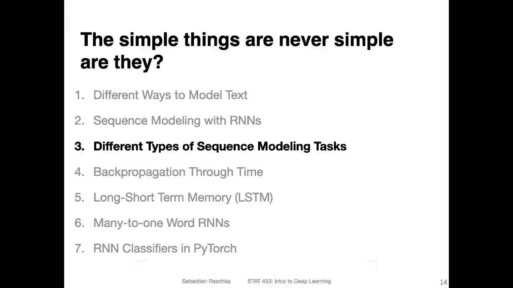
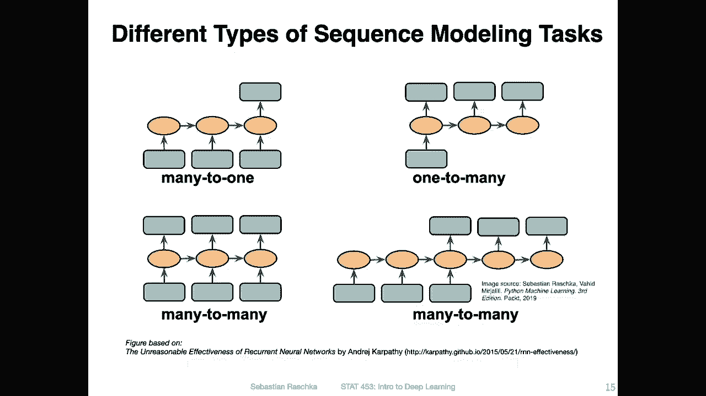
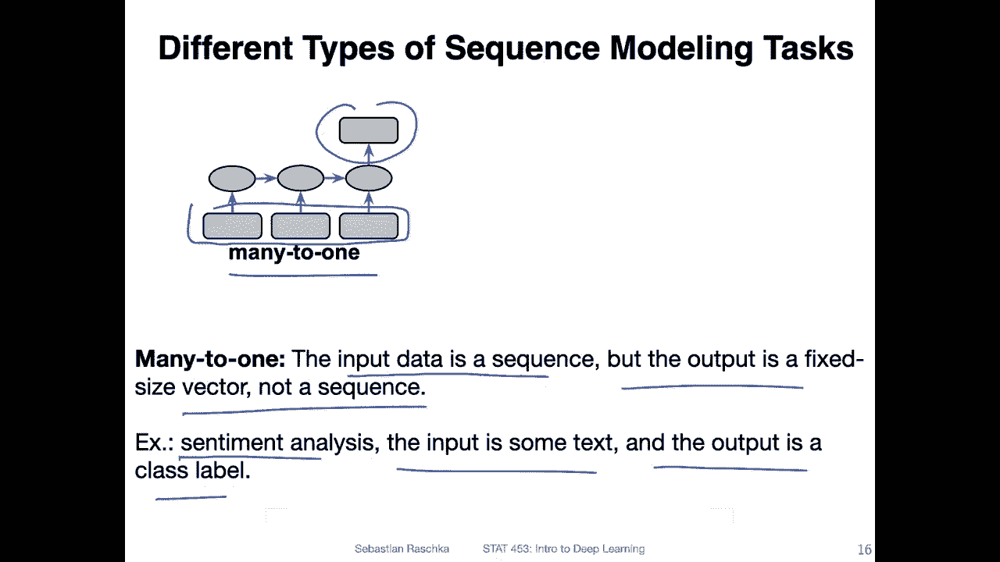
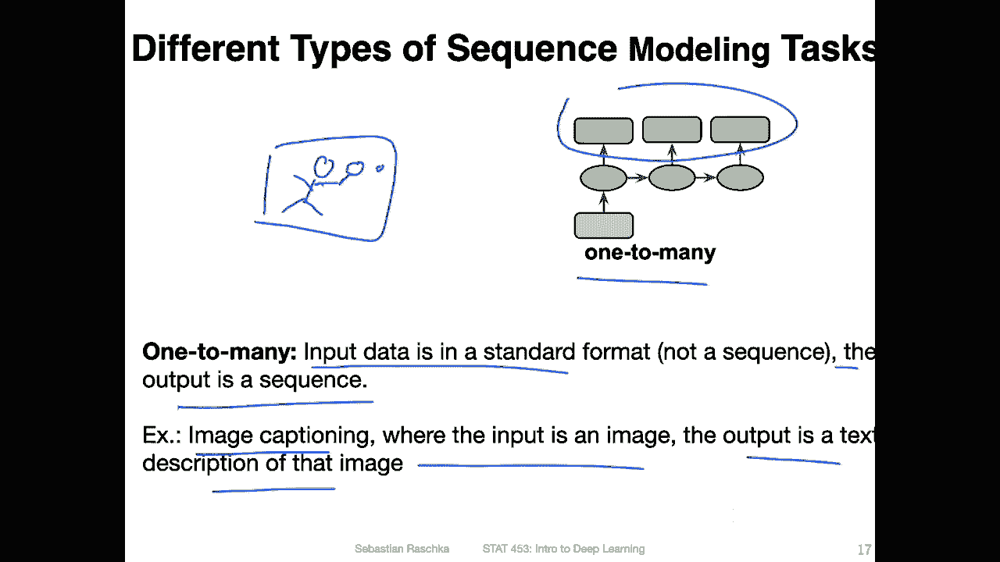
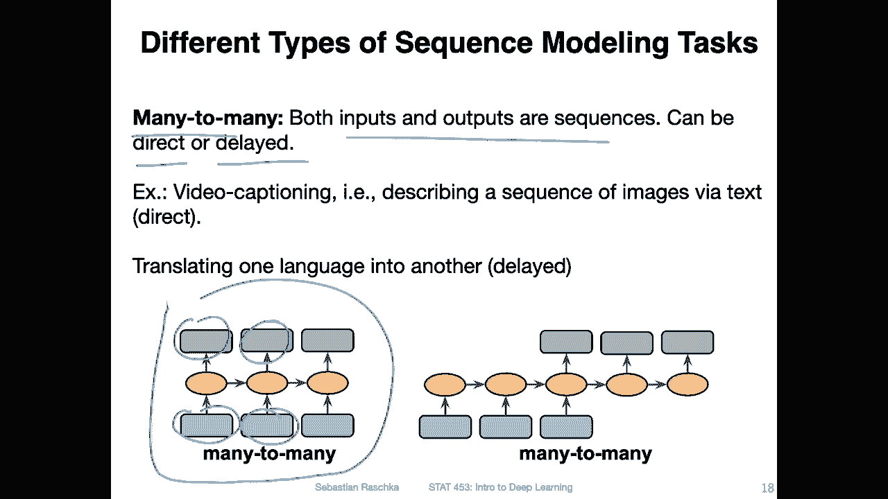
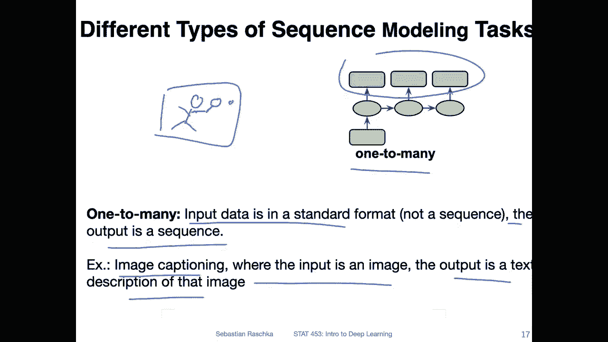
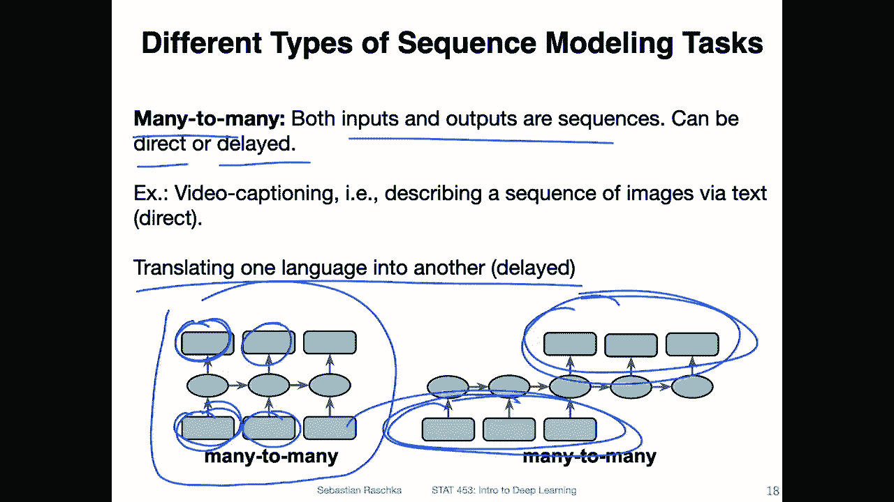
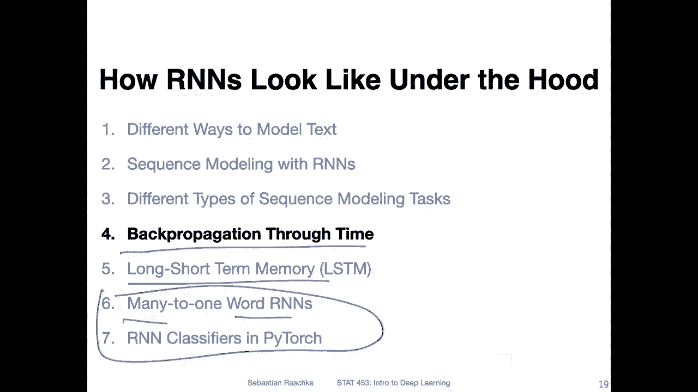
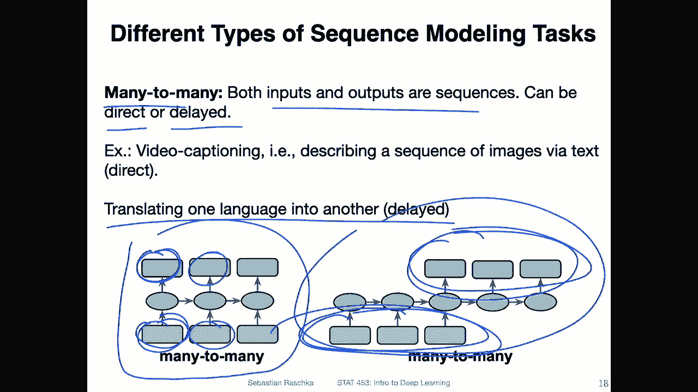
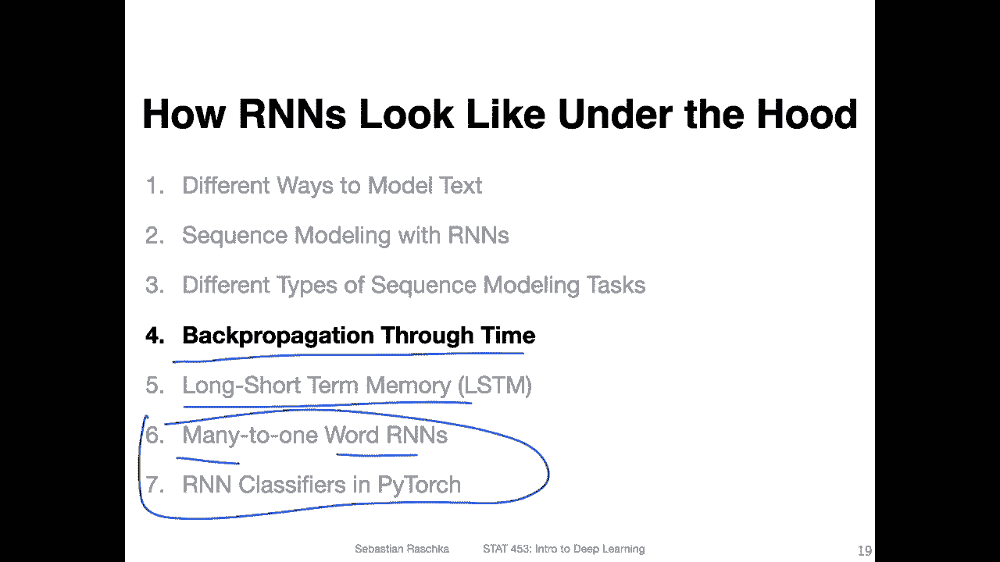

# 课程 P128：L15.3 - 不同类型的序列建模任务 📚

在本节课中，我们将学习循环神经网络（RNN）可以应用于哪些不同类型的序列建模任务。我们将逐一介绍四种常见的任务类型，并通过具体例子帮助理解每种任务的特点。

---

在上一节视频中，我们了解了循环神经网络（RNN）的整体架构概览。本节中，我们来看看如何利用这种架构来处理不同类型的序列建模任务。

以下是四种常见的序列建模任务概览，我们将在接下来的内容中逐步讲解。

---

首先，我们从“多对一”设置开始。这种任务的特点是输入是一个序列，但输出是一个固定大小的向量或值，而非序列。

一个典型的例子是**情感分析**。输入可以是一段文本，输出则是一个类别标签，用于判断文本的情感是积极还是消极。

回想之前提到的电影评论例子。每条输入可以是一篇书面影评，而输出则是判断该影评对电影的评价是正面还是负面。

---

接下来是“一对多”类型的序列建模任务。这种任务稍微超出了标准RNN的范畴，更常与卷积神经网络（CNN）结合使用。

在这种设置中，输入数据是标准输入（例如一张图像），而输出是一个序列。**图像描述生成**（Image Captioning）就是一个很好的例子。

输入可能是一张图片，输出则是描述该图片的文本序列。例如，一张有人打网球的图片，其描述可能是“一个人正在打网球”这样的文本序列。

---

另一种任务是“多对多”类型，它实际上有两种形式。在这种通用设置中，输入和输出都是序列。

第一种是**直接对应**的形式。对于序列中的每个时间步，都有一个输入对应一个输出。例如，**视频描述生成**任务就属于此类。视频由多帧图像组成，为每一帧图像生成描述，就构成了一个多对多的直接任务。

第二种是**延迟对应**的形式。在这种设置中，模型需要先读取完整的输入序列，然后再生成完整的输出序列。**机器翻译**是典型的例子。

例如，将一句英文翻译成德文。这并不适合直接逐词翻译，因为不同语言的语法规则不同。模型需要先理解整个句子的含义，才能生成准确的翻译。

---

以上是对不同序列建模任务的快速概览。在下一个视频中，我们将学习**随时间反向传播**（Backpropagation Through Time），这是RNN学习参数的方法。

之后，我们将讨论对标准RNN设置的改进，并查看一些具体例子。这些例子将包括使用词级RNN的“多对一”分类任务，以及在本课程后期可能涉及的文本生成和语言翻译等内容。

那么，接下来让我们开始讨论随时间反向传播。

---

**本节课总结**

本节课中，我们一起学习了循环神经网络可以处理的四种主要序列建模任务：“多对一”（如情感分析）、“一对多”（如图像描述）、“多对多-直接对应”（如视频描述）以及“多对多-延迟对应”（如机器翻译）。理解这些任务类型是应用RNN解决实际问题的基础。