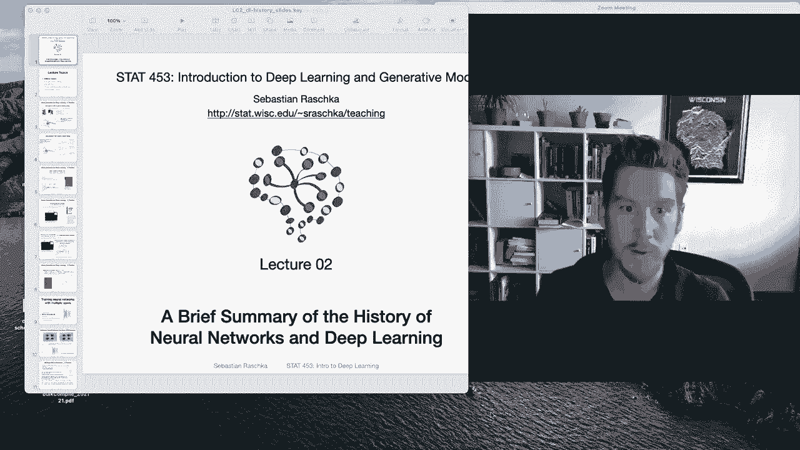
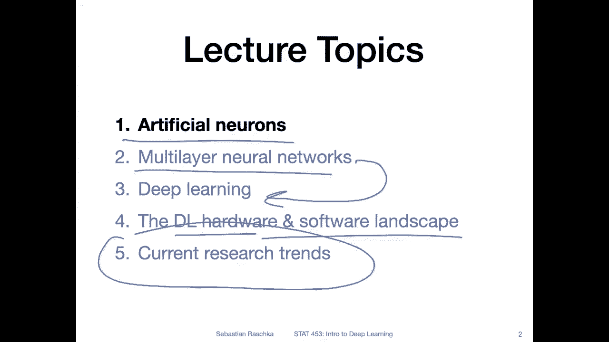

# 课程 P13：L2.0 - 深度学习简史 📜

在本节课中，我们将一起回顾神经网络与深度学习的发展历程。这段历史不仅有趣，更能帮助我们理解整个领域的知识脉络。我们将从最简单的概念开始，逐步看到技术如何演进，并最终了解当前的研究趋势。

## 1. 人工神经元：一切的起点 🧠

上一节我们介绍了课程的整体安排，本节中我们来看看深度学习的起点——人工神经元。

人工神经元是神经网络最基本的构建模块，它模拟了生物神经元接收信号并决定是否激活的过程。一个经典模型是感知机，其核心思想是对输入进行加权求和，然后通过一个阈值函数产生输出。

以下是感知机的基本工作原理：
*   **输入**：接收多个输入信号 `x1, x2, ..., xn`。
*   **权重**：每个输入对应一个权重 `w1, w2, ..., wn`，代表该输入的重要性。
*   **加权和**：计算所有输入与权重的乘积之和，再加上一个偏置项 `b`。公式为：`z = w1*x1 + w2*x2 + ... + wn*xn + b`。
*   **激活函数**：将加权和 `z` 通过一个激活函数（如阶跃函数）得到最终输出 `y`。例如：`y = 1 if z > 0 else 0`。

然而，单层感知机存在明显的局限性，它无法解决线性不可分的问题，比如异或逻辑运算。这促使了研究者们去探索更复杂的网络结构。

## 2. 多层神经网络：解决复杂问题 🔄

由于单层神经网络的局限性，研究者们开始探索增加网络层数。本节中我们来看看多层神经网络是如何被发明并变得有用的。

多层神经网络在输入层和输出层之间引入了“隐藏层”。这些隐藏层使得网络能够学习输入数据中更复杂、更抽象的特征表示。例如，在图像识别中，第一层隐藏层可能学习到边缘，第二层可能学习到由边缘组成的形状，更高层则可能识别出完整的物体。

从单层到多层的转变，极大地扩展了神经网络解决问题的能力。但训练多层网络在当时面临巨大挑战，尤其是如何有效地将误差从输出层反向传播到更早的层以更新权重。

## 3. 从多层网络到深度学习 🚀



多层神经网络的概念已经存在了数十年，而“深度学习”是近年才变得流行的术语。本节我们将探讨这一演变过程。

“深度学习”本质上是指具有多个隐藏层的神经网络。其兴起的关键在于三大要素的成熟：
*   **算法突破**：反向传播算法的有效应用，解决了深层网络的训练难题。
*   **数据规模**：互联网时代产生了海量的标注数据，为训练复杂模型提供了燃料。
*   **计算硬件**：图形处理器（GPU）的强大并行计算能力，使得训练深层网络在时间上变得可行。

这些因素共同作用，使得研究者能够构建和训练前所未有的深度模型，并在图像识别、语音处理等领域取得突破性进展，从而迎来了“深度学习”的浪潮。

## 4. 硬件与软件的发展 🛠️

随着深度学习模型的日益复杂，对计算能力和开发效率的要求也水涨船高。本节我们来看看支持深度学习发展的硬件与软件工具。

在硬件方面，GPU因其并行架构成为训练神经网络的首选。随后，更专业的张量处理单元（TPU）等AI芯片被开发出来，以进一步提升效率。

在软件方面，一系列深度学习框架应运而生，它们将常见的网络层、优化算法等封装成易于调用的模块，极大地降低了研究和工程的门槛。

以下是两个主流的深度学习框架示例：
```python
# TensorFlow 示例
import tensorflow as tf
model = tf.keras.Sequential([tf.keras.layers.Dense(units=1, input_shape=[1])])

# PyTorch 示例
import torch
model = torch.nn.Linear(in_features=1, out_features=1)
```

这些工具使得研究人员和工程师能够更专注于模型设计与应用，而非底层实现细节。

## 5. 当前研究趋势简述 🌟

在了解了历史与基础支撑后，本节我们简要概述一下近几年的研究趋势。

深度学习领域的发展日新月异。近年来，一些方向受到了特别多的关注：
*   **注意力机制与Transformer模型**：该架构在自然语言处理领域取得统治性成功，并逐渐扩展到计算机视觉等领域。
*   **自监督学习**：旨在从大量无标签数据中自行学习有效表示，减少对数据标注的依赖。
*   **生成模型**：如生成对抗网络（GAN）和扩散模型，能够生成高质量的图像、音频等内容。
*   **可解释性与鲁棒性**：研究如何理解模型的决策过程，并提升模型对对抗性攻击的防御能力。

这些趋势代表了深度学习领域正在向更高效、更通用、更可靠的方向演进。

## 总结 📝



本节课中我们一起学习了深度学习的发展简史。我们从模拟神经元的基本单元——感知机开始，看到了单层网络的局限如何催生了多层神经网络。随后，我们回顾了算法、数据和算力的进步如何共同推动多层网络演进为今天的“深度学习”。我们还了解了支撑这一领域的硬件与软件工具，并简要浏览了当前最前沿的研究趋势。这段历史为我们后续深入学习各个具体主题提供了清晰的路线图。