# 课程 P130：L15.5 - 长短期记忆 (LSTM) 🧠 📚

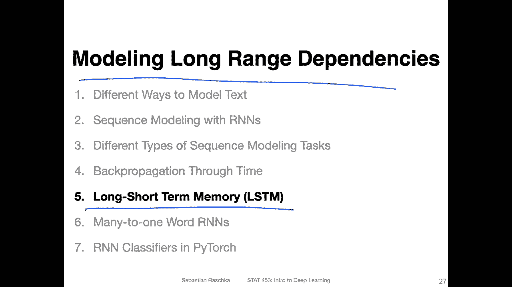

在本节课中，我们将要学习一种称为**长短期记忆 (LSTM)** 的模型。这是一种特殊的循环神经网络 (RNN) 单元，专门用于建模序列数据中的**长程依赖关系**。对于处理较长的序列数据，LSTM 至关重要，它能显著提升循环神经网络的性能。

---

## 🔍 背景：梯度消失与爆炸问题

上一节我们介绍了循环神经网络的基本结构及其面临的挑战。在深度学习中，梯度消失和爆炸是训练深层网络时的常见问题。我们之前讨论过一些解决方案，例如在多层感知机中使用 **ReLU** 激活函数代替 Sigmoid 函数，以及使用**批归一化 (Batch Normalization)** 技术。

然而，即使采用了这些方法，构建非常深的网络（例如超过16层）仍然困难。在卷积神经网络中，我们引入了**残差连接 (Skip Connections)** 来构建超过30、50甚至100层的网络（如 ResNet）。

在循环神经网络的场景中，问题更加复杂。我们不仅要考虑网络的深度（层数），还要考虑序列的长度（时间步数）。在反向传播过程中，梯度需要跨越多个时间步进行传播，这极易导致梯度消失或爆炸。

以下是三种处理循环神经网络中梯度问题的常用技术：

*   **梯度裁剪 (Gradient Clipping)**：这是最简单且广泛应用的技术。它为梯度设置一个最大值和最小值。例如，我们可以规定梯度绝对值不能超过2。如果梯度超过这个阈值，就将其裁剪到这个值，从而避免参数更新步长过大。
*   **沿时间截断的反向传播 (Truncated Backpropagation Through Time, TBPTT)**：这是一种限制反向传播时间步数的方法。在处理长序列时，前向传播会使用整个序列。但在反向传播时，我们可能只对最后若干个时间步（例如最后20步）计算梯度，而不是回溯整个序列。这能有效缓解长序列带来的计算和梯度问题。
*   **长短期记忆 (LSTM)**：这是一种更高级的方法，它通过引入一个**记忆细胞 (Memory Cell)** 来显式地建模长程依赖，从而从根本上缓解梯度消失问题。LSTM 架构最早在1997年的一篇有影响力的论文中提出。

除了 LSTM，还有一种流行的变体叫做**门控循环单元 (GRU)**。GRU 是 LSTM 的一个简化版本，参数更少。在实际应用中，LSTM 和 GRU 的性能通常相近，有时 LSTM 更好，有时 GRU 更好，没有绝对的优劣之分。目前，LSTM 仍然是使用最广泛的 RNN 记忆单元。本节课我们将重点讲解 LSTM，并在后续使用 PyTorch 实现它。

接下来的内容可能看起来比较复杂，但请不要担心。作为入门课程，我们的目标是获得一个宏观的理解。如果你希望深入掌握，可能需要花费数周时间研读论文并尝试从头实现。

---

## 🧩 LSTM 单元结构详解

LSTM 单元的核心思想是引入一个**细胞状态 (Cell State)**，作为贯穿整个序列的“信息高速公路”，使得信息可以相对无损地传递。同时，它通过三个“门”结构来精细控制信息的流动：遗忘门、输入门和输出门。

下图展示了 LSTM 单元在一个时间步内的完整计算图。它看起来复杂，但我们将一步步拆解。

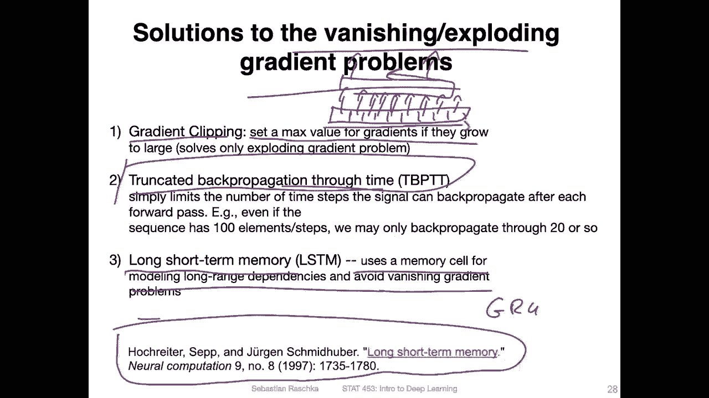

### LSTM 在 RNN 中的位置

首先，理解 LSTM 单元如何嵌入到 RNN 框架中很重要。在标准的 RNN 中，每个时间步有一个隐藏状态 `h_t`。在 LSTM-RNN 中，我们用 LSTM 单元替换了这个简单的隐藏层计算。

对于一个多层 LSTM 网络，每一层都可以包含 LSTM 单元。下图示意了 LSTM 单元的输入和输出：
*   **蓝色箭头**：来自上一个时间步的隐藏状态 `h_{t-1}`。
*   **红色/黑色箭头**：来自上一个时间步的细胞状态 `C_{t-1}`（这是 LSTM 新增的核心）。
*   **绿色箭头**：输出到下一个时间步的隐藏状态 `h_t`。
*   **粉色/紫色箭头**：输出到下一层（如果存在）的隐藏状态。

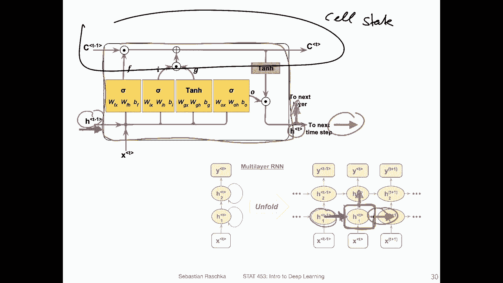

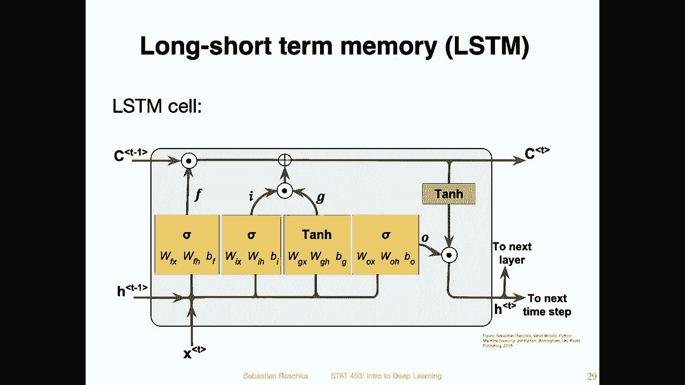

### 核心计算流程

LSTM 的计算围绕更新两个状态进行：
1.  **细胞状态 (C_t)**：长期记忆，在时间步间传递。
2.  **隐藏状态 (h_t)**：短期记忆/输出，传递给下一个时间步和下一层。

其核心操作包括**逐元素乘法 (⊙)** 和**加法 (+)**，并使用 **Sigmoid (σ)** 和 **Tanh** 作为激活函数。

---

## 🚪 三大门控机制

LSTM 通过三个门来控制信息流，每个门都是一个 Sigmoid 神经网络层，输出 0 到 1 之间的值，表示“允许通过”的比例。

### 1. 遗忘门 (Forget Gate)

遗忘门决定从上一个细胞状态 `C_{t-1}` 中丢弃哪些信息。

**公式**：
`f_t = σ(W_f · [h_{t-1}, x_t] + b_f)`

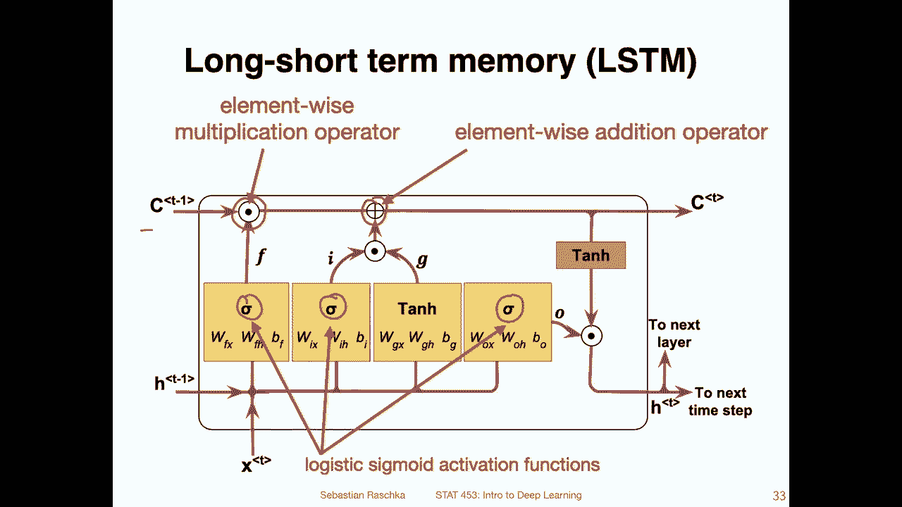

其中：
*   `[h_{t-1}, x_t]` 表示将上一个隐藏状态和当前输入拼接起来。
*   `W_f` 和 `b_f` 是遗忘门的权重和偏置。
*   `σ` 是 Sigmoid 函数，输出值在 `[0, 1]`。
    *   输出 `0` 表示“完全忘记”对应的信息。
    *   输出 `1` 表示“完全保留”对应的信息。

遗忘门的输出 `f_t` 会与上一个细胞状态 `C_{t-1}` 进行逐元素相乘，从而有选择地遗忘旧信息。

### 2. 输入门 (Input Gate) 与候选值

输入门决定将哪些新信息存入细胞状态。这一步分为两部分：
*   **输入门 (i_t)**：一个 Sigmoid 层，决定哪些值需要更新。
*   **候选细胞状态 (C̃_t)**：一个 Tanh 层，生成新的候选值向量，这些值可能被加入到细胞状态中。

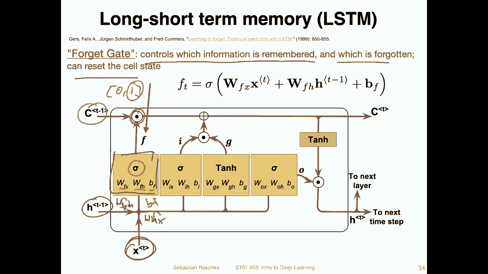

**公式**：
`i_t = σ(W_i · [h_{t-1}, x_t] + b_i)`
`C̃_t = tanh(W_C · [h_{t-1}, x_t] + b_C)`

接下来，我们将遗忘门的输出（控制旧记忆）和输入门的输出（控制新记忆）结合起来，更新细胞状态。

**细胞状态更新公式**：
`C_t = f_t ⊙ C_{t-1} + i_t ⊙ C̃_t`

这个公式是 LSTM 的核心：
*   `f_t ⊙ C_{t-1}`：选择性遗忘旧状态。
*   `i_t ⊙ C̃_t`：选择性添加新候选值。

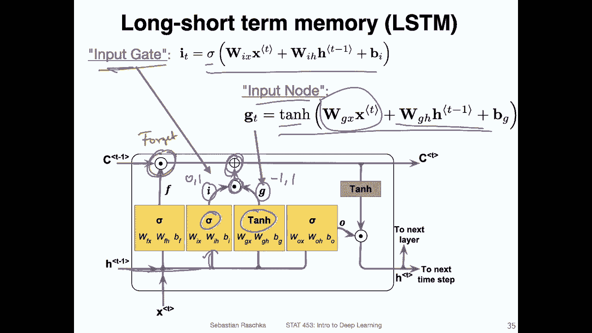

### 3. 输出门 (Output Gate)

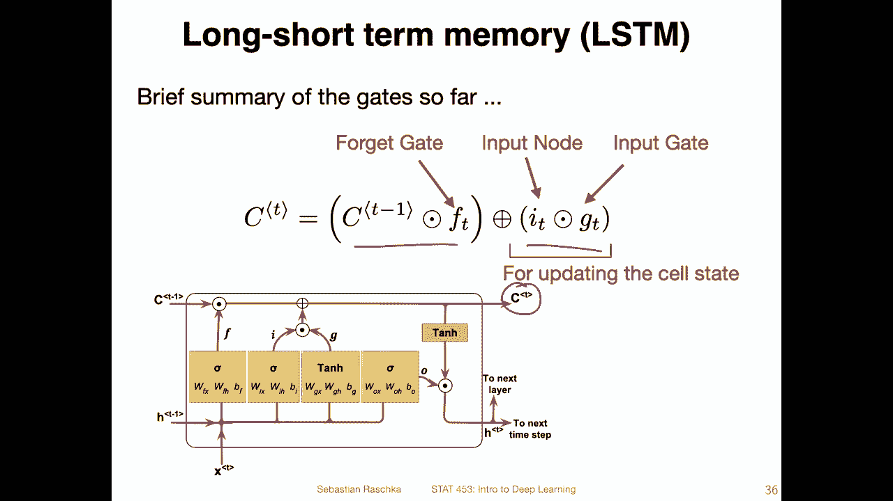

输出门基于更新后的细胞状态 `C_t`，决定当前时间步要输出什么到隐藏状态 `h_t`。
*   **输出门 (o_t)**：一个 Sigmoid 层，决定细胞状态的哪些部分将输出。
*   **隐藏状态 (h_t)**：将细胞状态通过 Tanh 激活（将值规范到 [-1, 1]），然后与输出门相乘。

**公式**：
`o_t = σ(W_o · [h_{t-1}, x_t] + b_o)`
`h_t = o_t ⊙ tanh(C_t)`

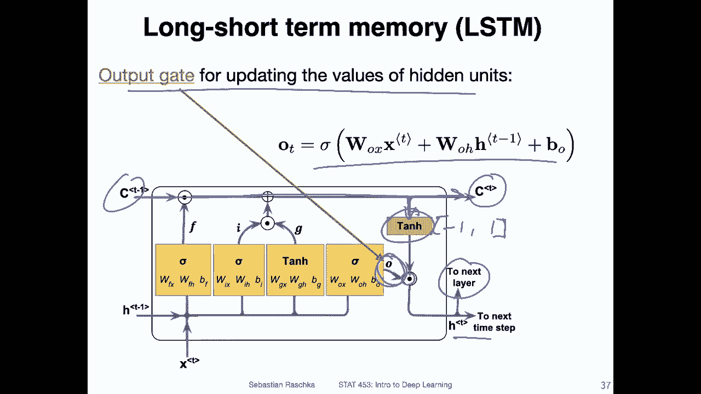

这个 `h_t` 会作为当前时间步的输出，并传递到下一个时间步。

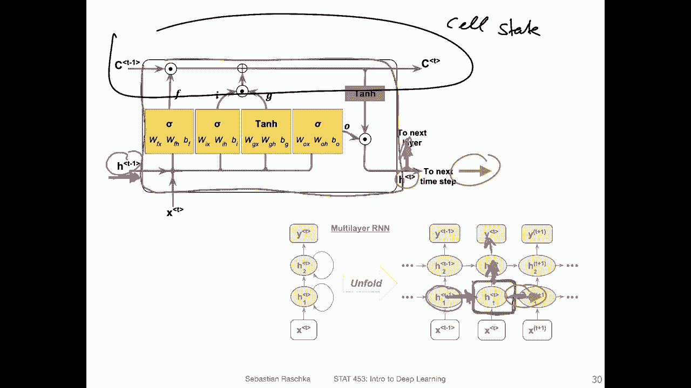

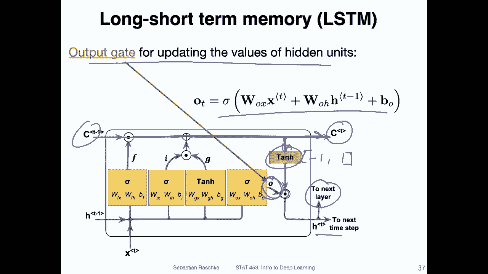

---

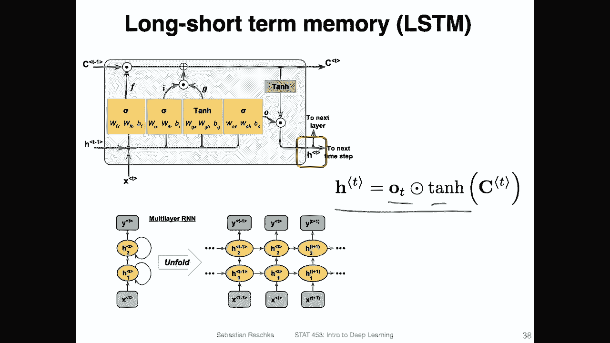

## 📊 总结与对比

本节课我们一起学习了长短期记忆 (LSTM) 网络。我们来总结一下关键点：

*   **目标**：解决标准 RNN 在长序列上的**梯度消失**问题，建模**长程依赖**。
*   **核心创新**：引入**细胞状态 (C)** 作为贯穿序列的“记忆通道”，并通过**门控机制**精细调控信息流。
*   **三大门控**：
    1.  **遗忘门**：决定丢弃哪些旧信息。`f_t = σ(W_f·[h_{t-1}, x_t] + b_f)`
    2.  **输入门**：决定添加哪些新信息。`i_t = σ(W_i·[h_{t-1}, x_t] + b_i)`
    3.  **输出门**：决定基于当前记忆输出什么。`o_t = σ(W_o·[h_{t-1}, x_t] + b_o)`
*   **状态更新**：
    *   细胞状态：`C_t = f_t ⊙ C_{t-1} + i_t ⊙ tanh(W_C·[h_{t-1}, x_t] + b_C)`
    *   隐藏状态：`h_t = o_t ⊙ tanh(C_t)`

LSTM 的结构虽然复杂，但其设计使得它能够有效地学习并记住长期信息，因此在机器翻译、文本生成、语音识别等任务中取得了巨大成功。它的一个流行变体是**门控循环单元 (GRU)**，结构更简单，参数更少，两者在实际应用中性能相当。

在接下来的课程中，我们将使用 PyTorch 实现一个基于 LSTM 的“多对一”分类器。大约两周后，我们还会重温 RNN/LSTM，将其应用于“多对多”的文本生成任务。

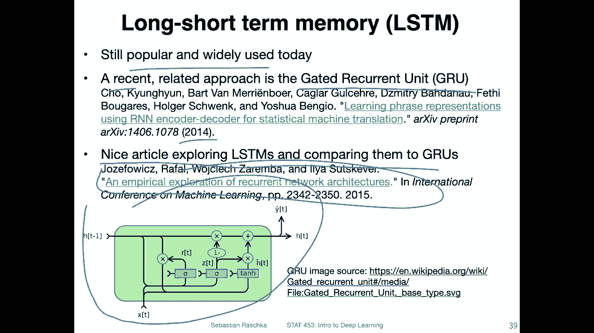

---

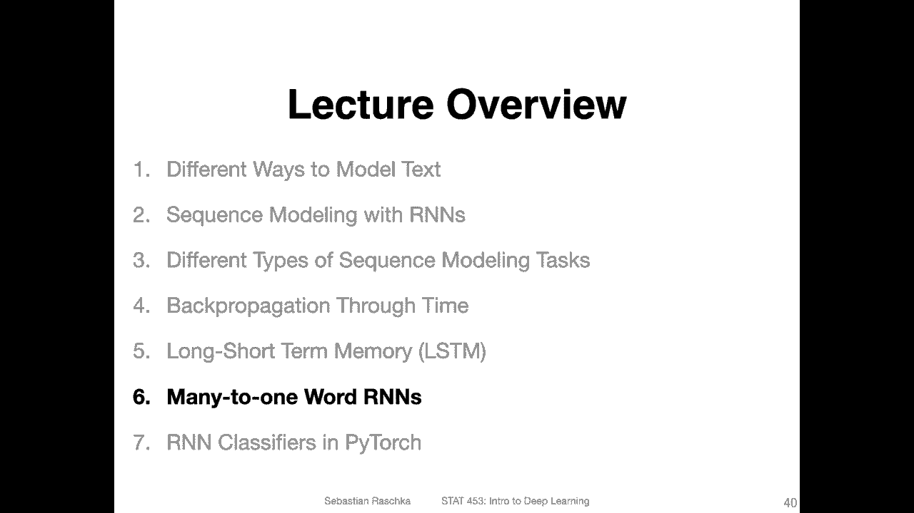

> **扩展阅读**：如果你对 LSTM 及其变体 GRU 的详细比较和应用场景感兴趣，可以搜索相关论文和文章进行深入学习。本课程作为概述，旨在提供宏观理解，更多细节将在 Piazza 或 Canvas 上提供参考资料。