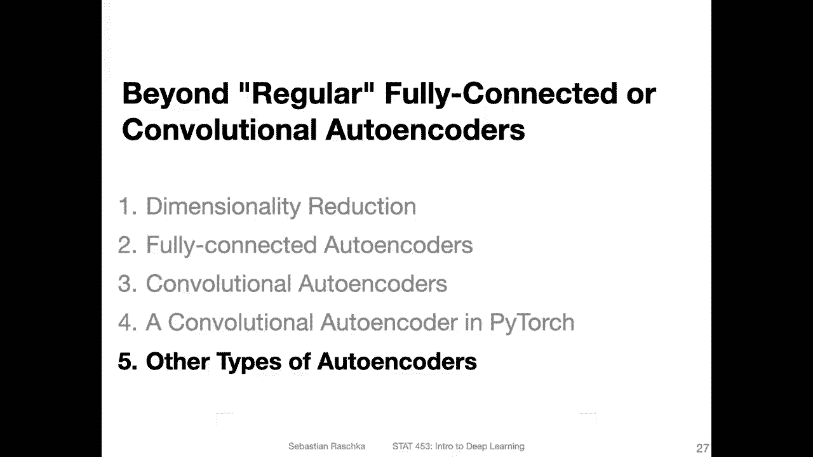
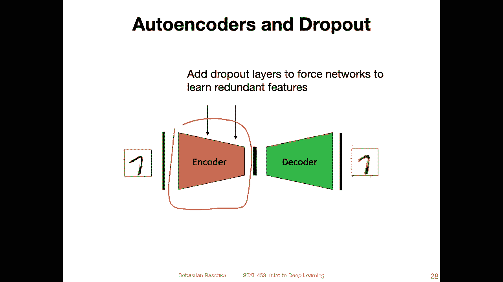
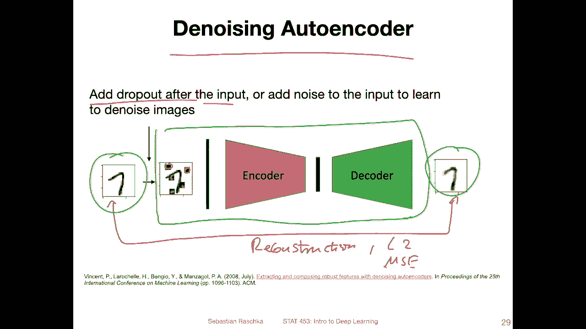
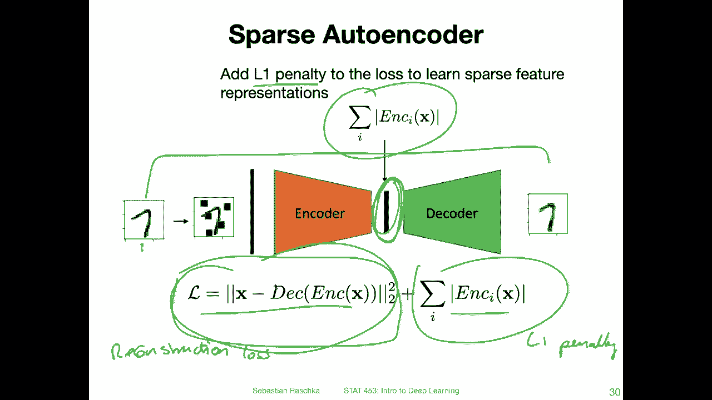
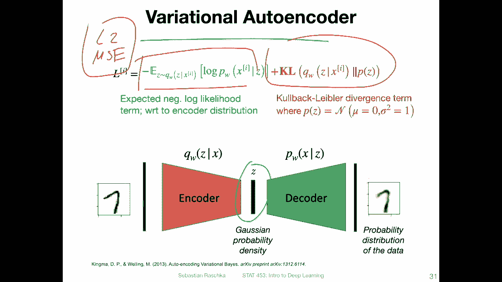

# 课程 P137：L16.5 - 其他类型的自动编码器 🧠



在本节课中，我们将学习几种自动编码器的变体，包括 Dropout 自动编码器、去噪自动编码器、稀疏自动编码器以及变分自动编码器的基本概念。这些变体通过引入不同的约束或结构，扩展了基础自动编码器的功能与应用场景。

---

## Dropout 自动编码器



上一节我们介绍了基础自动编码器的结构，本节中我们来看看如何通过引入 Dropout 来增强其鲁棒性。

我们可以在编码器和解码器的全连接层或卷积层之间加入 Dropout 层（例如 `Dropout1D` 或 `Dropout2D`）。Dropout 会在训练过程中随机“丢弃”一部分神经元，迫使网络学习冗余的特征表示。因为网络无法依赖某些特定特征始终存在，所以必须学习更稳健的表示。

以下是其核心思想：

```python
# 伪代码示例：在编码器中加入 Dropout
encoder_layers = [
    Linear(input_dim, hidden_dim),
    Dropout(p=0.5),  # 随机丢弃50%的神经元
    ReLU(),
    # ... 更多层
]
```

---

## 去噪自动编码器

理解了 Dropout 的作用后，我们可以将其思想应用于构建去噪自动编码器。

在输入层之后直接添加 Dropout，相当于向输入数据中添加了噪声（例如，随机将部分像素置零）。网络的目标仍然是最小化原始干净输入与解码器输出之间的重构误差。由于编码器只能看到带噪声的输入，为了最小化重构误差，它必须学会忽略噪声，从而学习到去噪的能力。



这种方法的核心损失函数通常是输入与输出之间的均方误差（MSE）：

**公式：** `Loss = MSE(原始输入, 解码器输出(编码器(带噪声输入)))`

---

## 稀疏自动编码器

除了处理噪声，我们有时还希望学习到的编码表示是稀疏的，即大部分元素为零。

这可以通过在损失函数中添加 L1 正则化项来实现。L1 正则化会惩罚编码向量中非零元素的绝对值之和，鼓励产生稀疏表示。此时的损失函数是重构损失与 L1 惩罚项的加权和。

以下是其损失函数的构成：

**公式：** `总损失 = 重构损失 + λ * Σ|z_i|`
其中，`z_i` 是编码向量中的元素，`λ` 是控制稀疏性强度的超参数。

---

## 变分自动编码器简介

最后，我们简要介绍一个更强大的变体——变分自动编码器，我们将在下一讲中对其进行深入探讨。



变分自动编码器的核心思想是让编码器学习一个概率分布（通常是高斯分布），而不仅仅是一个固定的向量。其损失函数包含两部分：
1.  **重构损失**：确保解码输出与输入相似。
2.  **KL 散度项**：约束学习到的潜在分布接近标准正态分布。

其损失函数可表示为：

**公式：** `损失 = 重构损失 + β * KL( N(μ, σ) || N(0, 1) )`

其中，`μ` 和 `σ` 是编码器输出的均值和方差。我们将在后续课程中详细解释其原理与实现。

---

## 总结

本节课中我们一起学习了自动编码器的几种重要变体：
*   **Dropout 自动编码器**通过引入随机性增强鲁棒性。
*   **去噪自动编码器**利用带噪声的输入学习恢复原始数据。
*   **稀疏自动编码器**通过 L1 正则化获得稀疏的编码表示。
*   **变分自动编码器**则引入了概率生成的思想，为生成模型奠定了基础。



理解这些变体有助于我们根据具体任务（如去噪、特征提取、生成数据）选择合适的自动编码器结构。下一讲我们将深入探讨变分自动编码器。