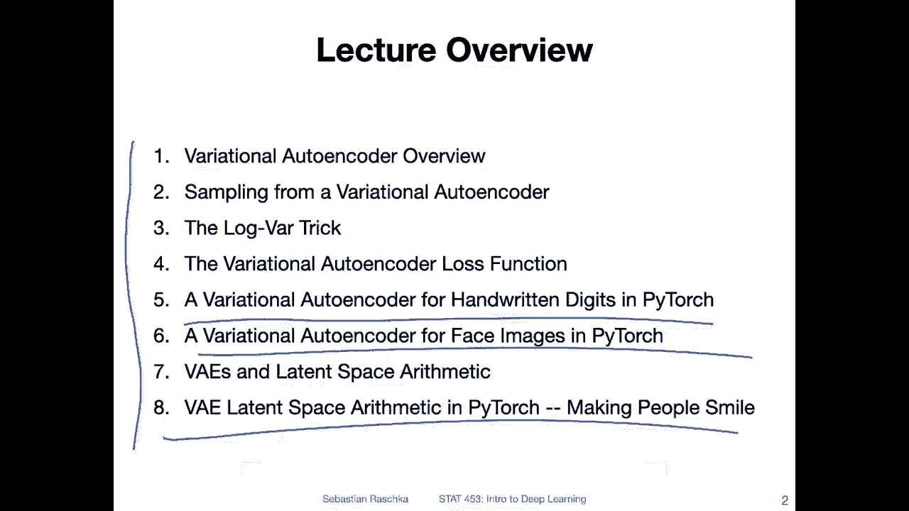
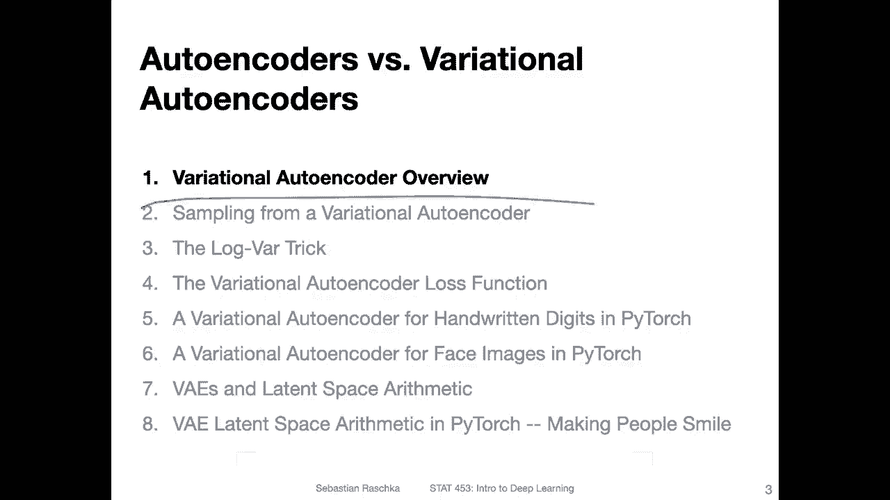

# P138：L17.0- 变分自编码器简介 🧠

## 课程概述

在本节课中，我们将要学习一种特殊的自编码器——变分自编码器。我们将了解它如何克服传统自编码器在生成新数据方面的局限性，并成为一个强大的生成模型。

上一周我们学习了自编码器。自编码器是一种特殊的神经网络，由两部分组成：一个**编码器**，它接收输入并将其压缩成更低维度的表示；以及一个**解码器**，它接收这个低维表示并尝试重建输入。

当时我展示了一个例子：我从这个低维空间中随机抽取一个坐标，然后使用解码器来生成一张与训练数据有些相似的新图像。通过这种方式，我们可以将其视为生成新数据。

然而，当我们讨论更高维度的空间时，如果低维空间的维度超过两个，这种方法的效果就不太好了，因为存在一些挑战。我将在本次讲座中更详细地探讨这些问题。

总的来说，在本次讲座中，我想讨论一种特定类型的自编码器，称为**变分自编码器**。这种变分自编码器在采样新数据方面表现更好。你可以将变分自编码器视为一个生成模型，我们可以用它从分布中采样并生成新数据。

这样看来，它就像是自编码器的一个改进版本，特别适合用于创建新数据。

在深入探讨其工作原理之前，让我先概述一下本次讲座的内容，然后我们将逐步学习变分自编码器的工作原理。当然，我也会展示一些代码示例。除了简单的代码示例，我们还将观察一个包含人脸图像的数据集，并学习如何让人脸“微笑”。

好的，我们开始吧。

## 今日主题

以下是今天要讨论的主题。请不要担心，虽然看起来有8个主题，但这次我会尽量精简。我知道本学期剩下的时间不多了，你们都在忙于课程项目和其他课程。我理解这一点，所以我不希望在学期末把事情搞得太复杂，只想在这里给你们一个关于变分自编码器的大致概览。

我只有25张幻灯片，非常有信心能在常规的75分钟讲座时间内完成。当然，我也会提供代码示例。

通过这次讲座，我希望能让大家对变分自编码器的工作原理有一个宏观的概览。同时，如果你们感兴趣，我也会提供一些未来的参考资料，因为变分自编码器背后有很多数学基础，我们无法在本讲座中全部涵盖，但有些人可能会对此感兴趣。

---

好的，在下一个视频中，我们将从概述什么是变分自编码器开始。

---

## 总结

本节课中，我们一起学习了变分自编码器的基本概念及其作为生成模型的潜力。我们了解到，与传统自编码器相比，变分自编码器通过引入概率分布，能够更有效地在高维潜在空间中生成新的、合理的数据样本。在接下来的内容中，我们将深入其具体架构和训练过程。