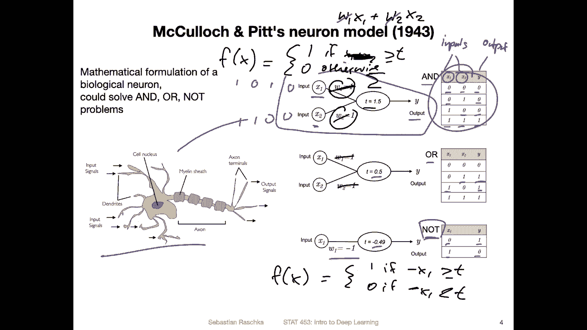
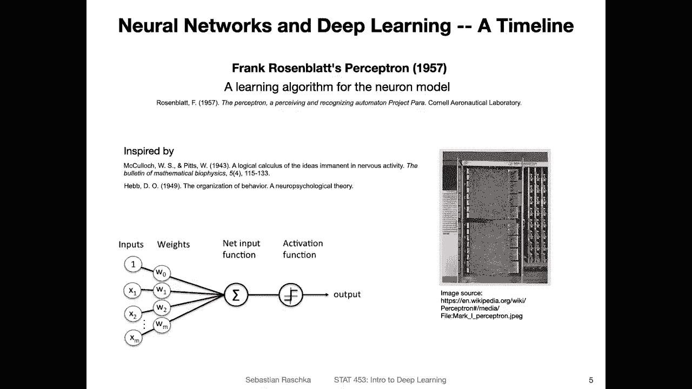
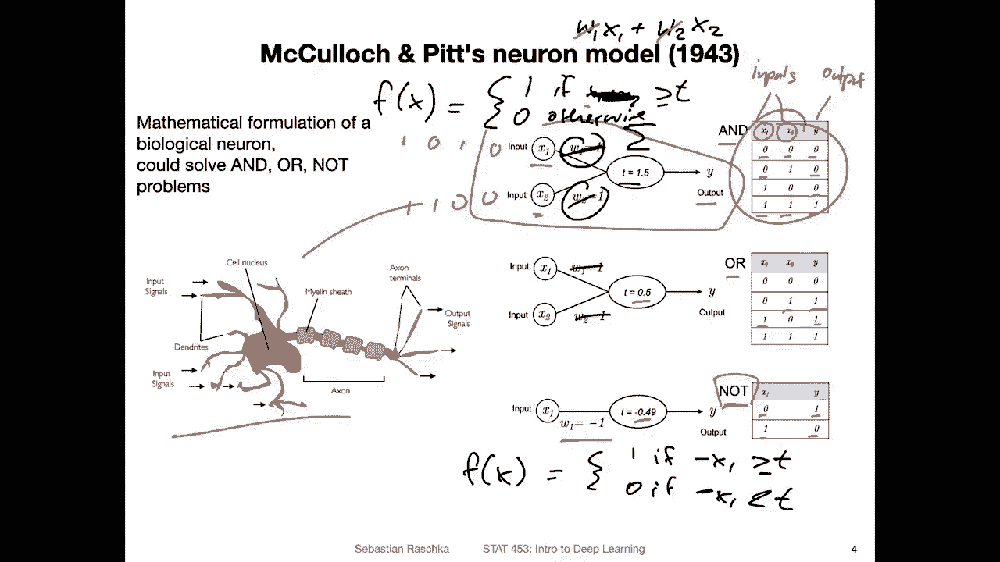
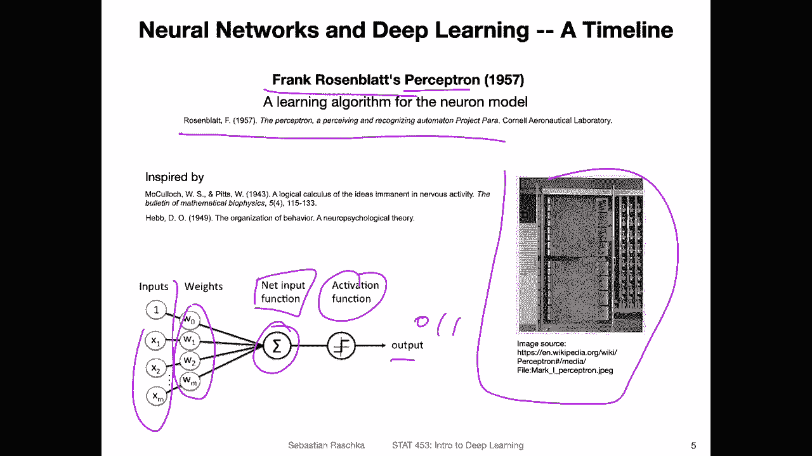
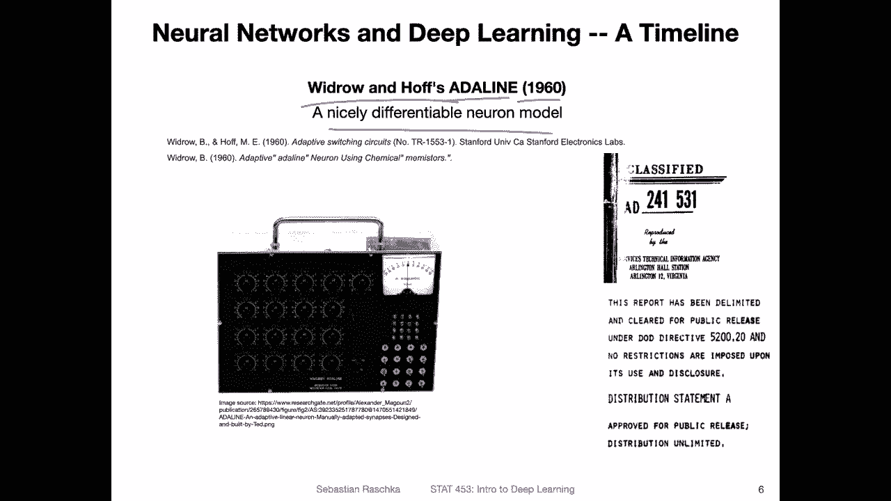
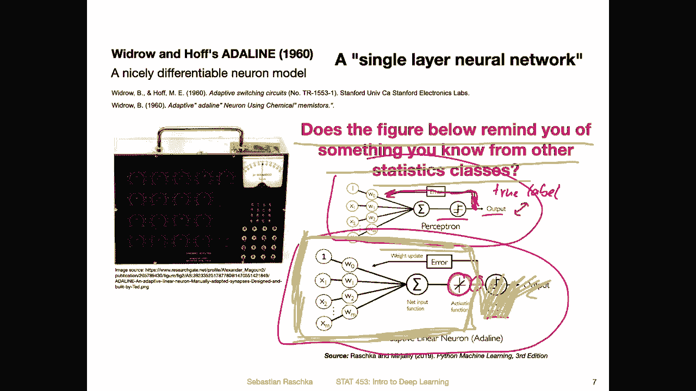
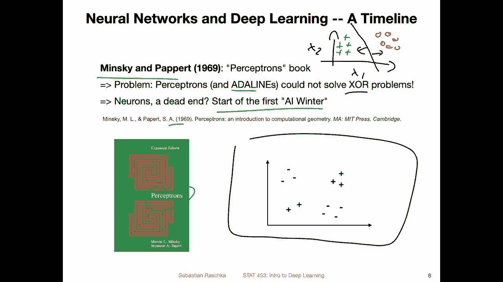
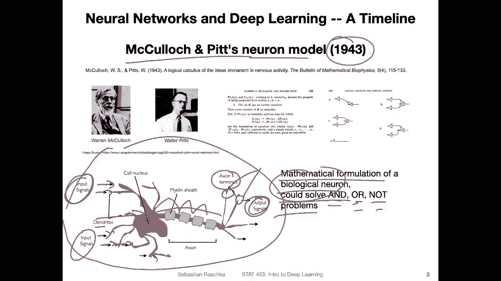

# 课程 P14：L2.1 - 人工神经元 🧠

在本节课中，我们将要学习人工神经元的基本概念，了解其如何从生物神经元中获得灵感，并演变为能够执行基本逻辑运算的数学模型。我们将探讨感知机与自适应线性神经元（Adaline）的初步概念，并理解早期神经网络的局限性。

## 从生物神经元到数学模型 🧬

上一节我们提到了人工神经网络的灵感来源于生物神经元。生物神经元接收输入信号，在细胞核中进行信息整合与处理，然后通过轴突终端产生输出信号。虽然人工神经网络的工作机制与生物神经元有很大不同，但核心的“输入-处理-输出”概念被保留了下来。

基于这个灵感，McCulloch和Pitts在1943年提出了一个神经元的数学模型。这个模型可以类比为一个简单的计算单元。

## 实现基本逻辑函数 🔢

为了阐明神经元数学模型如何与基本逻辑函数相关联，我们快速概览一下。

以下是三种基本逻辑函数的真值表：AND（与）、OR（或）和NOT（非）。

你可以将 `x1` 和 `x2` 视为输入，将 `y` 视为输出。
*   对于AND函数：仅当两个输入都为1时，输出才为1。
*   对于OR函数：只要有一个输入为1，输出就为1。
*   对于NOT函数：输出是输入的反转。

这里我们讨论的是二进制值，即可能的取值仅为0和1。

## 数学模型的实现方式 ➗

这与生物神经元类似，是使用数学方法实现AND函数的一种方式。我们有两个输入 `x1` 和 `x2`，以及一个输出。

我们将在下一讲讨论感知机模型时更详细地回顾这一点。这里只是展示，利用生物神经元的概念来实现此类函数确实是可行的。

其工作原理是：首先对输入进行求和（积分）。你可以将其视为一个分段线性函数。如果输入之和（例如 `x1 + x2`）大于或等于某个阈值，则返回1；否则返回0。这就是一个神经元。

这里也存在权重。请注意，在此例中我将权重设为1，因此它们实际上不起作用。通常我们会计算输入的加权和，但此处暂不讨论。由于权重为1，我们可以忽略它们。在后续课程中，我们将讨论如何通过学习来获得这些权重，即参数化模型。

你只需代入不同的值（如(0,0), (1,0), (0,1), (1,1)），查看和 `x1 + x2` 是否大于阈值，就会发现这实现了AND函数。

类似地，你可以通过将阈值改为0.5来实现OR函数。你也可以通过将阈值改为-0.49并将权重改为-1来实现NOT函数。其函数形式为：如果 `-x1` 大于等于阈值则返回1，否则返回0。

这就是数学模型如何表示AND、OR和NOT函数的一个例子。

## 从固定模型到学习算法 🤖

在上一张幻灯片中，我谈到了模型，但当时没有方法可以自动确定阈值。我们必须为特定函数手动编码阈值。

现在假设你有一个数据集，并且想学习一个分类器。你将需要尝试大量权重和阈值组合，以找到分类数据的好方法。

因此，Frank Rosenblatt提出了一个想法，即开发一种学习算法，能够从数据中自动找到最优的权重和阈值，以进行良好的分类。例如，如果你想分类垃圾邮件和非垃圾邮件，可以使用一个能从数据中学习以找到良好决策阈值的系统。

这大约是在McCulloch和Pitts神经元提出十年后，由Frank Rosenblatt完成的。实际上有多个感知机算法，但在实践中，当我们说“感知机算法”时，通常指一种流行的算法。我们将在下一讲更详细地讨论这个感知机算法，并用代码实现它。

## 感知机与Adaline的演进 ⚙️

以下是其工作原理和外观的快速概览。与上一张幻灯片类似，我们有多个输入和权重。它们在此处结合，形成加权和，这被称为净输入函数。然后有一个激活函数，这基本上就是上一张幻灯片介绍的阈值函数，之后会产生输出0或1。我们将再次更详细地讨论这一点。

在感知机之后，我们仍在讨论单层神经网络。随后出现了所谓的Adaline（自适应线性神经元），由Widrow和Hoff在1960年提出，仅三年之后。

感知机和Adaline之间的区别在于，Adaline是一个**可微分的神经元模型**。这稍微改变了我们学习权重的方式，因为现在我们可以使用微积分来学习权重，这更加方便。我们将在下一讲看到这个学习算法如何工作，并在未来的课程中讨论使用微积分学习权重的梯度下降法。

以下是本视频最后一个快速概览。这是之前展示的感知机。现在Adaline实际上非常相似，其主要区别在于没有线性激活函数。

在感知机中，你进行分类，得到一个输出，然后通过将此输出与真实标签进行比较来计算误差。基于此误差，你可以返回并更新权重。

对于Adaline，区别在于你在计算实际输出之前，在阈值函数之前进行此更新。这里有一个问题：下图是否让你想起了在其他统计学课程中学到的东西？如果你只看黄色高亮的部分（忽略阈值函数），它是否让你想起了什么？这可能是Piazza上的一个好问题。

## 早期神经网络的局限性与AI寒冬 ❄️

最后，为什么我们现在有深度学习？为什么我们没有停留在感知机和Adaline？因为显然我们现在有了可以轻松参数化的分类器。问题是它们只能学习非常简单的决策边界，即所谓的**线性决策边界**。

线性决策边界是将数据集分成两部分的边界。例如，在一个二维分类问题中，一个线性分类器可能会学习一条直线作为决策边界，将一侧的数据点分类为一类，另一侧的分类为另一类。

但是，如果我们有一个例如“异或”（XOR）问题，数据点的排列使得没有一个线性决策边界能够正确分类所有点。无论你如何尝试，线性分类器都无法解决这个问题。

实际上，有一本由Minsky和Papert在1969年写的书叫《Perceptrons》，它对感知机持非常负面的态度，基本上说感知机和Adaline无法解决XOR等问题，因此非常有限，可能不是AI的目标。这引发了所谓的“AI寒冬”，人们一度对神经网络研究失去了兴趣。

然而，事情并非如此黯淡，因为实际上有方法可以开发能够解决XOR问题的新网络，我将在下一个视频中讨论这一点。

## 总结 📝

本节课我们一起学习了人工神经元的起源与发展。我们从McCulloch和Pitts的数学模型出发，看到了它如何实现AND、OR和NOT等基本逻辑函数。接着，我们了解了Frank Rosenblatt的感知机如何引入学习算法来自动寻找权重和阈值。随后，Adaline通过引入可微模型，为使用微积分优化权重奠定了基础。最后，我们认识到这些早期单层模型的局限性——它们只能处理线性可分问题，无法解决像XOR这样的非线性问题，这直接导致了AI寒冬的到来。这为后续多层神经网络和深度学习的发展埋下了伏笔。