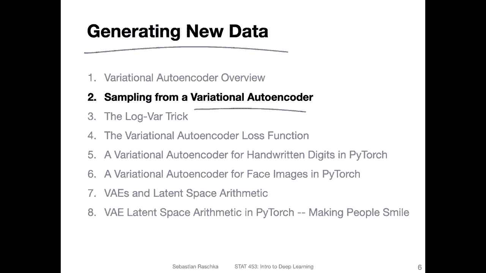
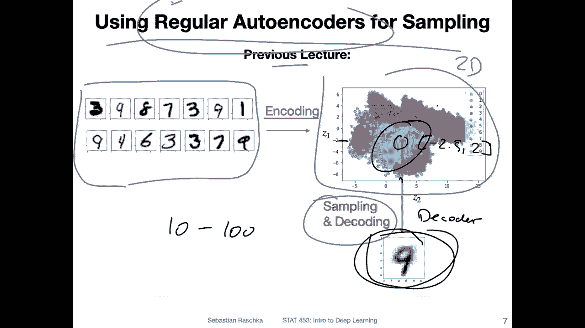
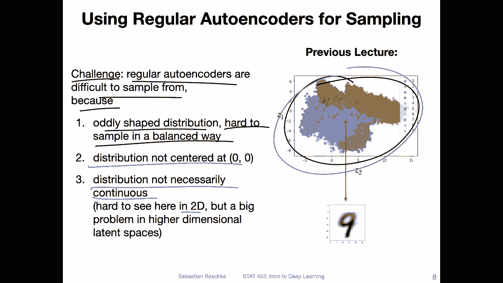
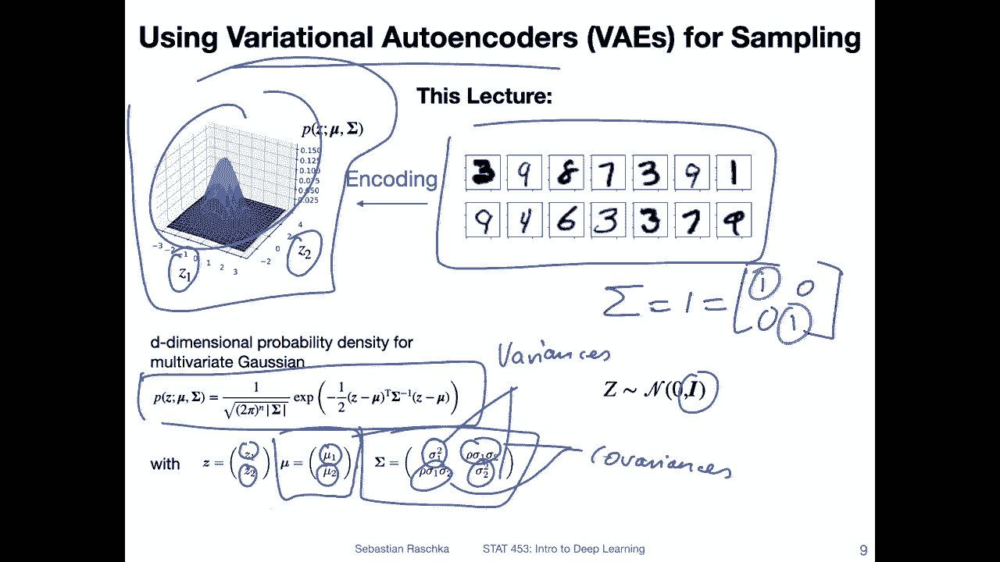
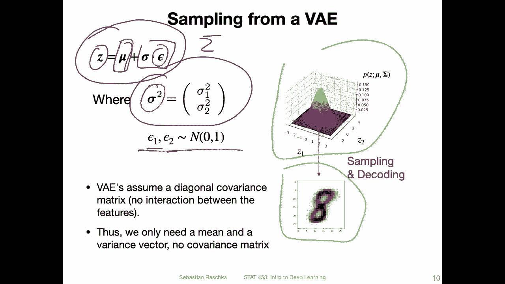
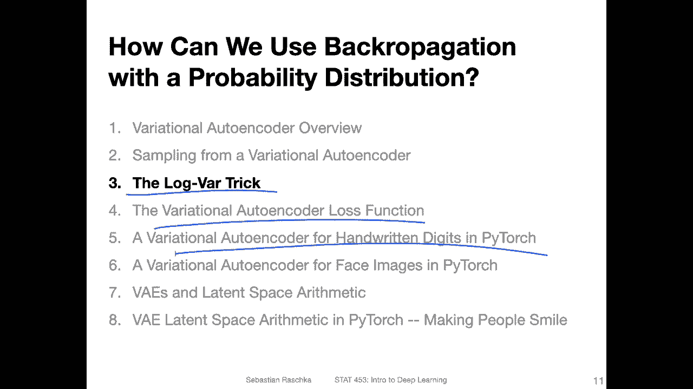
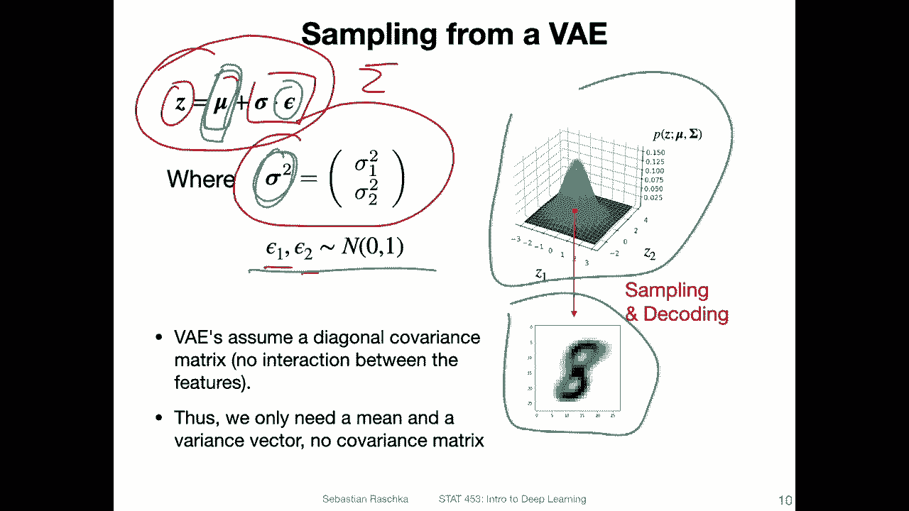
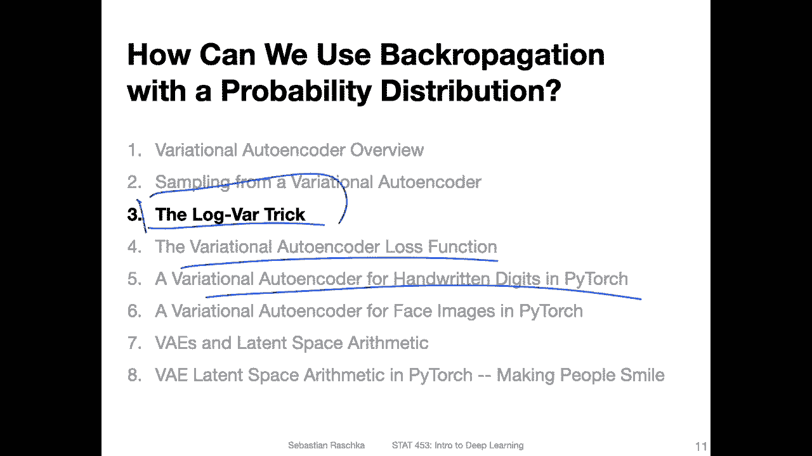

# 课程 P140：L17.2 - 从变分自动编码器采样 🎲



在本节课中，我们将要学习为什么变分自动编码器在生成新数据方面优于普通自动编码器。核心原因在于，变分自动编码器强制其潜在空间服从标准正态分布，这使得从中采样变得更容易，从而更利于数据生成。

## 普通自动编码器的采样问题

上一节我们介绍了普通自动编码器的基本结构。本节中我们来看看使用它进行采样时面临的挑战。

在之前的课程中，我们使用MNIST数据集，并通过编码器将其映射到一个二维潜在空间。选择二维空间主要是为了可视化，实际上潜在空间的维度可以是任意的。通常，潜在空间的维度小于输入维度，但更大的潜在空间能保留更多信息，有助于生成更好的重构图像。

在之前的代码示例中，我们曾从该二维空间中任意选取一个点（例如 `(-2.5, 2)`），并将其输入解码器，得到了一个手写数字图像。

然而，这个二维空间看起来连续且密集，主要是因为维度较低。如果潜在空间维度很高（例如100维），数据点之间会非常稀疏，空间将不再连续。此时，若从高维空间中任意采样一个点，解码器很可能无法生成一个看起来像有效输入数据的图像。

以下是使用普通自动编码器采样时的主要问题：



*   **分布形状不规则**：潜在空间的分布可能形状怪异，难以进行均衡采样。我们熟悉如何从高斯分布中采样，但对于任意的不规则分布，采样非常困难。
*   **分布不居中**：分布可能位于空间的任意位置，这进一步增加了采样的难度。
*   **分布不连续**：在低维空间中看似连续，但在高维空间中，数据点可能非常分散，导致分布不连续。

因此，普通自动编码器虽然擅长数据压缩，但在生成与训练数据相似的新数据方面表现不佳。

## 变分自动编码器的解决方案

现在，让我们考虑变分自动编码器。我们仍然使用MNIST数据集，但在训练变分自动编码器时，我们强制其潜在空间服从标准多元高斯分布。

这里我们以二维为例，其概率密度函数为：



$$
p(\mathbf{z}) = \mathcal{N}(\mathbf{z}; \boldsymbol{\mu}, \boldsymbol{\Sigma})
$$

其中，$\boldsymbol{\mu}$ 是均值向量，$\boldsymbol{\Sigma}$ 是协方差矩阵。在变分自动编码器中，我们通常假设潜在特征之间相互独立，即协方差矩阵 $\boldsymbol{\Sigma}$ 是一个对角矩阵。更进一步，我们通常将其约束为单位矩阵 $\mathbf{I}$，这意味着每个维度的方差为1，协方差为0。这就是标准多元高斯分布。

## 从分布中采样

一旦我们确定了这个分布，就可以从中进行采样。由于这是一个连续分布，我们可以预期，当我们从中采样时，解码器能够生成合理的输出，因为分布中没有“间隙”。



那么，如何从这个分布中采样呢？以下是采样一个新潜在向量 $\mathbf{z}$ 的方法：

```python
z = mu + sigma * epsilon
```

其中：
*   $\boldsymbol{\mu}$ 是均值向量。
*   $\boldsymbol{\sigma}$ 是标准差向量（由方差向量开方得到）。
*   $\boldsymbol{\epsilon}$ 是从标准正态分布 $\mathcal{N}(0, \mathbf{I})$ 中采样的随机噪声向量。

在实现中，我们通过神经网络学习并存储均值向量 $\boldsymbol{\mu}$ 和对数方差向量 $\log(\boldsymbol{\sigma}^2)$。在正向传播时，我们使用上述公式进行采样。这涉及到一个重要的技巧，即“重参数化技巧”，它允许我们通过随机节点进行反向传播。我们将在下一节详细介绍这个技巧。

## 总结与预告



本节课中我们一起学习了变分自动编码器在数据生成方面的优势。关键在于它通过约束潜在空间为标准正态分布，解决了普通自动编码器采样困难的问题，使得生成新数据成为可能。

下一节，我们将深入探讨实现采样所必需的**重参数化技巧**，之后会介绍变分自动编码器的损失函数。最后，我将通过PyTorch代码示例展示整个流程，届时所有这些概念将变得更加清晰。







请继续关注下一节关于重参数化技巧的讲解。