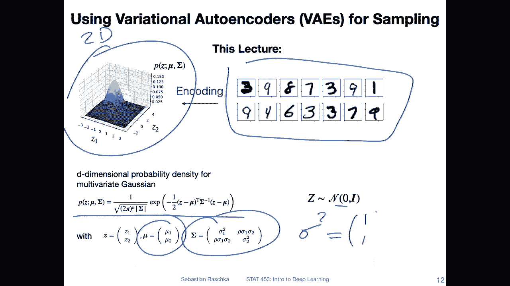
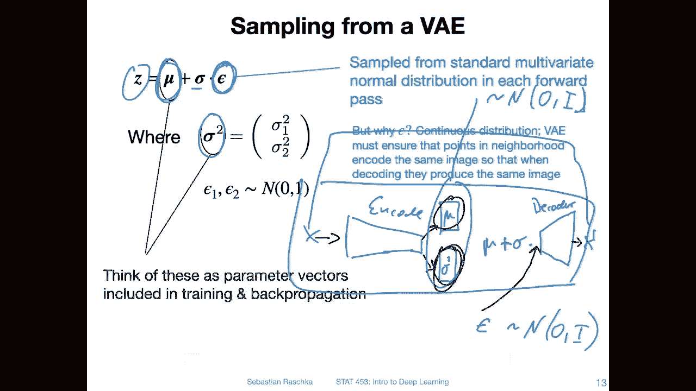
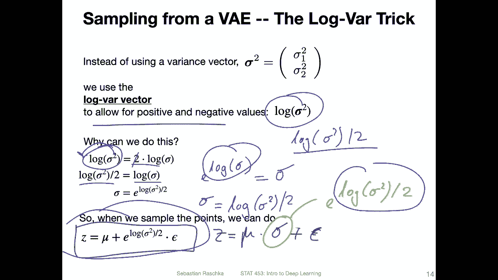
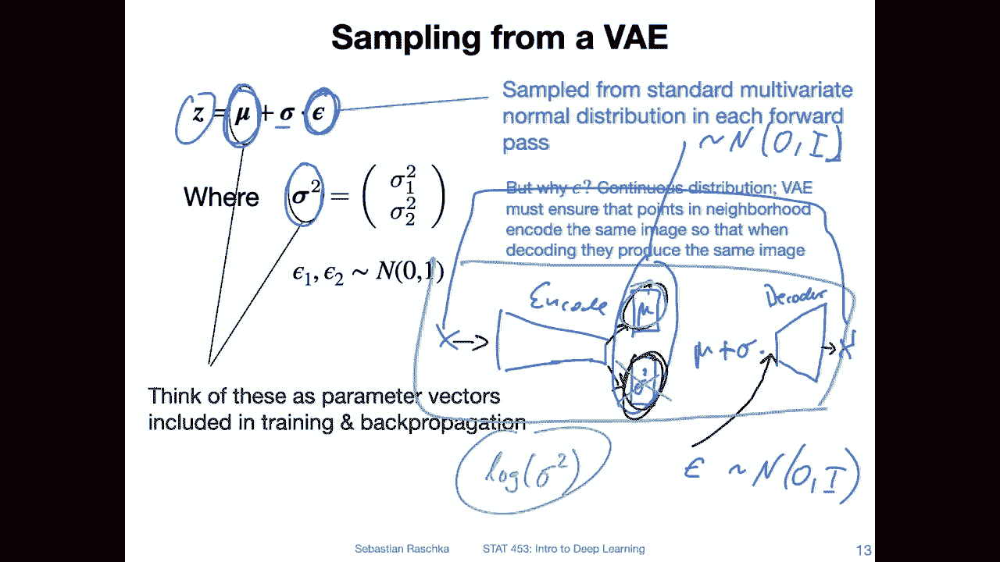

# 课程 P141：L17.3 - 对数方差技巧 📊

在本节课中，我们将要学习变分自编码器中的一个重要概念：**对数方差技巧**。我们将探讨为什么在训练过程中使用对数方差而非直接使用方差，以及这一技巧如何使反向传播更加稳定和高效。

---

## 回顾：变分自编码器的潜在空间

上一节我们介绍了变分自编码器的基本结构。为了确保行文流畅，我们先简要回顾一下关键点。

在变分自编码器中，编码器网络将输入数据映射到一个潜在空间。这个潜在空间的分布被设计为服从**标准多元高斯分布**。其概率密度函数由均值向量 **μ** 和协方差矩阵 **Σ** 定义。对于标准正态分布，我们有：

**μ = 0**，且 **Σ = I**（单位矩阵）。

这意味着每个维度都是独立的，且方差为1。

当我们从编码器得到一个数据点 **x** 时，编码器会输出两个向量：
*   均值向量 **μ**
*   方差向量 **σ²**

为了从这个分布中采样一个潜在向量 **z**，我们使用以下公式：

**z = μ + σ ⊙ ε**

其中 **ε** 是从标准正态分布 **N(0, I)** 中独立采样得到的随机向量，**⊙** 表示逐元素乘法。

这个采样得到的 **z** 随后被送入解码器，以重建输入数据 **x‘**。我们的目标是使重建结果 **x‘** 尽可能接近原始输入 **x**，同时确保潜在空间分布 **q(z|x)** 接近先验分布 **p(z)**（即标准正态分布）。

---

## 引入对数方差技巧

然而，在神经网络中直接使用方差向量 **σ²** 会带来一个问题。方差必须始终为正值，这可能会在反向传播过程中导致训练不稳定。

为了解决这个问题，我们引入了**对数方差技巧**。其核心思想是：让网络学习并输出**对数方差向量 log_var**，而不是方差向量本身。

以下是这么做的原因：
1.  **数值稳定性**：对数函数可以将一个正数（方差）映射到整个实数域（负无穷到正无穷）。这意味着网络层的输出 `log_var` 可以是任意实数值，训练起来更稳定。
2.  **计算便利**：通过指数运算，我们可以轻松地从 `log_var` 恢复出方差和标准差。

具体操作如下：
*   网络编码器部分输出两个向量：**μ** 和 **log_var**。
*   采样步骤的公式变为：

    **z = μ + exp(log_var / 2) ⊙ ε**

这里，`exp(log_var / 2)` 等价于标准差 **σ**。因为：
*   `log_var = log(σ²)`
*   `log_var / 2 = log(σ)`
*   `exp(log_var / 2) = σ`

因此，这个公式与原始的 **z = μ + σ ⊙ ε** 是完全等价的。

---

## 网络结构图示

让我们通过一个修改后的结构图来直观理解这个过程：

输入 **x** → 编码器网络 → 输出 **μ** 和 **log_var** → 采样 **z = μ + exp(log_var/2) * ε** → 解码器网络 → 输出重建数据 **x‘**。

在这个流程中，**μ** 和 **log_var** 是网络通过梯度下降学习得到的参数。**ε** 是从外部引入的随机噪声，用于提供随机性。整个采样操作（重参数化技巧）使得梯度可以穿过随机采样层，顺利地从解码器传回编码器。

---

## 总结与下节预告

本节课中，我们一起学习了**对数方差技巧**。我们了解到，通过让变分自编码器的编码器输出对数方差 `log_var`，而不是方差本身，可以提升模型训练的数值稳定性和效率。采样过程则通过公式 **z = μ + exp(log_var / 2) ⊙ ε** 来实现。

下一节，我们将探讨变分自编码器的**损失函数**，它由两部分组成：重建损失和KL散度损失。理解损失函数后，我们将结合本节的“对数方差技巧”，进入第一个代码示例，亲眼看看这些概念是如何在PyTorch中实现的。