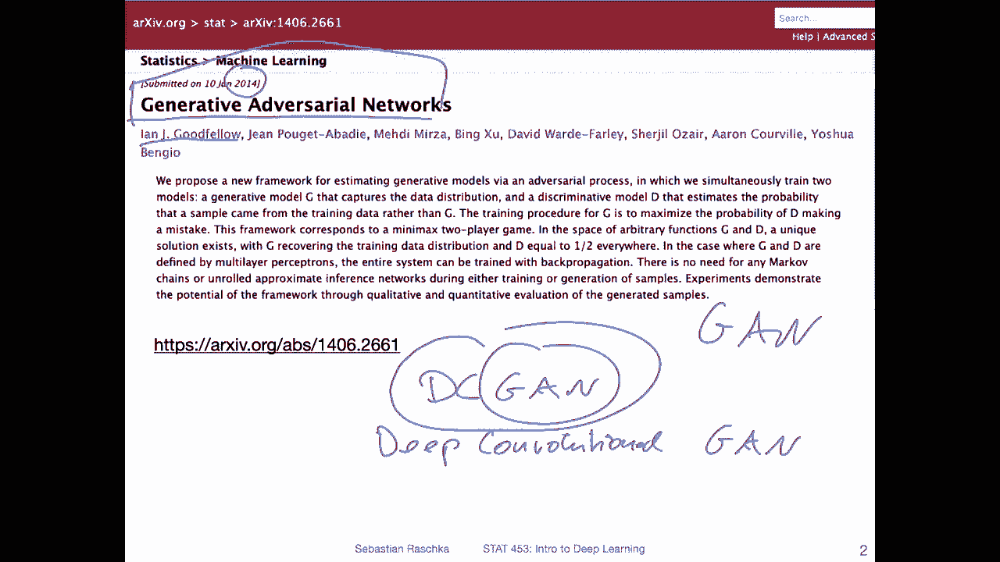
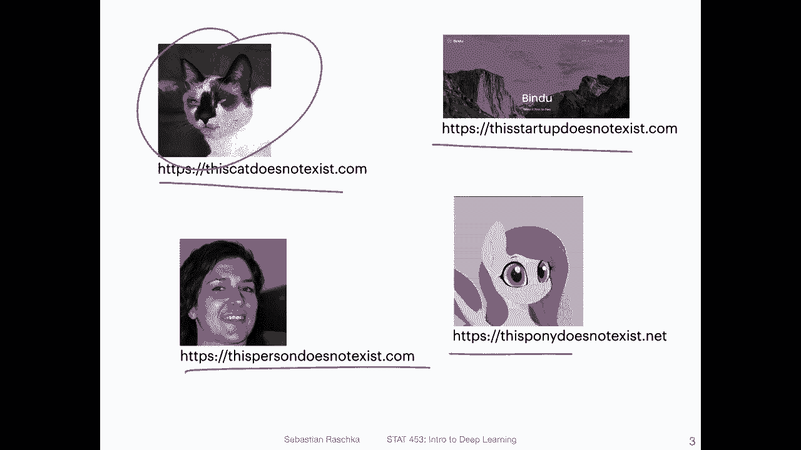
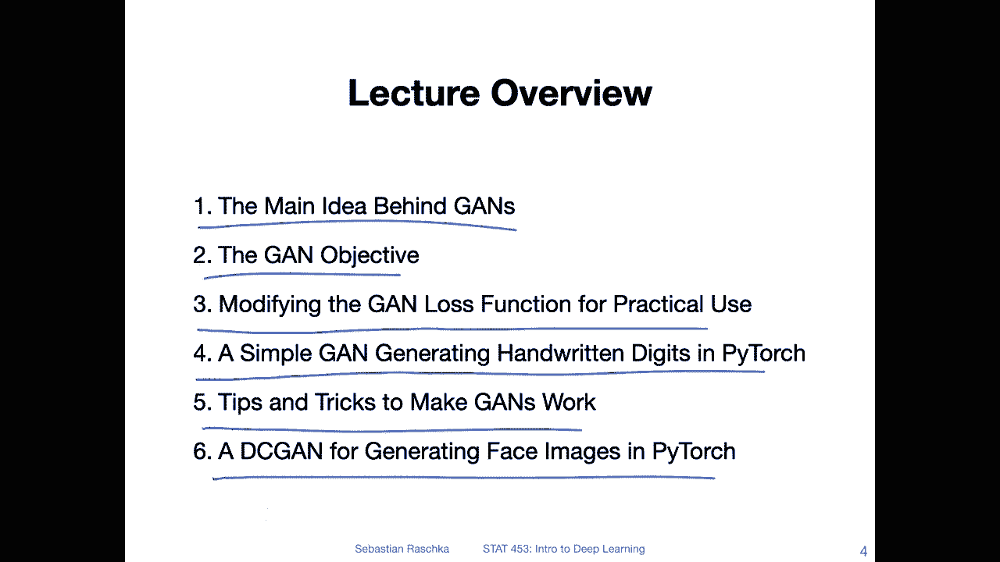

# 课程 P146：L18.0 - 生成对抗网络简介 🎭

在本节课中，我们将要学习生成对抗网络的基本概念、原理及其实现。生成对抗网络是深度学习领域中一种非常流行的模型，主要用于生成新的数据。尽管如今已有成百上千种不同的GAN变体，但我们将从最原始的GAN模型开始，逐步深入，并最终实现一个深度卷积生成对抗网络。此外，我们还将探讨训练GAN时的一些技巧与策略。

---

## 生成对抗网络概览 🧠

上一节我们介绍了本节课的主要内容，本节中我们来看看生成对抗网络的核心思想。生成对抗网络由Ian Goodfellow等人于2014年提出，并在2016年左右开始广泛流行。该模型包含两个神经网络：一个生成器和一个判别器，它们通过对抗过程共同学习。

以下是生成对抗网络的基本工作流程：

1.  **生成器**接收随机噪声作为输入，并尝试生成与真实数据相似的数据。
2.  **判别器**接收真实数据和生成器生成的数据作为输入，并尝试区分它们。
3.  两个网络在训练过程中相互竞争：生成器试图生成足以“欺骗”判别器的数据，而判别器则努力提升自己的鉴别能力。

## 目标函数与损失函数 📉

在了解了GAN的基本框架后，我们来看看其核心的优化目标。原始论文中提出的目标函数是一个极小极大博弈问题。

生成器 \( G \) 和判别器 \( D \) 的损失函数可以表示为：

\[
\min_G \max_D V(D, G) = \mathbb{E}_{x \sim p_{data}(x)}[\log D(x)] + \mathbb{E}_{z \sim p_z(z)}[\log(1 - D(G(z)))]
\]

其中：
*   \( x \) 代表真实数据。
*   \( z \) 代表输入生成器的随机噪声。
*   \( D(x) \) 是判别器认为 \( x \) 是真实数据的概率。
*   \( G(z) \) 是生成器根据噪声 \( z \) 生成的数据。

然而，在实际训练中，这个原始目标函数可能导致梯度消失问题。因此，一个更实用的改进是让生成器最大化 \( \log(D(G(z))) \)，而不是最小化 \( \log(1 - D(G(z))) \)。这为生成器在训练初期提供了更强的梯度信号。

## 训练全连接GAN：手写数字生成示例 ✍️

理论部分介绍完毕，现在让我们动手实践。我们将构建一个基于全连接层的基本GAN模型，用于生成MNIST手写数字。

以下是实现的关键步骤：

1.  **构建生成器**：一个将随机噪声映射为28x28像素图像的前馈神经网络。
2.  **构建判别器**：一个接收图像并输出其“真实性”概率的前馈神经网络。
3.  **交替训练**：在一个训练循环中，先更新判别器，再更新生成器。
4.  **监控损失**：观察生成器和判别器的损失变化，确保训练过程稳定。

通过这个简单的例子，你可以直观地看到GAN如何从随机噪声开始，逐渐学会生成逼真的手写数字图像。

## 训练GAN的技巧与策略 🛠️

正如之前提到的，训练GAN可能非常具有挑战性。两个网络需要精细地平衡，否则训练很容易失败。以下是一些被证明有效的实用技巧：

*   **使用卷积层**：对于图像数据，使用卷积神经网络作为生成器和判别器的骨干，这通常比全连接网络效果更好。
*   **批量归一化**：在生成器和判别器中使用批量归一化层，有助于稳定训练。
*   **使用LeakyReLU激活函数**：在判别器中用LeakyReLU替代普通的ReLU，可以缓解梯度稀疏问题。
*   **标签平滑**：对真实数据的标签使用略小于1的值（如0.9），可以防止判别器变得过于自信。
*   **避免在生成器中使用池化层**：使用步幅卷积进行上采样和下采样，而不是池化层。
*   **使用Adam优化器**：Adam优化器通常比SGD更适合GAN的训练。

即使遵循这些技巧，训练GAN仍然需要耐心和大量的超参数调试。

## 实现DCGAN：生成人脸图像 👤

掌握了基本技巧后，我们将应用它们来构建一个更强大的模型——深度卷积生成对抗网络，用于生成逼真的人脸图像。DCGAN是GAN发展史上的一个里程碑，它明确了在GAN架构中使用卷积网络的最佳实践。

以下是DCGAN架构的主要特点：

1.  **判别器**使用带步幅的卷积层来逐步减小空间维度并增加通道数。
2.  **生成器**使用转置卷积层将随机噪声向量“上采样”为完整图像。
3.  去除全连接层，几乎全部使用卷积层。
4.  在生成器和判别器中都使用批量归一化。

训练DCGAN生成高质量人脸图像需要更长时间、更多数据和更仔细的调参，但它展示了GAN在复杂数据生成任务上的巨大潜力。

---

## 总结 📚

本节课中，我们一起学习了生成对抗网络的核心概念。我们从GAN的基本思想出发，理解了生成器与判别器之间的对抗训练过程。我们分析了原始的目标函数及其在实际训练中的改进。通过手写数字生成的例子，我们实践了一个简单的全连接GAN。接着，我们探讨了训练GAN时常见的问题与一系列实用的训练技巧。最后，我们介绍了DCGAN架构，并将其应用于生成人脸图像的任务。

生成对抗网络是一个强大而活跃的研究领域，虽然训练过程可能充满挑战，但它为数据生成、图像编辑、风格迁移等任务开辟了广阔的可能性。希望本教程为你开启了探索GAN世界的大门。