# 课程 P147：L18.1 - GAN 背后的主要思想 🎨

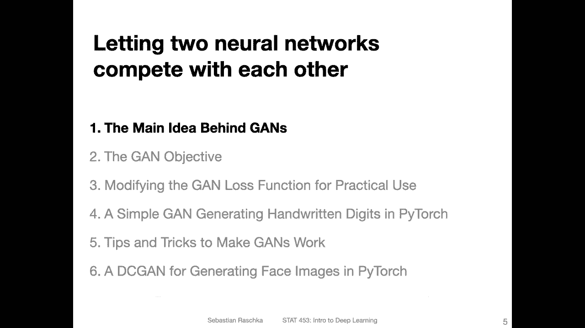

在本节课中，我们将要学习生成对抗网络背后的核心思想。GAN 通过让两个神经网络相互竞争来生成新的数据。

## 概述

生成对抗网络之所以得名，是因为我们确实用它来生成新数据。它并非传统统计学意义上对特征和标签的联合分布或数据生成分布进行显式建模，而更侧重于生成新数据这一事实，尽管它也在隐式地学习一个分布。

传统上，GAN 主要用于生成新图像，这仍然是其最大的应用领域。当然，这个概念更广泛，也可以应用于其他类型的数据，例如文本或分子结构图。不过，对于文本数据，循环神经网络或 Transformer 等自回归模型可能更合适。

## GAN 的核心机制

上一节我们介绍了 GAN 的基本目标，本节中我们来看看它是如何运作的。

GAN 在幕后隐式地学习训练集的分布，然后模仿这个分布，使我们能够生成本质上来自该分布的新数据，即创造出前所未见的新图像或新数据。这与变分自编码器的解码器部分功能相似：当我们采样一个随机噪声向量并通过解码器时，它也在生成新数据。GAN 的生成器同样可以从噪声向量生成新数据，但其工作原理有所不同。

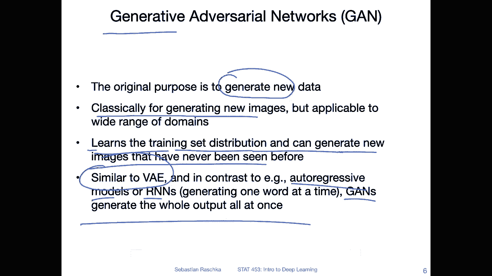

在 GAN 的框架中，我们没有显式地对分布建模，而是设置了一个生成器和一个判别器。判别器就像一个裁判，它隐式地“迫使”生成器去建模训练集的分布。这一点在接下来的图示中会更加清晰。

与变分自编码器类似，但 GAN 是一次性生成整个输出，这不同于自回归模型或循环神经网络等逐词/逐字符生成的模型。

## GAN 的结构与对抗过程

以下是 GAN 结构的一个示意图（尽管图中显示的是深度卷积 GAN，但基本概念同样适用于常规 GAN）。核心概念不在于这些卷积层或全连接层，而在于判别器和生成器这两部分。

我们有两个主要部分：
1.  **生成器**：接收一个噪声向量作为输入，经过一些神经网络层，最终生成一张图像。这类似于变分自编码器中解码器的工作。
2.  **判别器**：它的工作是判断一张图像是真实的还是生成的。它接收两种输入：来自训练集的真实图像和来自生成器的生成图像。

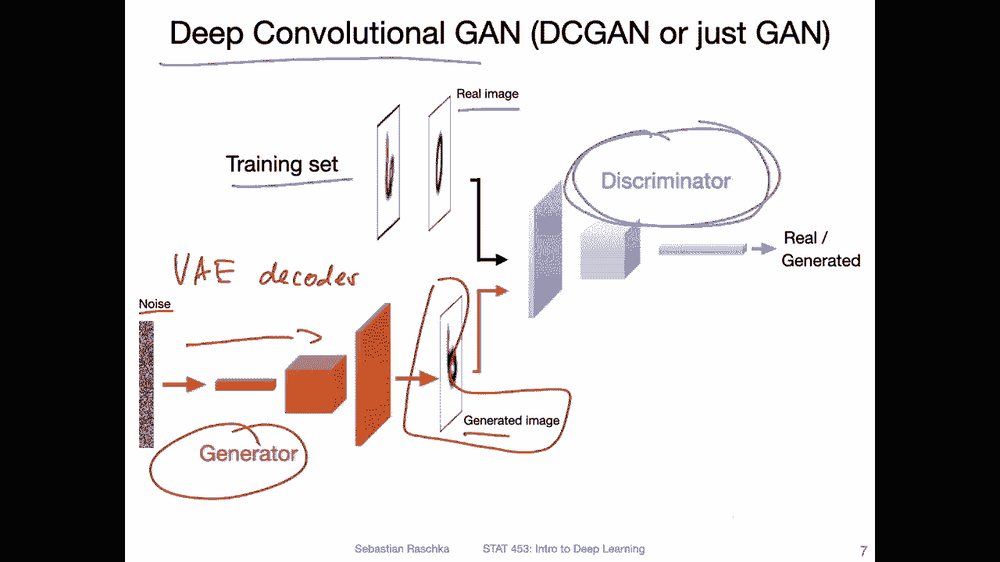

接下来，我们将分步骤详细讲解训练过程。

### 步骤一：训练判别器

首先，我们聚焦于训练判别器。这本质上是一个二分类任务。

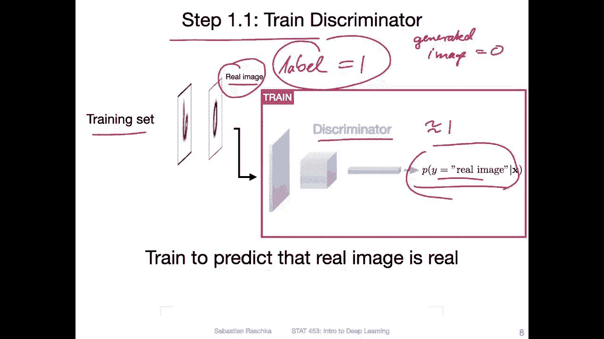

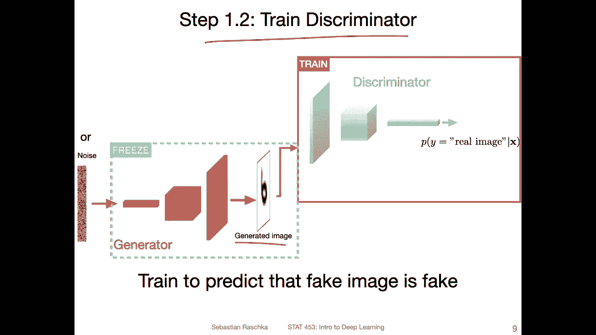

**步骤 1.1：用真实图像训练判别器**
我们取用训练集中的真实图像，并为其赋予标签“1”（代表真实图像）。我们训练判别器，使其对于真实图像，输出概率尽可能接近 1。这相当于最大化该样本的预测概率。

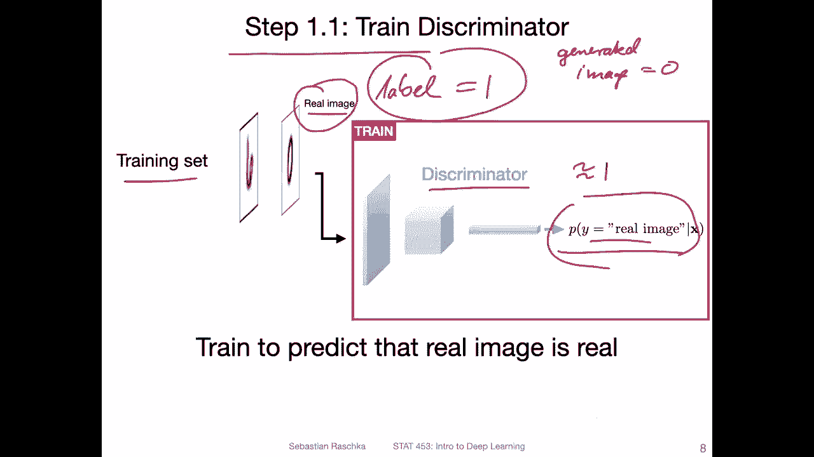

**步骤 1.2：用生成图像训练判别器**
接着，我们使用生成器产生的图像（由随机噪声向量，例如来自标准正态分布，通过生成器得到）来训练判别器。我们为这些生成图像赋予标签“0”（代表生成图像）。我们训练判别器，使其对于生成图像，输出概率尽可能接近 0。

**请注意**：在此步骤中，我们只更新判别器的参数，生成器的参数保持不变。

### 步骤二：训练生成器

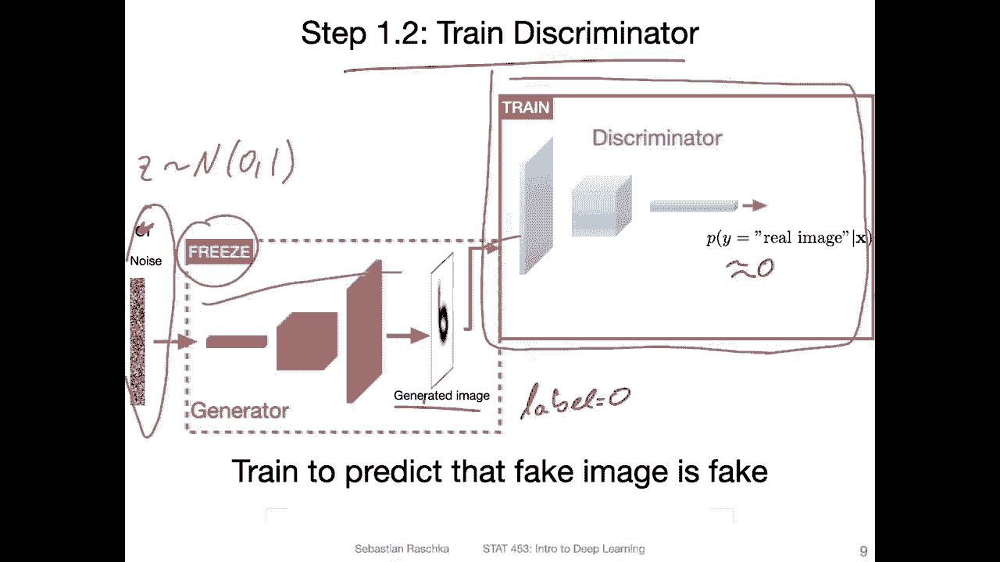

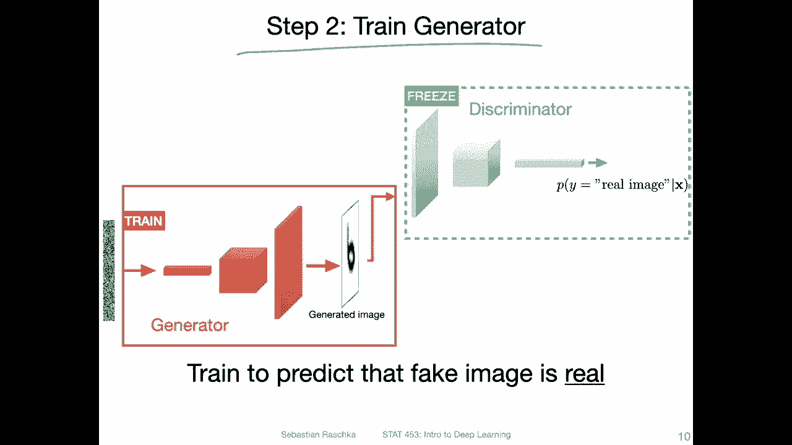

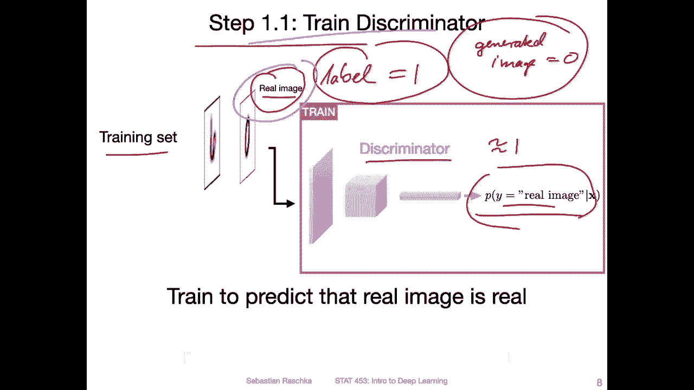

在训练生成器时，我们的目标与之前相反：我们希望生成器能“欺骗”判别器。

我们固定判别器的参数，只更新生成器的参数。此时，我们**希望判别器对生成器新产生的图像做出错误判断**，即输出一个高的概率值（接近1），认为它是真实图像。因此，我们训练生成器以最大化判别器将生成图像误判为真实图像的概率。

这体现了“对抗”的含义：判别器努力更好地区分真假，而生成器则努力生成更逼真的图像来欺骗判别器。

### 对抗循环

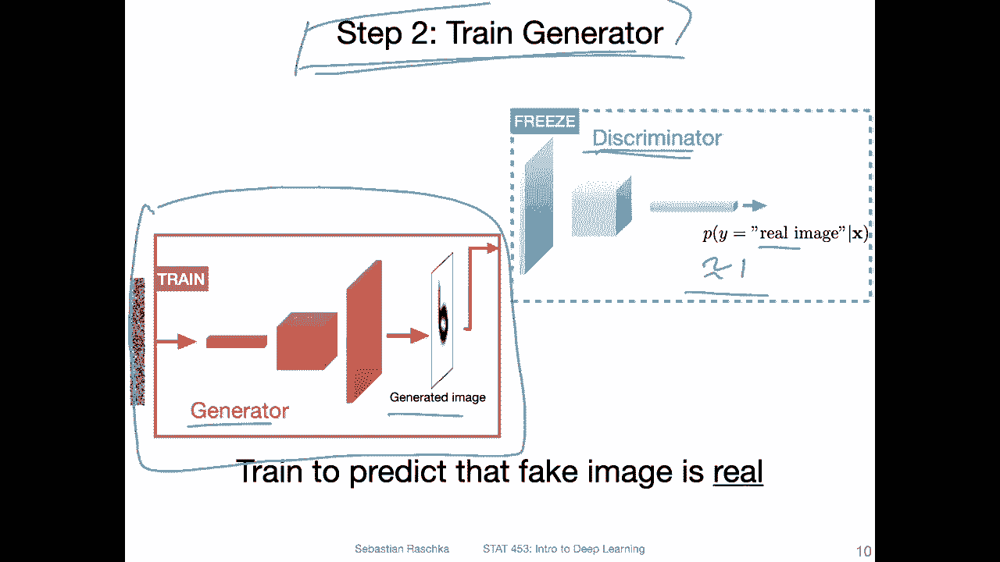

完成步骤二后，我们会回到步骤一，再次训练判别器以更好地识别真假图像，然后再训练生成器去欺骗更新后的判别器。如此循环往复，形成一个对抗游戏。

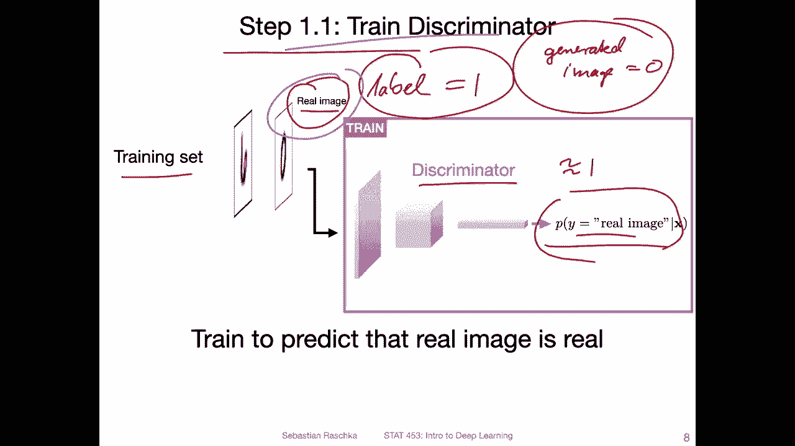

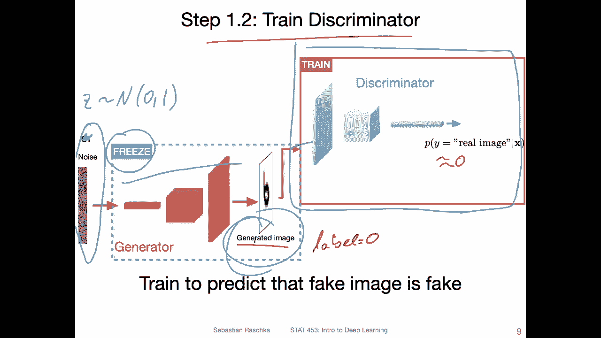

实际上，通过这个持续的对抗过程，判别器学会了更好地区分真实图像和生成图像，而生成器则学会了生成更逼真、更接近训练集分布的图像来迷惑判别器。如果训练足够充分，最终生成器将能够生成与训练集图像极其相似、甚至以假乱真的新图像。

正如你在先前的示例中可能看到的，许多逼真的人脸图像正是由 GAN 通过这种对抗游戏生成的。

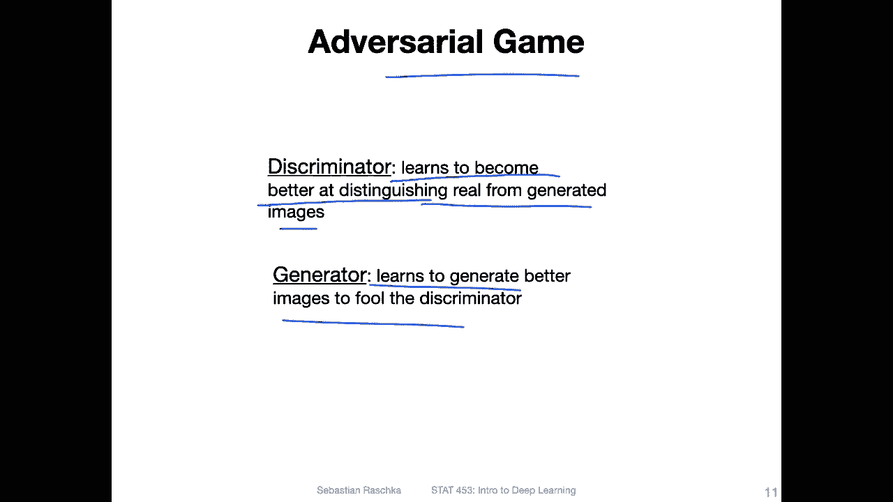

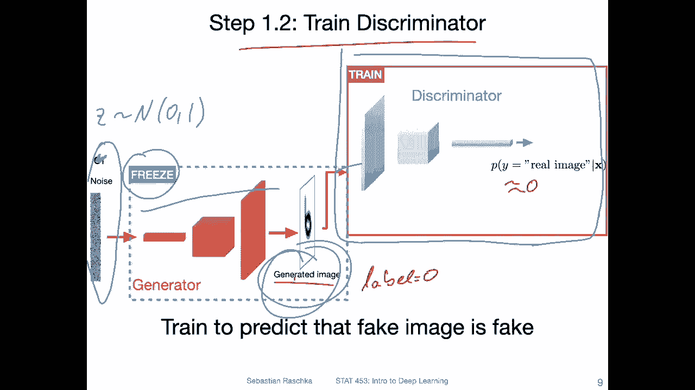

## 总结

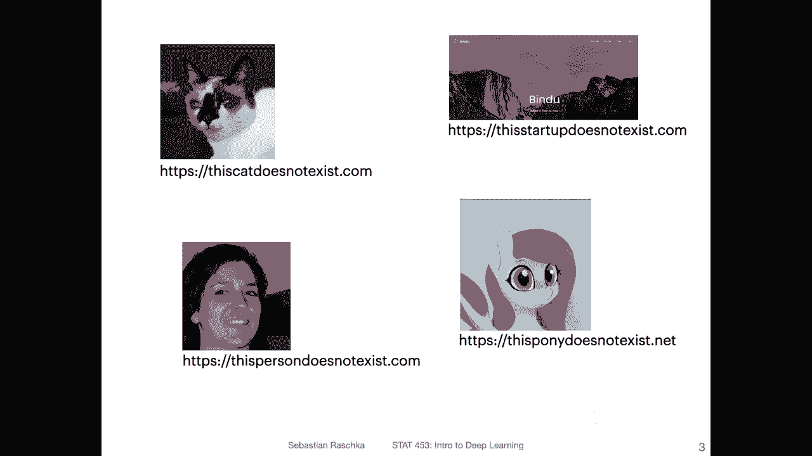

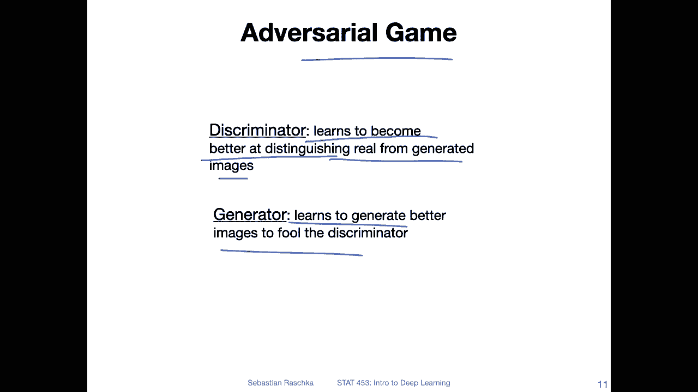

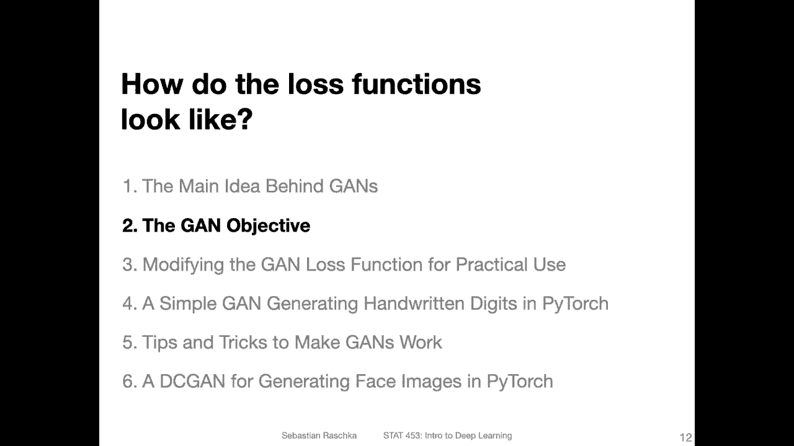

本节课中我们一起学习了生成对抗网络的核心思想。GAN 通过设置生成器和判别器这两个相互对抗的神经网络，在动态竞争中使生成器学会模仿真实数据分布，从而创造出高质量的新数据。判别器的任务是准确分类，而生成器的任务是成功欺骗，这种对抗机制是 GAN 成功的关键。在下一讲中，我们将深入探讨 GAN 损失函数的具体形式。