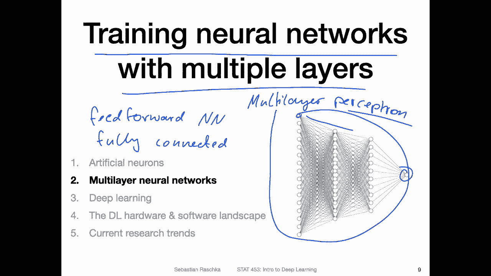
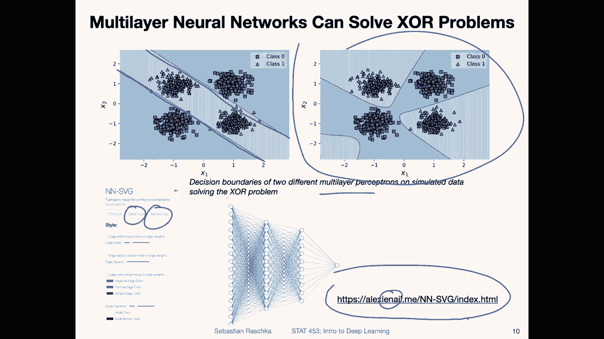
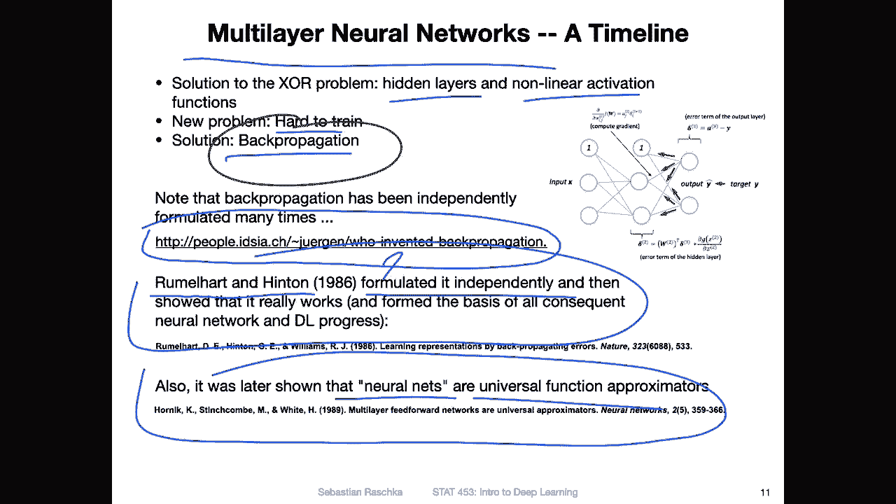
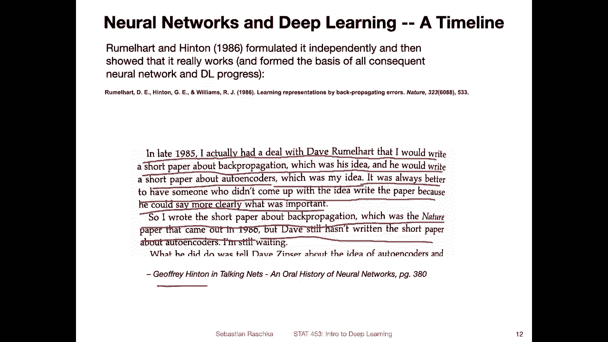
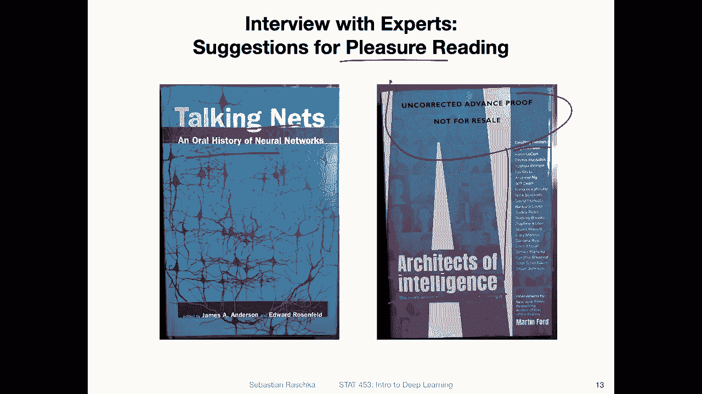
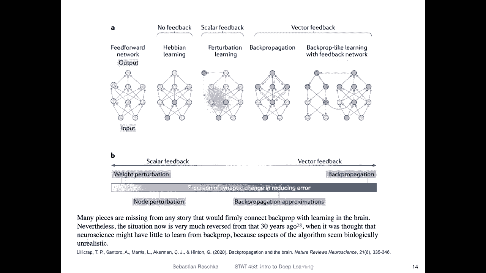
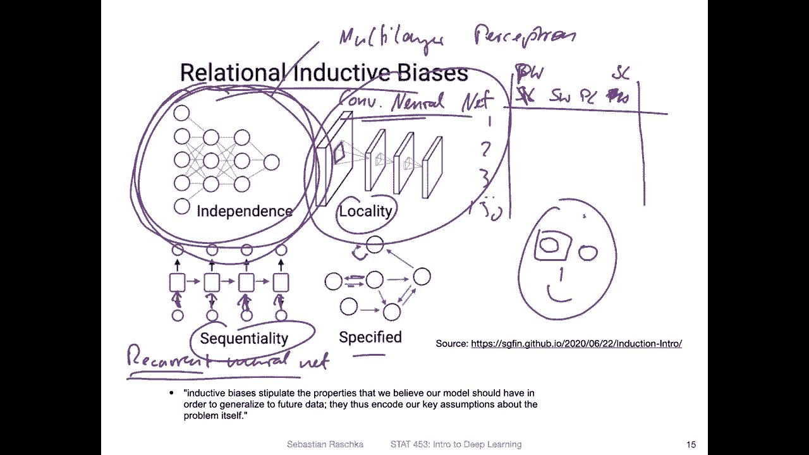
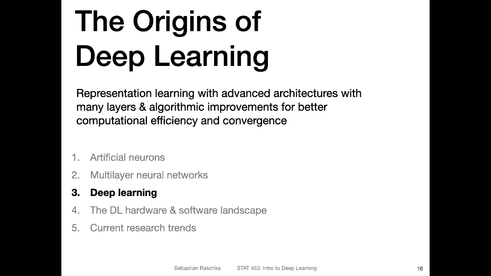

# 课程 P15：L2.2 - 多层网络 🧠

在本节课中，我们将学习多层神经网络，也称为多层感知机。我们将了解其基本架构、如何解决异或问题，以及训练这类网络的关键算法——反向传播。此外，我们还将简要探讨不同神经网络架构背后的设计思想。

---

## 多层感知机架构

现在我们来讨论如何训练多层神经网络。

右侧展示的是一个所谓的**多层感知机**。它有时也被称为**前馈神经网络**，并且是一个**全连接**的神经网络。这里有两个特性描述了其数据流向：数据仅向前单向流动，并且网络是全连接的。这意味着这里的每个单元都与其他单元完全连接。

请注意“感知机”这个词，尽管这类网络与原始的感知机联系并不紧密，因为这里还有另一个关键点未在图中显示：我们使用了**非线性激活函数**。关于这一点，我们将在后续课程中详细讨论，此处无需记忆。

这种架构使我们能够解决异或问题。即使这里只有一个输出节点，它之所以能解决异或问题，原因在于它拥有**多个层**以及**非线性激活函数**。这两个方面使其具备了解决异或问题的能力。

这里我生成了一些玩具数据，并应用了一个真实的多层感知机进行训练。我训练了两个隐藏单元数量略有不同的多层感知机，可以看到，两种情况下神经网络都为这个异或问题找到了解决方案。

在左侧，网络通过学习两条平行的二元决策边界来解决异或问题。我发现这非常有趣，它看起来非常有序且高效。网络解决异或问题的另一种方式如右侧所示。我只是稍微改变了隐藏单元的数量，可以看到解决方案截然不同。当然，使用多层神经网络解决这个问题有无限多种方案。我们将在后续课程中更详细地讨论这一点。

如果你有兴趣为自己的报告或提案绘制神经网络架构图，这里有一个由 Alex（姓氏不详）开发的非常棒的工具。它可以让你快速绘制简单的神经网络图，也包括 LeNet 风格和 AlexNet 风格的卷积网络图，这些我们也会在后续课程中涉及。

---

## 训练挑战与反向传播

关于多层神经网络，还有更多内容需要了解。

现在，通过隐藏层和非线性激活函数，我们有了解决异或问题的方法。然而，当这种网络架构被提出时，也带来了一个新问题：**训练困难**。最初并没有针对它的训练算法。

后来提出的一个解决方案是**反向传播**。它被独立提出了多次。实际上，有一篇由 Yo Schmtubba 撰写的文章讨论了谁最先发明了它。这里引用了不同的文献资源，你可能会觉得有趣。这是一篇博客文章，列出了反向传播或其相关概念的各种发明者或方式。

然而，真正使其流行并证明其能有效训练多层感知机的论文，是 Ruelhart 和 Hinton 在 1986 年发表的。这是一个独立的表述，意味着他们当时并未知晓之前的文献。正是这篇论文真正使其流行起来，因为他们确实证明了这种方法在实践中是有效的。

后来还证明，像这里展示的、具有一个隐藏层的多层感知机，如果隐藏层规模足够大，就能够近似任意函数。也就是说，如果隐藏层规模相对非常大，它可以以一定的精度近似任何函数。

当然，能够近似任意函数并不意味着容易做到。在某些情况下，训练网络仍然很困难。我们稍后将学习其他更适合特定类型问题的架构。但这仍然是一个重大突破，因为现在有了一个可以高效训练多层神经网络的算法。

剧透一下：这个算法至今仍在常用架构中使用。它仍然是我们训练神经网络最高效、最流行的算法，经受住了时间的考验。

---

## 关于反向传播的趣闻

这里有一个关于 Ruelhart 和 Hinton 反向传播算法的趣闻。我是在一本访谈录中读到 Geoff Hinton 谈论他们是如何提出这个算法的。

他说，在 1985 年底，他和 Dave Ruelhart 实际上有一个约定：他会写一篇关于反向传播的短文（这是 Dave 的想法），而 Dave 则会写一篇关于自编码器的短文（这是 Geoff 的想法）。让没有想出这个想法的人来写论文总是更好，因为他能更清楚地说明什么是重要的。于是，Geoff 写了一篇关于反向传播的短文，也就是 1986 年发表在《自然》杂志上的那篇论文。而 Dave 至今还没有写那篇关于自编码器的短文，Geoff 仍在等待。

这段内容来自一本名为《Talking Nets》的书，虽然有点旧，但如果你感兴趣，仍然很有趣。它是一本通过采访上世纪从事神经网络研究的人员来概述神经网络口述历史的书。还有另一本更有趣的书叫《Architects of Intelligence》，大概是 2018 年的，我去年读过，也非常有趣。里面有很多采访，包括 Geoff Hinton 和许多其他著名的深度学习研究者。这是一本非常有趣的读物，特别是他们让每个人都预测人工智能何时能被发明出来，但并没有明确的共识。有些人说上节课提到的通用人工智能永远不会被发明，有些人说需要 100 年等等，读起来确实很有意思。

---

## 其他学习算法与架构归纳偏置

反向传播并不是参数化神经网络（如多层感知机）的唯一算法。

还有其他类型的学习算法。这里引用了一篇由 Lily Cr、Sanenttorro、Mirrors、Akaman 和 Hinton 合著的论文，他们讨论了反向传播与大脑，基本上探讨了人类大脑的学习算法与反向传播可能有多相似。当然，我们目前还不知道答案。我们知道大脑可能并不使用我们训练神经网络时所用的反向传播，但它可能使用某种与反向传播有些相似的东西。这里我不想深入讨论神经科学以及它与人类大脑工作方式的相似性，但我觉得有趣的是，这里简要概述了我们可以用于训练神经网络的不同类型的学习算法。

例如，有**赫布学习**。假设你对更新这里的这个连接感兴趣，赫布学习不涉及反馈。这里的“反馈”指的是，如果你做了一个预测然后查看误差，你通常会更新网络以最小化误差。但如果没有反馈，它并不是真正在最小化误差。在赫布学习中，连接会因其被用于预测的次数越多而变得越强。这并不一定能改善误差。你可以想象一下，比如你在打网球，做了一个错误的动作，但没有人教你那是错的，而你却一遍又一遍地重复这个错误动作。如果你反复重复网球中的错误动作，却没有人教你这是错的，以后要改掉它会更难，但这并不意味着你的网球技术会变好。

另一种类型的学习是**扰动学习**。你对权重做一个扰动，看看是否变得更好，如果更好就保留，否则就丢弃。这种方法效率也不高，实际上非常慢。

反向传播实际上非常高效，也非常擅长最小化误差。还有另一种类型的学习算法，它与反向传播相似，但不是反向传播误差，而是涉及第二个网络。但根据那篇论文，他们也承认反向传播是目前最小化误差最高效的算法。尽管这可能不是人类大脑使用的方式，但在实践中，当我们开发计算机和预测算法时，我们关心的是低误差和良好的预测等，这就是为什么我们仍然使用反向传播，因为我们还没有找到比它更好的方法。

当然，在本课程中我们只是简要概述。当我们讨论神经网络时，我们将专注于反向传播。

这里有一张很好的图，是我上周末从一篇讨论关系归纳偏置和其他类型偏置的论文中看到的。我喜欢这张图，因为它大致勾勒出了常用的不同类型神经网络架构。

我们有**多层神经网络**或**多层感知机**，我在本视频中简要介绍过。这里我们假设数据列是独立的。因此，这是一个可以用于表格数据集的网络，我们在前一周讨论过。例如，回想一下你的鸢尾花数据集，你有最多 150 朵鸢尾花，然后有萼片长度、萼片宽度、花瓣长度和花瓣宽度，以及一个类别标签。这可以作为多层感知机的输入，而这些列的顺序并不重要。当然，一旦你训练了网络，顺序就重要了，因为它是基于这个表格训练的。但在训练之前，比如萼片长度在这里还是在那里，实际上没有区别。即使列的顺序不同，你也可以学习到相同的网络。因此，对于这些特征之间的依赖关系没有假设。

相比之下，所谓的**卷积网络**（我将在下一个视频中介绍）有一个假设是**局部性**。还有另一个假设是**等变性**，但我们现在关注局部性。它基本上假设存在某种结构。这通常用于图像分析，因为你可以认为相邻像素是相互关联的。例如，如果你有一张人物的图像，比如两只眼睛、鼻子、嘴巴，这些像素显然是相关的，因为它们都包含了眼睛。因此，打乱这些像素，把一个像素放到这里，就没有意义了。这样，就有一种局部性假设。因此，在关系归纳偏置方面，你可以认为，当你使用某种架构时，你对数据做出了某种假设。

还有一种叫做**循环神经网络**。这个假设输入是**顺序相关**的。因此存在顺序关系、序列关系。因此，循环神经网络对文本很有用，因为文本中的单词有特定的顺序。打乱句子中的单词是没有意义的，因为那样句子就不再具有相同的意义，就像打乱图像中的像素会失去图像之间的关系一样。

多层感知机没有这样的假设。因此，从这个意义上说，它非常强大，你可以学习很多东西。简单提一下，它可以被视为一个通用函数逼近器。然而，当然，如果你没有任何先验假设，学习也会更具挑战性。因此，利用诸如局部性或顺序性这样的先验假设实际上可以使学习更容易。这也是深度学习背后的关键思想之一。在下一个视频中，我将讨论深度学习，以及它是如何从简单的多层网络演变而来的。

最后，这里还有最后一种架构，叫做“指定式”。当然，这不是一种特定的神经网络架构。这里指的是有人手动编码事物之间的关系。我认为这不容易实现，因为你必须手动编码，这非常繁琐。因此，像这样的东西目前在实践中并不常用。实际上，在深度学习中，我们通常对图像使用卷积网络，对文本使用循环神经网络，对表格数据使用多层感知机。

---

## 总结

本节课中，我们一起学习了多层神经网络（多层感知机）的基本概念。我们了解到，通过引入隐藏层和非线性激活函数，这种网络能够解决像异或这样的非线性问题。我们探讨了训练这类网络的核心算法——反向传播，它高效且至今仍是主流方法。我们还简要了解了其他学习算法，并认识到不同的神经网络架构（如多层感知机、卷积网络、循环神经网络）背后对应着不同的数据关系假设（归纳偏置），选择合适的架构可以更有效地解决特定类型的问题。下一讲，我们将简要探讨深度学习的起源及其如何从多层网络发展而来。