# 课程 P153：L19.0 - 用于序列到序列建模的 RNN 和转换器 🧠 📚

在本节课中，我们将学习如何使用循环神经网络和转换器进行序列生成。课程内容为可选，与任何测验或评分无关，你可以根据自己的兴趣和时间安排学习。

学期过得比想象中快得多，我们已经来到了最后一讲。我知道大家正专注于课程项目，我也非常期待观看你们本周和下周的项目展示并阅读报告。

本节课的主题是用于序列生成的循环神经网络和转换器。我们之前介绍过用于分类的循环神经网络，现在我们将重点学习如何用它们生成新数据。接着，我们会引入注意力机制来改进循环神经网络的序列生成过程。最后，我们将抛开循环神经网络，深入探讨构成流行转换器网络基础的注意力机制本身。

## 📋 课程大纲

以下是今天课程涵盖的六个主要主题：

首先，我们将从循环神经网络序列生成的一般性讨论开始。在早期的课程中，我们讨论了用于分类的循环神经网络。现在我们将学习它们同样可以用于生成序列。

具体来说，我们将了解所谓的字符级循环神经网络。字符级循环神经网络是一种一次输入一个字符（例如字母表中的字母）的循环神经网络，并可以据此生成新的文本。

接着，我们将学习一个称为“注意力”的概念。这个概念最初是为循环神经网络提出的。在每个时间步，循环神经网络可以关注序列的特定部分，这对于处理长序列特别有用。

然后，我们将学习一篇名为“注意力就是你所需要的一切”的论文所提出的概念。这是关于仅使用注意力或自注意力机制，而不使用循环神经网络。研究表明，仅使用注意力机制就能获得非常好的性能，实际上并不需要循环神经网络。这催生了我们将要讨论的所谓转换器模型。

最后，我将展示一个代码示例，说明如何在 PyTorch 中使用转换器。

好的，以上就是我们的六个主要主题。让我们从下一个视频开始，首先讨论使用循环神经网络进行序列生成。

---

## 1. 🌀 使用循环神经网络进行序列生成

上一节我们概述了课程内容。本节中，我们来看看如何使用循环神经网络进行序列生成。

我们之前已经学习过循环神经网络在分类任务中的应用。现在，我们将焦点转向一个新的能力：生成全新的序列数据。这开启了诸如文本生成、音乐创作等可能性。

### 字符级循环神经网络

字符级循环神经网络是序列生成的一个典型例子。它的工作原理如下：

*   **输入**：模型一次接收一个字符作为输入（例如，字母、空格、标点）。
*   **处理**：循环神经网络根据当前输入和其内部隐藏状态进行处理。
*   **输出**：在每一步，模型会输出一个对下一个可能字符的预测（一个概率分布）。
*   **生成**：要生成文本，我们可以从某个起始字符（或序列）开始，将模型的预测输出作为下一个输入，如此循环往复，从而生成任意长度的字符序列。

通过在海量文本数据上训练，这种模型可以学习到语言的统计规律和风格，从而生成连贯且风格类似的新文本。

---

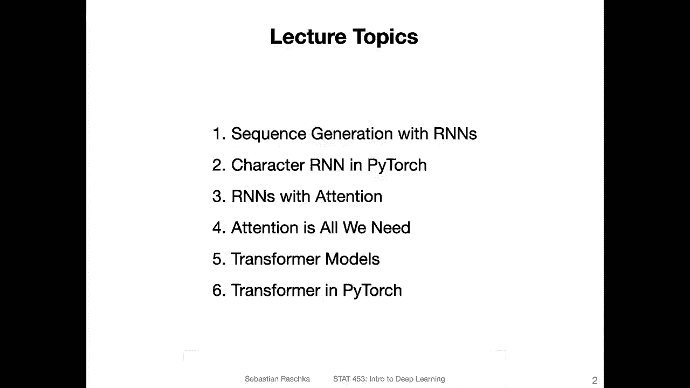


## 2. 👁️ 为循环神经网络引入注意力机制

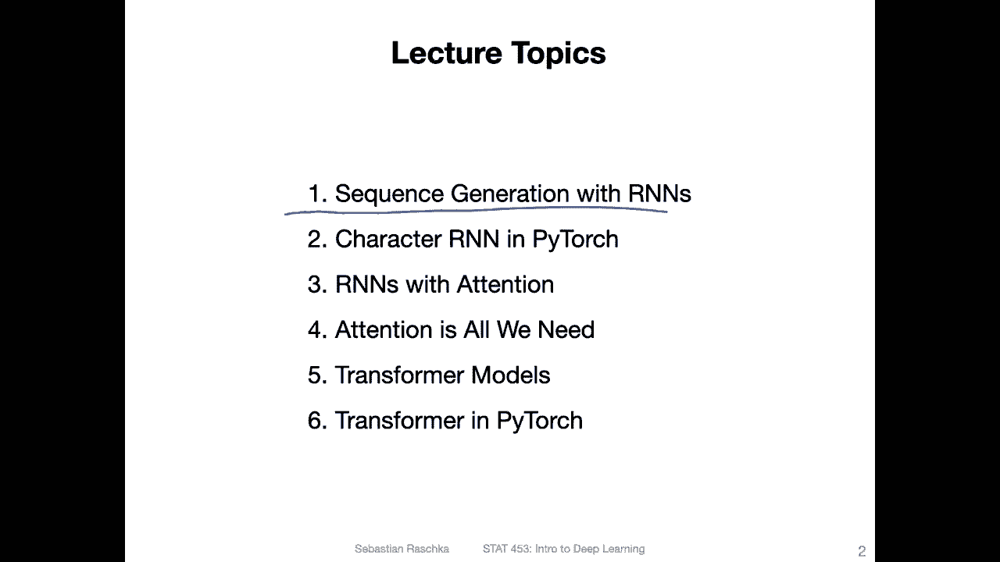

在掌握了基础的序列生成后，我们面临一个新的挑战：如何处理非常长的序列？传统的循环神经网络在记忆和关联远距离信息方面存在困难。

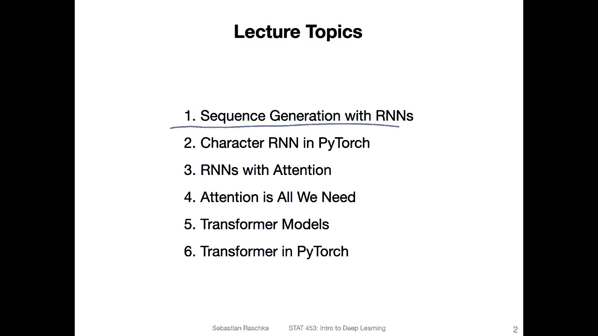

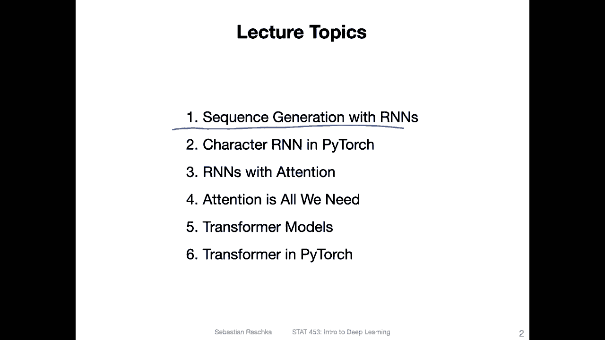

为了解决这个问题，研究者提出了**注意力机制**。注意力机制允许模型在生成序列的每一个时间步，动态地“回顾”并重点关注输入序列中最相关的部分，而不是仅仅依赖最后一个隐藏状态。

其核心思想可以概括为：模型会计算一组**注意力权重**，这些权重决定了在生成当前输出时，应该对输入序列的每个部分赋予多少“注意力”。公式可以简化为：

**注意力输出 = Σ (注意力权重_i * 值_i)**

其中，`值`通常来自输入序列的编码表示。这使得模型能够更有效地捕捉长距离依赖关系，显著提升了在机器翻译、文本摘要等任务上的性能。

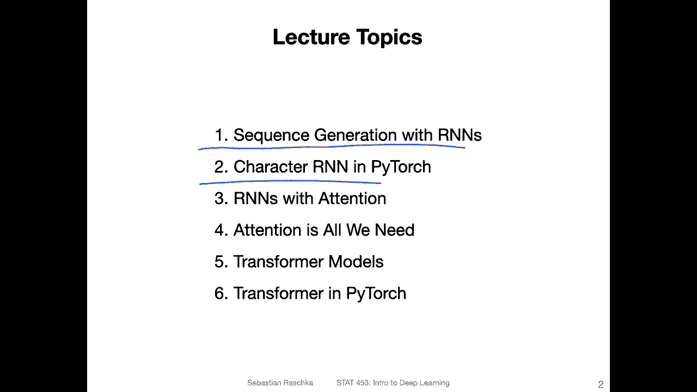

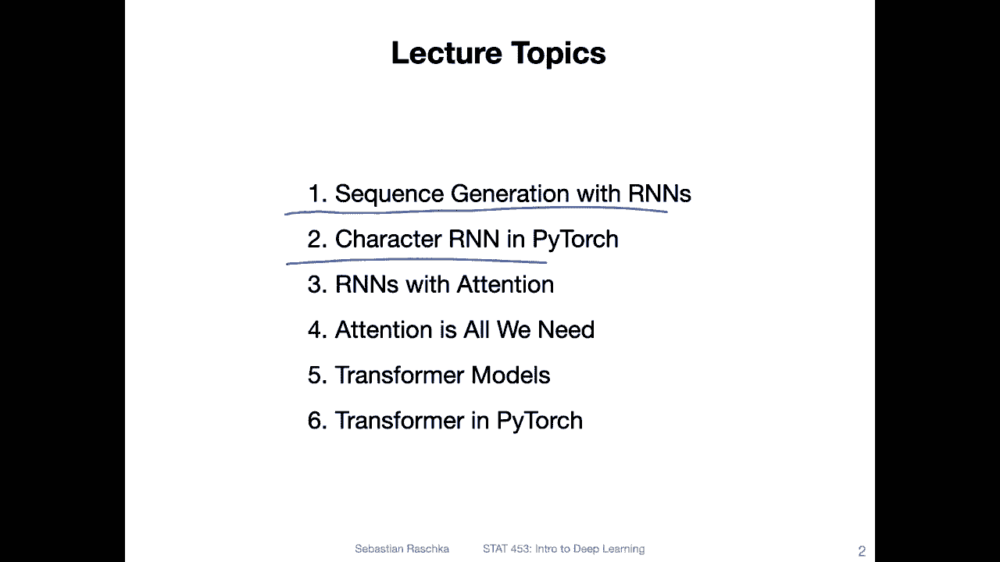

---

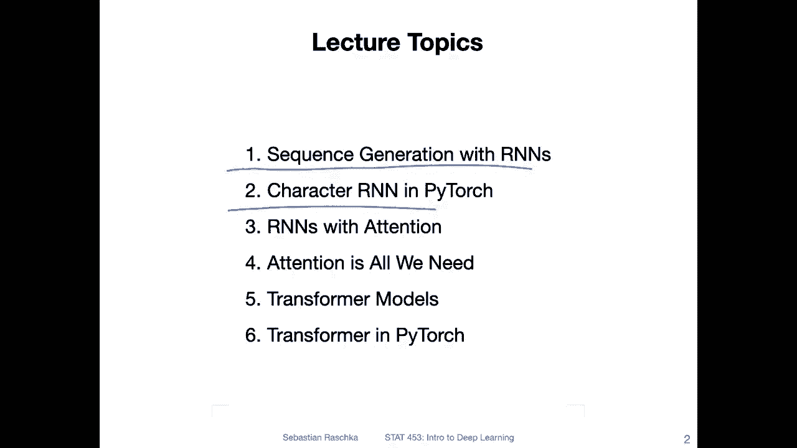

## 3. ⚡ 注意力就是一切：转换器模型

上一节我们看到了注意力机制如何增强循环神经网络。但一个革命性的想法是：**我们是否可以完全抛弃循环结构，只依靠注意力机制来构建模型？**

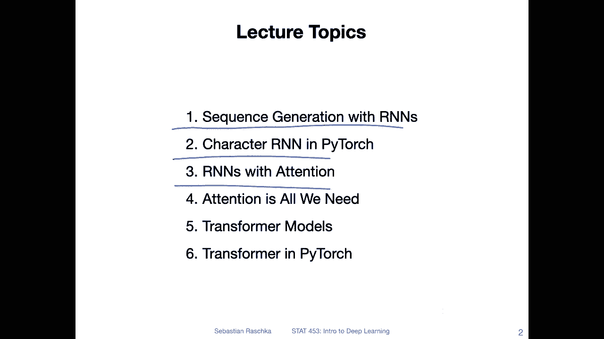

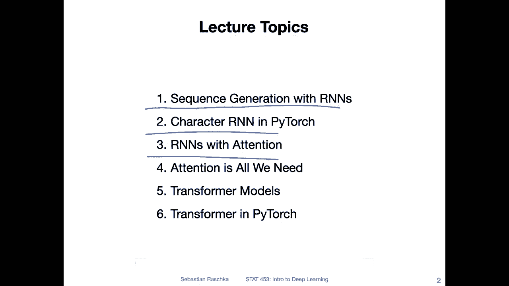

答案是肯定的，这就是2017年里程碑式论文《Attention Is All You Need》的核心贡献。由此诞生的模型架构被称为**转换器**。

转换器完全基于**自注意力机制**和**前馈神经网络**构建，摒弃了循环连接。自注意力机制允许序列中的每个位置直接与序列中所有其他位置进行交互，从而高效地捕捉全局依赖关系。

转换器通常由编码器和解码器堆叠而成，但其核心创新在于：
*   **自注意力层**：计算序列内部元素之间的关系。
*   **多头注意力**：并行运行多个自注意力机制，以从不同子空间捕捉信息。
*   **位置编码**：由于没有循环结构，需要显式地向输入中添加位置信息，以便模型理解序列的顺序。

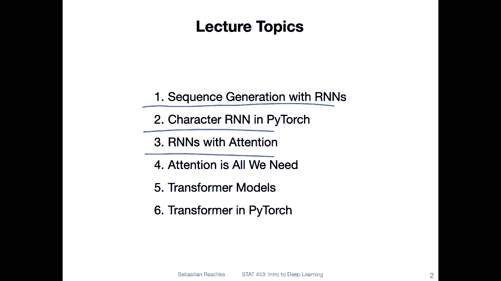

这种架构不仅训练速度更快（便于并行化），而且在许多自然语言处理任务上取得了当时最好的效果。

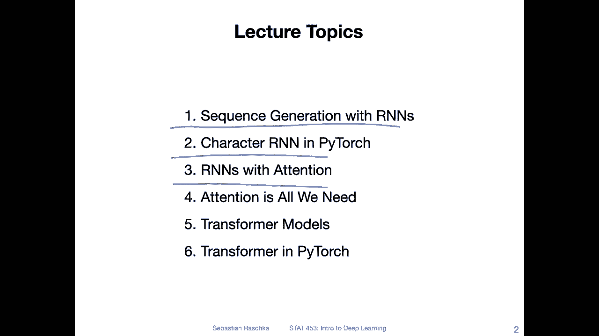

---

## 4. 💻 在 PyTorch 中使用转换器：代码示例

理论之后，我们来实践一下。本节将展示如何在 PyTorch 中使用内置的转换器模块。

PyTorch 在 `torch.nn` 模块中提供了 `Transformer` 类，以及相关的 `TransformerEncoder`, `TransformerDecoder` 等组件，使得构建转换器模型变得非常方便。

以下是一个高度简化的示例框架，展示了关键组成部分：

```python
import torch
import torch.nn as nn


# 定义一个简单的转换器模型
class SimpleTransformer(nn.Module):
    def __init__(self, num_tokens, d_model, nhead, num_encoder_layers):
        super().__init__()
        self.embedding = nn.Embedding(num_tokens, d_model)
        self.pos_encoder = ... # 位置编码器
        encoder_layer = nn.TransformerEncoderLayer(d_model=d_model, nhead=nhead)
        self.transformer_encoder = nn.TransformerEncoder(encoder_layer, num_layers=num_encoder_layers)
        self.fc_out = nn.Linear(d_model, num_tokens)

    def forward(self, src):
        # src: [序列长度, 批次大小]
        src = self.embedding(src) * math.sqrt(d_model)
        src = self.pos_encoder(src)
        output = self.transformer_encoder(src)
        output = self.fc_out(output)
        return output # 预测每个位置的下一个token

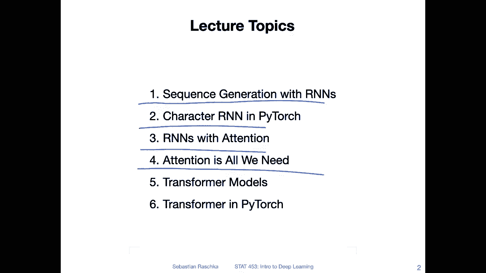

# 实例化模型、定义损失函数和优化器
model = SimpleTransformer(num_tokens=10000, d_model=512, nhead=8, num_encoder_layers=6)
criterion = nn.CrossEntropyLoss()
optimizer = torch.optim.Adam(model.parameters())
```

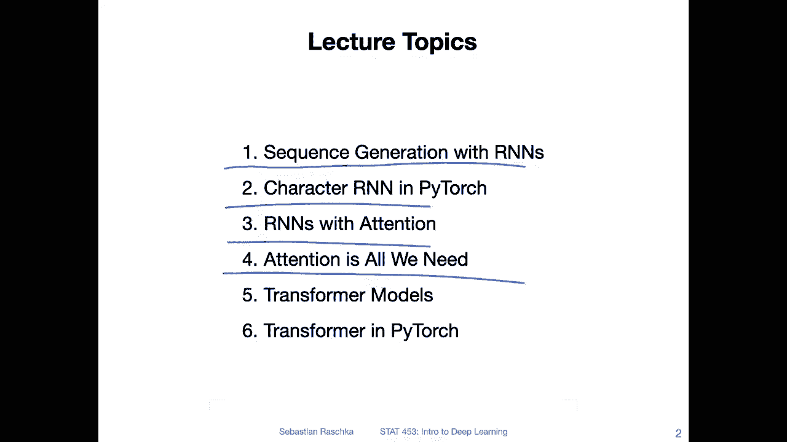

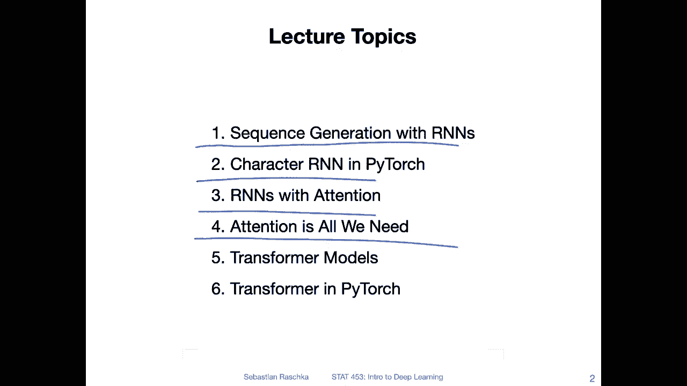

这段代码勾勒出了构建一个转换器模型的基本步骤：嵌入输入、添加位置信息、通过多层转换器编码器进行处理，最后通过线性层输出预测。实际应用中还需要处理掩码、批次维度等细节。

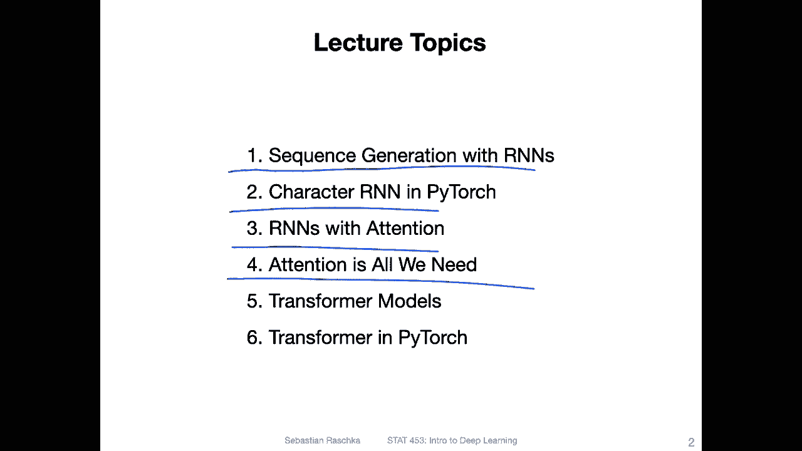

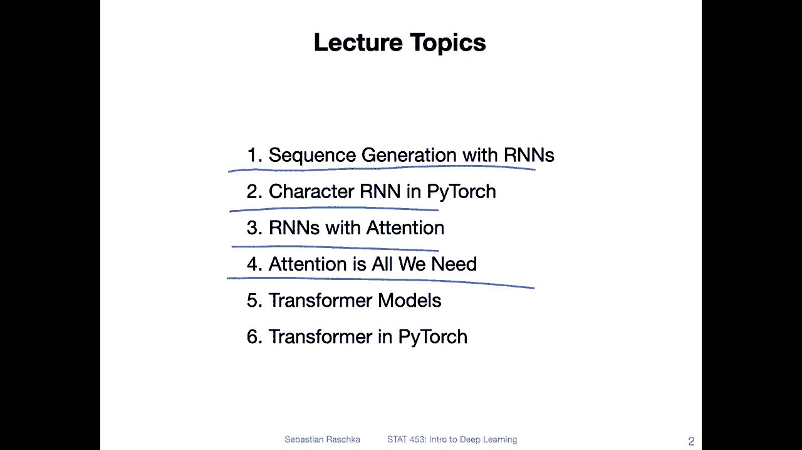

---

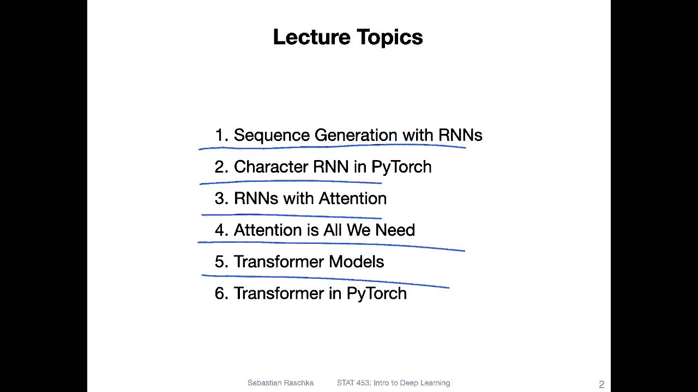

## 🎯 课程总结

本节课中，我们一起学习了从循环神经网络到现代转换器的序列生成技术演进。

我们首先回顾了**循环神经网络**如何用于生成序列，并以字符级文本生成为例。接着，为了克服循环神经网络处理长序列的瓶颈，我们引入了**注意力机制**，它使模型能够动态聚焦于输入的相关部分。

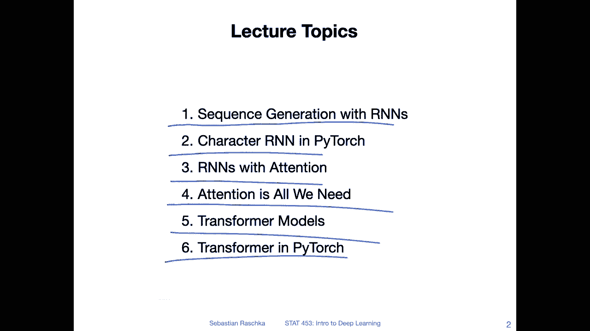

然后，我们探讨了革命性的**转换器模型**，它证明了“注意力就是一切”，完全基于自注意力机制构建，摒弃了循环结构，从而实现了更强的并行能力和对长程依赖的捕捉。最后，我们通过一个简单的 PyTorch 代码示例，了解了如何动手使用转换器模块。

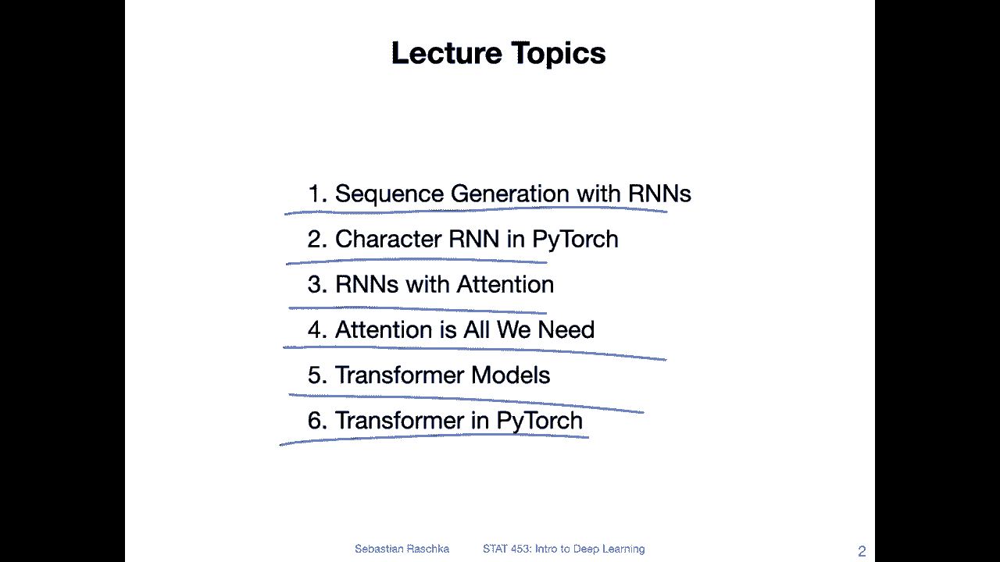

希望本课程为你打开了序列建模和生成式人工智能的大门。祝你项目顺利，学习愉快！