# P155：L19.2.1 - 在 PyTorch 中实现字符 RNN（概念）📚

在本节课中，我们将学习如何在 PyTorch 中实现一个字符级别的循环神经网络（RNN）。我们将重点关注实现前的核心概念，特别是 PyTorch 中 `LSTM` 类和 `LSTMCell` 类的区别与用法。理解这些概念将为下一节课的实际代码实现打下坚实基础。

## LSTM 类回顾 🔄

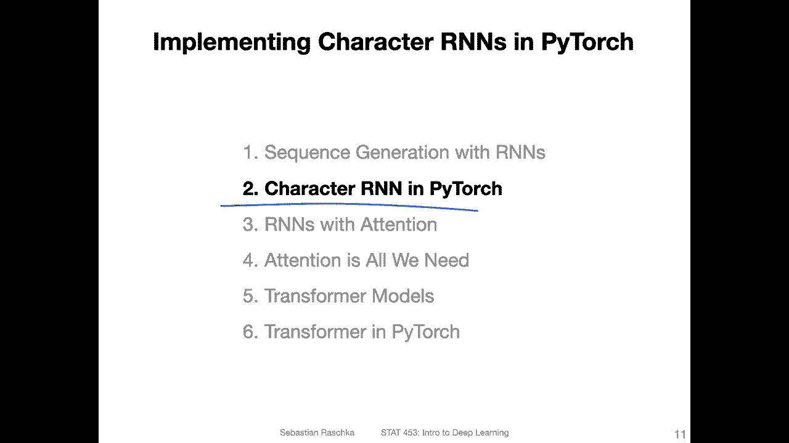

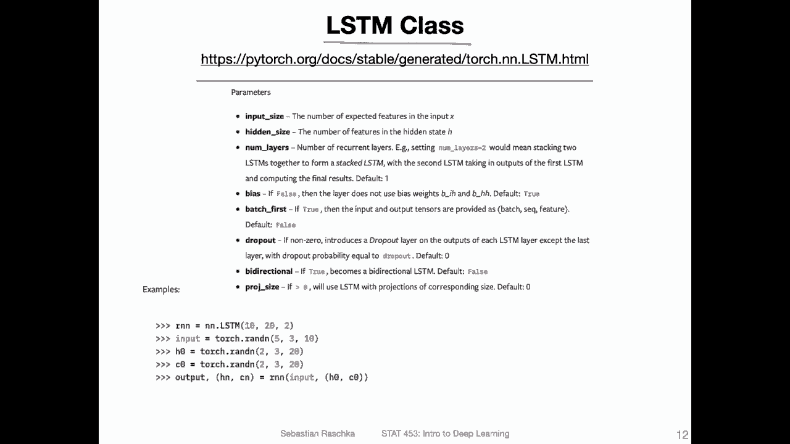

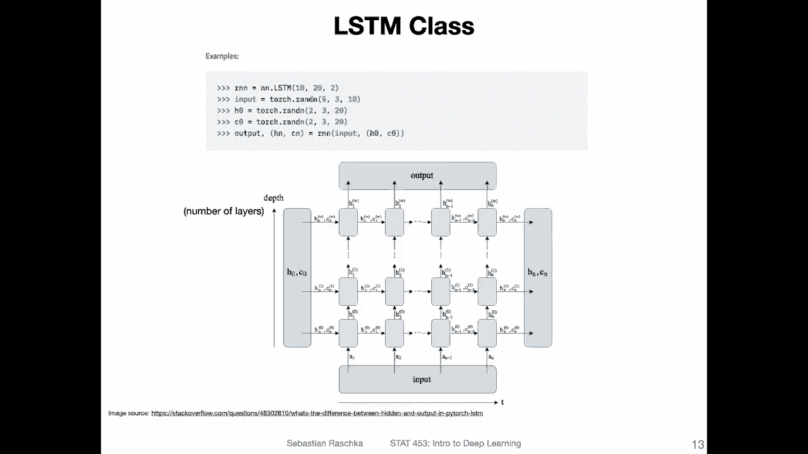

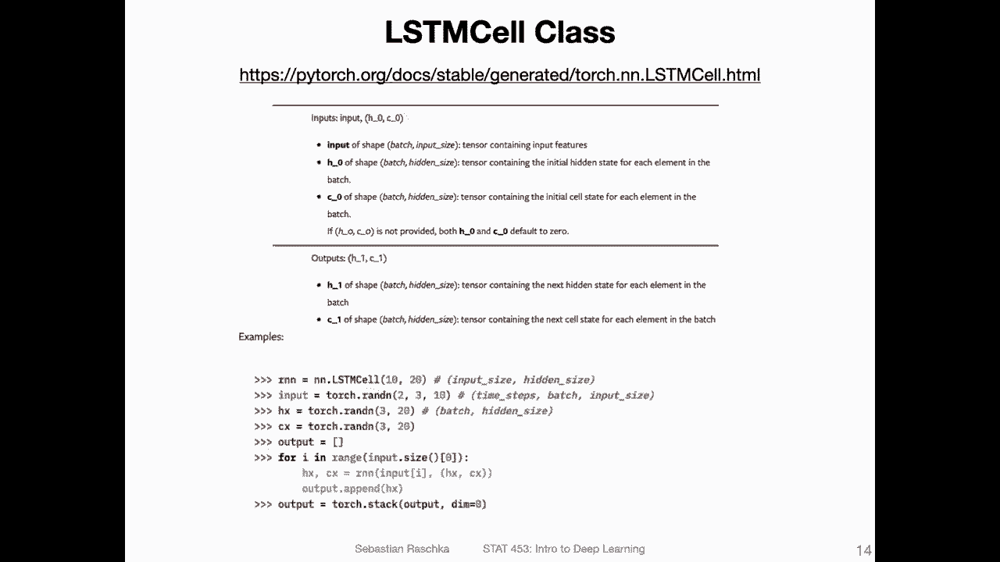

上一节我们介绍了 RNN 的基本概念，本节中我们来看看 PyTorch 中 `LSTM` 类的具体细节。我们之前在实现用于分类的 RNN 时使用过这个类。

`LSTM` 类在初始化时需要几个关键参数：
*   `input_size`：输入特征的维度。
*   `hidden_size`：隐藏状态的维度。
*   `num_layers`：RNN 的层数。

以下是一个初始化示例：
```python
lstm = nn.LSTM(input_size=10, hidden_size=20, num_layers=2)
```

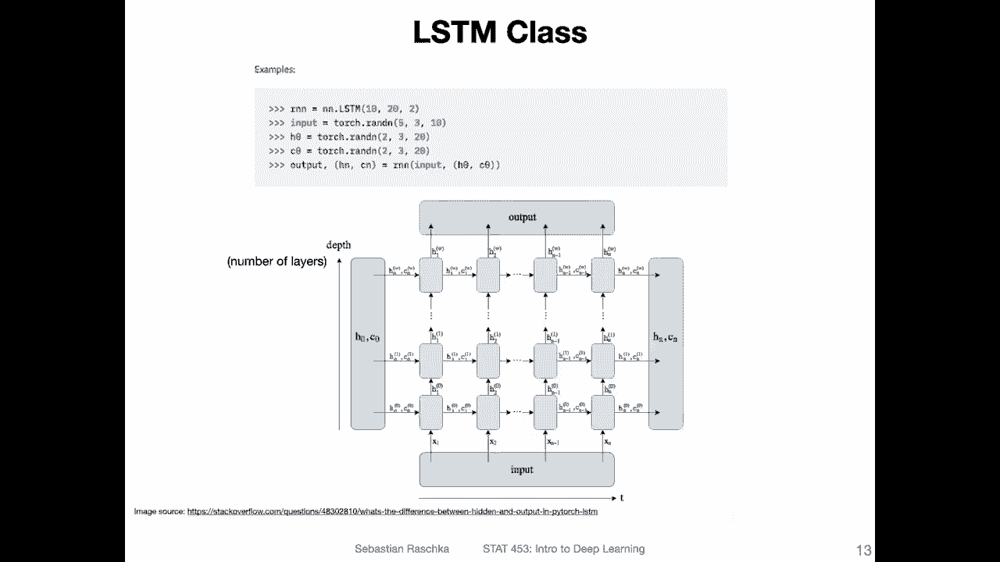

在使用时，`LSTM` 接收两个输入：
1.  输入序列 `input`。
2.  一个包含初始隐藏状态 `h0` 和初始细胞状态 `c0` 的元组 `(h0, c0)`。

它的输出也是一个元组，包含：
1.  所有时间步的输出 `output`。
2.  最后一个时间步的隐藏状态 `hn` 和细胞状态 `cn`，即 `(hn, cn)`。

为了更直观地理解，可以参考下图，它展示了多层 LSTM 中数据（输入、状态、输出）的流动过程：

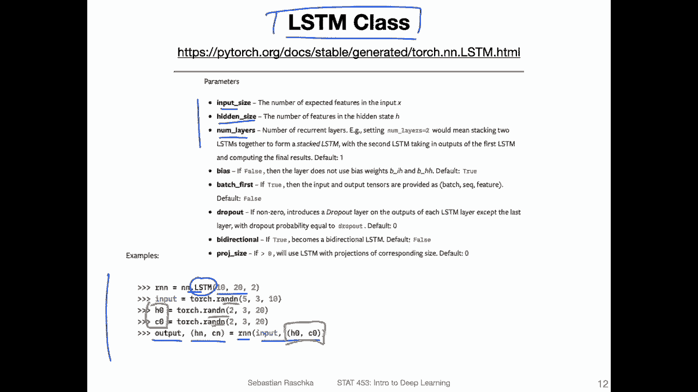


在上图中，底部是输入序列，黄色部分代表初始状态 `(h0, c0)`。网络可以有多层（图中为3层）。输出包括每个时间步的输出（右侧）以及最后一个时间步的最终状态 `(hn, cn)`。这些最终状态可以被传递给另一个 RNN 以处理后续序列。

## LSTM Cell 类 🧱

理解了完整的 `LSTM` 类后，我们再来看看 `LSTMCell` 类。`LSTMCell` 是构成 `LSTM` 的基本单元。

两者的主要区别在于：
*   `LSTM` 类：一次处理整个序列（或多个时间步），并可堆叠多层。
*   `LSTMCell` 类：一次只处理**一个时间步**的输入，并且**只代表单层**。如果需要多层，需要手动堆叠多个 `LSTMCell`。

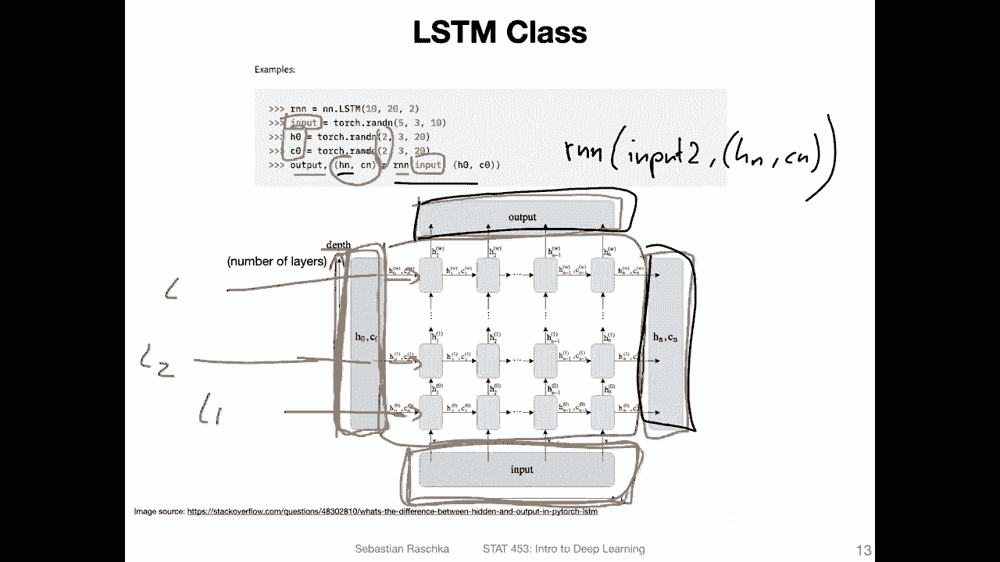

下图展示了 `LSTMCell` 在一个时间步内的计算过程，它对应上图中红色框内的单个计算单元：

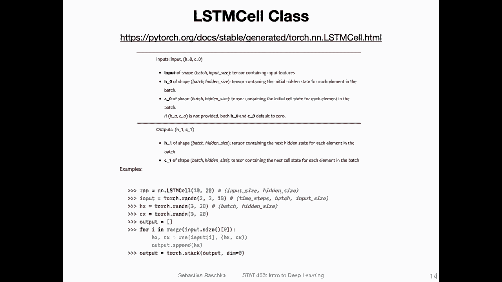


`LSTMCell` 接收当前时间步的输入、上一个时间步的隐藏状态和细胞状态，然后输出当前时间步的输出、以及传递给下一个时间步的新的隐藏状态和细胞状态。

对于字符级 RNN 这种需要逐字符生成和计算损失的任务，使用 `LSTMCell` 通常更直观和方便，因为它允许我们更精细地控制每个时间步的计算。

## 应用场景：多对多架构 ➡️➡️

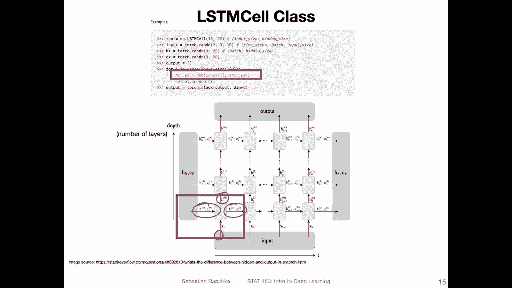

我们实现的字符 RNN 属于“多对多”（Many-to-Many）的序列生成模型，即根据前面的字符序列预测下一个字符。

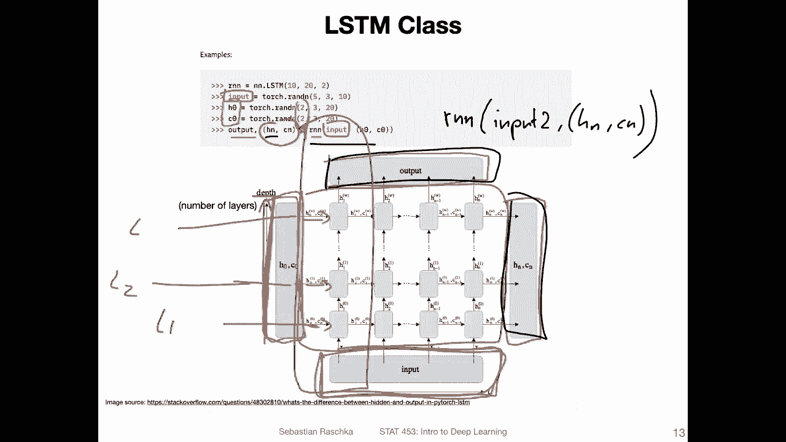

以下是另一种重要的“多对多”架构：
*   **语言翻译**：将一种语言的序列转换为另一种语言的序列。PyTorch 官方提供了关于此的精彩教程，如果你感兴趣，可以自行查阅学习。

由于已有优质资源，我们的课程将专注于字符级文本生成任务。

## 下节预告 🔜

本节课我们一起学习了 PyTorch 中 `LSTM` 和 `LSTMCell` 的核心概念与区别。下一节课，我们将运用这些知识，实际动手编写代码，使用 `LSTMCell` 类来构建一个能够生成新文本的字符级 RNN 模型。

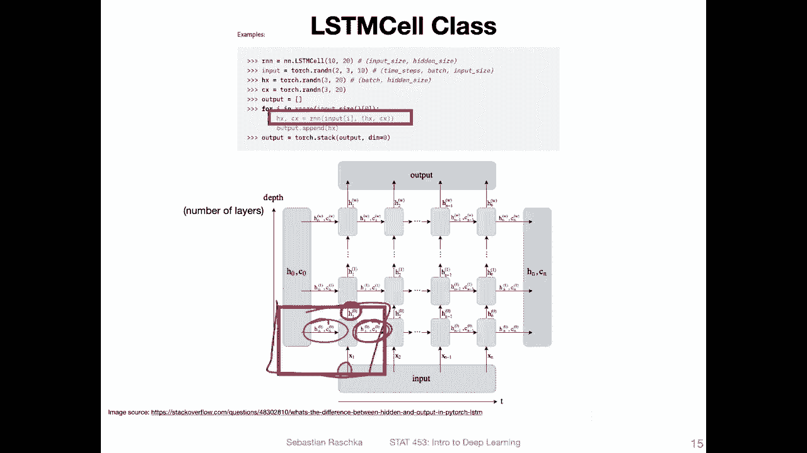

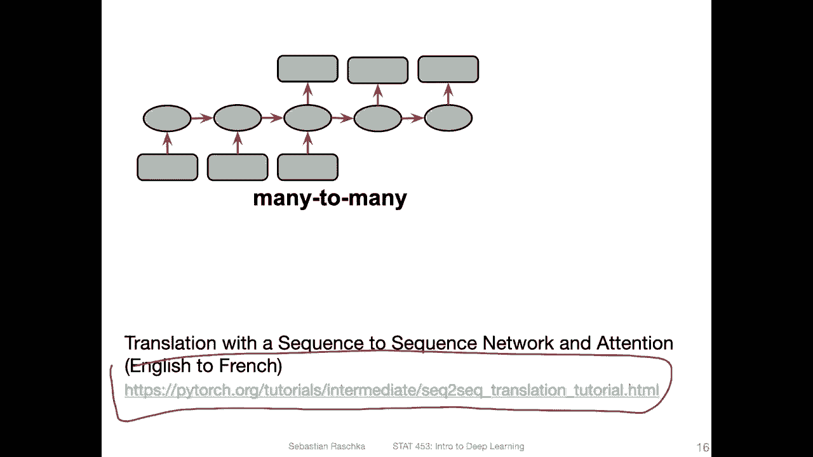

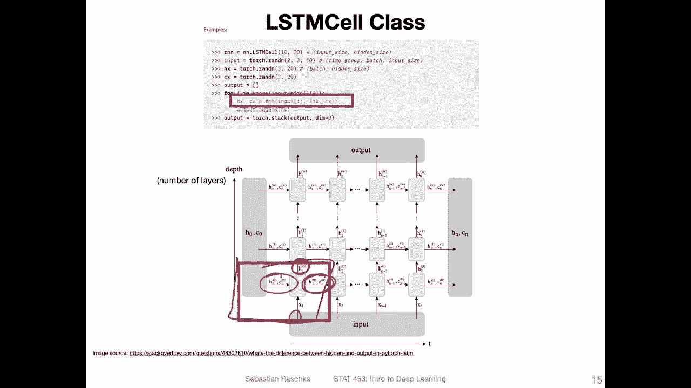

