# 课程 P156：L19.2.2 - 在 PyTorch 中实现字符 RNN 🧠

在本节课中，我们将学习如何使用 PyTorch 实现一个基于字符的循环神经网络。我们将从零开始构建一个简单的 LSTM 模型，用于学习文本序列并生成新的文本。课程将涵盖数据准备、模型构建、训练循环以及文本生成等核心步骤。

---

## 1. 概述与准备工作 📋

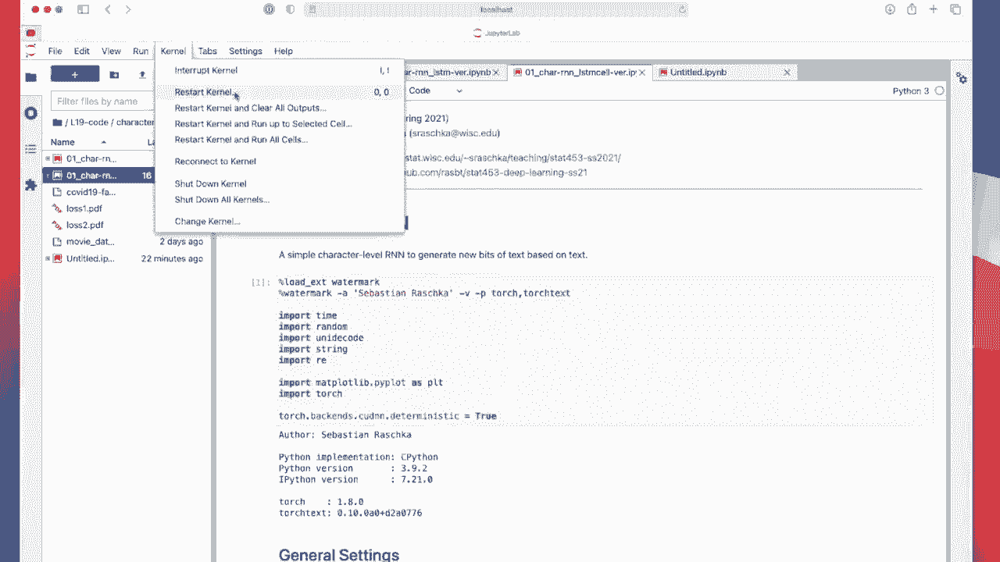

上一节我们介绍了 LSTM 及其单元的基本概念。本节中，我们来看看如何用代码实现一个字符级的 RNN。

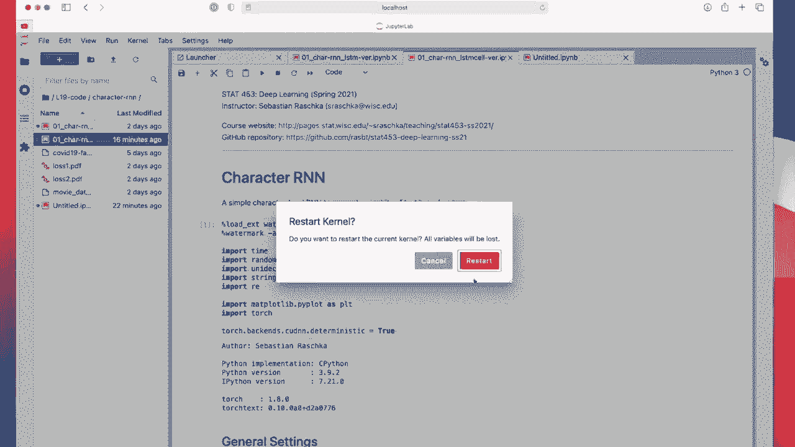

首先，我们导入必要的库并设置一些超参数。

```python
import torch
import torch.nn as nn
import torch.optim as optim
import string
import random

# 超参数
text_port_size = 200  # 文本片段长度
num_iterations = 5000  # 训练迭代次数
learning_rate = 0.001
embedding_size = 100
hidden_size = 128
```

我们使用 Python 的 `string` 库获取所有可打印字符作为字符集。

```python
all_characters = string.printable
num_characters = len(all_characters)  # 字符总数，例如 100
```

我们的训练数据是来自威斯康星大学网站的 COVID-19 常见问题解答文本。

```python
with open('covid_faq.txt', 'r', encoding='utf-8') as f:
    text = f.read()
print(f"文本总字符数: {len(text)}")  # 例如 84000
```

---

## 2. 数据预处理 🔧

我们需要将文本数据转换为模型可以处理的张量格式。以下是数据处理的几个关键函数。

首先，定义一个函数来随机获取指定长度的文本片段。

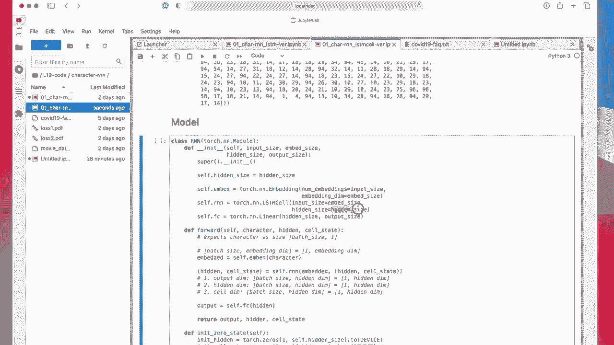

```python
def get_random_text_portion(text, portion_size):
    start_idx = random.randint(0, len(text) - portion_size - 1)
    return text[start_idx:start_idx + portion_size]
```

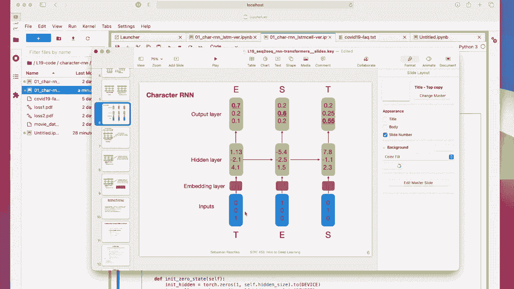

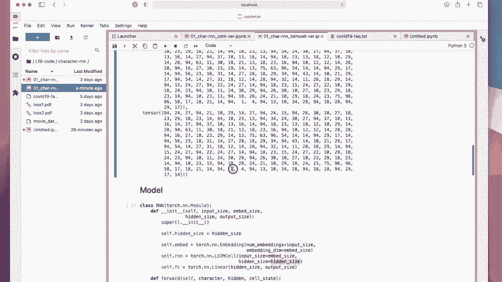

接着，定义一个函数将字符串转换为对应的整数索引。

```python
def char_to_tensor(string):
    tensor = torch.zeros(len(string)).long()
    for c in range(len(string)):
        tensor[c] = all_characters.index(string[c])
    return tensor
```

最后，定义一个函数来获取一个训练样本，包括特征（输入序列）和标签（目标序列，即输入序列右移一位）。

```python
def get_random_sample(text, portion_size):
    # 获取随机文本片段
    portion = get_random_text_portion(text, portion_size)
    # 转换为整数张量
    input_tensor = char_to_tensor(portion)
    # 目标标签是输入右移一位
    target_tensor = char_to_tensor(portion[1:] + portion[0])
    return input_tensor, target_tensor
```

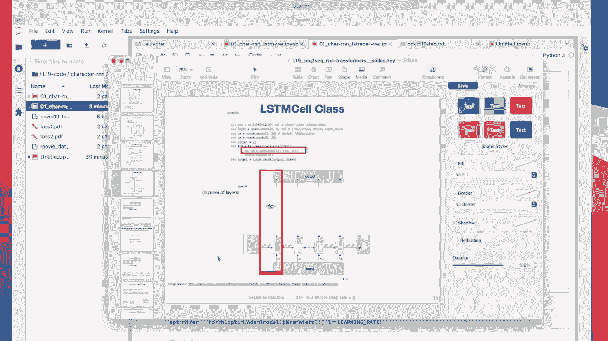

---

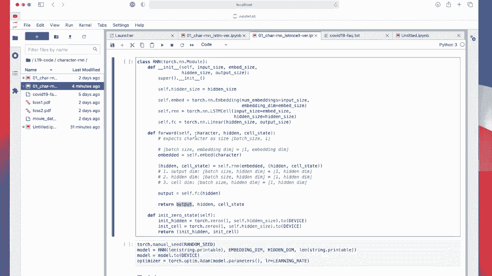

## 3. 构建字符 RNN 模型 🏗️

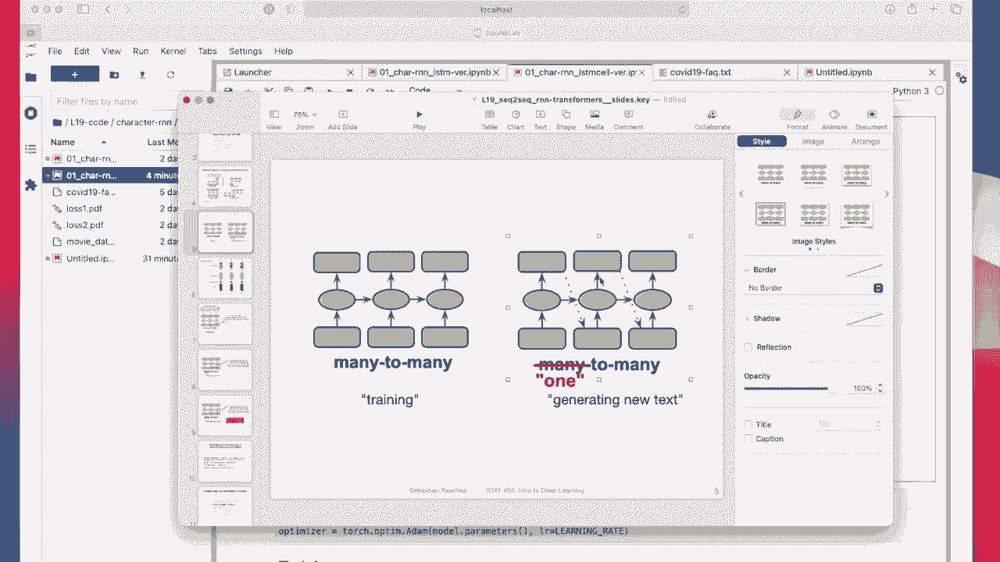

现在我们来构建核心的 RNN 模型。我们将使用 `nn.LSTMCell` 来手动处理序列的每个时间步，这比使用 `nn.LSTM` 更直观，便于理解循环过程。

模型结构如下：
1.  **嵌入层 (Embedding Layer)**：将字符索引映射为稠密向量。
2.  **LSTM 单元 (LSTMCell)**：处理序列，维护隐藏状态和细胞状态。
3.  **全连接层 (Fully Connected Layer)**：将 LSTM 的输出映射回字符空间，用于预测下一个字符。

以下是模型类的定义：

```python
class CharRNN(nn.Module):
    def __init__(self, input_size, embedding_size, hidden_size, output_size):
        super(CharRNN, self).__init__()
        self.hidden_size = hidden_size
        # 嵌入层
        self.embedding = nn.Embedding(input_size, embedding_size)
        # LSTM 单元
        self.lstm = nn.LSTMCell(embedding_size, hidden_size)
        # 输出层（全连接层）
        self.fc = nn.Linear(hidden_size, output_size)

    def forward(self, char, hidden_state, cell_state):
        # char: (batch_size=1,)
        # 1. 通过嵌入层
        embedded = self.embedding(char)  # 输出形状: (1, embedding_size)
        # 2. 通过 LSTM 单元
        hidden_state, cell_state = self.lstm(embedded, (hidden_state, cell_state))
        # 3. 通过全连接层得到输出（logits）
        output = self.fc(hidden_state)  # 输出形状: (1, output_size)
        return output, hidden_state, cell_state

    def init_zero_state(self, batch_size=1):
        # 初始化隐藏状态和细胞状态为零
        return (torch.zeros(batch_size, self.hidden_size),
                torch.zeros(batch_size, self.hidden_size))
```

**核心概念解释**：
*   **前向传播流程**：在每个时间步，模型接收一个字符索引、上一个时间步的隐藏状态 `hidden_state` 和细胞状态 `cell_state`。字符经过嵌入层变为向量，然后与状态一起输入 LSTM 单元，得到新的状态和输出。输出再经过全连接层，得到对下一个字符的预测（logits）。
*   **状态初始化**：序列开始时，没有先前的状态，因此我们用零向量来初始化 `hidden_state` 和 `cell_state`。

---

## 4. 训练循环 🏋️

模型定义好后，我们进入训练阶段。训练循环会迭代多次，每次处理一个随机文本片段。

以下是训练函数的核心步骤：

```python
def train(model, optimizer, criterion, text, num_iterations, text_port_size):
    model.train()
    for i in range(num_iterations):
        # 初始化损失和零状态
        total_loss = 0
        hidden, cell = model.init_zero_state()

        # 获取随机训练样本
        input_tensor, target_tensor = get_random_sample(text, text_port_size)

        # 遍历序列中的每个字符（时间步）
        for t in range(text_port_size):
            # 准备当前输入字符和目标字符
            input_char = input_tensor[t].unsqueeze(0)  # 形状变为 (1,)
            target_char = target_tensor[t].unsqueeze(0)

            # 前向传播
            output, hidden, cell = model(input_char, hidden, cell)
            # 计算损失（交叉熵损失函数内部会处理 logits）
            loss = criterion(output, target_char)
            total_loss += loss

        # 反向传播与优化
        optimizer.zero_grad()
        # 计算平均损失
        avg_loss = total_loss / text_port_size
        avg_loss.backward()
        optimizer.step()

        # 每隔一定迭代次数，打印损失并评估模型生成文本的能力
        if i % 500 == 0:
            print(f'迭代次数: {i}, 损失: {avg_loss.item():.4f}')
            evaluate(model, prime_str="TH", predict_len=100, temperature=0.8)
```

**训练流程说明**：
1.  每次迭代（`iteration`）处理一个长度为 `text_port_size` 的文本片段。
2.  在每个片段开始时，将 LSTM 的状态重置为零。
3.  遍历片段中的每个字符：
    *   将当前字符输入模型，得到预测输出和更新后的状态。
    *   计算预测输出与真实下一个字符（目标）之间的损失。
4.  遍历完整个片段后，计算平均损失，执行反向传播和参数更新。

---

## 5. 文本生成与评估 🔮

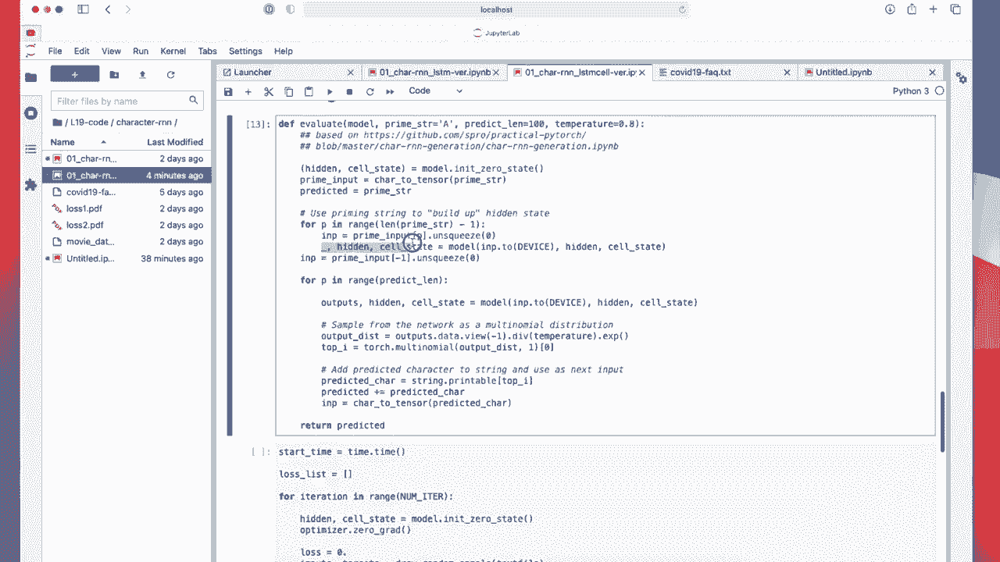

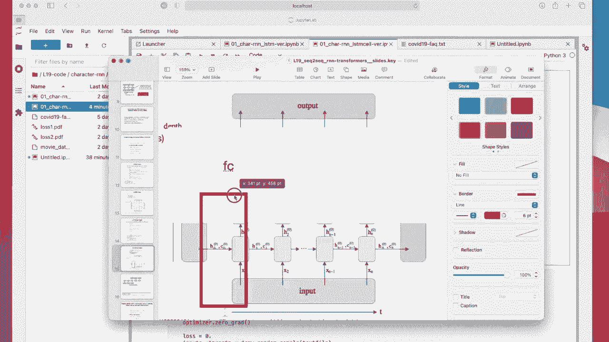

训练过程中，我们希望看到模型的学习效果。因此，我们实现一个 `evaluate` 函数，让模型根据给定的起始字符（prime）生成一段新文本。

文本生成的关键在于“采样”策略。我们使用 **温度采样（Temperature Sampling）** 来增加生成文本的多样性。

```python
def evaluate(model, prime_str='TH', predict_len=100, temperature=0.8):
    model.eval()
    with torch.no_grad():
        # 初始化状态
        hidden, cell = model.init_zero_state()
        # “预热”模型：用起始字符构建初始状态
        for p in range(len(prime_str) - 1):
            _, hidden, cell = model(char_to_tensor(prime_str[p]).unsqueeze(0), hidden, cell)

        # 准备第一个输入字符（起始字符串的最后一个字符）
        input_char = char_to_tensor(prime_str[-1]).unsqueeze(0)
        predicted = prime_str

        # 开始生成后续字符
        for _ in range(predict_len):
            # 前向传播，得到输出 logits
            output, hidden, cell = model(input_char, hidden, cell)
            # 应用温度采样
            output_dist = output.data.view(-1).div(temperature).exp()
            # 根据输出分布进行多项式采样，得到下一个字符的索引
            top_char = torch.multinomial(output_dist, 1)[0]
            # 将索引转换为字符并添加到生成文本中
            predicted_char = all_characters[top_char]
            predicted += predicted_char
            # 将预测的字符作为下一个时间步的输入
            input_char = char_to_tensor(predicted_char).unsqueeze(0)

        print(f"生成文本: {predicted}")
    model.train()
```

**温度采样解释**：
*   **公式**：`output_dist = exp(logits / temperature)`
*   **作用**：`temperature` 参数控制采样分布的尖锐程度。
    *   **低温度（如 0.1）**：分布更尖锐，模型更倾向于选择概率最高的字符，生成文本更确定、更保守，但也可能更重复。
    *   **高温度（如 1.5）**：分布更平缓，选择其他字符的概率增加，生成文本更多样、更有创造性，但也可能包含更多错误或无意义内容。
    *   **温度=1.0**：为标准 softmax。

---

## 6. 模型初始化与训练启动 🚀

最后，我们初始化模型、损失函数、优化器，并开始训练。

```python
# 初始化模型
model = CharRNN(input_size=num_characters,
                embedding_size=embedding_size,
                hidden_size=hidden_size,
                output_size=num_characters)

# 定义损失函数和优化器
criterion = nn.CrossEntropyLoss()
optimizer = optim.Adam(model.parameters(), lr=learning_rate)

# 开始训练
train(model, optimizer, criterion, text, num_iterations, text_port_size)
```

训练过程中，你会看到损失逐渐下降，并且每隔一定迭代次数，模型生成的文本会从最初的乱码逐渐变得包含可识别的单词和短语结构。

---

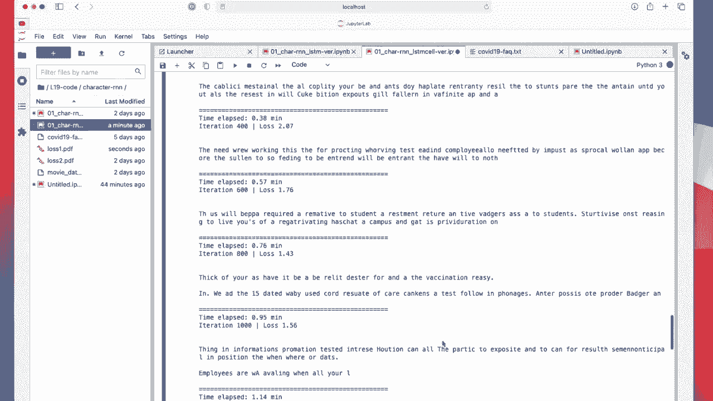

## 总结 📝

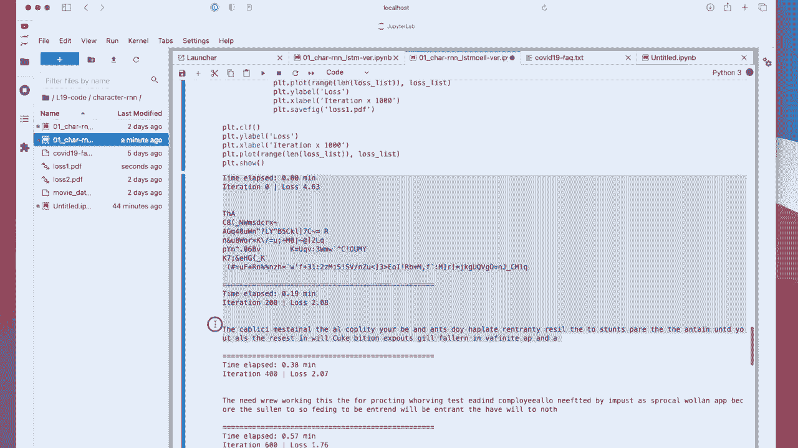

本节课中我们一起学习了如何在 PyTorch 中实现一个字符级的循环神经网络。我们完成了以下核心任务：

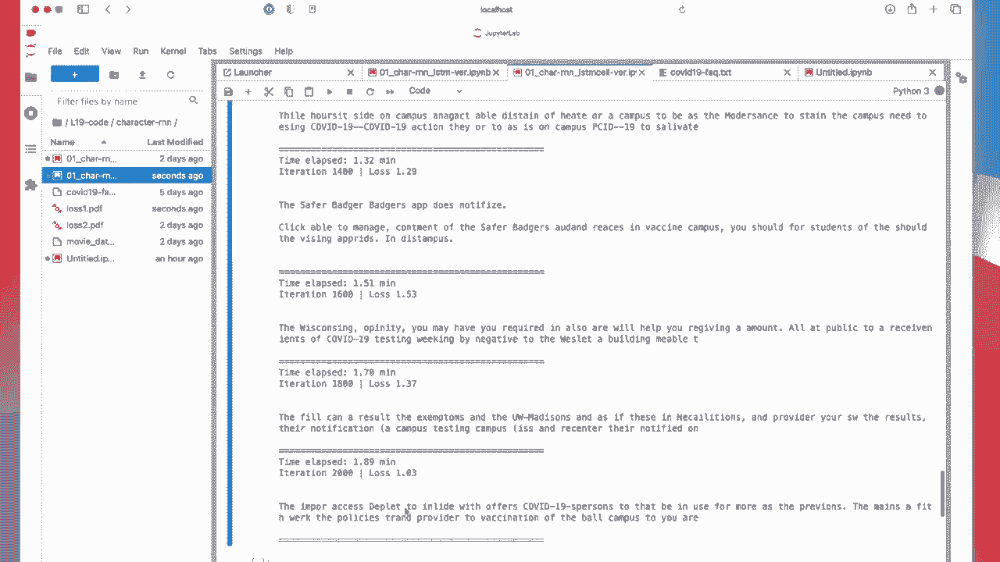

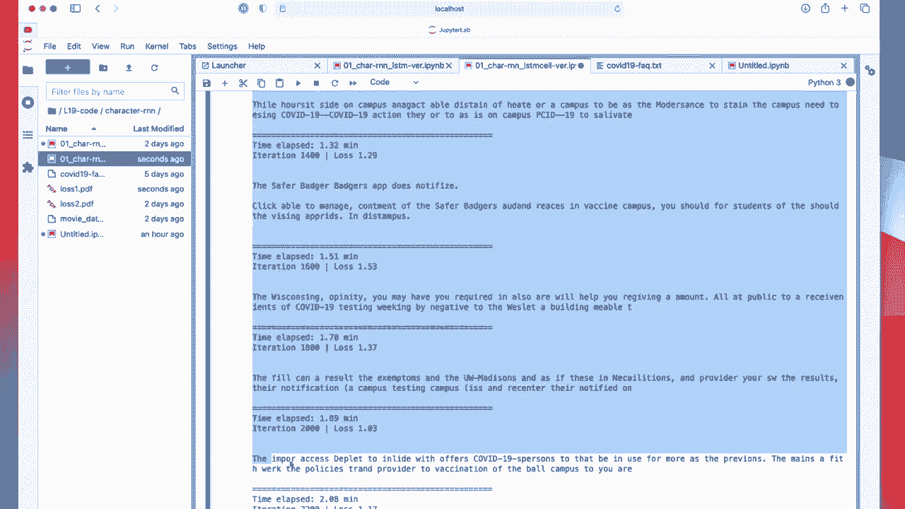

1.  **数据准备**：将文本数据切割成片段，并转换为模型可处理的整数张量。
2.  **模型构建**：使用 `nn.Embedding`、`nn.LSTMCell` 和 `nn.Linear` 搭建了一个能够处理序列的 RNN 模型。
3.  **训练循环**：实现了按时间步展开的训练过程，包括状态管理、损失计算和参数优化。
4.  **文本生成**：实现了基于温度采样的文本生成函数，用于评估模型性能。

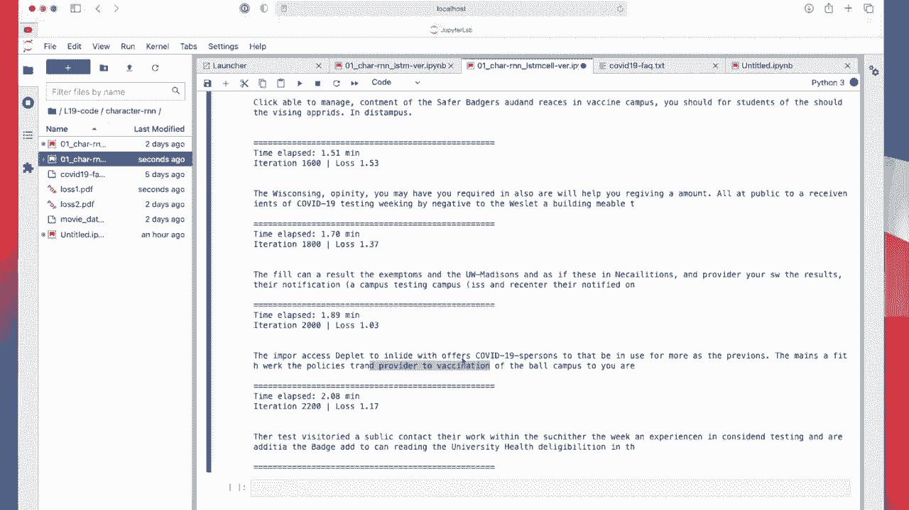

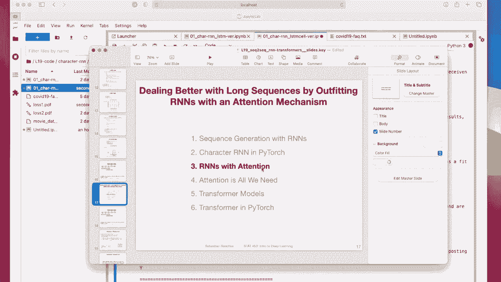

这个简单的模型展示了 RNN 学习序列模式的基本能力。为了获得更好的效果，你可以尝试调整超参数（如层数、隐藏层大小）、使用更大的数据集或训练更长时间。在下一节课中，我们将探讨如何为 RNN 添加注意力机制，以进一步提升其处理长序列的能力。