# 课程 P158：L19.4.1 - 在没有RNN的情况下使用注意力：一种基本的自我注意力形式 🧠

在本节课中，我们将学习一种不依赖循环神经网络（RNN）的注意力机制，即自我注意力。我们将从基础概念入手，理解其核心原理，为后续学习更复杂的Transformer模型打下基础。

---

在上一节视频中，我们讨论了带有注意力机制的循环神经网络。这种注意力机制帮助RNN更好地处理长序列。

现在，我们将进行一个大胆的尝试：移除循环神经网络部分。我们将研究一个仅使用注意力机制、不含RNN部分的模型。😊

我们将要探讨的这种特定注意力类型也称为**自我注意力**。它是所谓的**Transformer网络**背后的基础或主要原理之一。Transformer模型是目前处理长序列和文本数据的最先进模型。

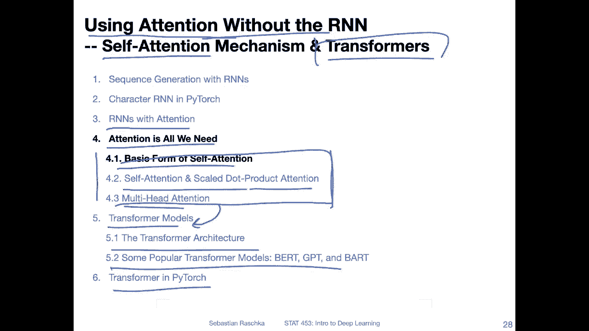

由于涉及许多小主题，为了避免制作一个过长的视频，我决定将其进一步细分为多个小节。

在本视频中，我们将先了解一个广泛的概念，然后为了教学目的，介绍一种非常基础的自我注意力形式，以理解其背后的基本原理。接着，我们会探讨原始Transformer模型中更复杂的形式。这个原始Transformer模型还有一个称为**多头注意力**的概念。在涵盖这些内容之后，我们将看看这些概念是如何组合成Transformer模型的。我还会介绍一些关于它的有趣见解，并讨论当今流行的一些变体。最后，我们将以在PyTorch中实现Transformer模型作为结束。

---

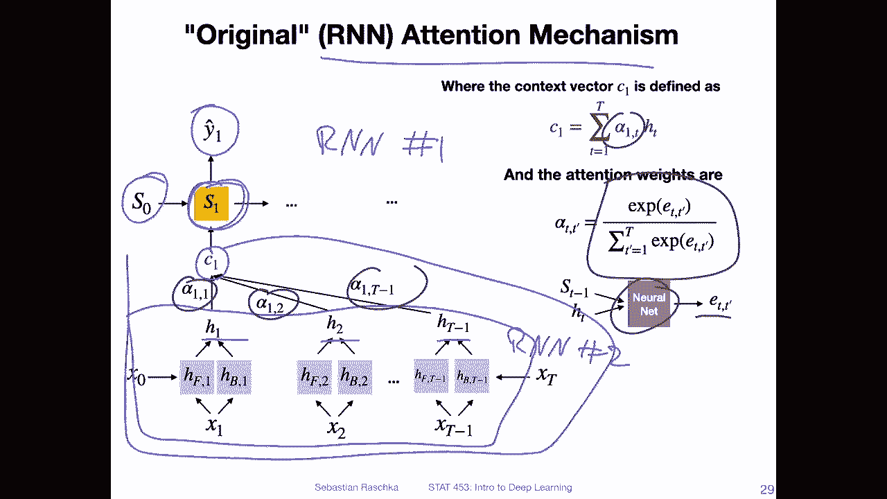

好的，这里只是对上一视频内容的回顾。我们有一个带有注意力机制的RNN。它的工作原理是：对于每个生成的词（这里我们称这个RNN为RN #1），我们有一个双向RNN。在每个时间步，这里的RNN会创建一个输出词，除了接收先前的隐藏状态外，它还接收一个**上下文向量**，这个向量依赖于这里的整个序列输入。我们这里有整个序列，即这里的隐藏表示，然后我们用这些**注意力权重**乘以它们。注意力权重是由神经网络计算出的值的归一化版本。这就是我们在上一视频中介绍的内容。关键思想是，我们以加权形式将整个序列作为输入。

---

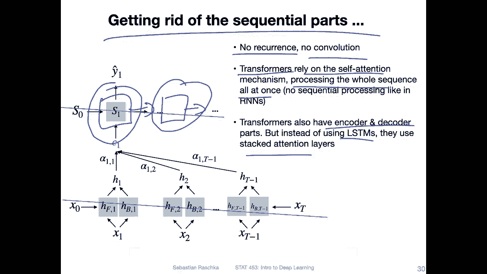

现在，我们将从该模型中移除所有顺序处理部分。我们摒弃所有顺序部分，不使用任何循环、卷积或任何专门用于顺序处理输入的东西。

我们将朝着这个所谓的**Transformer模型**努力，它仅依赖于**自我注意力机制**。自我注意力机制一次性处理整个序列。这实际上也非常有利于并行化。实际上，Transformer模型的训练成本相当高，但它们能更好地利用多个GPU，因为你可以并行训练。而对于RNN，你一次生成一个东西，所以无法并行运行这些计算，因为要计算后面的部分，必须先完成前面的部分。因此，Transformer在并行化计算方面要好得多。

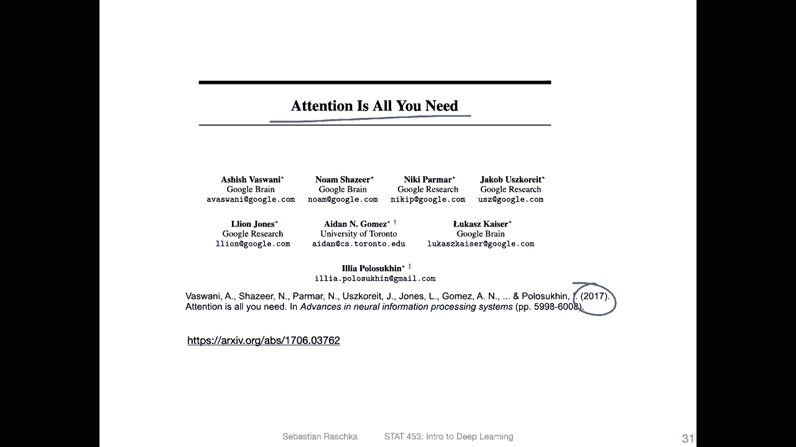

与“多对多”RNN类似，我们也将有一个编码器和一个解码器部分。但在这里，我们不使用RNN或LSTM，而是使用一种称为**堆叠注意力层**的东西。这就是我们努力的方向。这是大的图景，我们将逐步添加这些部分，一步一步地进行。

---

这些幻灯片的基本基础是这篇名为 **《Attention Is All You Need》** 的论文。这是2017年具有开创性意义的基础论文，它介绍了原始的Transformer架构，其性能在当时超越了任何其他方法。

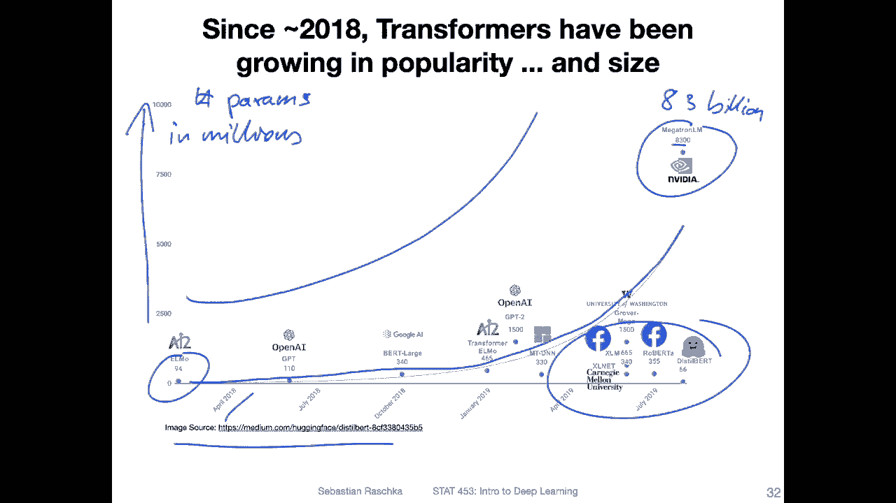

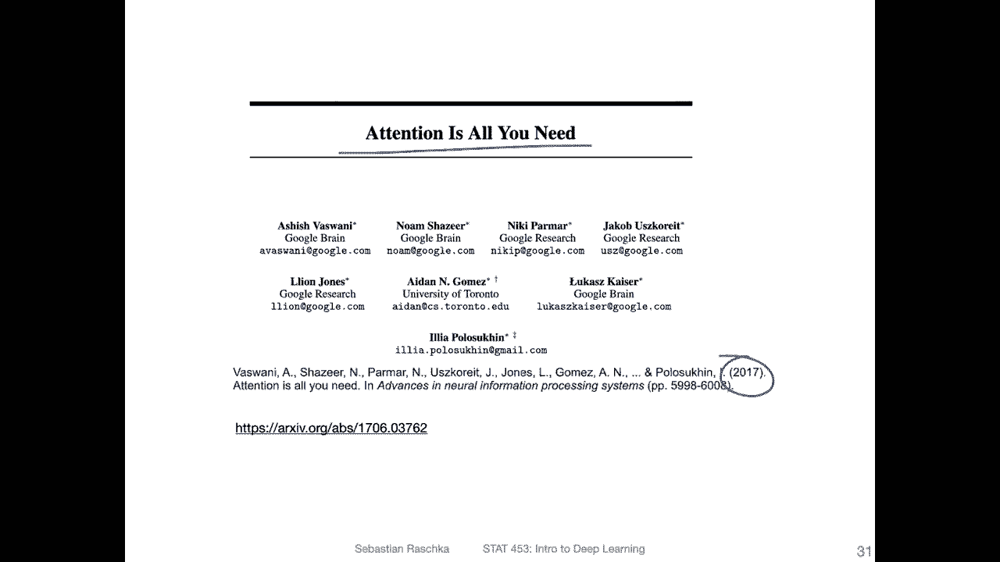

---

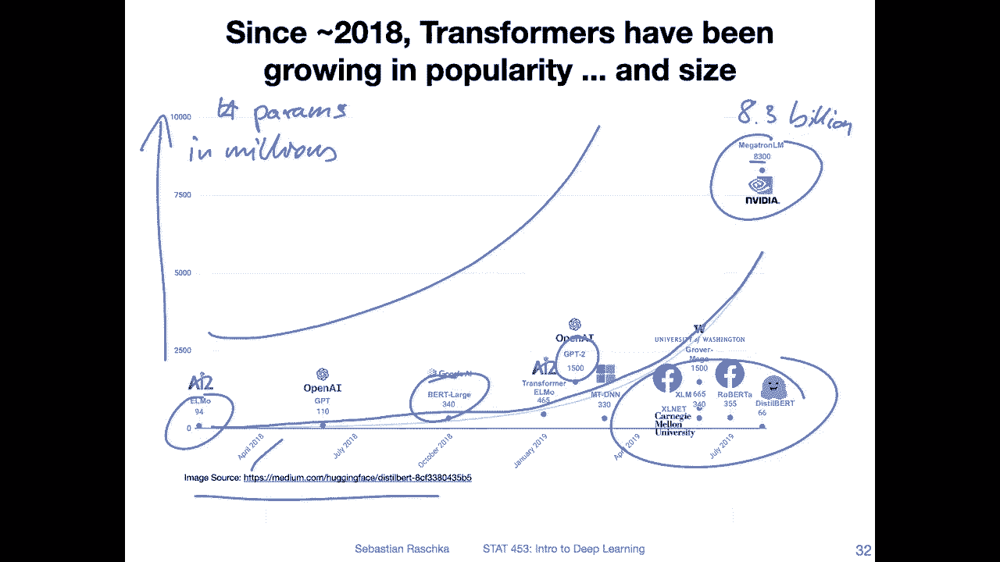

自那时起，从2018年开始，基于Transformer的自然语言处理领域发展迅猛。你可以看到它开始时规模也相对较小，这里的Y轴（虽然很遗憾作者没有标注Y轴，但我认为在这篇文章中他们指的是**以百万为单位的参数量**），这个模型有83亿参数。你可以看到这些模型的规模呈巨大增长曲线，同时其受欢迎程度也大幅增长。虽然本视频中没有展示，但也有一些综述论文展示了Transformer被引用的次数以及现有模型的数量，这也是指数级增长。所以，这是一个非常非常热门的领域。当然，训练83亿个参数对于普通人来说是不可行的。如今，也有研究小组专注于开发小型Transformer模型。无论如何，这只是一个大图景，表明Transformer模型很有趣，有很多不同的变体。我们讨论的是这个基础模型《Attention Is All You Need》，如果你感兴趣，

---

你可以后续跟进其他一些模型。我稍后也会简要谈谈GPT-2和BERT模型，它们也是基础模型，主要概念在于它们使用了自监督学习技术，这些技术后来也被其他类型的Transformer所采用。

---

好的，回到**自我注意力机制**。在讨论Transformer中使用的自我注意力机制之前，我想先介绍一种非常基础的形式，以便循序渐进地引入这个主题。

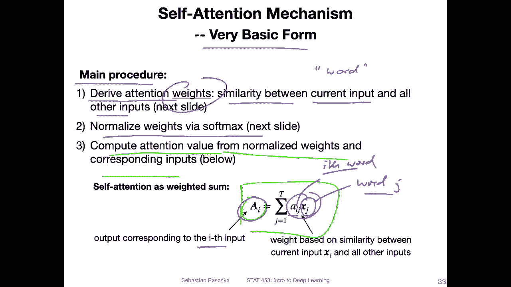

这种非常基础的形式，我们可以将其视为一个包含三个步骤的过程：
1.  推导注意力权重，它是当前输入（序列中的一个元素，可以看作句子中的一个词）与所有其他输入之间相似性或兼容性的一种形式。
2.  一旦我们有了权重（我将在下一张幻灯片展示如何推导权重），我们通过softmax函数对它们进行归一化。这与我们在RNN中计算归一化注意力权重时所做的类似。
3.  然后，在第三步，我们从归一化权重和相应的输入计算**注意力值**。

整个过程看起来与我们之前在RNN中展示的注意力机制非常相似。在RNN注意力机制中，我们也有一个加权和作为注意力值。

这里，`x_j` 是一个输入词。我们假设句子中有T个词。对于每个词，我们有一个注意力权重。让我们称这个词为 `j`，从 `j=1` 到 `T`。句子中有T个词，然后对于第 `i` 个词，你可以看到这是 `a_{ij}`。所以，`i` 代表第 `i` 个词。这是第 `i` 个词与第 `j` 个词之间关系的注意力权重。你用它来计算句子中第 `i` 个词的注意力值。可能信息有点密集，让我们一步一步来看，我也会展示这些注意力权重 `a` 是如何计算的。

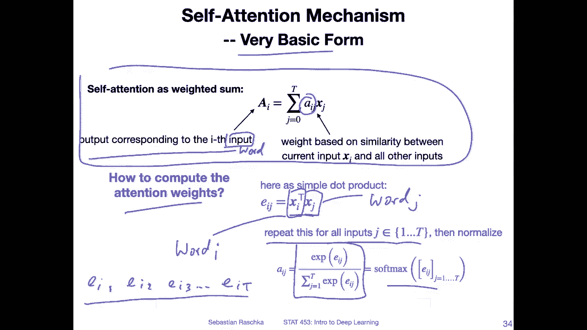

---

在顶部，我再次展示了上一张幻灯片的内容，我们计算对应于第 `i` 个输入（第 `i` 个词）的输出。每次我在这里写“输入”，我指的是一个句子，而“第 `i` 个输入”就是第 `i` 个词。

现在，我们如何计算这些注意力权重呢？在这种简单的、非常基础的自我注意力形式中（仅用于介绍目的），我们假设通过**点积**来计算。在第 `i` 个输入词和第 `j` 个词之间计算点积。让我们表示为 `w_i` 和 `w_j`。然后我们对句子中的所有词（T个词）重复这个过程。我们得到 `e_{i1}, e_{i2}, e_{i3}, ..., e_{iT}`。当我们使用softmax函数计算归一化形式时，所有这些归一化后的值将求和为1。

---

这些将成为我们的注意力权重。总结前面的幻灯片，这里有一个我们刚刚讨论内容的可视化表示。

假设我们有一个输入序列。这里的输入序列，你可以把它看作一个句子。每个 `x`，每个向量代表一个词。我说向量，因为这是一个**词嵌入**。我们在RNN的背景下讨论过这个，例如，我们将单词转换为整数索引，然后从嵌入矩阵中检索嵌入。所以嵌入本质上就是每个特定词的连续值向量。

然后，在第一步中，我们计算相似性。让我们称当前输入为**查询**。例如，`i` 可以是1，即第一个词。我们对每个词都这样做，但假设我们从第一个词开始，然后执行步骤1、2、3，接着移动到第二个词，对步骤1、2、3做同样的事情。这里，第一步的输出是 `a_{i=1}`，第二步是 `a_{i=2}`，然后我们把它们全部堆叠起来。本质上我们会得到一个矩阵。我有点超前了，还是一次展开一件事。

我们使用点积来计算相似性。为什么用点积？这只是我们计算向量之间兼容性或相似性的一种方式。我们也可以考虑其他函数，如余弦相似性（本质上就是归一化的点积）。但为了简单起见，我们使用点积。我们在这里计算查询 `x_i` 与句子中每个其他词的点积。注意，这里是 `x_1`, `x_2`... 对于每一个，我们计算这个相似性，它是一个标量（单个数字）。然后我们将其通过softmax函数，使它们归一化。现在我们有了归一化的注意力分数，它们的值在0到1之间，并且求和为1。应该是从 `i=1` 到 `T`。无论如何，然后我们在这里对它们求和。我们得到注意力值，它是一个向量。因为 `x_j` 是我们的输入词，我们从 `x_1` 到 `x_T` 遍历所有输入。现在我们用对应的 `a` 对这些输入进行加权。我们做的是：加权这个输入，然后加上这个加权输入，再加上这个加权输入... 这给我们一个向量，因为我们在相加。这个向量本质上就像一个词嵌入，只是它包含了关于整个序列的信息。而原始的词嵌入只包含关于词本身的信息。所以，无论一个词在句子中的什么位置，也无论句子最初是什么样子，例如“Hello”这个词，当我们将其放入模型时，总是具有相同的嵌入。在RNN中也是如此，我们总是有相同的嵌入值，无论它在句子中是第一个词、第二个词还是最后一个词，也无论其他词是什么。但现在，相比之下，我们的输出这里，如果我们有查询词（比如第一个词“Hello”），它也是这个词的一种表示，只是它包含了“Hello”在所有其他词上下文中的信息。因为我们有这个加权步骤。所以我们现在有了一个更强大的上下文感知嵌入向量。

我们所做的本质上是：在提取信息方面，我们不再仅仅单独考虑每个词，而是现在有了**能感知其上下文的词表示**。这就是我称之为非常简单的、基础的自我注意力形式。当然，这不是Transformer中使用的形式，但只是为了引入这个主题。在下一个视频中，我们将看看更复杂的版本。但我认为，这个例子总结了整个概念，或者说，总结了注意力背后的主要思想之一：**推导上下文**。

好的，在下一个视频中，让我们来看看更复杂的版本。

---

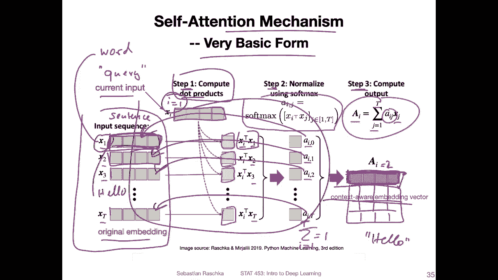
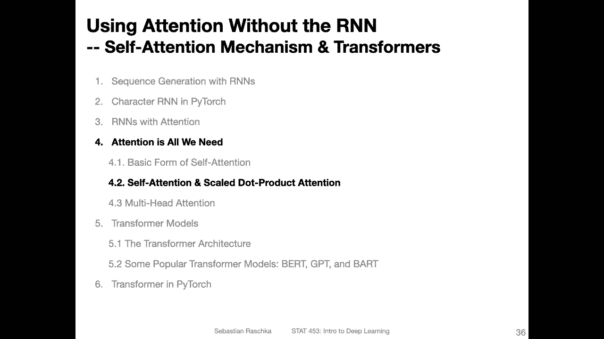
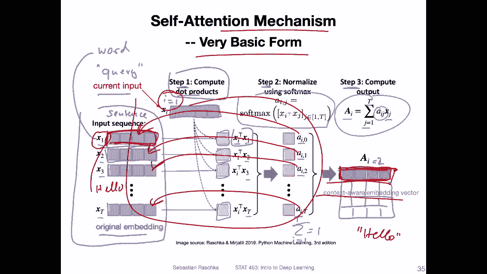
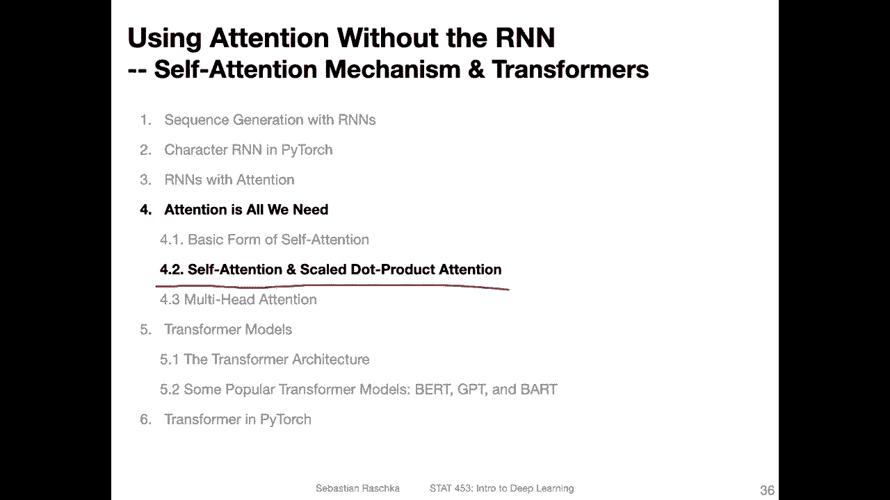

---

## 总结

本节课中，我们一起学习了自我注意力的基础概念。我们从回顾带注意力的RNN开始，然后移除了RNN的顺序处理部分，引入了仅依赖注意力的模型思想。我们重点探讨了一种基础的自我注意力形式，它通过计算词向量之间的点积作为相似度，再经softmax归一化为注意力权重，最后对输入词进行加权求和，从而得到包含上下文信息的词表示。这个过程的核心在于让每个词的表示都能感知到句子中其他词的信息，为理解更复杂的Transformer模型奠定了基础。