# 课程 P159：L19.4.2 - 自注意力与缩放点积注意力 🧠

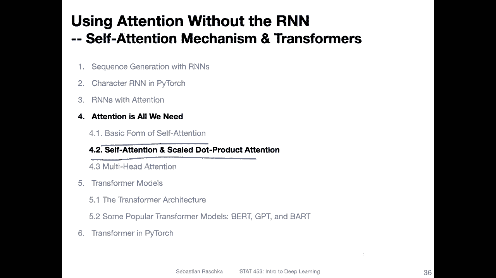

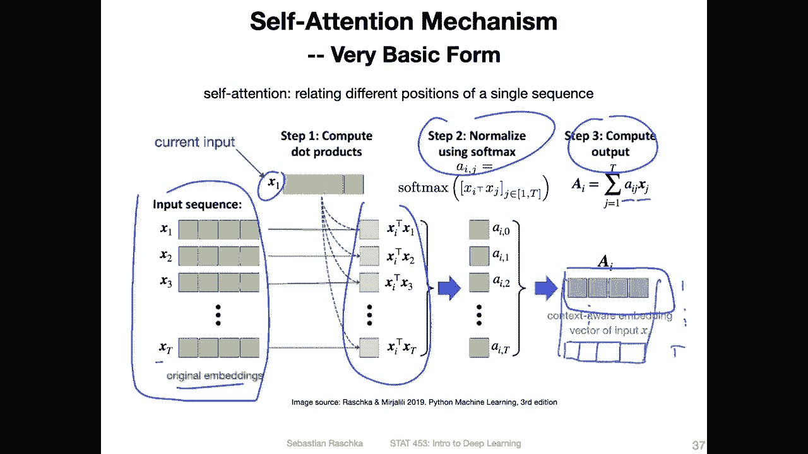

在本节课中，我们将学习自注意力机制的高级形式，特别是《Attention Is All You Need》论文中提出的缩放点积注意力。我们将了解如何通过引入可学习的参数矩阵，使自注意力机制能够被训练并应用于语言模型等任务。

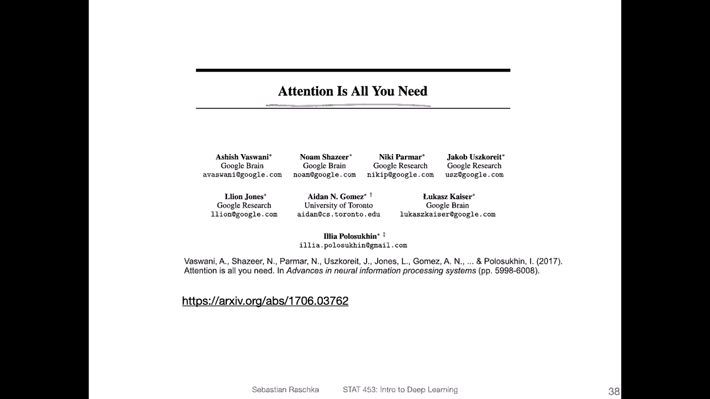

---

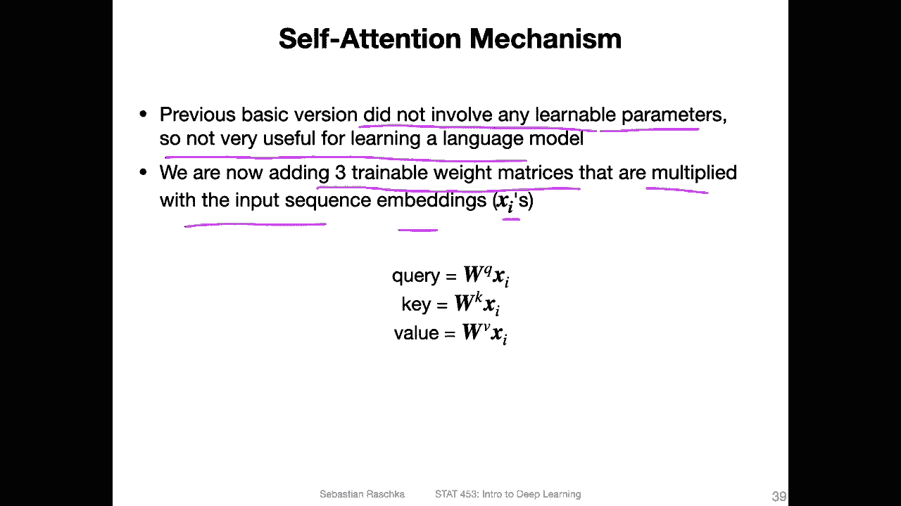

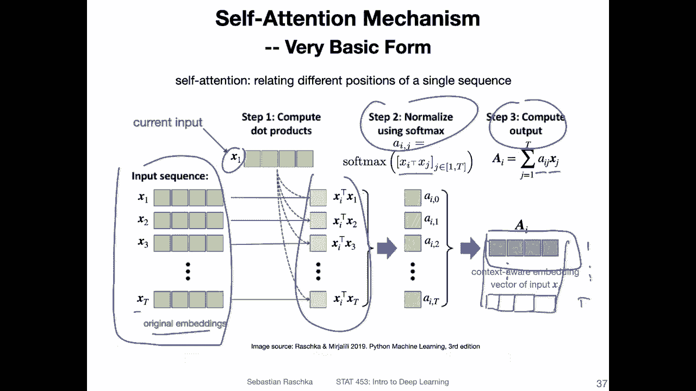

在上一节视频中，我们讨论了自注意力的基础形式。本节中，我们将深入探讨一个更复杂的版本，即《Attention Is All You Need》论文中使用的自注意力机制。

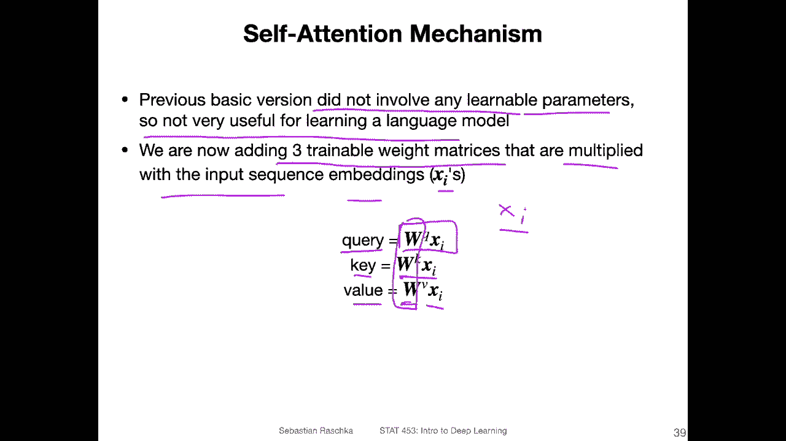

回顾一下，基础自注意力机制的定义如下：我们有一个由词嵌入组成的输入序列。然后，我们计算一个特定输入与所有其他输入的点积。接着，使用 softmax 函数对这些点积进行归一化，最终输出是注意力加权的输入之和。对于每个输入 `a_i`，我们得到一个向量。如果我们有 `T` 个词，就会得到一个 `T x T` 维的注意力矩阵。

现在，我们将扩展这个基础注意力的概念，引入论文中使用的注意力机制。

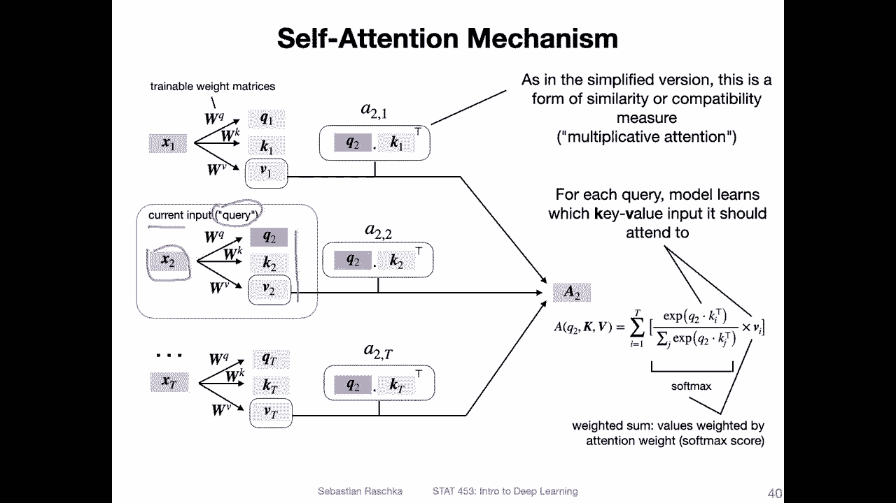

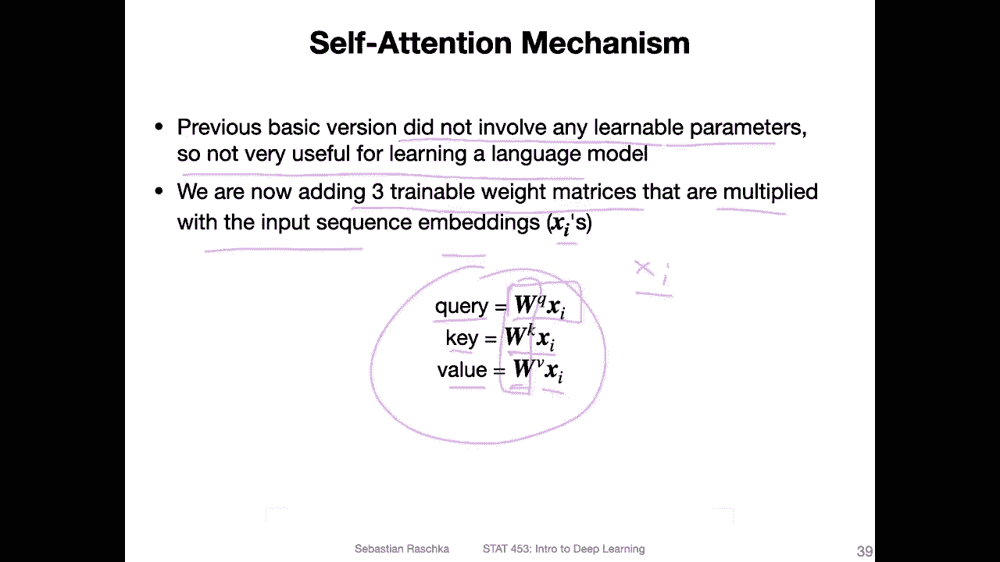

首先，基础自注意力版本存在一个主要问题：它不包含任何可学习的参数。这意味着它对于学习语言模型并不十分有用，因为如果没有可学习参数，我们无法通过反向传播来更新和优化模型。为了解决这个问题，我们现在引入三个可训练的权重矩阵，它们将与输入序列的词嵌入 `X` 相乘。

具体来说，我们不再直接计算输入之间的点积，而是引入三个权重矩阵：`W_Q`（查询矩阵）、`W_K`（键矩阵）和 `W_V`（值矩阵）。通过将词嵌入向量 `x_i` 与这些矩阵相乘，我们分别得到查询向量 `q_i`、键向量 `k_i` 和值向量 `v_i`。这些权重矩阵可以通过反向传播进行更新。

以下是该自注意力机制针对特定输入（例如句子中的第二个词 `x_2`）的计算过程示意图。我们将 `x_2` 视为当前查询。通过矩阵乘法，我们为所有输入词计算其对应的查询、键和值向量。

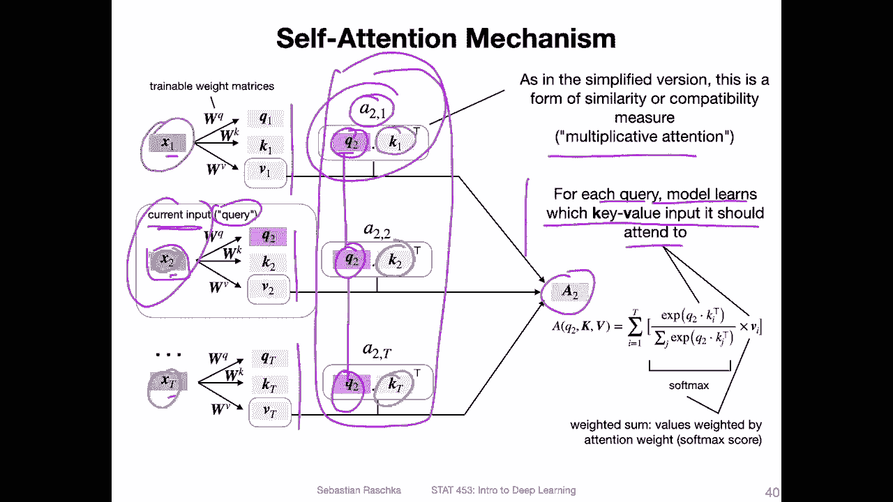

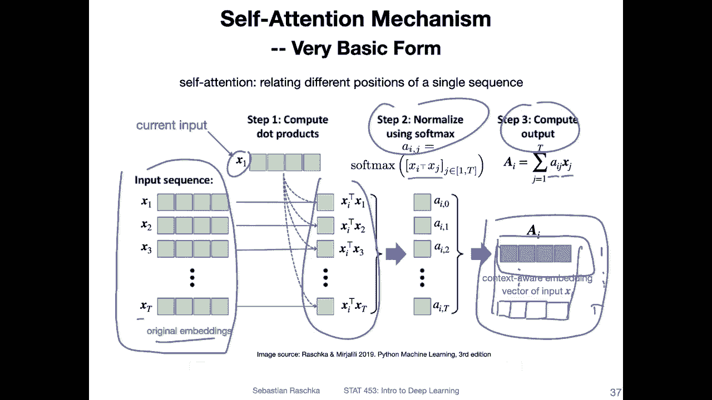

接下来，我们计算注意力分数。与基础版本不同，这里我们计算的是当前查询向量 `q_2` 与所有键向量 `k_i` 的点积。这个过程可以形象地理解为：对于每个查询，模型学习它应该关注哪些键值对输入。

计算出的点积经过 softmax 函数归一化，得到注意力权重 `a_i`，这些权重之和为 1。然后，我们将每个注意力权重与其对应的值向量 `v_i` 相乘，并对所有结果求和，从而得到当前输入 `x_2` 的上下文感知嵌入表示 `a_2`。

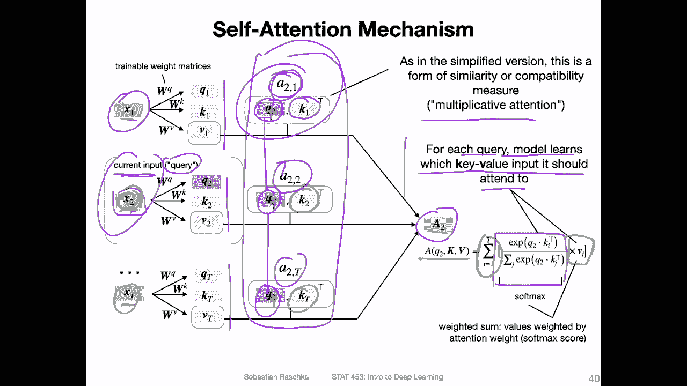

这个过程会为输入序列中的每个词（`x_1` 到 `x_T`）重复执行。值得注意的是，所有这些计算都可以并行进行，因为处理每个词时并不依赖于其他词的计算结果，这是 Transformer 模型的一个优点。

为了更好地理解上一张幻灯片的内容，我们来分析一下其中各部分的维度。

*   输入词嵌入 `x_i` 是一个 `1 x d_e` 维的向量，其中 `d_e` 是嵌入维度（在原始论文中为 512）。
*   权重矩阵 `W_Q`、`W_K`、`W_V` 的维度是 `d_e x d_q`、`d_e x d_k` 和 `d_e x d_v`。在原始 Transformer 论文中，通常设置 `d_q = d_k = d_v`。
*   查询向量 `q_i`、键向量 `k_i` 和值向量 `v_i` 的维度分别是 `1 x d_q`、`1 x d_k` 和 `1 x d_v`。
*   点积 `q_i · k_i` 的结果是一个标量。
*   Softmax 归一化后，我们得到标量注意力权重。
*   最终输出 `a_i` 是 `1 x d_v` 维的向量。

之前的图示仅展示了针对第二个词的注意力计算。实际上，我们需要为输入序列中的每个词（第一个词、最后一个词等）重复此过程。虽然图示看起来是顺序的，但所有计算均可并行执行。

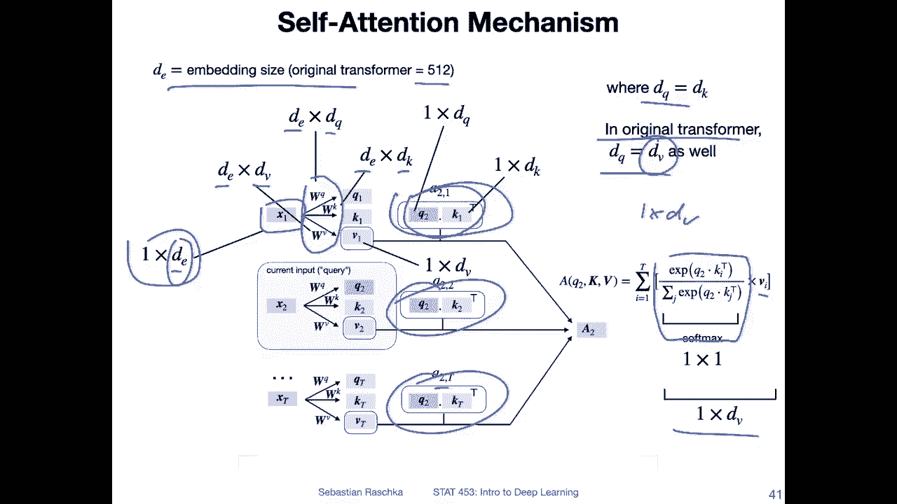

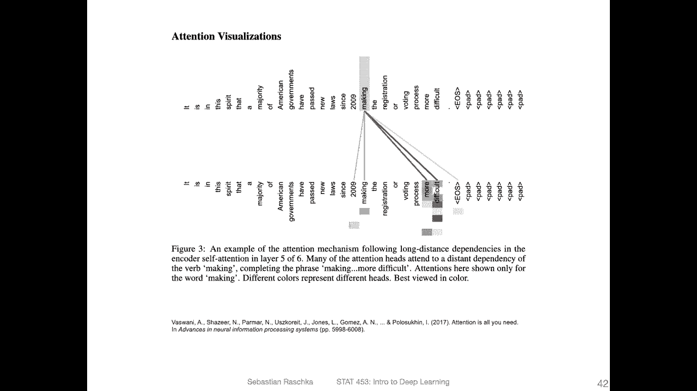

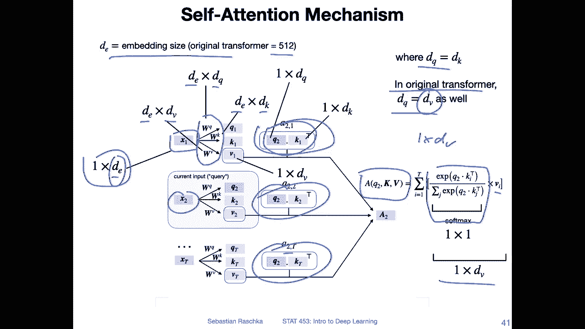

最终，我们会得到一个 `T x d_v` 维的注意力矩阵，其中每一行对应一个词的上下文感知嵌入。

我们可以使用更紧凑的矩阵表示法来总结整个过程。

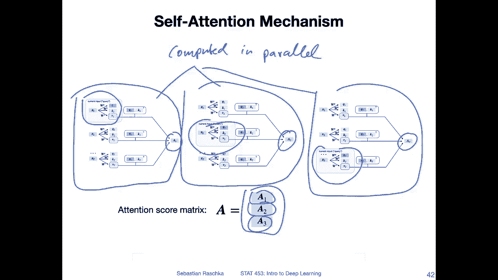

将整个输入序列表示为矩阵 `X`，其维度为 `T x d_e`。通过矩阵乘法 `Q = X W_Q`、`K = X W_K`、`V = X W_V`，我们一次性得到所有词的查询、键和值矩阵。

注意力矩阵 `A` 可以通过以下公式计算：
`A = softmax( (Q K^T) / sqrt(d_k) ) V`

这里，`Q K^T` 计算了所有查询和键对之间的点积，得到一个 `T x T` 的矩阵。除以 `sqrt(d_k)` 是缩放操作，`softmax` 函数按行进行归一化。最后，与值矩阵 `V` 相乘，得到 `T x d_v` 维的输出矩阵。

这个缩放因子 `sqrt(d_k)` 的作用是防止点积的值过大。当点积值很大时，softmax 函数的梯度会变得非常小（进入饱和区），这不利于训练。通过缩放，可以使注意力权重的分布更加平缓，有利于模型学习。

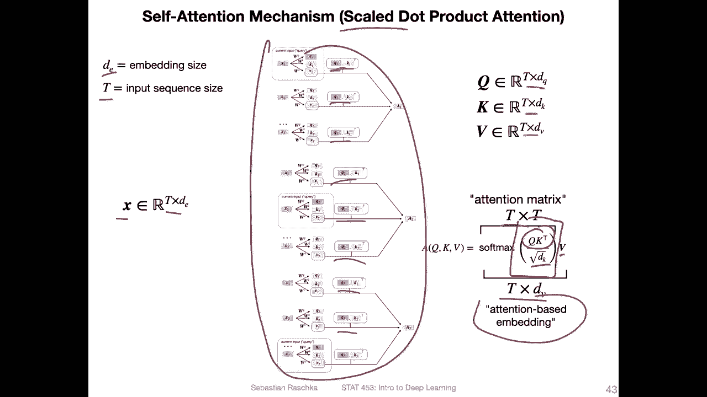

自注意力机制的一个潜在缺点是，`Q K^T` 计算产生的 `T x T` 矩阵在输入序列很长时会占用大量内存（复杂度为 O(T²)）。不过，其可并行计算的特性在一定程度上弥补了这一不足。

下图是《Attention Is All You Need》论文中对缩放点积注意力的可视化总结，清晰地展示了矩阵乘法、缩放、可选的掩码（在解码器中用到）、softmax 以及与值矩阵相乘的步骤。

---

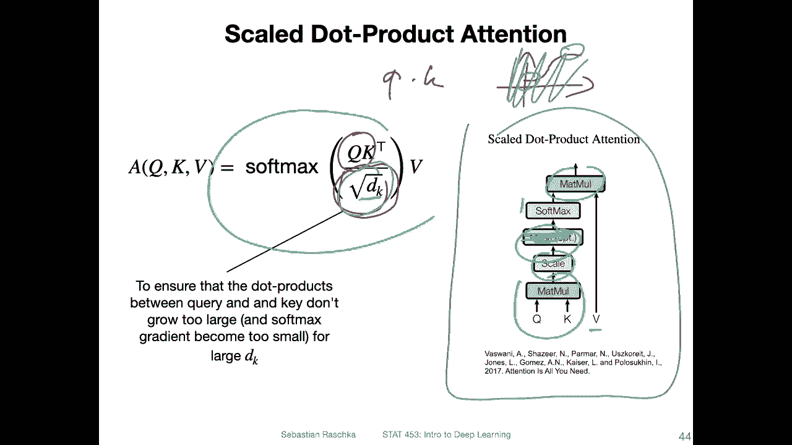

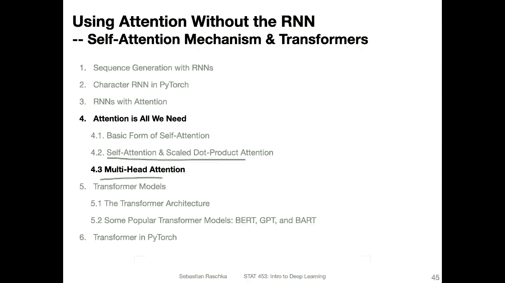

本节课我们一起学习了自注意力机制及其更实用的变体——缩放点积注意力。我们了解了如何通过引入可学习的查询、键、值矩阵，使注意力机制能够被训练。我们还探讨了其并行计算的优势以及缩放因子的重要性。在下一节课中，我们将在此基础上学习多头注意力机制，这是构建完整 Transformer 模型的关键一步。