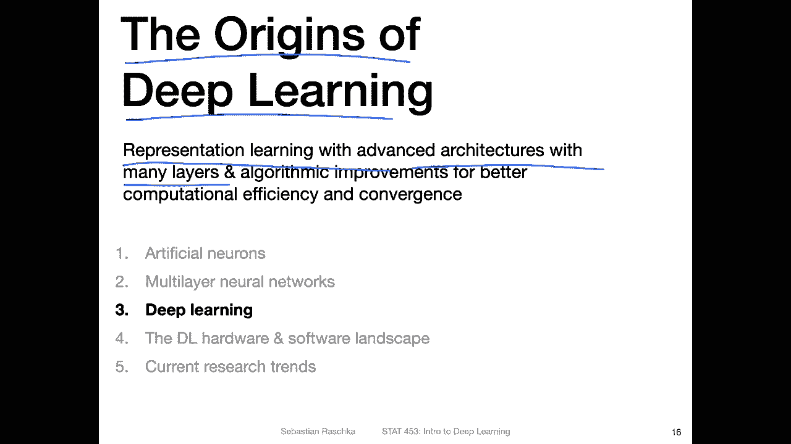
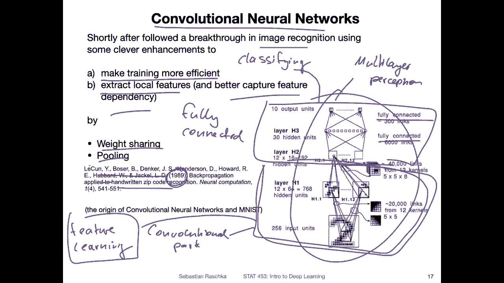
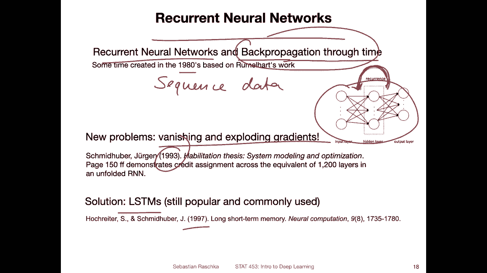
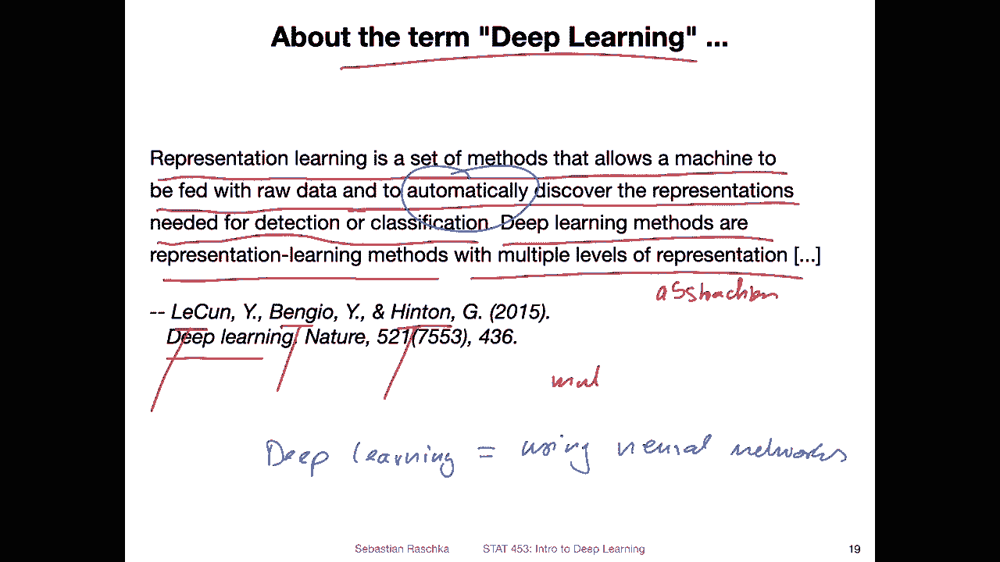
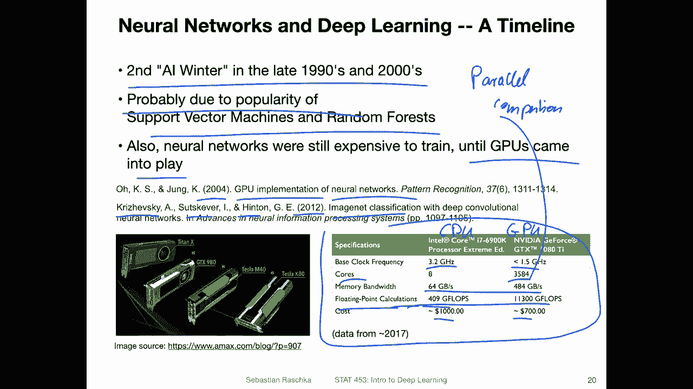
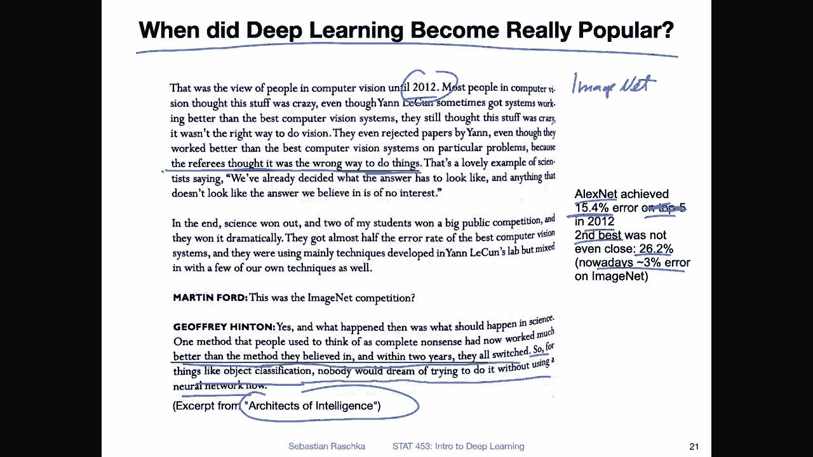
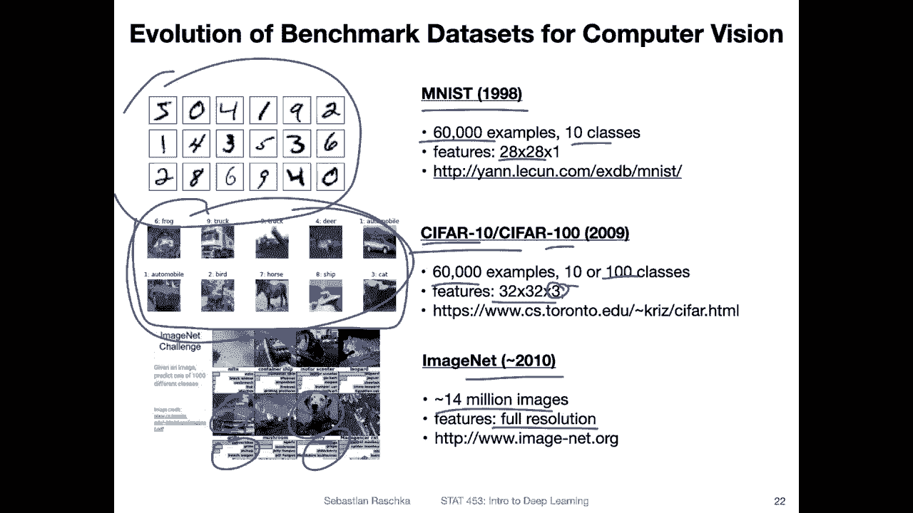
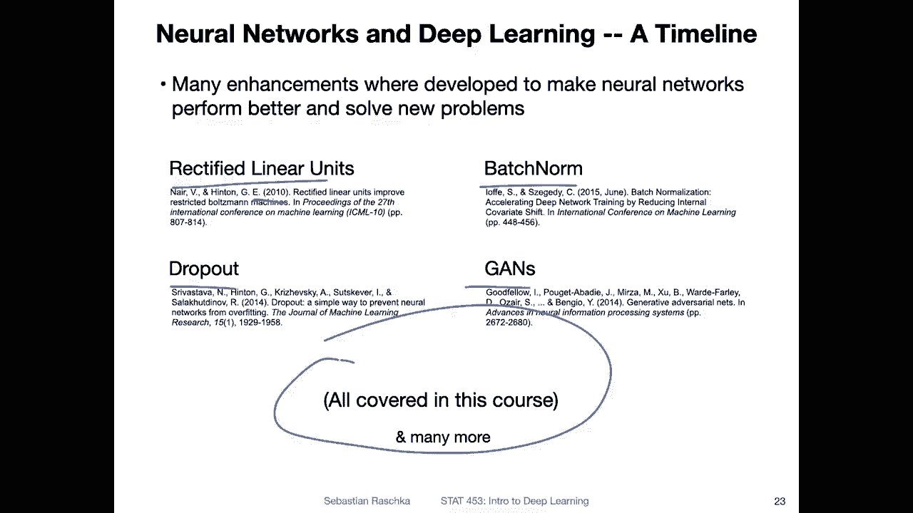
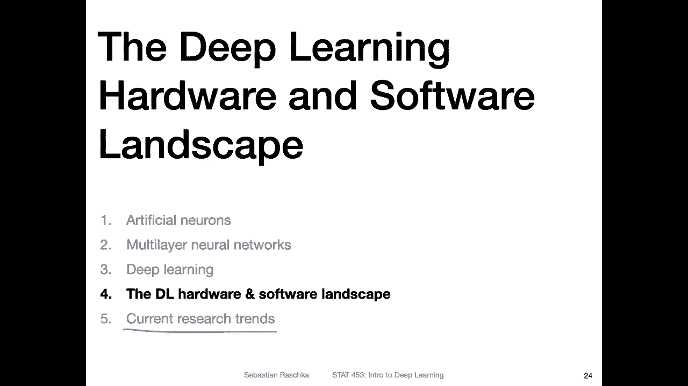

# 深度学习课程 P16：L2.3 - 深度学习的起源 🧠

在本节课中，我们将要学习深度学习的起源。我们将从多层感知机过渡到深度学习，探讨“深度学习”这一术语的由来，并了解推动其发展的关键架构与技术突破。

## 从多层感知机到深度学习



上一节我们介绍了多层感知机。本节中我们来看看“深度学习”这一概念是如何出现的。

“深度学习”是一个相对较新的术语，大约在10-15年前被提出。而多层感知机已经存在了至少30-40年。那么，使用多层感知机是否算作深度学习呢？这在技术上是存在争议的。

从技术上讲，“深度学习”一词最初出现时，指的是**使用具有许多层的先进架构进行表示学习**。因此，仅仅拥有多层结构并不是多层感知机与深度学习的主要区别。关键在于**表示学习的能力**，这才是深度学习的核心。

如今，在较新的论文中，人们使用多层感知机时也常称之为深度学习。为了减少混淆，现在通常将所有神经网络都自动归入深度学习的范畴。

## 表示学习与卷积神经网络

让我们更深入地探讨一下刚才提到的表示学习方面。这可以追溯到大约20世纪90年代，甚至在“深度学习”这个词出现之前。

卷积神经网络是建立在多层感知机之上的一个专门化版本。它引入了**局部性**的概念，旨在提高训练效率并提取局部特征，从而更好地捕捉特征间的依赖关系。

回想一下，多层感知机假设特征独立，适用于表格数据。而卷积网络可以利用**关系归纳偏置**的先验知识，专门为图像识别和图像数据设计。

以下是卷积网络的基本工作原理：



```python
# 概念性结构：卷积部分 + 全连接部分
# 卷积部分：特征学习（卷积层、权重共享、池化）
# 全连接部分：分类器（本质上是多层感知机）
```

在右侧展示的是Yann LeCun等人应用于手写邮政编码识别的原始LeNet架构。我们将在后续课程中专门讲解卷积网络，这里先简要概述。



卷积网络由两部分组成：
1.  **卷积部分**：包含卷积层，运用了**权重共享**的技巧，并涉及池化操作。这使得训练更加高效。你可以粗略地将其视为**特征学习层**，这些层能够从数据中提取抽象特征。
2.  **全连接部分**：本质上是一个**多层感知机**，充当分类器。

因此，整个网络可以看作一个任务：下半部分用于**特征学习**，上半部分用于**分类**由前面层提取的特征。这使得手工设计特征变得过时。网络自己学习特征，并且学习的方式对分类器是最优的，因为整个网络是连接在一起的、共同学习的。这是神经网络在处理图像数据时非常高效的一个优势。

这同样是20世纪90年代的成果，那时“深度学习”一词尚未出现。但如今，卷积神经网络无疑是深度学习最流行的形式之一。当然，深度学习还有另一个重要分支——循环神经网络。

## 循环神经网络



循环神经网络也可以看作是多层感知机的一个高级版本。

它的新颖之处在于引入了**循环**结构。多层感知机是前馈网络，而循环神经网络可以“回顾”先前的信息。这将在本课程后续的专门讲座中详细讨论。

其核心思想是，我们使用了一种改进的反向传播算法，称为**随时间反向传播**，因为它包含了时间成分。这对于处理**序列数据**特别有用，因为这类数据中的特征之间存在顺序依赖关系。

然而，训练具有许多层的神经网络，尤其是处理长序列的循环网络时，会面临**梯度消失和爆炸**的挑战。针对这个问题有许多潜在的解决方案，其中至今仍常用的是**长短期记忆网络**。

这也是深度学习的一种流行形式。实际上，我不知道循环神经网络最初是何时发明的，大概是在20世纪80年代反向传播算法发明之后不久，作为其一项进展。

## 深度学习的核心定义

那么，“深度学习”最初到底指什么呢？这里引用深度学习综述（作者：Yoshua Bengio, Yann LeCun, Geoffrey Hinton）中的一句话来总结：

> 表示学习是一组方法，允许机器接收原始数据，并自动发现用于检测或分类所需的表示。深度学习方法是具有多个表示（或抽象）层次的表示学习方法。

这里的重点确实是深度学习所做的**隐式特征提取**，这是传统机器学习无法做到的（正如我们上周讨论的，传统方法依赖于手工特征与自动特征提取）。如今，深度学习基本上就等同于使用神经网络。



## 走向现代：硬件革命与ImageNet突破

从这些20世纪90年代发明的架构，到现代深度学习研究时代，中间不幸地经历了另一个“AI寒冬”（20世纪90年代末至21世纪初）。这可能是因为支持向量机和随机森林的流行。当时，神经网络虽然有能力，但训练成本非常高，需要巨大的计算机硬件，并且即使如此，训练时间也很长。相比之下，支持向量机和随机森林更容易训练，并且效果相当好。

然而，后来人们发现了如何利用**GPU**来更高效地训练神经网络。这真正帮助神经网络变得流行和可行。根据文献，GPU实现神经网络可以追溯到2004年，但真正变得流行是在2012年。

2012年，Alex Krizhevsky、Ilya Sutskever和Geoffrey Hinton在ImageNet分类挑战赛上使用了在GPU上训练的深度神经网络，其性能大幅超越了传统的计算机视觉方法。以下是关于硬件差异的简要说明：

| 特性 | CPU (如 Intel) | GPU (如 NVIDIA) |
| :--- | :--- | :--- |
| **核心数量** | 较少，但频率高 | **极多**，但频率较低 |
| **擅长运算** | 通用计算 | **线性代数**（向量/矩阵运算） |
| **关键优势** | 单核性能强 | **并行计算**能力强，内存带宽高 |

GPU特别擅长并行计算点积和矩阵乘法，这使得它对深度学习非常有用。你不需要为这门课购买GPU，后续会介绍一些免费的在线资源。

关于深度学习何时真正流行起来，这里有一段有趣的引述，来自对Geoffrey Hinton的采访，谈及2012年的ImageNet竞赛：



> 当时，会议被传统的计算机视觉方法（如手动特征工程）主导，没有深度学习。评审们认为（神经网络）是做事情的错误方式……然而，2012年提交的AlexNet在top-5分类错误率上达到了15.4%，而第二好的方法只有26.2%。他们的方法比任何传统计算机视觉系统都好大约一倍。人们真的对深度学习的效果感到惊讶。他说，在两年内，所有人都转向了（深度学习）。对于像物体分类这样的任务，现在没人会梦想不使用神经网络。

因此，2012年确实是深度学习的突破时刻。

## 常用基准数据集

以下是开发卷积网络或物体分类方法时常用的基准数据集：

*   **MNIST**：传统数据集（1998年），6万张示例，10个类别（手写数字），图像分辨率非常低。非常适合调试网络，训练速度快。
*   **CIFAR-10 / CIFAR-100**：更高级的数据集，6万张示例，CIFAR-10有10个类别，CIFAR-100有100个类别。分辨率仍较低（32x32），但是**彩色图像**（3个通道）。
*   **ImageNet**：更具挑战性的数据集，包含约1400万张全分辨率图像。其挑战性在于图像中可能有多个物体，标签有时存在歧义。因此，通常使用**top-5准确率/错误率**进行评估。即，检查模型预测的置信度最高的前5个标签中，是否包含图像的真实标签。

## 后续发展与总结

自2012年以来，当然又有了许多进展，使得深度神经网络工作得更好。一些常见且流行的技术包括：
*   **ReLU**：修正线性单元，非常简单但非常有效的激活函数。
*   **批量归一化**
*   **Dropout**
*   **生成对抗网络**



这些技术都将在本课程中涵盖，并且过去十年还有更多进展，它们共同推动了深度学习的发展。

在下一个视频中，我们将简要讨论硬件和软件格局在过去几年发生的变化，并简要概述当前的一些研究趋势，从而结束第二讲的系列视频。之后，我们将进入关于感知机的更详细课程。



---



**本节课中我们一起学习了**：深度学习的起源和定义，其与多层感知机的联系与区别；推动深度学习发展的两大关键架构——卷积神经网络和循环神经网络的基本思想；深度学习在2012年借助GPU和ImageNet竞赛实现突破的历史；以及常用的基准数据集和后续重要技术。理解这些起源有助于我们把握深度学习发展的脉络和核心思想。