# 课程 P161：L19.5.1 - Transformer 架构详解 🧠

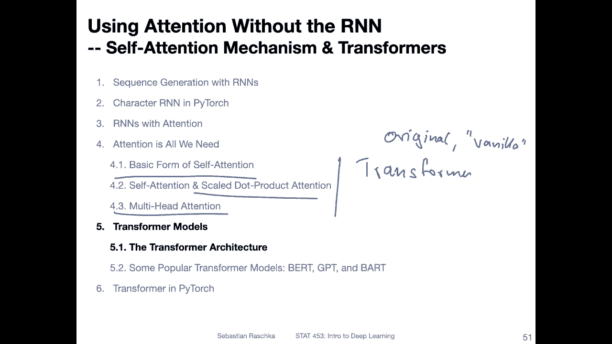

在本节课中，我们将详细学习 Transformer 模型的核心架构。我们将从回顾缩放点积注意力机制开始，逐步拆解 Transformer 的编码器-解码器结构，并解释其中的关键组件，如多头注意力、掩码、位置编码和层归一化。

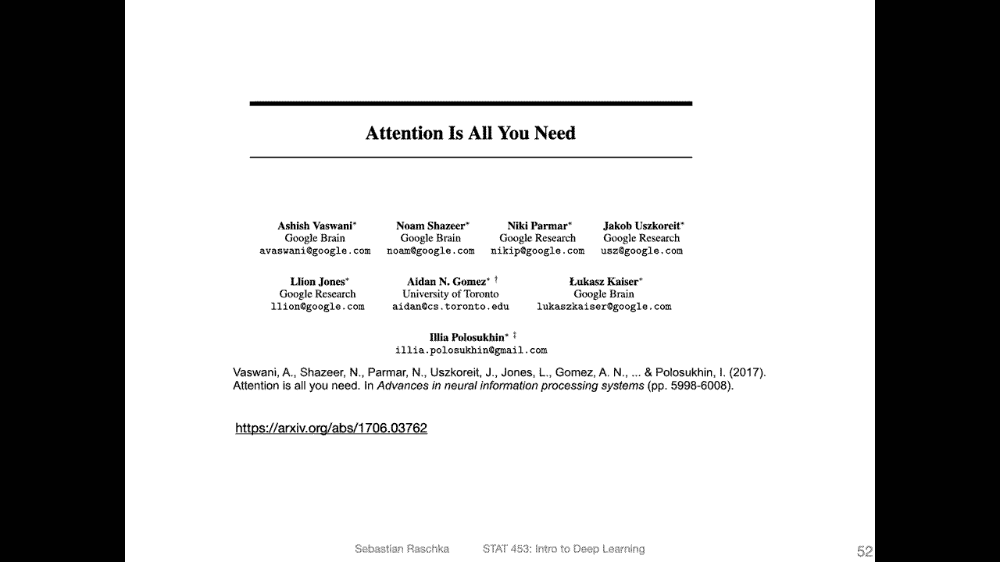

---

## 回顾：缩放点积注意力

在上一节我们介绍了多头注意力的基础，本节中我们首先回顾其核心——缩放点积注意力机制，以便更好地理解 Transformer。

缩放点积注意力机制在《Attention Is All You Need》论文中被提出，其计算过程可分为五个步骤。以下是该过程的总结：

1.  **构造查询、键和值**：输入矩阵 **X** 的每一行代表一个词。我们分别使用可学习的权重矩阵 **W^Q**、**W^K**、**W^V** 与输入相乘，得到查询矩阵 **Q**、键矩阵 **K** 和值矩阵 **V**。
    *   公式：**Q = X W^Q**, **K = X W^K**, **V = X W^V**

2.  **计算注意力分数**：通过矩阵乘法计算查询 **Q** 和键 **K** 的相似度（点积）。结果矩阵的每个元素代表了序列中两个词之间的关联强度。

3.  **缩放**：将上一步的结果除以键向量维度 **d_k** 的平方根进行缩放。这是为了防止点积值过大，导致 Softmax 函数的梯度变得过小，不利于训练。
    *   公式：**分数 = (Q K^T) / sqrt(d_k)**

4.  **应用 Softmax**：对缩放后的分数矩阵的每一行应用 Softmax 函数，将其转换为概率分布（注意力权重），权重之和为 1。

5.  **加权求和**：将上一步得到的注意力权重矩阵与值矩阵 **V** 相乘。对于输出矩阵的每一行（对应一个词），其结果都是所有值向量的加权和，权重由该词与其他词的关联度决定。这样，每个词的输出表示都融合了整个句子的上下文信息。

---

## 多头注意力机制

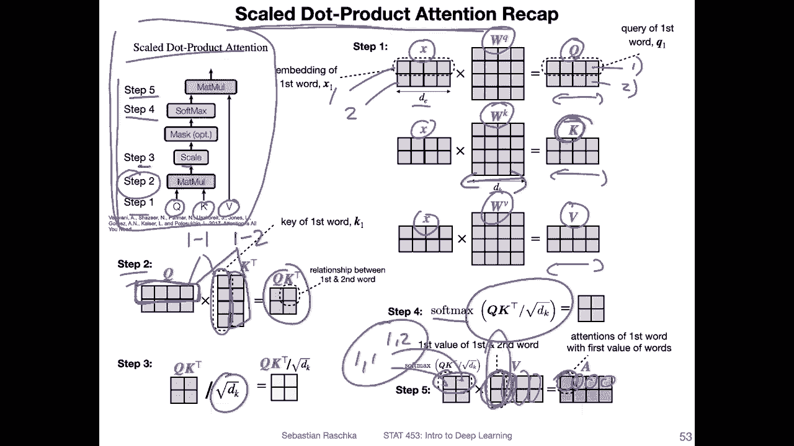

上一节我们介绍了单一的注意力头，本节中我们来看看如何通过并行计算多个注意力头来增强模型能力。

多头注意力机制的核心思想是并行运行多个缩放点积注意力过程。具体步骤如下：

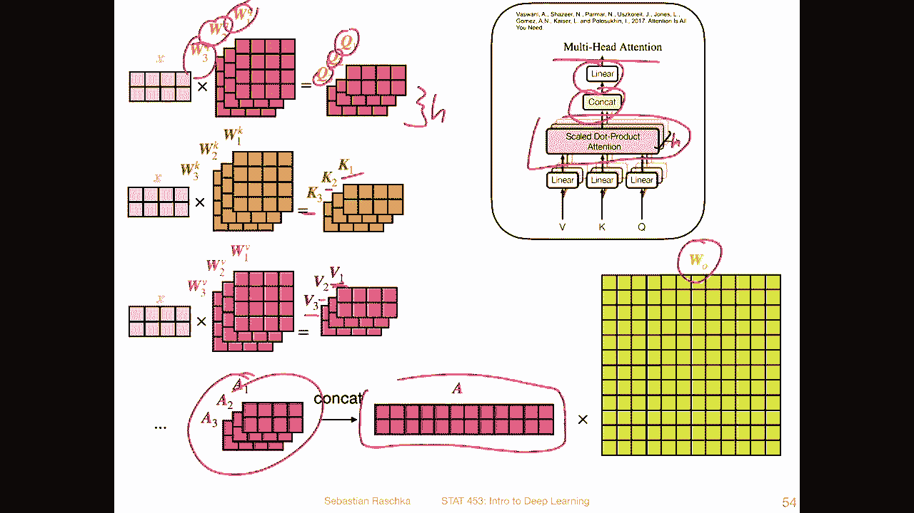

*   首先，使用不同的线性投影矩阵，将输入分别投影到 **h** 组（例如8组）查询、键和值子空间。
*   然后，在每组子空间上独立执行缩放点积注意力计算。
*   接着，将所有 **h** 个注意力头的输出在特征维度上进行拼接。
*   最后，将拼接后的结果通过一个可学习的线性层进行投影，得到最终输出。

这种设计允许模型在不同的表示子空间中共同关注来自不同位置的信息，从而捕获更丰富的上下文关系。

---

## Transformer 整体架构 🏗️

了解了核心组件后，现在我们来俯瞰 Transformer 模型的完整架构。它看起来可能很复杂，但我们可以逐一拆解理解。

Transformer 模型主要分为两大部分：编码器和解码器。

*   **编码器**：接收输入序列（例如一个句子），并生成该序列的上下文表示。
*   **解码器**：接收编码器的输出以及自身已生成的部分输出序列（向右偏移一位），然后自回归地（一次一个词）预测下一个词的概率。

整个架构中有几个关键设计：
1.  **多头注意力层**：在编码器和解码器中都使用了该层。解码器中还有一个**掩码多头注意力层**，用于防止模型在训练时“偷看”未来的词。
2.  **前馈神经网络**：每个注意力层后面都接有一个全连接的前馈网络，用于进行非线性变换。
3.  **残差连接与层归一化**：每个子层（注意力层、前馈层）的输出都会与输入进行相加（残差连接），然后进行层归一化。这有助于缓解梯度消失问题，并稳定训练过程。
4.  **堆叠结构**：编码器和解码器都由 **N** 个（原论文中 N=6）完全相同的层堆叠而成，层与层之间不共享权重。

编码器和解码器的输入/输出维度始终保持一致（例如512维），这是为了确保残差连接能够顺利进行。

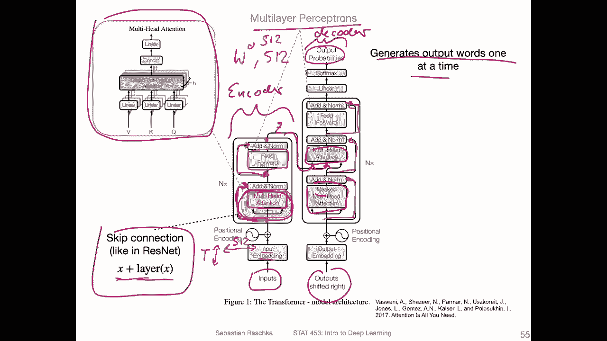

---

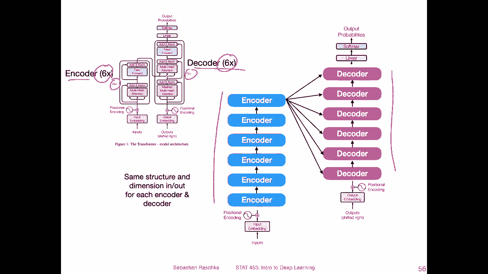

## 掩码多头注意力 🎭

上一节提到了解码器中的掩码注意力，本节中我们详细解释其作用。

在训练解码器时，我们已知完整的目标序列。但在预测第 **t** 个词时，模型只能依赖于第 **1** 到 **t-1** 个已生成的词，而不应“看到”第 **t** 个及之后的词。掩码多头注意力正是为了实现这一点。

其实现方式是在计算注意力分数（Softmax 之前）时，将未来位置（当前位置之后）的分数设置为一个极大的负数（例如 `-1e9`）。这样，在应用 Softmax 后，这些未来位置的注意力权重就会变为接近 0 的值，从而被有效地“屏蔽”。

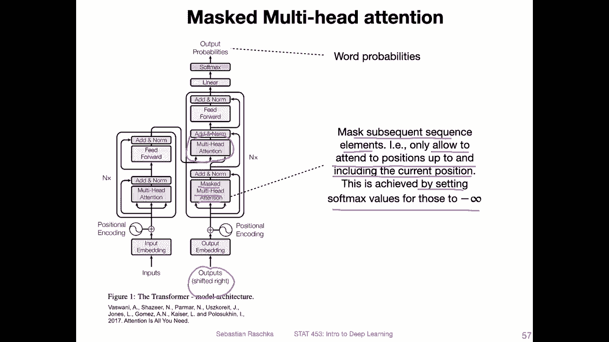

例如，在翻译句子“I like planes”为德语时，当模型正在预测第二个词，它只能基于第一个词“Ich”进行计算，而“Fliege”和“gerne”这两个未来的词会被掩码掉。

解码器的最终输出会通过一个线性层映射到词汇表大小，再经过 Softmax 得到每个词的概率，通过交叉熵损失进行训练。

---

## 位置编码 📍

我们之前提到，自注意力机制本身对序列中词的位置不敏感。为了给模型注入位置信息，Transformer 引入了**位置编码**。

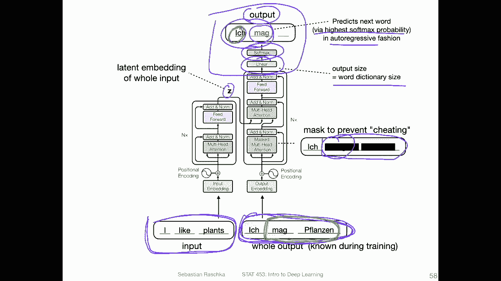

位置编码是一个与词嵌入维度相同的向量，它根据词在序列中的位置，通过正弦和余弦函数生成一组固定的值。这个位置编码向量会被直接加到对应的词嵌入向量上。

```python
# 位置编码公式（简化示意）
PE(pos, 2i) = sin(pos / 10000^(2i/d_model))
PE(pos, 2i+1) = cos(pos / 10000^(2i/d_model))
```
其中，`pos` 是位置，`i` 是维度索引，`d_model` 是模型维度。

这样，不同位置就会获得独特的位置编码模式，使得模型能够区分“我喜欢飞机”和“飞机喜欢我”这种词序不同的句子。

---

## 层归一化

在 Transformer 中，每个“Add & Norm”层中的“Norm”指的就是**层归一化**。

层归一化与批归一化类似，但归一化的维度不同。批归一化是在批次维度上计算均值和方差，而层归一化是在特征维度（对于 Transformer，即跨注意力头或隐藏单元）上进行的。

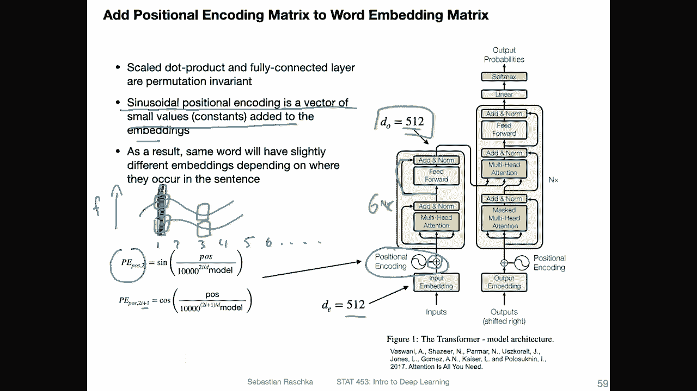

对于某个层的输出向量 **x**，层归一化的计算如下：
*   公式：**LayerNorm(x) = γ * (x - μ) / σ + β**
其中 **μ** 和 **σ** 是该向量自身所有元素的均值和标准差，**γ** 和 **β** 是可学习的缩放和偏移参数。

层归一化有助于稳定训练过程，减少内部协变量偏移，并且对小批量大小不敏感。

---

## 注意力可视化 👀

最后，我们通过论文中的可视化图来直观理解注意力机制学到了什么。

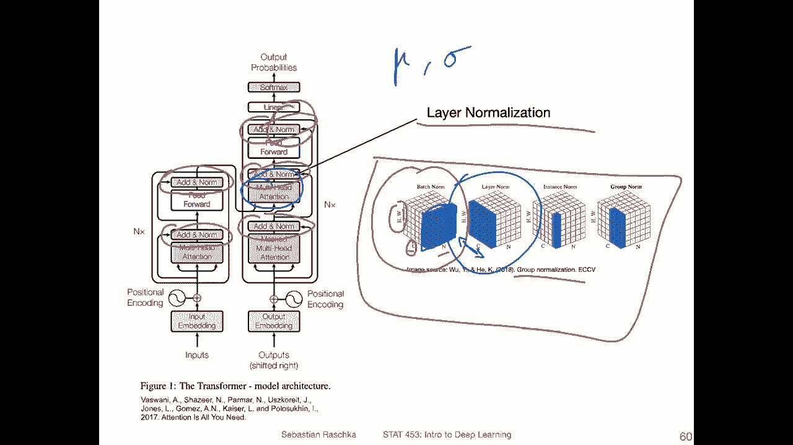

下图展示了两个不同注意力头（Head 5 和 Head 6）在翻译句子时产生的注意力权重。颜色深浅表示注意力强度。


可以看到：
*   对于单词“law”，在 Head 5 中，它主要关注“European”和“law”本身；而在 Head 6 中，它的关注模式则完全不同。
*   这证明了多头注意力机制的有效性：不同的注意力头确实学会了关注句子中不同类型的关系和依赖，它们提供的信息是互补而非冗余的。

---

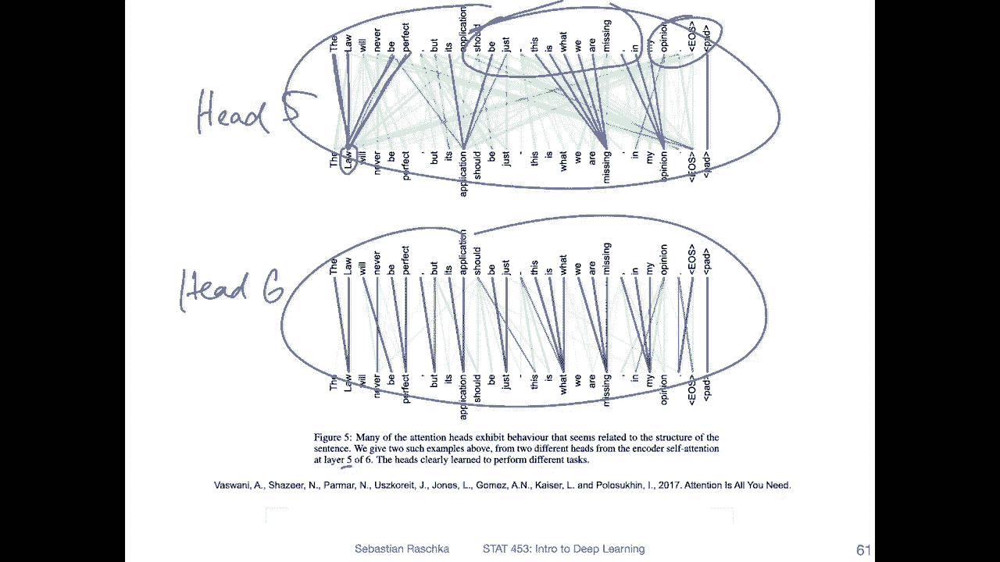

## 总结

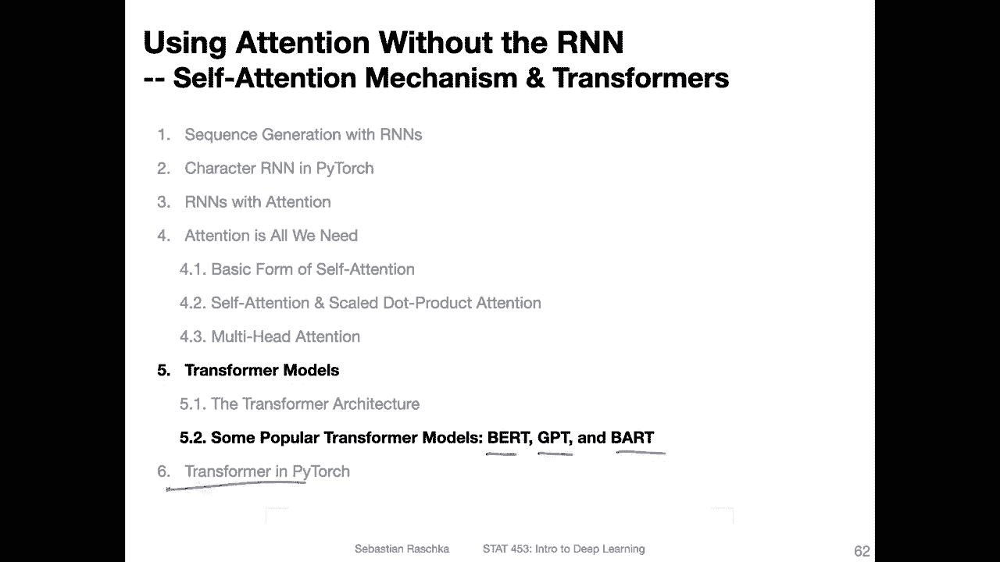

本节课中我们一起学习了 Transformer 模型的核心架构。我们从基础的缩放点积注意力出发，逐步构建了多头注意力机制，并深入剖析了 Transformer 编码器-解码器结构中的各个关键部分，包括掩码注意力、位置编码、残差连接与层归一化。最后，我们通过注意力可视化看到了模型如何学习词与词之间的复杂关系。理解这一经典架构是掌握后续如 BERT、GPT 等现代 Transformer 变体模型的重要基础。