# P164：L19.5.2.3 - BERT：来自Transformer的双向编码器表示 🧠

在本节课中，我们将学习BERT模型。BERT是“Bidirectional Encoder Representations from Transformers”的缩写，由谷歌研究团队于2018年提出。它的核心创新在于其**双向**特性，能够同时利用上下文信息进行预训练，这使其在多项自然语言处理任务上取得了突破性进展。

---

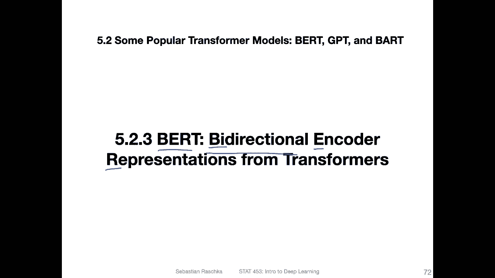

上一节我们介绍了GPT-1，它是一个单向的Transformer模型，其预训练任务是预测下一个词。BERT则与之不同，它是一个双向的Transformer编码器。

BERT的主要架构与原始Transformer论文中的编码器部分基本相同，都包含多头注意力机制和前馈神经网络。关键区别在于BERT的**双向**预训练方式，它通过一种称为“掩码语言模型”的任务来实现。

为了理解BERT的双向预训练，我们来看一个简单的概念。它不像GPT那样从左到右顺序处理，而是随机掩盖输入句子中的一些词，然后让模型根据**所有未被掩盖的词**来预测这些被掩盖的词。这迫使模型同时利用左右两侧的上下文信息。

以下是BERT预训练的两个主要任务：

1.  **掩码语言模型**：随机掩盖输入序列中15%的词汇，让模型预测这些被掩盖的词。
2.  **下一句预测**：给定两个句子A和B，让模型判断B是否是A的下一句。这有助于模型理解句子间关系。

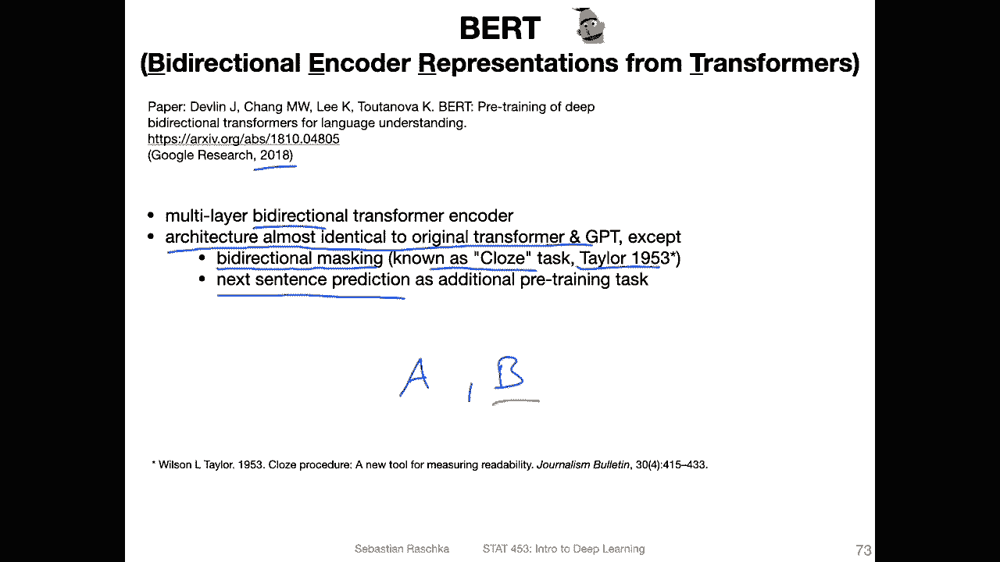

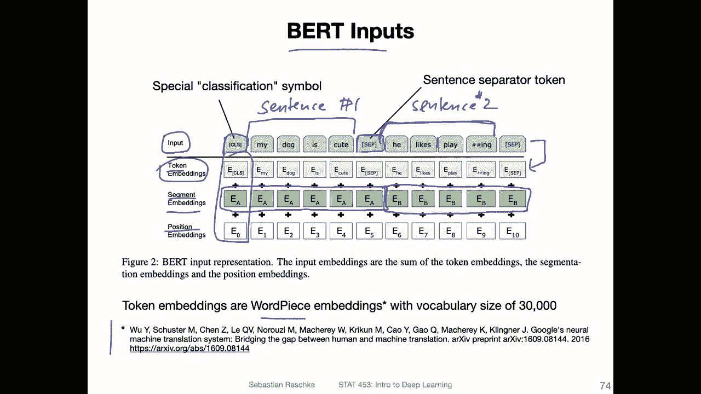

BERT的输入表示由三部分组成：

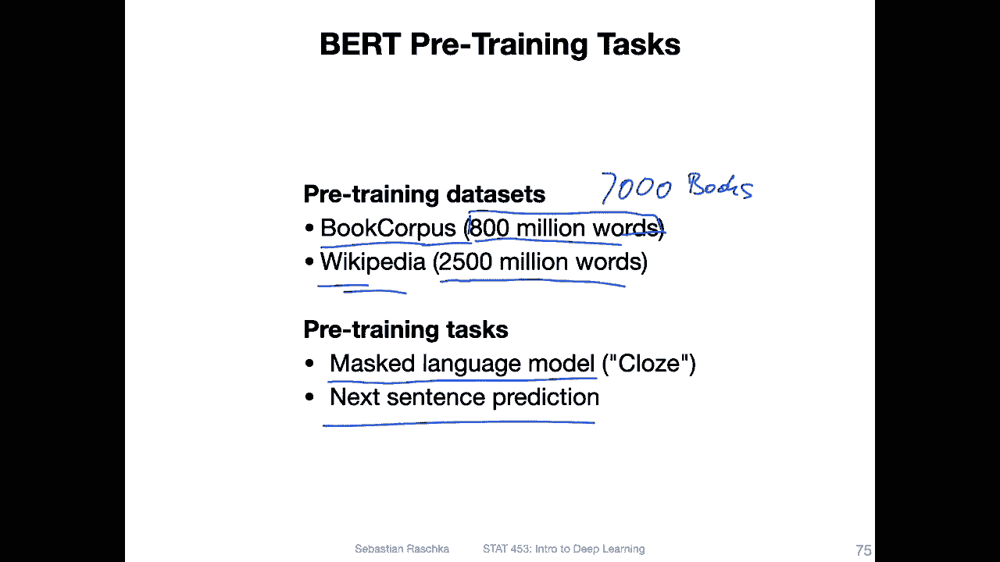

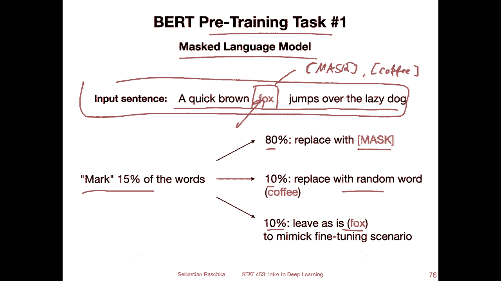

*   **词嵌入**：每个词的向量表示。
*   **段落嵌入**：用于区分句子A和句子B。
*   **位置嵌入**：表示每个词在序列中的位置。

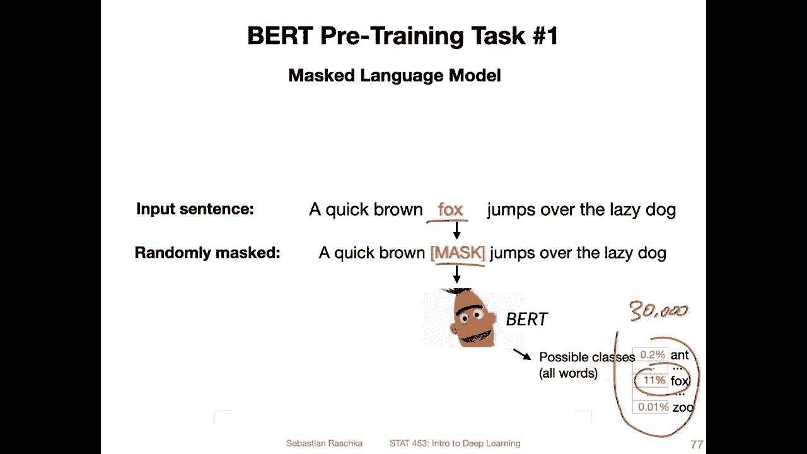

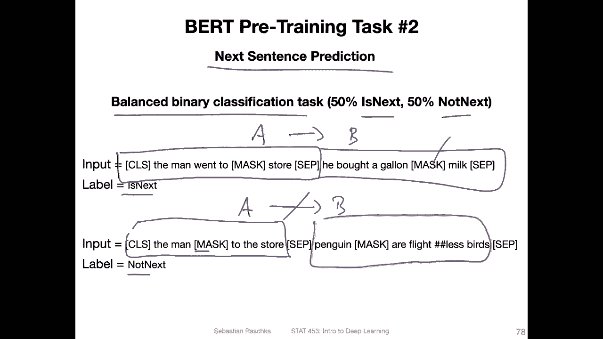

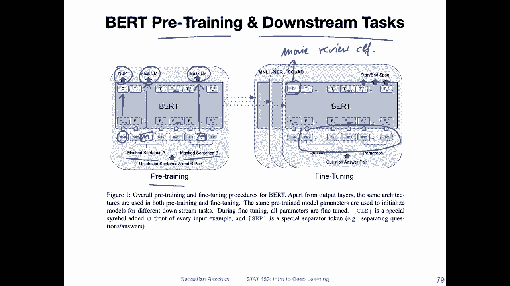

这些嵌入相加后，形成BERT的输入。

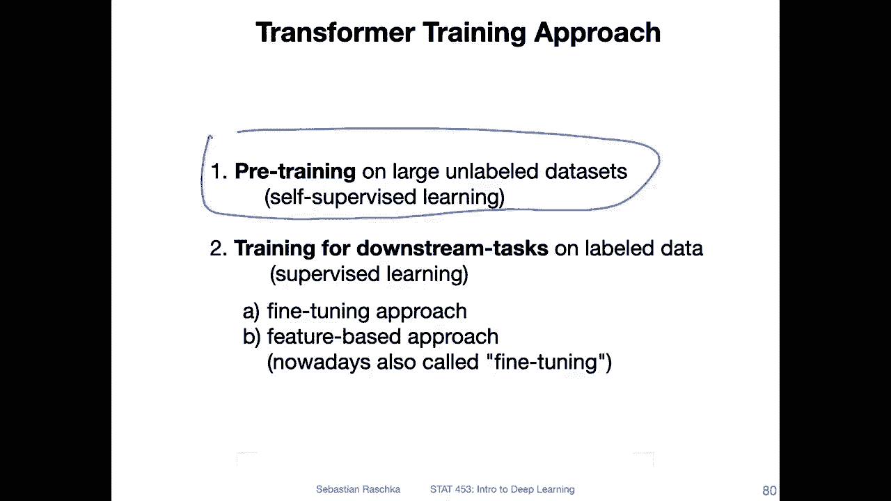

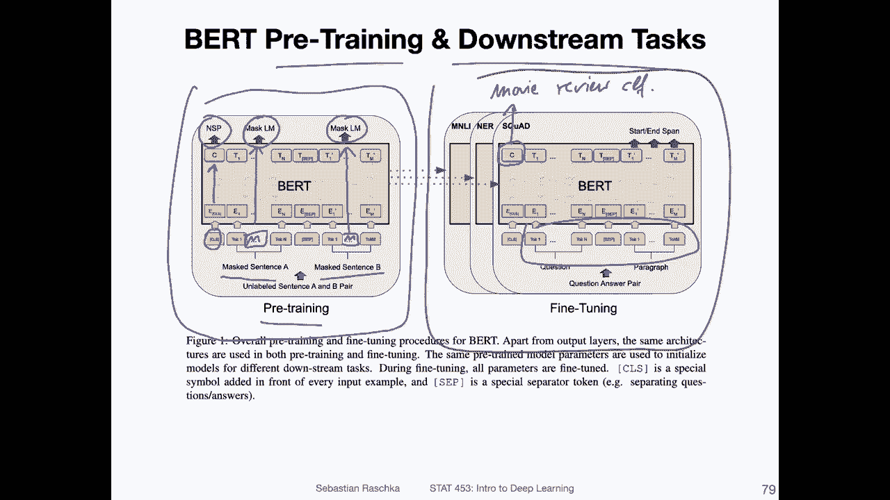

BERT模型有不同规模的版本，例如BERT-Base包含12层Transformer编码器，而BERT-Large包含24层。模型规模越大，通常性能越好，但计算成本也越高。

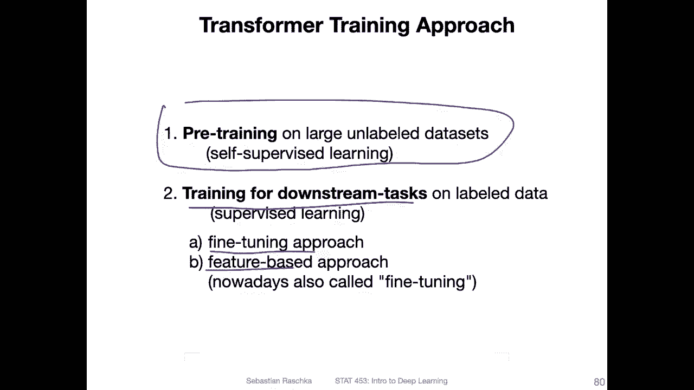

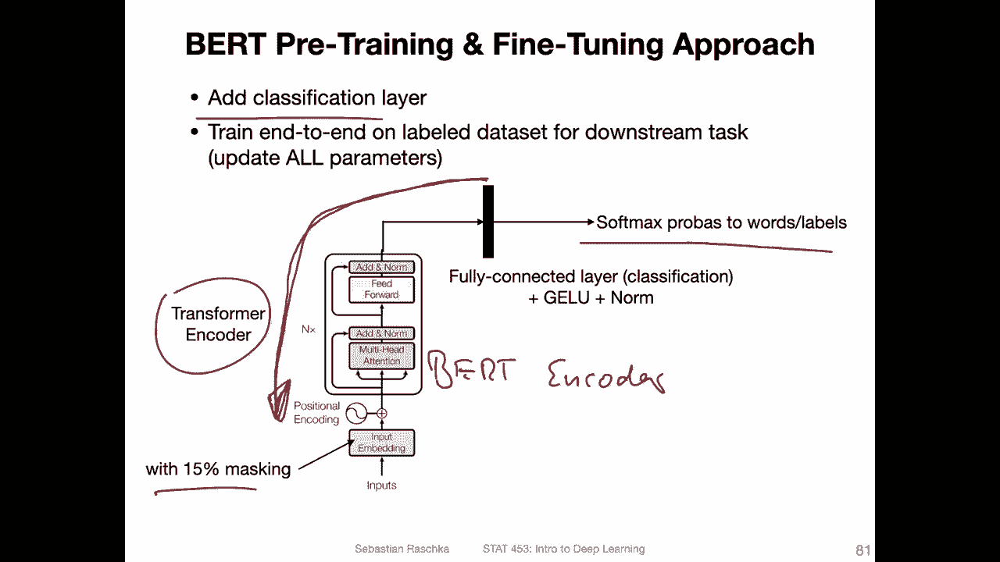

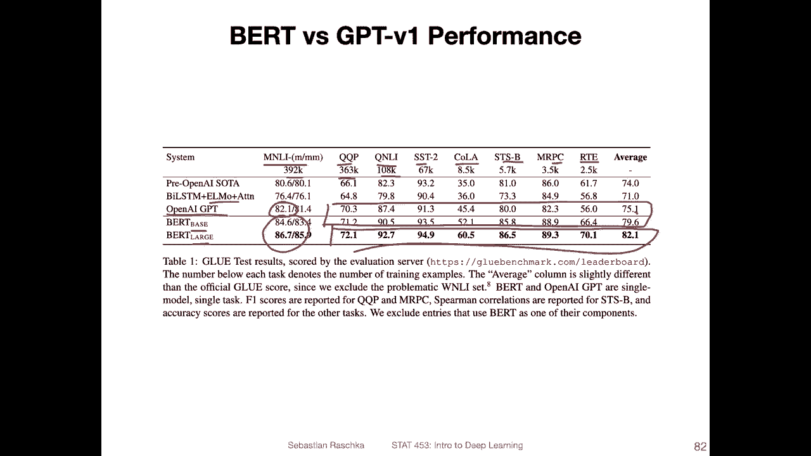

在完成预训练后，BERT可以通过简单的微调，适配到各种下游任务，如文本分类、问答和命名实体识别。你只需要在预训练好的BERT模型上添加一个与任务相关的输出层，然后在特定任务的数据集上进行少量训练即可。

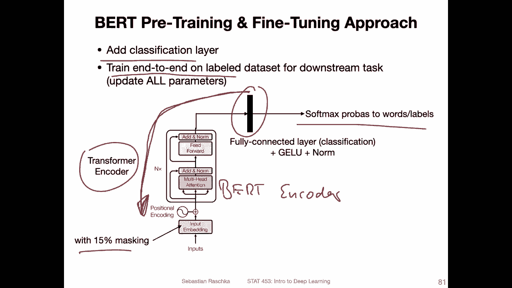

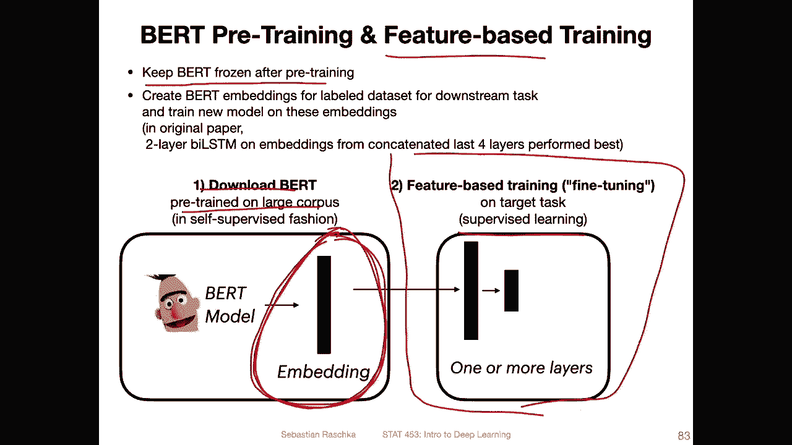

---

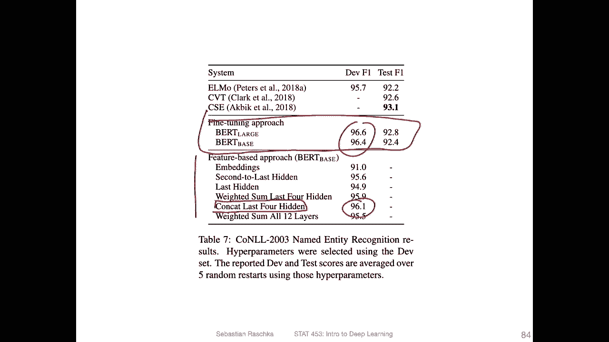

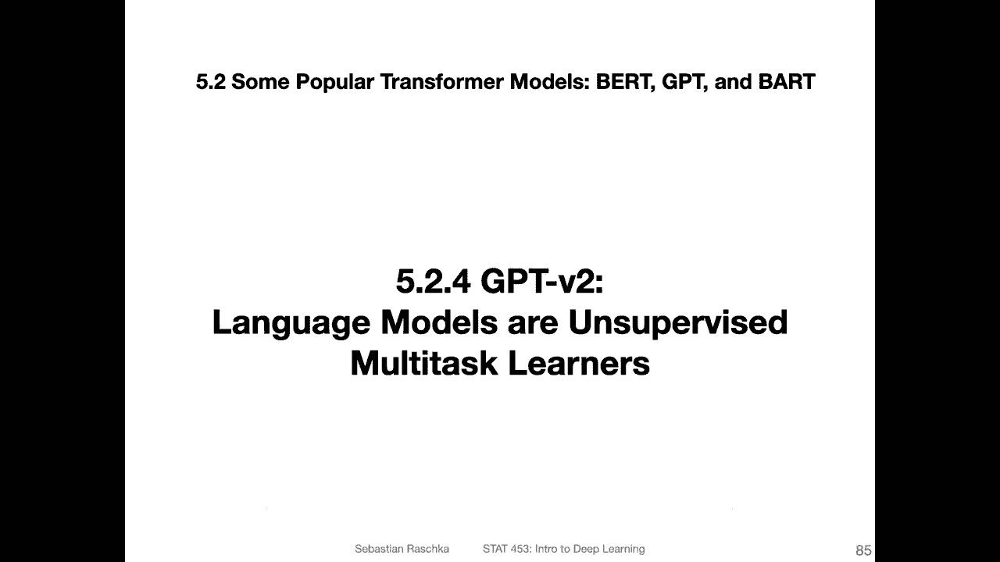

本节课中，我们一起学习了BERT模型。我们了解到BERT的核心是**双向编码器表示**，它通过掩码语言模型和下一句预测任务进行预训练，从而能够深度理解上下文。这种设计使其成为自然语言处理领域一个强大且通用的基础模型。