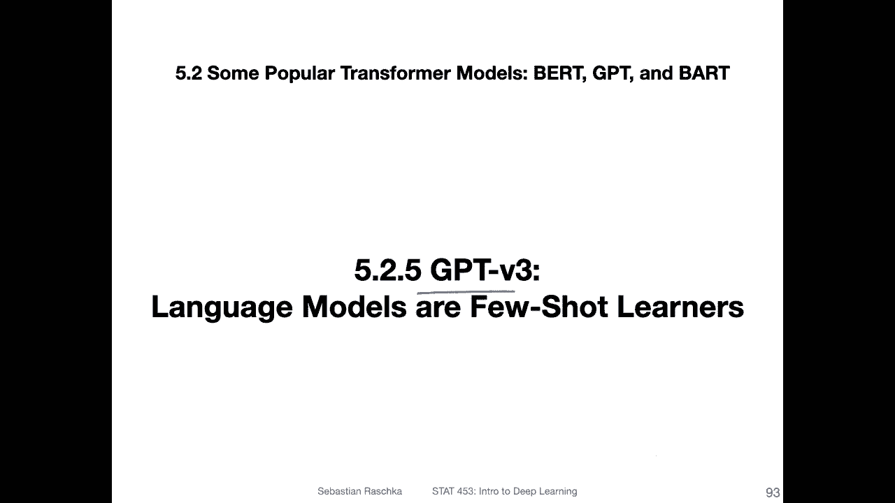
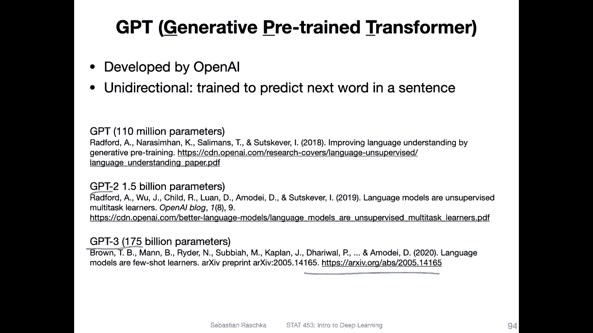
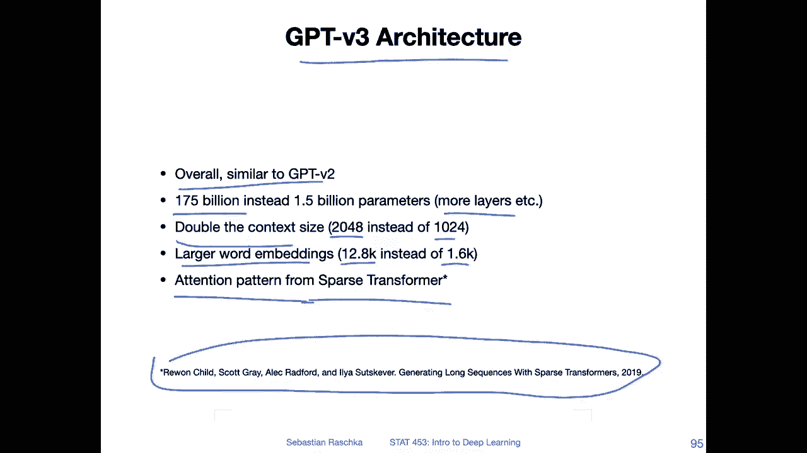
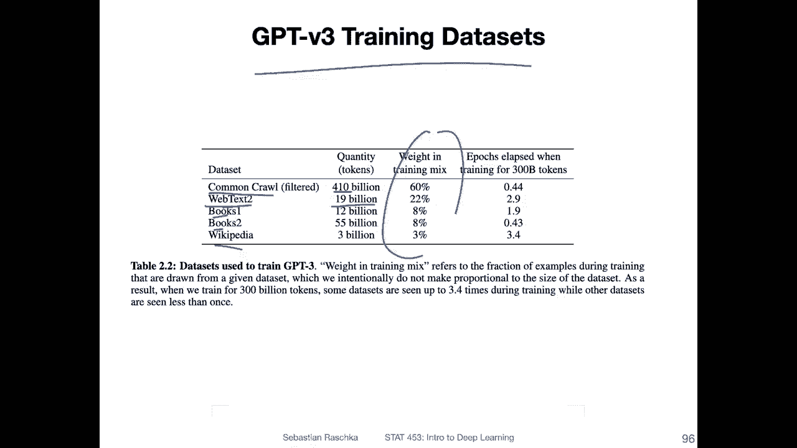
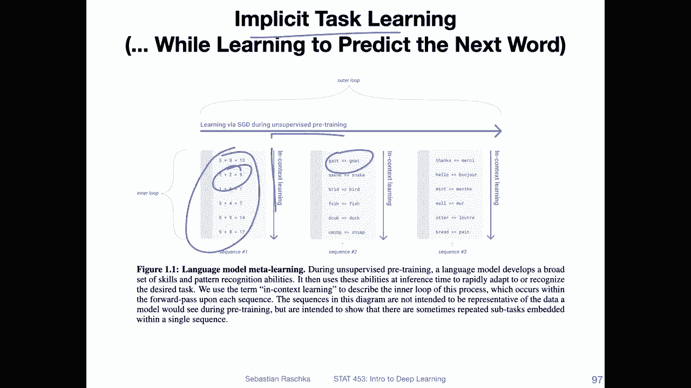
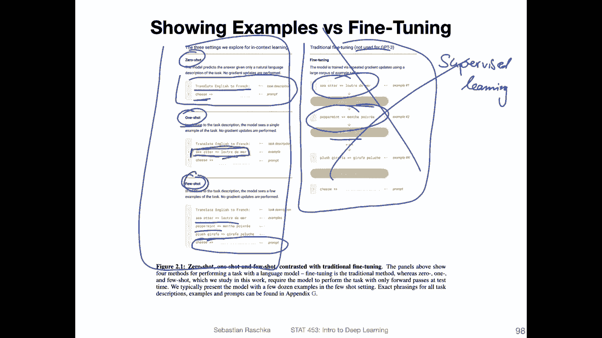
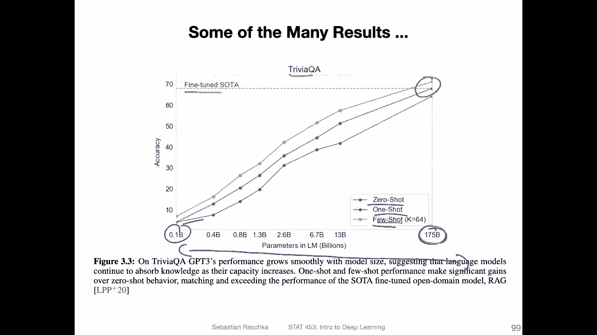
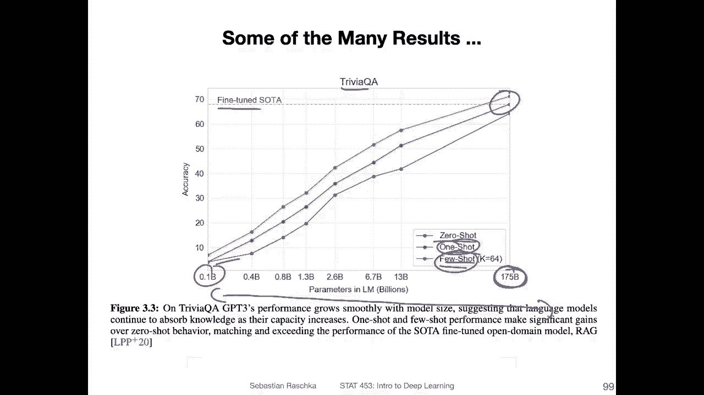
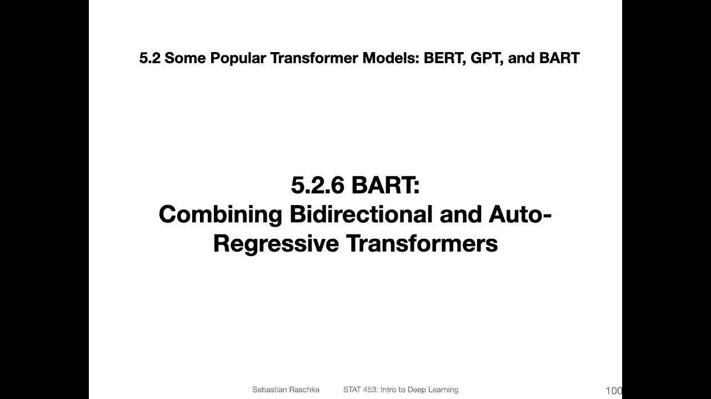

# 课程 P166：L19.5.2.5 - GPT-3：语言模型是少样本学习器 📚

在本节课中，我们将学习GPT系列模型的第三个重要版本——GPT-3。我们将了解其相较于前代模型的规模扩展、架构调整、训练数据变化，以及其核心创新：**少样本学习**能力。我们将重点探讨GPT-3如何在不进行微调的情况下，仅通过提供少量示例（上下文学习）就能出色地完成各种任务。

---

## 🏗️ GPT-3 模型概览

GPT-3是GPT系列的第三个主要版本。正如所有美好的事物都成三出现一样，GPT-3也带来了巨大的飞跃。

GPT-3的模型规模远超之前的版本。其参数量从GPT-2的15亿（1.5 billion）激增至**1750亿（175 billion）**。若想了解更详细的技术细节，可以查阅发布在arXiv上的原始论文。该论文篇幅很长，大约有40到50页。

## ⚙️ 架构与改进

上一节我们介绍了GPT-3的巨大规模，本节中我们来看看其具体的架构变化。

GPT-3的整体架构与GPT-2相似，但规模更大，层数更多。主要改进包括：
*   **上下文长度**：从1024个输入标记增加到**2048**个。
*   **词嵌入维度**：从1600大幅增加至约**12800**。
*   **注意力机制**：为了应对计算量随规模二次增长的问题，GPT-3采用了**稀疏Transformer**中的注意力模式，以提升计算效率。关于稀疏Transformer的更多细节，可以参考相关论文。

## 📊 训练数据集

了解了模型架构后，我们来看看支撑如此庞大模型训练的数据。

GPT-3使用的训练数据集规模也显著扩大。以下是其主要组成部分及权重：
*   **WebText2**：包含约190亿个标记，是GPT-2所用WebText数据集的升级版。
*   **Common Crawl**：一个经过过滤的版本，包含约4100亿个标记。
*   **书籍数据集**。
*   **维基百科数据集**。

这些数据集在总训练过程中被赋予了不同的混合权重。

## 🔄 隐式任务与上下文学习

GPT-3的核心思想在于其学习方式。它将无监督的预训练（自监督学习）称为**外部循环**。

研究者认为，由于训练文本中蕴含了丰富的信息，模型在进行常规语言建模训练时，会**隐式地学习**如何执行任务。这种能力被称为**上下文学习**：模型通过观察输入上下文中的模式和示例，来理解并执行新任务，例如拼写纠正等。

## 🎯 零样本、单样本与少样本学习

与GPT-2一样，GPT-3在预训练后**不进行任务特定的微调**。其创新在于扩展了任务提示的方式。

以下是三种不同的上下文学习设置：

1.  **零样本学习**：只给模型任务描述和输入，不给示例。
    *   **提示示例**：`翻译英文为法文：cheese =>`

2.  **单样本学习**：提供任务描述和**一个**输入-输出示例。
    *   **提示示例**：`翻译英文为法文：sea otter => loutre de mer cheese =>`

3.  **少样本学习**：提供任务描述和**多个**输入-输出示例（通常为10-100个，以填满上下文窗口为限）。
    *   **提示示例**：`翻译英文为法文：sea otter => loutre de mer, peppermint => menthe poivrée, plush giraffe => girafe peluche cheese =>`

这与传统的监督学习（如GPT-1的微调）有本质区别。传统方法需要根据示例计算梯度并更新模型权重，而GPT-3只是将示例作为输入文本的一部分，**模型需要自行推断出该执行的任务**。

## 📈 性能表现

提供示例对模型性能有显著提升。

在下图的性能对比中，横轴是模型参数量，从少到多。可以清晰地看到：
*   **单样本**和**少样本**学习的性能始终优于**零样本**学习。
*   当使用庞大的GPT-3模型并结合少样本示例时，它甚至能在一些任务（如 trivia QA）上**超越之前专门训练过的 state-of-the-art 模型**。这非常令人印象深刻，因为GPT-3本身并未针对问答进行训练，它仅仅是通过观察几个例子就“学会”了如何回答问题。

## ✅ 总结

本节课中我们一起学习了GPT-3的核心内容。

GPT-3的核心贡献在于两方面：
1.  将语言模型的规模推向了一个新的极致（1750亿参数）。
2.  系统性地探索并证明了**通过提供单样本和少样本示例（上下文学习）**，大语言模型可以在不进行梯度更新微调的情况下，出色地完成多种任务。

接下来，我们将介绍一个结合了BERT和GPT概念的早期但有趣的模型。

