# 课程 P167：L19.5.2.6 - BART：结合双向与自回归 Transformer 🤖

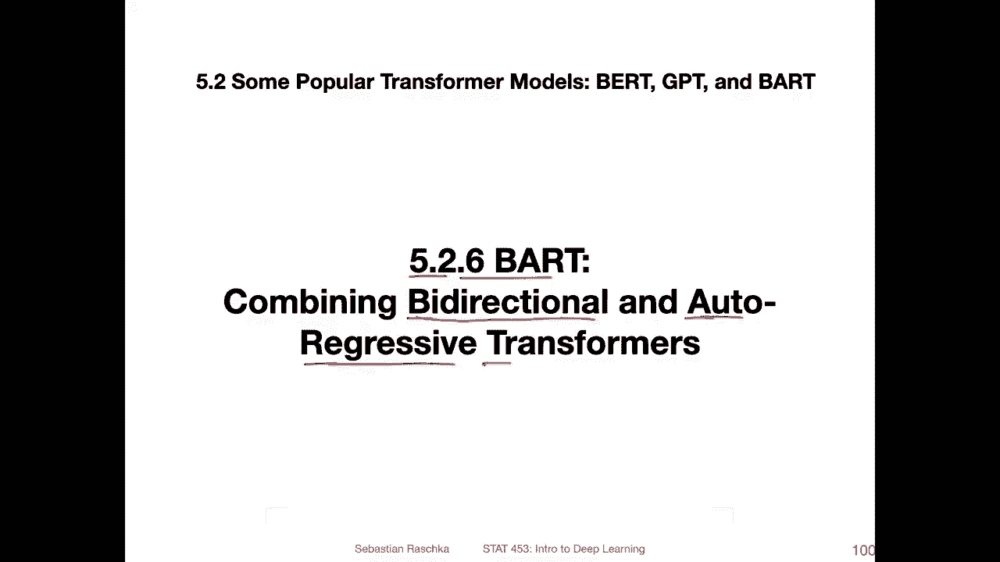

在本节课中，我们将学习 BART 模型。BART 是一个结合了 BERT 的双向编码器思想和 GPT 的自回归解码器思想的模型，旨在同时胜任理解类任务和生成类任务。

---

语言模型的数量几乎是无限的，我们无法全部涵盖。但 BART 是一个有趣的模型，值得介绍。BART 的全称是 **Bidirectional and AutoRegressive Transformers**，它结合了 BERT 和 GPT 的核心概念。

上一节我们介绍了 BERT 和 GPT 各自的特性，本节中我们来看看 BART 如何将它们融合。

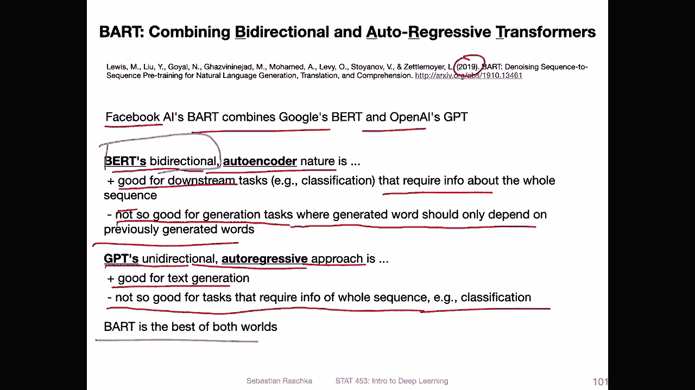

BART 模型由 Facebook AI Research 于 2019 年提出。虽然其性能可能已非最前沿，但其核心思想依然很有价值。其背后的逻辑是：BERT 的双向（自编码）特性使其擅长需要理解整个句子的下游任务，例如分类任务。然而，BERT 在生成任务（如问答、文本生成）上表现不佳，因为生成任务需要模型基于已生成的内容来预测下一个词。

另一方面，GPT 的单向自回归方法更擅长生成文本，但在需要同时考虑整个输入序列的任务（如分类）上则不如 BERT。

BART 的论点在于，它结合了两者的优点，实现了“鱼与熊掌兼得”。它本质上是一个 **BERT 编码器** 加上一个 **GPT 解码器**，并引入了一些额外的噪声变换。

上图来自原论文，阐释了这一概念。左侧是双向编码器，右侧是自回归解码器。如果你回想一下，这本质上重构了原始 Transformer 模型的结构。在原始 Transformer 的“Attention is All You Need”论文中，编码器接收整个文本输入，解码器则通过移位来预测下一个词。

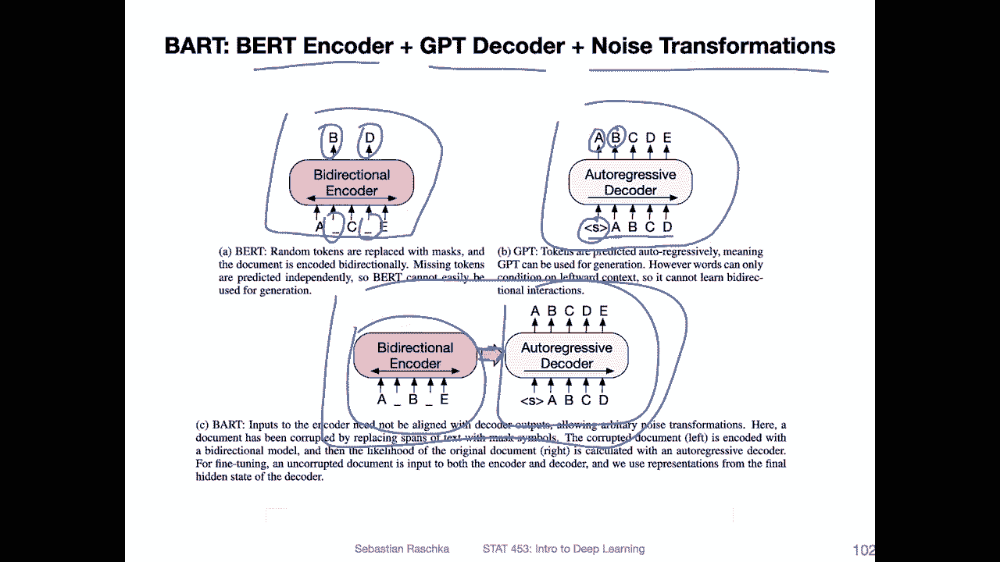

当然，BART 并非完全相同，因为它额外引入了噪声变换。这使得 BART 的编码器更像一个**去噪自编码器**，其概念与去噪自编码器讲座中的内容非常相似：扰动输入，然后尝试重建原始输入。

以下是 BART 论文中使用的几种噪声变换示例：

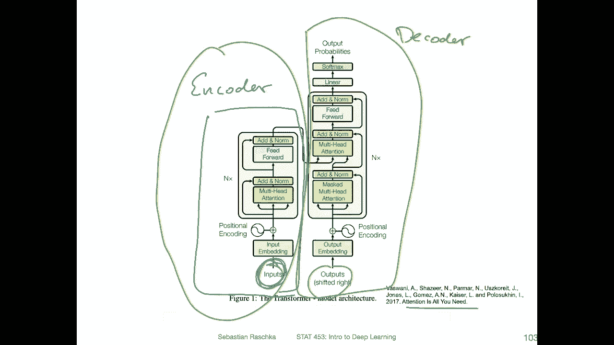

*   **词元掩码**：类似于 BERT 的 `[MASK]` 操作。
*   **句子置换**：打乱文档中句子的顺序。
*   **文档旋转**：随机选择一个词元，然后旋转文档使其以该词元开头。
*   **词元删除**：随机删除一些词元。
*   **文本填充**：用单个 `[MASK]` 标记替换一段连续的文本。

模型的任务是重建回原始的、未受干扰的输入。

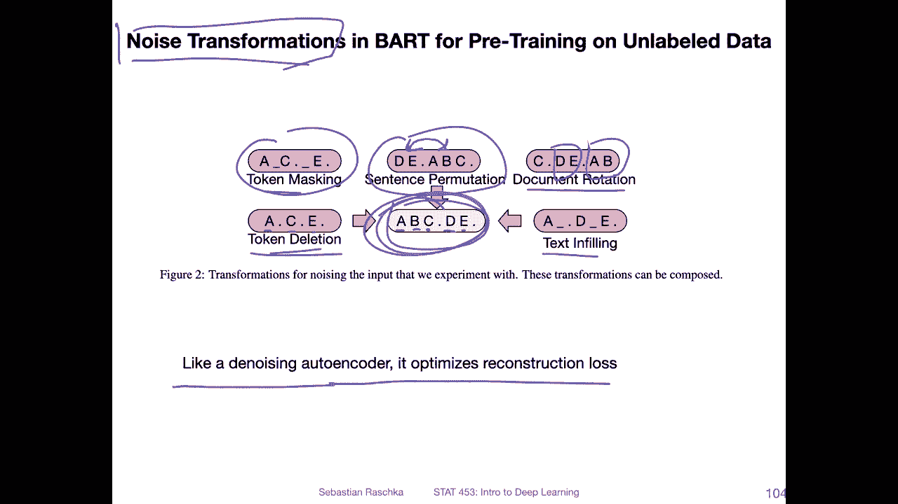

论文研究了不同噪声变换对性能的影响。基础模型配合不同的单一噪声变换（如仅使用词元掩码或词元删除）表现都很好。结合使用两种变换方法通常能获得最佳性能。

在预训练阶段，模型学习如何从被噪声干扰的输入中重建原始文本。接下来我们看看如何针对不同下游任务进行微调。

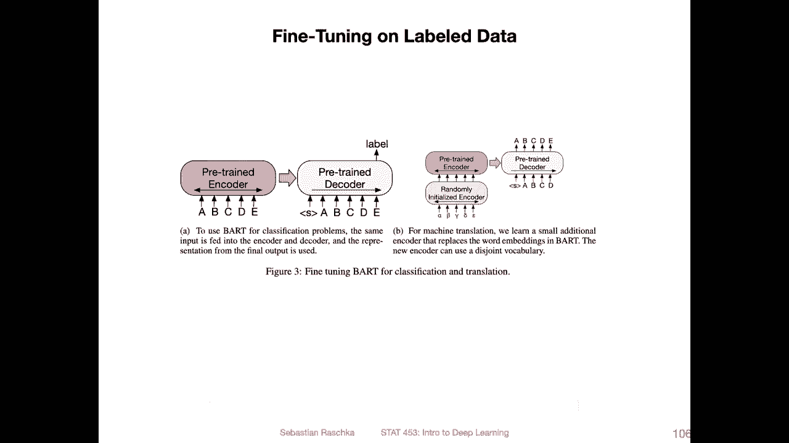

对于微调，BART 有两种主要设置：

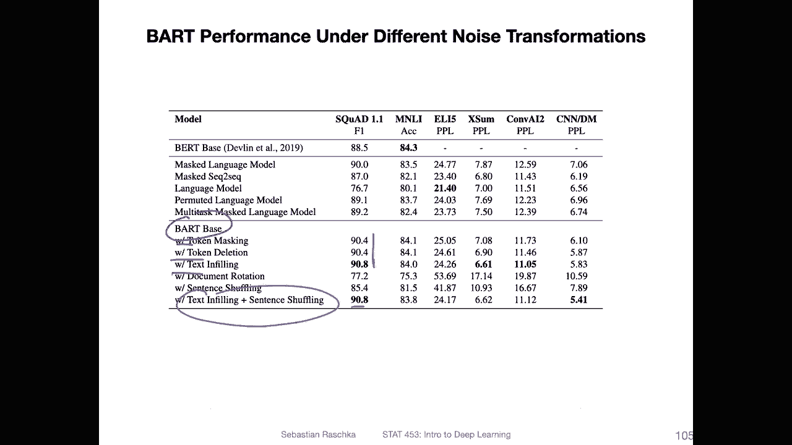

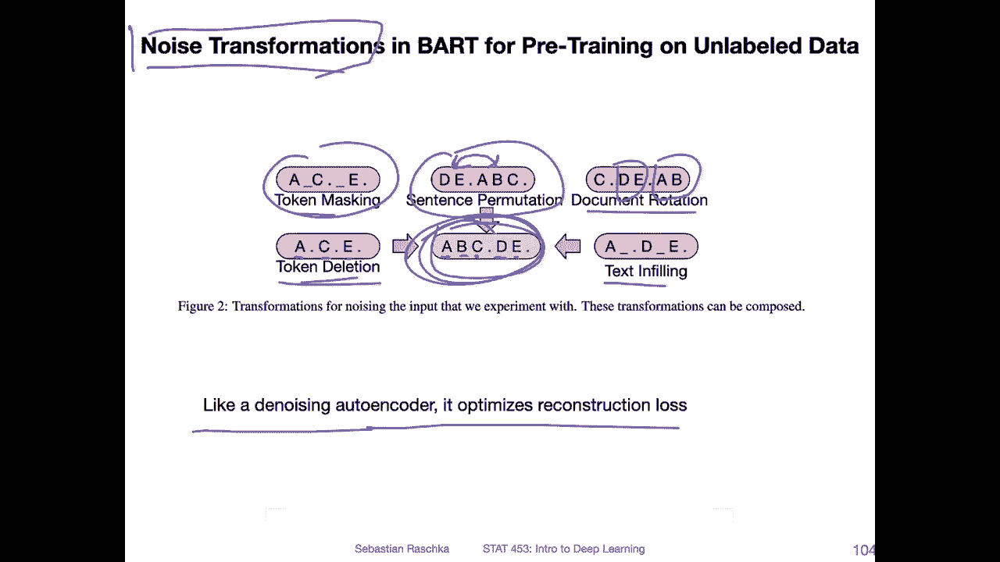

*   **左侧 - 分类/判别式任务**：例如文本分类。编码器处理输入，解码器的最终输出用于预测一个标签。
*   **右侧 - 生成式任务**：例如机器翻译、文本摘要。这里需要一个小的修改：在预训练的 BART 编码器前，额外添加一个**随机初始化的编码器**。这个新编码器接收源语言（如英语）的词嵌入，其输出再送入预训练的 BART 编码器-解码器结构，以生成目标语言（如法语）的文本。

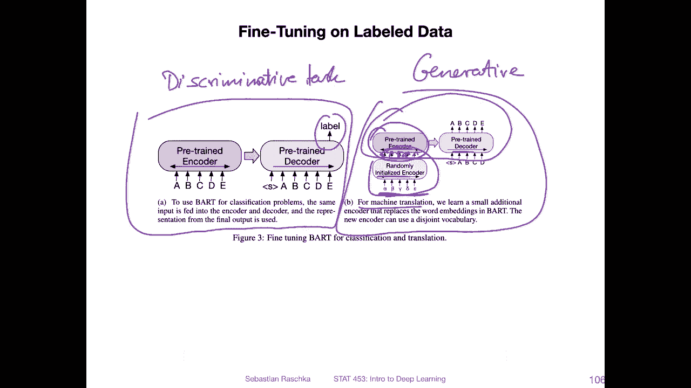

BART 模型表现非常出色。在判别式任务（如分类）上，它与当时强大的 BERT 变体（如 RoBERTa）性能相当，甚至在某些任务上更优。

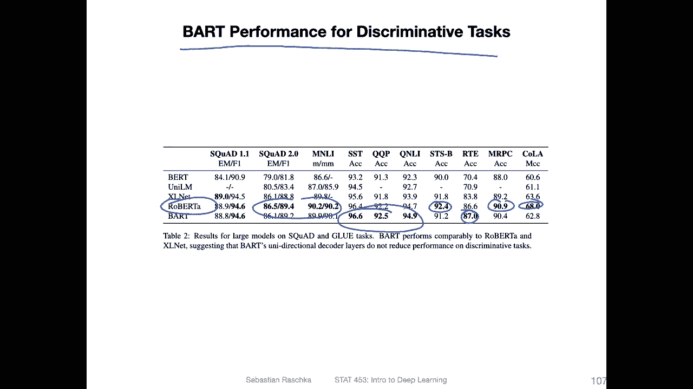

更重要的是，在生成式任务上，如抽象问答、对话响应生成和文本摘要，BART 达到了当时的顶尖水平。这证明了它确实结合了 BERT 和 GPT 的优势。

---

本节课中我们一起学习了 BART 模型。BART 通过结合 BERT 的双向编码器和 GPT 的自回归解码器，并引入去噪预训练目标，成为一个能同时出色完成理解（如分类）和生成（如翻译、摘要）任务的通用架构。它体现了将不同模型优点融合以取得更全面能力的思路。

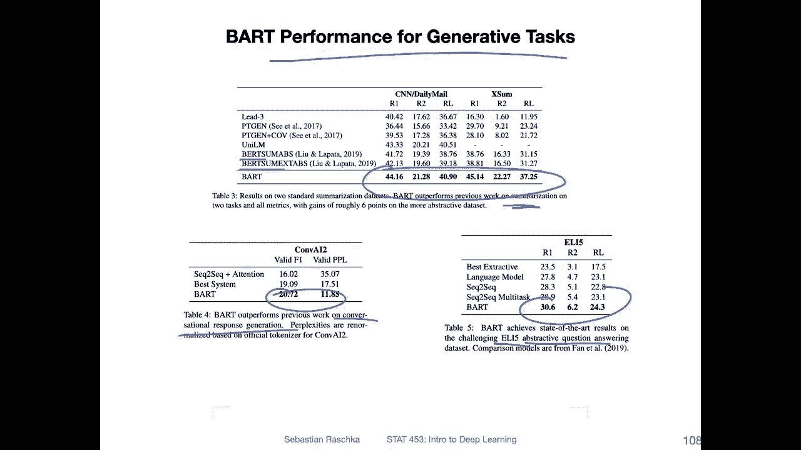

关于这些流行的 Transformer 模型，还有更多内容可以探讨。

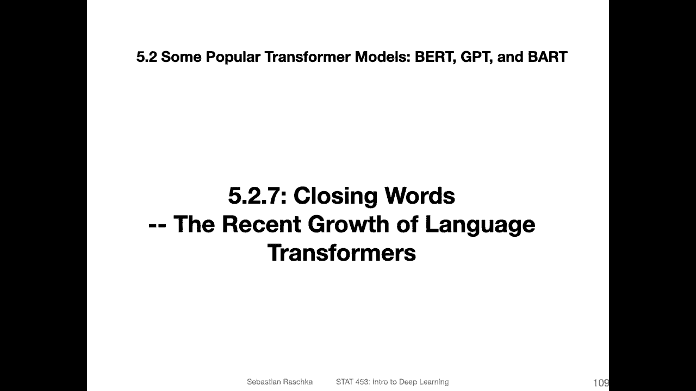

