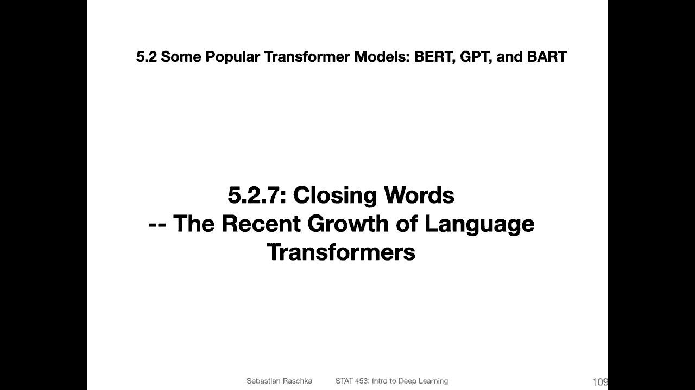
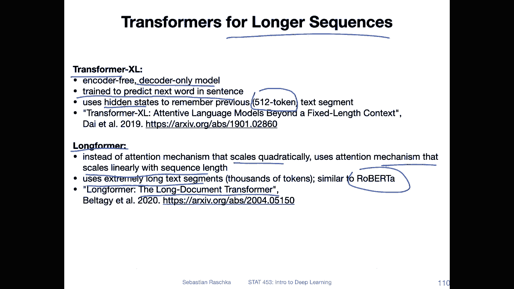
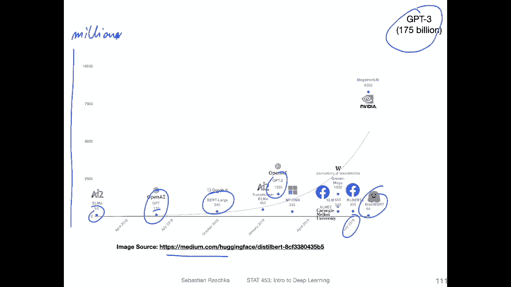
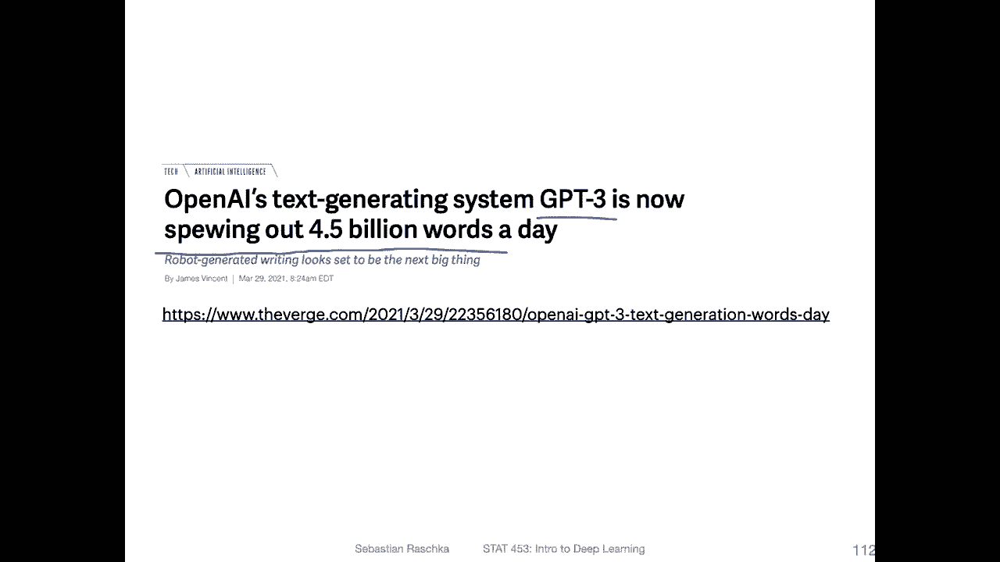
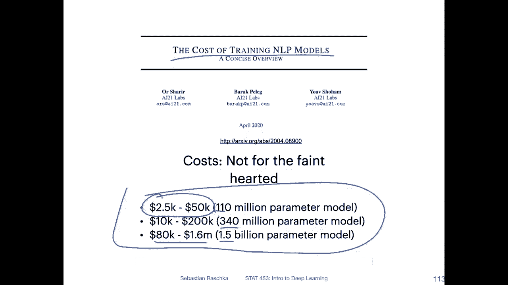
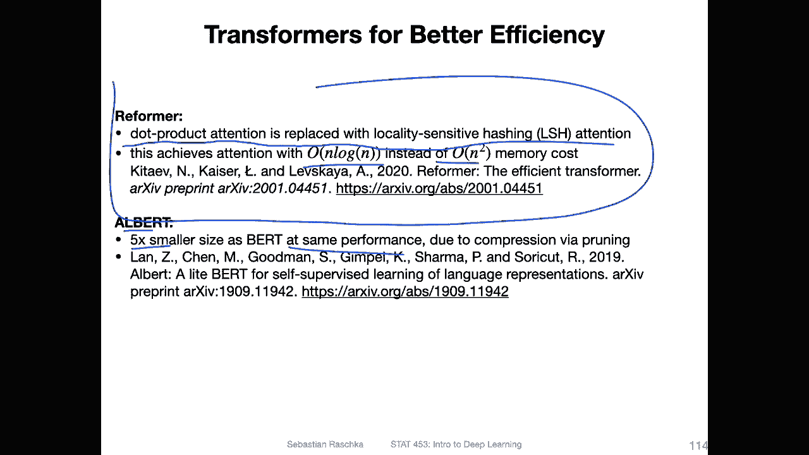
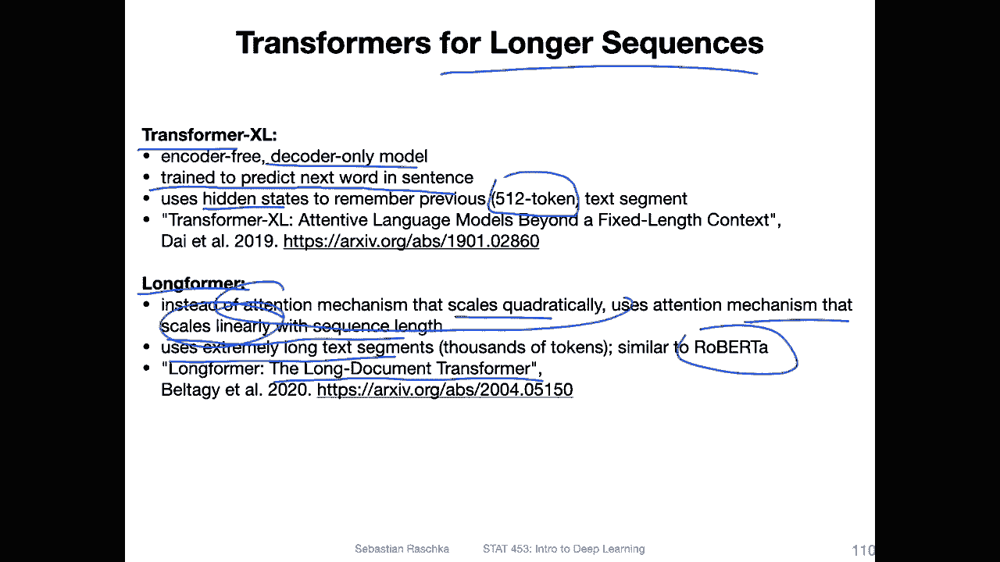
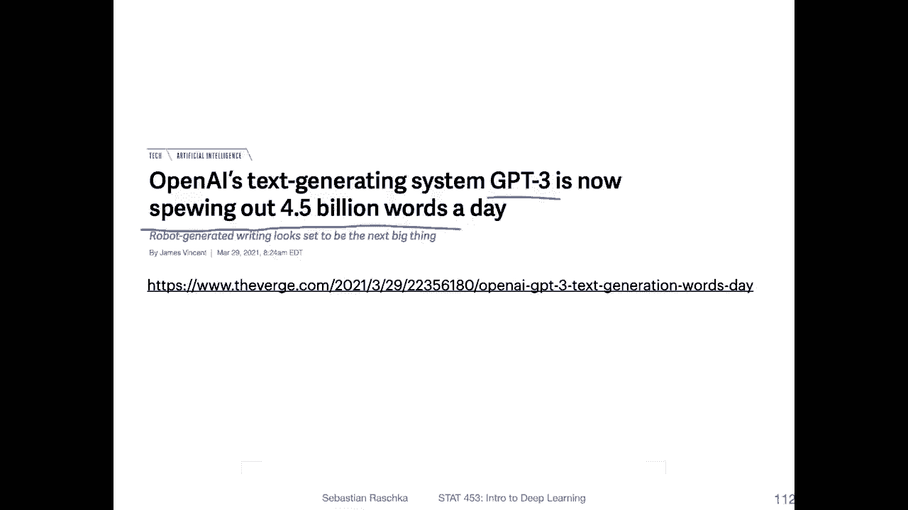
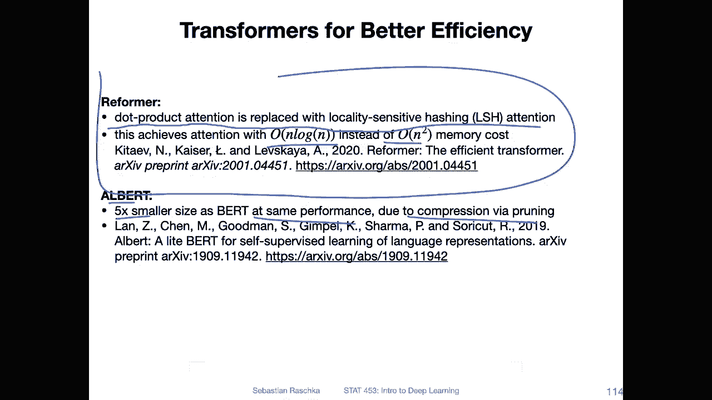
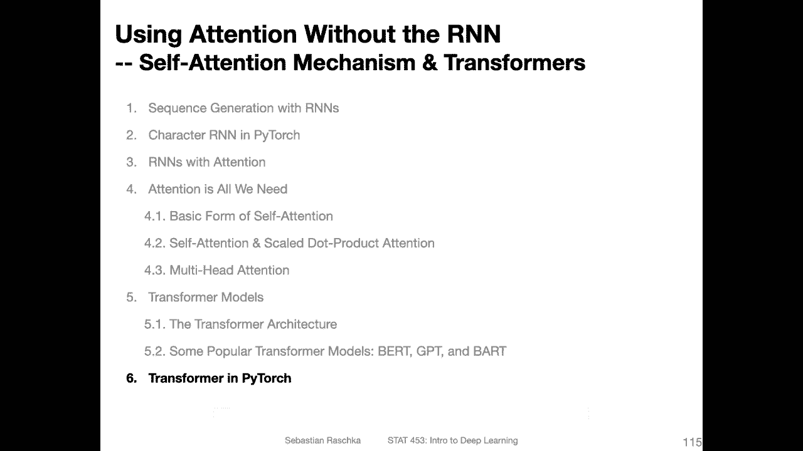

# 课程 P168：L19.5.2.7 - Transformers的近期增长趋势 📈

在本节课中，我们将探讨近年来广受欢迎的大规模语言模型的发展趋势。我们将了解模型规模的增长、面临的挑战以及旨在提升效率的各种创新方法。

---

上一节我们介绍了Transformer模型的基础架构，本节中我们来看看该领域近期的动态与趋势。

当然，我无法涵盖所有模型，因为数量实在太多，可能达到成百上千个。但可以再提及几个有趣的模型，特别是那些处理长序列的模型。

例如，**Transformer-XL**。它是一个类似于GPT的仅解码器模型，同样被训练用于预测句子中的下一个词。然而，与常规的GPT模型不同，它使用了一种隐藏状态来连接不同的输入片段。回想一下GPT-1，它使用512个输入标记。而Transformer-XL可以连接多个这样的512标记片段。在某种程度上，它有点像在Transformer模型中引入了RNN的思想。这是一种处理更长输入的方法。

另一种方法是**Longformer**（长文档Transformer）。注意力机制的复杂度随输入规模呈二次方增长，这相当昂贵。Longformer开发了一种机制，其复杂度仅随序列长度线性增长，而非二次方。因此，它能够处理数千个标记的长文本段落，其规模与RoBERTa类似。当然，这只是众多使Transformer更高效、以处理更长输入的方法之一。

总体而言，这些语言模型的一个趋势是变得**越来越大**。这是一张来自Hugging Face的图表（截至2019年）。我们可以看到从ELMo、GPT（1.1亿参数）、BERT（3.4亿参数）、GPT-2（15亿参数）到GPT-3（1750亿参数）的发展。模型规模正在急剧增长。

幸运的是，也有一些方法专注于提升效率。例如，可以看到一些更小的模型，特别是**DistilBERT**，它是BERT的一个精简版本，让技术再次变得更容易获取。因为这些模型如此庞大，我们普通人可能永远无法训练它们，除非你能访问非常庞大的计算资源。即使你能访问数千个GPU，训练这些大规模语言模型也可能非常棘手，需要大量的调试和工程工作才能扩展到那么多GPU，这并非即插即用。

如今有一个有趣的现象。大约两个月前有一篇文章提到，GPT-3现在每天生成约45亿个单词。他们围绕GPT-3提供了商业化的API，这是一个非常流行且广泛应用于现实场景的模型。

如前所述，模型规模也带来了问题。有一篇关于训练大型自然语言处理模型成本的论文很有意思。其中给出了一些惊人的数字：对于1.1亿参数的GPT-1，估计训练成本在2.5万到5万美元之间；而像BERT或GPT-2这样的模型，训练成本则高达数十万甚至数百万美元。这相当令人印象深刻，但考虑到环境成本，也多少有些遗憾。当然，这本身也是一种研究，观察其发展方向很有趣，但我希望事情不要那么昂贵和耗电。

幸运的是，一些人也专注于开发更高效的模型。例如，**Reformer**方法用局部敏感哈希机制替代了点积注意力，从而实现了O(N log N)的复杂度，而不是O(N²)的内存成本。还有**ALBERT**，它是一个比BERT小5倍但达到相同性能的版本。这些都是不同的方法。

还有之前简要提到的**Sparse Transformer**，也就是前面提到的Longformer，它拥有随序列长度线性增长的注意力机制。

此外还有**DistilBERT**。方法多种多样，这里只是重点介绍几种。

以**ALBERT**模型为例，它也专注于通过训练后的剪枝来进行压缩。即先训练模型，然后进行剪枝以获得更小的模型。

好了，这就是对不同大规模语言模型的一次快速巡览。在下一个视频中，可能会有一个简短的代码示例，然后结束这门关于RNN、注意力和Transformer模型的漫长课程。

---

本节课中我们一起学习了大规模语言模型的近期趋势，包括模型规模的指数级增长、随之而来的计算成本与效率挑战，以及业界为应对这些挑战所提出的多种创新模型与方法（如Transformer-XL、Longformer、高效模型压缩等）。理解这些趋势有助于我们把握自然语言处理领域的发展方向。