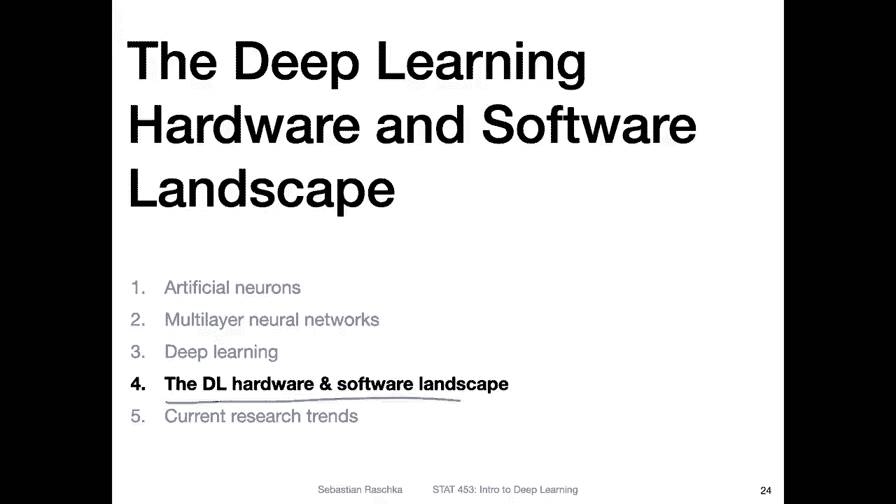
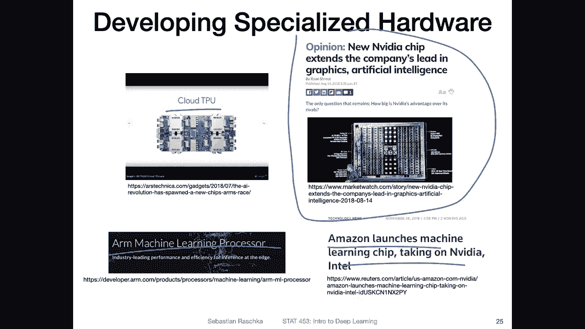
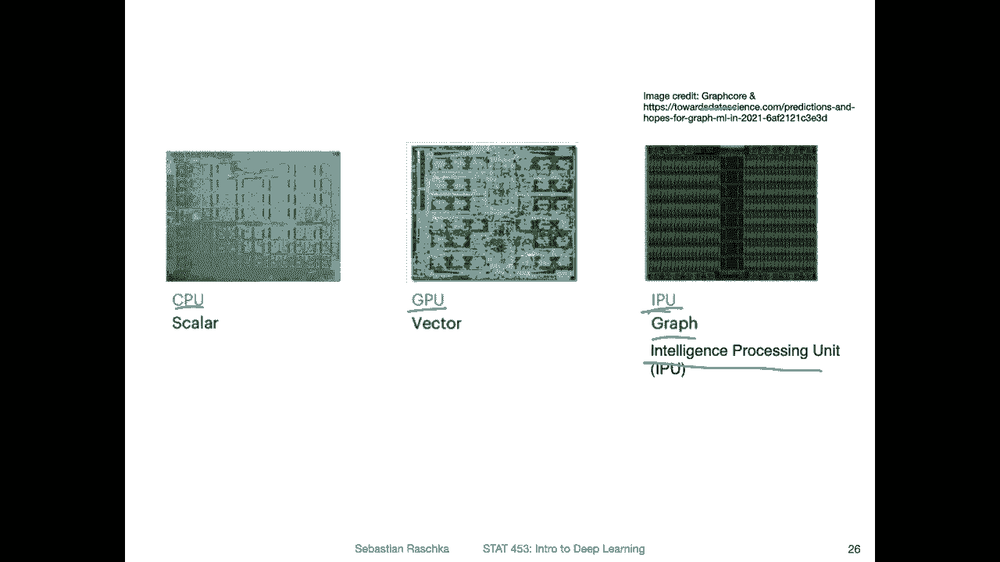
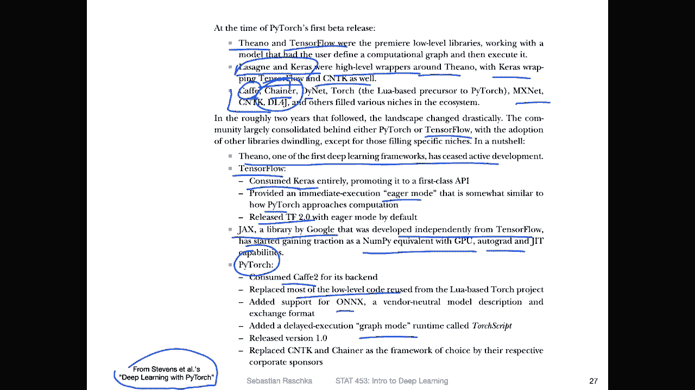
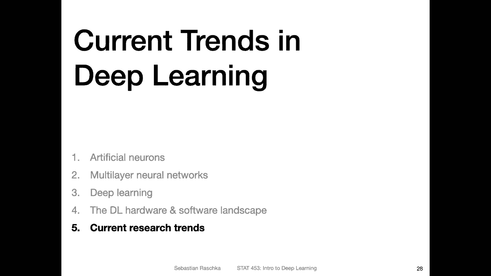

# 深度学习课程 P17：L2.4 - 深度学习硬件与软件概览 🖥️🔧

在本节课中，我们将简要介绍深度学习领域的硬件与软件发展现状。我们将了解当前主流的计算硬件，并回顾深度学习框架的演进历史。

## 硬件概览 💻

上一节我们讨论了深度学习的基础概念，本节中我们来看看支撑这些算法运行的硬件设备。

目前，深度学习任务主要依赖于图形处理器（GPU）进行计算。英伟达（Nvidia）公司每年都会推出新的GPU型号，这些设备因其强大的并行计算能力，成为深度学习研究和应用的主流选择。

然而，硬件领域也在不断发展。例如，谷歌公司开发了**张量处理单元（TPU）**。TPU是一种专为特定任务优化的专用处理器，通常部署在谷歌云服务器上。虽然单个TPU在理论上可能比GPU成本更低，但其强大之处在于能够将多个TPU组合起来协同工作。

此外，ARM公司也在研发机器学习处理器。苹果新款MacBook搭载的ARM处理器在推理任务上表现出色，但在模型训练方面，GPU目前仍是行业标准。

值得一提的是，一家名为Graphcore的新公司推出了**智能处理单元（IPU）**。这种处理器特别擅长处理图神经网络相关的计算任务。我们可以这样理解不同处理器的专长：
*   **CPU**：擅长处理标量（单个数值）的简单计算。
*   **GPU**：擅长处理向量（数组）的并行计算。
*   **IPU**：擅长处理图结构数据的计算。

总而言之，尽管有众多新兴硬件，GPU目前仍是深度学习领域最普遍使用的计算设备。

## 软件演进 📜

了解了硬件之后，我们再来看看深度学习软件，特别是框架的发展历程。这对于理解当前主流工具（如PyTorch）的定位非常有帮助。

以下是深度学习框架发展的一个简要时间线：

*   **2015年之前**：Theano是当时的主流框架。为了简化其使用，出现了像Lasagna和Keras这样的高级封装库。
*   **2015年左右**：谷歌发布了TensorFlow。同时，Keras扩展了功能，开始支持TensorFlow和微软的CNTK等后端。此外，还出现了Caffe（擅长部署）、Chainer和DyNet（支持动态计算图）等专用库。
*   **随后几年**：Theano停止开发，TensorFlow成为主流并整合了Keras。在TensorFlow 2.0中，Keras成为了其默认的高级API，并且加入了**即时执行模式（Eager Mode）**，这使得其使用体验更接近PyTorch的动态图模式。
*   **PyTorch的崛起**：PyTorch从Chainer等库中汲取了动态计算图的理念，因其易用性而受到研究人员广泛欢迎。后来，PyTorch通过整合Caffe2增强了生产部署能力，并增加了**ONNX支持**（一种模型交换标准）和**图模式（Graph Mode）**，使其在保持研究灵活性的同时，也适合产品化部署。
*   **新兴工具**：谷歌还开发了JAX库，它是一个可以在GPU上运行、具有自动微分和即时编译功能的较低层库。虽然其上也有像Flax这样的深度学习封装，但PyTorch目前仍是功能最全面、最成熟的库之一。

简而言之，TensorFlow通过加入Eager Mode变得更像PyTorch，而PyTorch通过加入Graph Mode变得更像TensorFlow，两者如今在功能上已非常相似。对于初学者和研究人员而言，PyTorch因其易用性和活跃的社区，是目前非常推荐的选择。

## 总结 📝

本节课我们一起学习了深度学习的硬件与软件生态。
*   在**硬件**方面，GPU是当前进行深度学习计算的主力，同时TPU、IPU等专用处理器也在不断发展。
*   在**软件**方面，我们回顾了从Theano、TensorFlow到PyTorch等主流框架的演进历程，了解了它们各自的特点和融合趋势。

掌握这些背景知识，有助于我们更好地选择和使用工具，为后续的深度学习实践打下基础。在接下来的内容中，我们将开始学习神经网络的基础单元——感知机。