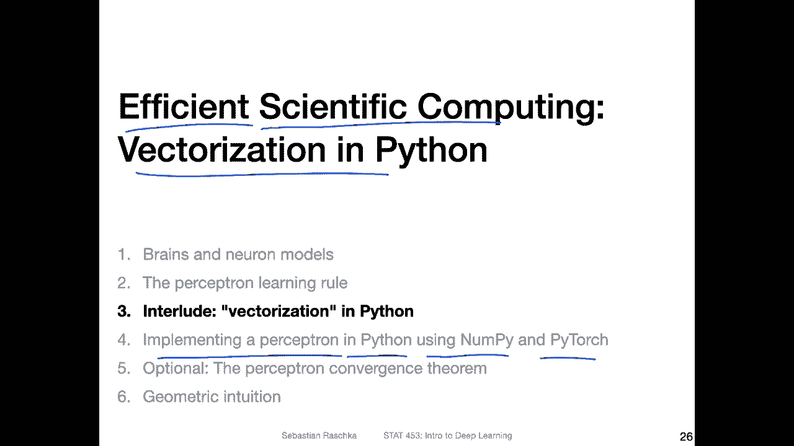
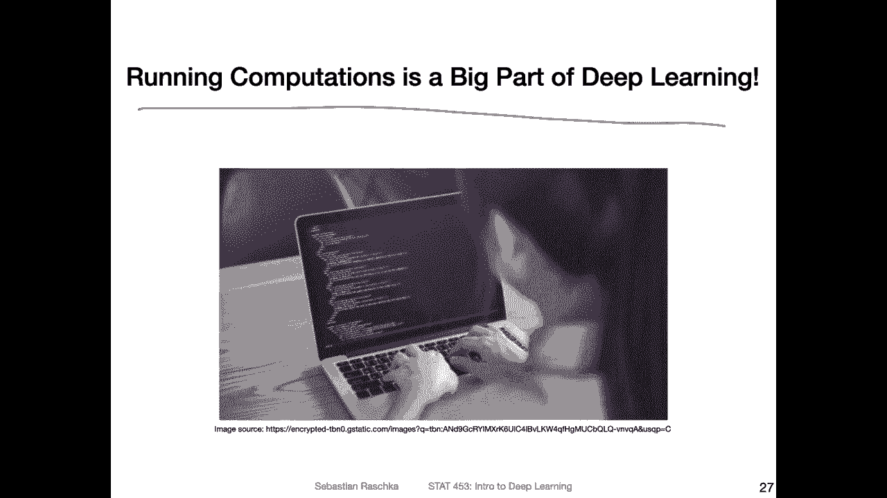
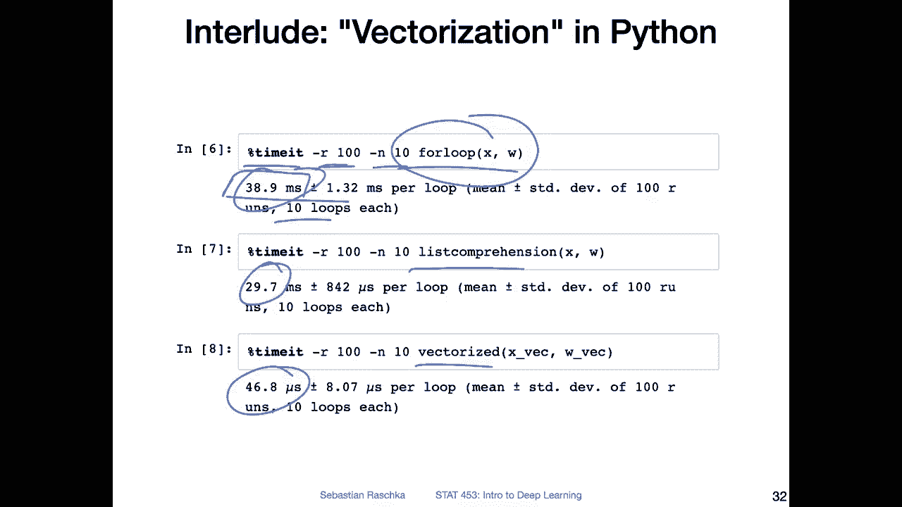
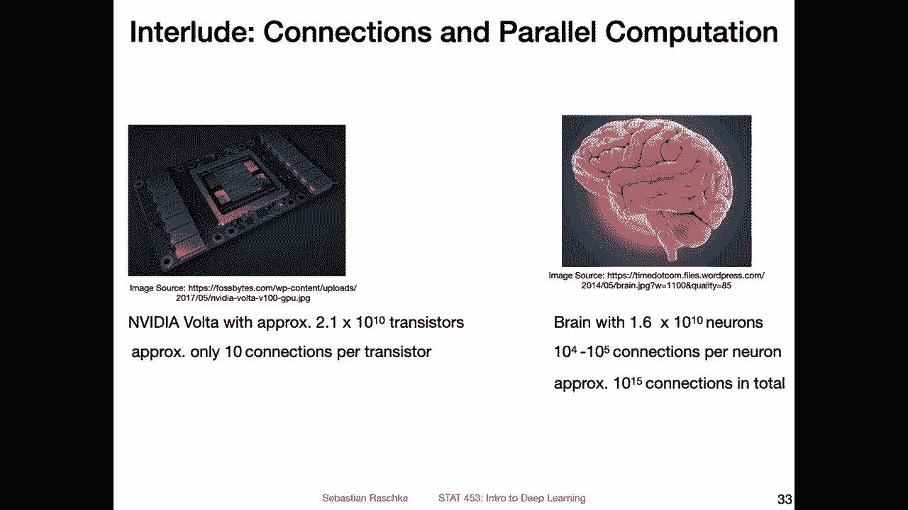
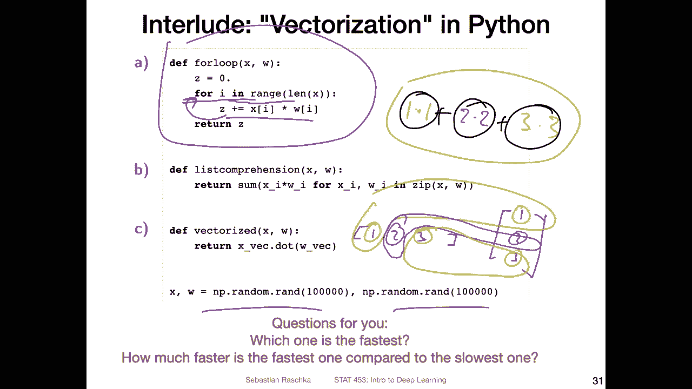
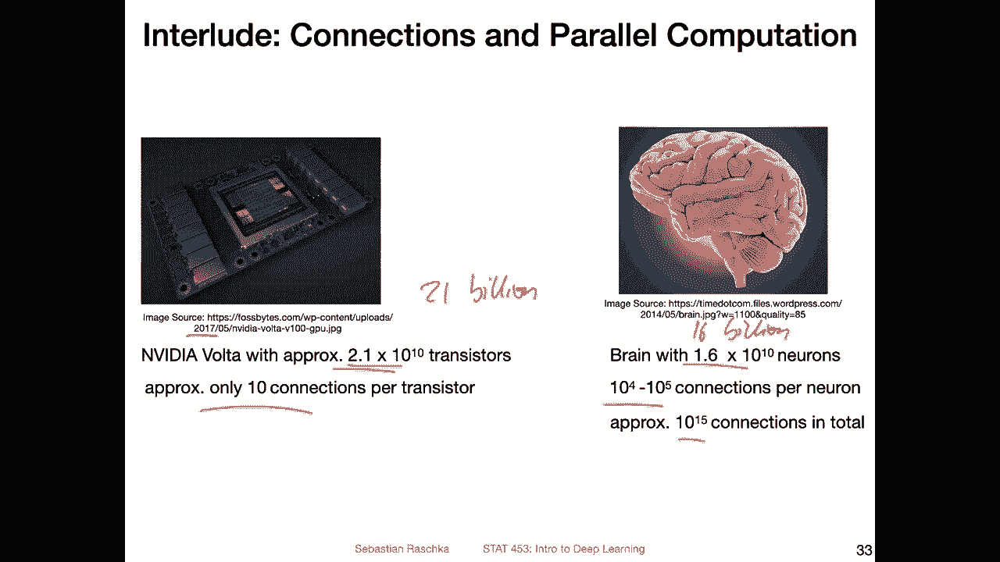
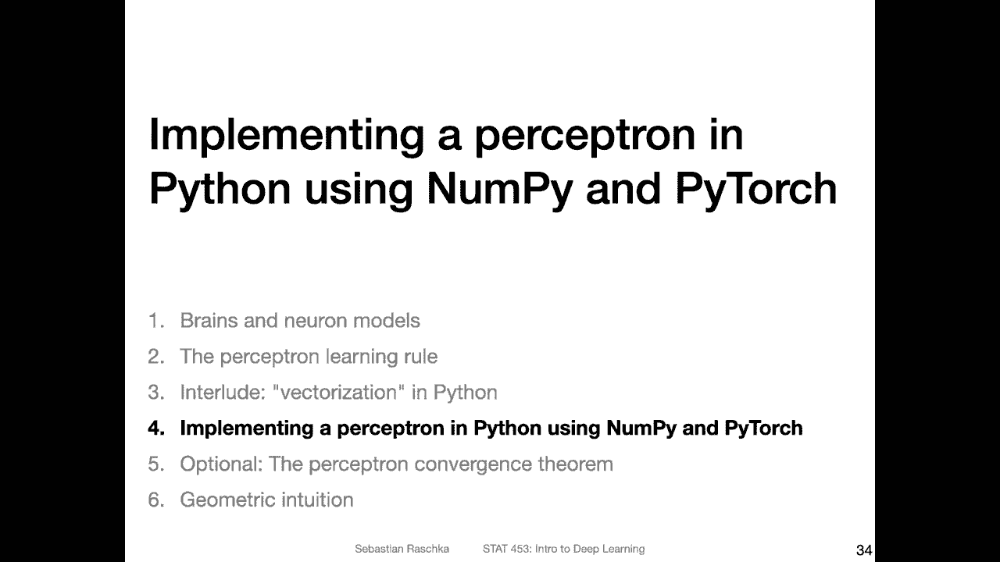

# 课程 P22：L3.3 - Python 中的向量化 🚀

在本节课中，我们将要学习一个在科学计算中提升效率的重要概念——向量化。我们将了解为什么在深度学习中应避免使用循环，以及如何利用 NumPy 等库进行高效的向量化计算。



## 概述

在深度学习中，计算效率至关重要。虽然 Python 本身并非以速度著称，但通过使用 NumPy 和 PyTorch 等高效库，我们可以将计算任务委托给底层用 C++ 或 CUDA 编写的优化例程，从而极大地提升性能。本节课将重点介绍向量化的概念及其优势。

## 为何需要向量化？



上一节我们提到了深度学习对计算效率的要求。本节中我们来看看，为什么向量化是实现高效计算的关键。

深度学习的应用通常涉及大量计算。Python 语言本身速度不快，但这通常不会成为瓶颈，因为我们使用 NumPy 进行 CPU 计算，使用 PyTorch 进行 GPU 计算。这些库的底层是高效的 C++ 和 CUDA 例程。据 PyTorch 开发者估计，即使加上 Python 这一层，整体速度也仅比纯 C++ 实现慢约 10%。因此，只要“聪明地”使用 Python，我们就能获得接近原生代码的性能。

然而，如果使用不当，Python 中的某些操作（如循环）会非常慢。这就是我们需要向量化的原因。

## 计算净输入：三种方法对比

接下来，我们通过一个具体例子来理解向量化。我们将使用感知机模型中的净输入（加权和）计算作为示例。

净输入的公式为：
`z = w0*x0 + w1*x1 + w2*x2 + ... + wm*xm`
其中，`w0` 通常代表偏置项。

以下是三种不同的实现方式：

### 方法一：使用 For 循环

这是最基础的方法，通过循环逐个元素进行计算。

```python
# 定义输入和权重（列表）
x = [1, 2, 3]
w = [0.1, 0.2, 0.3]
bias = 0.5

# 使用 for 循环计算净输入 z
z = 0
for i in range(len(x)):
    z += x[i] * w[i]
z += bias
```

### 方法二：使用列表推导式/生成器表达式

这是 Python 中更简洁的写法，本质仍是循环，但有时效率稍高。

```python
# 使用生成器表达式（无方括号）计算
z = sum(x_i * w_i for x_i, w_i in zip(x, w)) + bias
```

### 方法三：使用 NumPy 向量化

这是最高效的方法，利用 NumPy 数组和点积运算一次性完成所有计算。

```python
import numpy as np

# 将列表转换为 NumPy 数组
x_np = np.array([1, 2, 3])
w_np = np.array([0.1, 0.2, 0.3])
bias = 0.5

# 使用向量化点积计算净输入 z
z = np.dot(x_np, w_np) + bias
# 或更明确地写成：
# z = x_np.T @ w_np + bias
# 对于一维数组，转置可省略
```

## 性能比较与分析



现在，我们来比较这三种方法的性能。对于大型向量，哪种方法最快？

使用 `timeit` 模块进行基准测试的结果如下（数值为近似值，用于对比）：
*   **For 循环**：约 40 毫秒
*   **列表推导式**：约 30 毫秒（快约 25%）
*   **NumPy 向量化**：约 40 **微秒**（比循环快约 **1000 倍**）



由此可见，向量化实现带来了巨大的性能提升。在深度学习中，我们应尽量避免使用 `for` 循环，尽可能使用 NumPy 或 PyTorch 中的点积、矩阵乘法等向量化操作。

## 向量化为何高效？

上一节我们看到了性能的巨大差异，本节中我们来看看其背后的原理。



向量化高效的核心在于**并行计算**。

*   **循环（串行）**：在 `for` 循环中，计算按顺序逐个进行。完成第一个 `x[i] * w[i]` 后，才能开始第二个，以此类推。
*   **向量化（并行）**：在点积运算 `np.dot(x, w)` 中，所有配对元素的乘法（如 `x[0]*w[0]`, `x[1]*w[1]`, `x[2]*w[2]`）理论上可以**同时进行**。计算单元可以并行处理这些独立的乘法操作，最后再将结果相加。

现代 CPU 的 SIMD（单指令多数据）指令集和 GPU 的大量核心架构，都非常擅长这种并行数据操作。因此，向量化能够充分利用硬件潜力，实现高速计算。

## 总结

本节课中我们一起学习了 Python 中向量化的重要性与实践。我们了解到：
1.  深度学习中应追求计算效率，而向量化是关键手段。
2.  与传统的 `for` 循环相比，使用 NumPy 等库的向量化操作能带来数百至数千倍的性能提升。
3.  向量化的高效性源于其将串行计算转化为并行计算的能力，从而更好地利用现代硬件的特性。





掌握向量化思维，是进行高效科学计算和深度学习编程的基础。在接下来的课程中，我们将运用这一概念来实现感知机等模型。