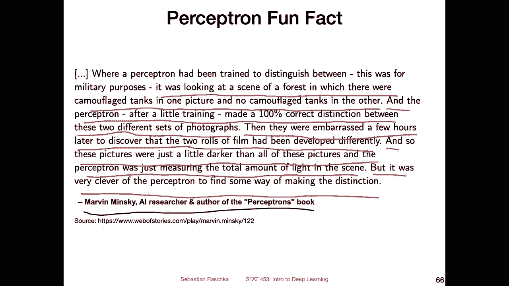
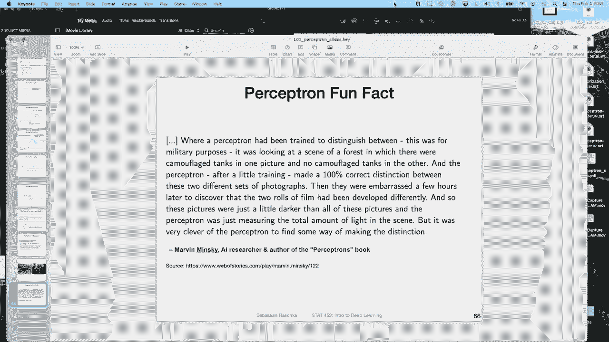

# 课程 P24：L3.5 - 感知器背后的几何直觉 🧠

在本节课中，我们将探讨感知器学习算法背后的几何原理。我们将理解为什么简单的权重更新规则能够有效地调整决策边界，并分析感知器模型的局限性。

---

## 感知器学习算法回顾

上一节我们介绍了感知器的基本概念，本节中我们来看看其学习算法的具体步骤。

感知器学习算法如下：

1.  初始化权重向量 **w** 为零或小的随机数。
2.  对于训练集中的每个样本 **x**：
    *   计算预测值：`ŷ = step(**w**·**x** + b)`，其中 `step` 是阶跃函数。
    *   如果预测错误，则更新权重：
        *   如果 `ŷ = 0` 但真实标签 `y = 1`，则 **w** = **w** + **x**。
        *   如果 `ŷ = 1` 但真实标签 `y = 0`，则 **w** = **w** - **x**。

核心问题在于：为什么通过加上或减去输入向量 **x** 就能修正决策边界？接下来我们将从几何角度进行解释。

---

## 权重向量与决策边界的关系

首先，我们需要理解权重向量 **w** 与决策边界之间的几何关系。

决策边界由方程 **w**·**x** + b = 0 定义。可以证明，权重向量 **w** 垂直于这条决策边界。理解这一点是理解后续更新的关键。

为什么是垂直（90度角）呢？考虑点积公式：
**w**·**x** = ||**w**|| * ||**x**|| * cos(θ)

在决策边界上，点积为零（**w**·**x** + b = 0，为简化我们先忽略偏置 b）。要使点积为零，而权重和输入向量的长度通常不为零，唯一的方法是让 cos(θ) = 0。而 cos(θ) = 0 意味着角度 θ = 90°。因此，在决策边界上的点，其与权重向量的夹角为90度。

---

## 夹角与分类预测

理解了垂直关系后，我们可以用夹角来解释分类决策。

*   **正确预测为类别1**： 当一个属于类别1的样本被正确分类时，其输入向量 **x** 与权重向量 **w** 的夹角 θ < 90°。此时 cos(θ) > 0，使得点积 **w**·**x** > 0，从而预测为1。
*   **错误预测**： 如果该样本被错误预测为0，则意味着其夹角 θ > 90°。此时 cos(θ) < 0，导致点积 **w**·**x** < 0。

我们的目标就是修正这种错误，将夹角从大于90度调整为小于90度。

---

## 权重更新的几何解释

现在，我们来看感知器如何通过更新权重来修正错误。

假设我们有一个属于类别1的样本 **x**，但当前权重 **w** 导致夹角 θ > 90°，因此被错误预测为0。

更新规则是：**w_new = w_old + x**

从几何上看，向量加法 **w_old + x** 会产生一个新的向量 **w_new**。这个新向量更接近于输入向量 **x** 的方向。通过这种加法，**w_new** 与 **x** 之间的夹角会减小（变得小于90度），从而使该样本在下一次计算时能获得正的点积，被正确分类为1。

这个过程直观地“推动”决策边界，使其向误分类样本的方向移动，直到该样本被正确分类到边界正确的一侧。

对于另一种错误情况（预测为1但真实为0），更新规则 **w_new = w_old - x** 具有相反的效果，将权重向量推离错误样本，同样是为了减小误分类。

---

## 感知器的局限性

尽管感知器提供了清晰的几何解释和简单的学习算法，但它存在几个重大缺陷，这也解释了为什么现代实践中较少使用它。

以下是感知器的主要缺点：

1.  **线性分类器**： 感知器只能产生线性决策边界（一条直线或一个超平面）。它无法解决非线性可分问题，例如经典的“异或”问题或数据呈同心圆分布的情况。
2.  **二分类限制**： 单个感知器只能进行二分类。虽然可以通过“一对多”或“一对一”策略组合多个感知器来实现多类分类，但这并非其原生能力。
3.  **非线性可分时不收敛**： 如果数据本身不是线性可分的，感知器学习算法将永远不会收敛。它会持续振荡，决策边界在不同解之间来回跳跃。
4.  **解不唯一**： 即使对于线性可分的数据，感知器也可能找到多个有效的决策边界。最终解高度依赖于初始权重和训练样本的顺序，而算法本身无法找到“最优”或“最鲁棒”的那个解（例如最大间隔的解）。

---

## 一个有趣的历史案例

感知器的局限性在历史上一个著名的实验中暴露无遗。研究人员试图用感知器从照片中识别是否有坦克。

> 他们用一组有坦克的森林照片和一组无坦克的森林照片训练感知器。经过训练，感知器达到了100%的准确率。然而几小时后，他们尴尬地发现，两组照片是用不同的方式冲洗的：有坦克的照片整体更亮一些。感知器实际上学会的是区分照片的亮度，而非识别坦克。如果有一张暗色调的坦克照片，它就会分类错误。

这个案例说明了感知器（乃至许多机器学习模型）可能学习到数据中虚假的、非本质的相关性。

---

## 总结

本节课中我们一起学习了感知器背后的几何直觉。我们了解到：

*   权重向量垂直于决策边界。
*   分类决策取决于输入向量与权重向量之间的夹角。
*   权重更新（加上或减去输入向量）在几何上相当于调整权重向量的方向，以修正误分类样本的夹角。
*   尽管原理简单直观，但感知器受限于其线性本质，无法处理复杂的非线性问题，这也是更强大的模型（如神经网络）得以发展的原因。

从下周开始，我们将介绍一些必要的线性代数基础，并逐步学习使用 PyTorch 实现更复杂的机器学习方法。