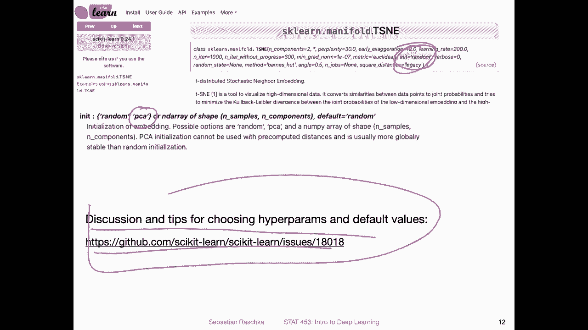

# 深度学习新闻 #2，2021年2月6日 📰

在本节课中，我们将回顾2021年2月初深度学习与人工智能领域的一些重要新闻和研究进展。我们将探讨自动化论文评审、新型生成模型、零样本学习、编程语言趋势、机器人学习以及数据可视化技术等多个主题。

---

## 🤖 自动化AI论文评审

上一节我们介绍了本周的概述，本节中我们来看看一项关于自动化AI论文评审的研究。

一篇名为《Seu Research Explo Crazy idea of Automating AI paper reviews》的文章引起了广泛关注。论文评审是当前深度学习与机器学习社区中一个非常敏感的话题。像ICML和NeurIPS这样的顶级会议每年会收到约5000到10000篇投稿。维持高质量的评审工作极具挑战性。评审者通常需要在很短的时间内审阅3到5篇论文。面对如此庞大的投稿量，寻找足够多的合格评审者同样困难。这可能是促使研究人员探索自动化评审想法的动机。

虽然我对使用AI真正决定论文质量持保留态度，但这项研究从语言理解的角度来看非常有趣。它展示了深度学习在理解人类语言和复杂文本内容方面的进展。

以下是评估一篇优秀评审报告最常被提及的几个品质，这些也可以作为我们课程项目同行评审的参考标准：

*   **决断性**：评审意见应明确。
*   **全面性**：评审应覆盖论文的各个方面。
*   **论证充分性**：观点需要有依据支撑。
*   **准确性**：评价应准确无误。
*   **友善性**：评审态度应友好、建设性。

他们提出的模型基于BART。BART是一种去噪自编码器，与BERT相关，用于预训练序列到序列模型。我们将在课程第五部分详细讨论序列到序列模型。序列到序列意味着模型的输入是一个序列，输出也是一个序列，而不仅仅是单个预测值。一个简单的例子是语言翻译，将一种语言翻译成另一种语言。

在该研究中，他们首先让人类标注员为论文打上各种标签（如摘要、动机、实质内容等）。然后训练一个能够自动完成相同标注任务的模型。之后进行一些后处理，最终仍需人类评估结果。

> 如果您对此项目感兴趣，可以在arXiv上找到相关论文，代码也已开源在GitHub上。

---

## 🎨 DALL·E：从文本生成图像

上一节我们讨论了自动化评审，本节中我们来看看一个有趣的生成模型项目。

您可能从未想过“意大利面做的夜晚”会是什么样子。这个名为DALL·E的项目（名字融合了Wall-E和艺术家达利）是一个机器学习项目。研究人员训练了一个拥有120亿参数的语言模型GPT-3。DALL·E基于GPT-3的概念，在图像及其描述文本的数据集上进行训练。然后，用户可以通过输入文本（如“意大利面做的夜晚”）来查询模型，模型会合成融合了文本概念的全新图像。

> 目前，DALL·E的论文和代码尚未公开，但有一篇博客文章可供深入了解。如果您对生成模型感兴趣，这是一个非常有趣的项目。

---

## 🔍 CLIP：连接语言与图像的零样本学习

虽然DALL·E的细节尚未完全公开，但其核心组件之一——CLIP模型已经可用。

CLIP代表对比语言-图像预训练。您可以将其理解为一个图像分类器，但它采用了一种巧妙的方法。CLIP基于**零样本迁移**学习。零样本意味着对模型从未在训练中见过的类别进行分类。

在少样本学习中，我们设定为 **N-shot K-way**，其中N代表每个类别的示例数量，K代表类别数量。例如，一个5-shot 10-way问题意味着有10个不同类别，但每个类别只有5个示例。零样本学习则更为极端，意味着某个类别**完全没有**训练示例。

CLIP通过**自然语言监督**和**多模态学习**来解决这个问题。多模态学习意味着使用不同的数据源，这里即图像数据和文本数据。具体来说，他们使用词嵌入来预测新的图像类别。在训练时，模型同时看到图像及其描述。当遇到新类别时，模型可以利用词嵌入或描述来预测类别。

以下是一个性能对比示例：在ImageNet数据集上，一个标准的ResNet-101模型达到了76.2%的准确率。而CLIP模型在另一个数据集上训练，并未在ImageNet上微调，却同样达到了76.2%的准确率。更令人印象深刻的是，它在其他未见过的ImageNet变体数据集上也表现良好。这表明CLIP通过对比语言-图像预训练的概念，能够更好地泛化到其他类型的数据集。

这种方法潜力巨大。例如，在开发自动驾驶系统时，您可能拥有海量数据。如果想寻找“行人穿过繁忙十字路口”的特定图像或视频片段，利用CLIP模型，您可以通过输入文本描述，高效地在大型数据集中进行查询。

以下是CLIP方法的高层次概述：

1.  它基于**自监督学习**中的对比预训练思想。
2.  模型同时在文本描述和图像上训练，分别通过文本编码器和图像编码器生成**嵌入向量**。
3.  模型学习将正确的文本描述与对应的图像关联起来。匹配的图文对应高分，不匹配的对应低分。
4.  预训练完成后，可以从文本标签创建分类器。例如，将类别标签嵌入到“一张XX的照片”这样的描述中，生成文本嵌入。
5.  对于一张需要分类的新图像（零样本预测），通过图像编码器得到其嵌入，然后找出与之相似度最高的文本描述嵌入，从而确定其类别。

> CLIP的论文和代码均已公开。

---

## 🌐 开源大型语言模型与编程语言趋势

上一节我们介绍了CLIP模型，本节中我们关注社区动态和工具趋势。

我多次提到了GPT-3模型。遗憾的是，GPT-3尚未公开。但出现了一项旨在训练开源版本GPT-3规模模型的计划。该计划的主要目标是复制GPT-3规模的模型并向公众免费开源。他们在一个名为“The Pile”的825GB数据集（包含YouTube描述、PubMed论文等）上训练模型。这是一个拥有约2000亿参数的大型模型。训练此类模型成本极高（可能高达数百万美元），通常需要大公司支持，因此这项开源计划非常有价值。

另一则新闻是关于编程语言和工具流行度的分析。根据O‘Reilly基于其网站查询和书籍搜索的数据，Python毫无疑问位居榜首，并且其热度仍在持续增长。Scala语言的关注度则出现显著下降。这提醒我们，在追求前沿技术（如学习新语言）和高效完成工作之间需要权衡。目前看来，Python仍然是机器学习和深度学习的绝佳选择。

---

## 🤖 基于视觉演示的机器人操作学习

另一个有趣的项目来自Facebook AI Research，他们致力于教AI通过视觉演示来操纵物体。

目前训练机器人仍然非常具有挑战性。强化学习领域让机器人通过试错来学习。另一种方法是**逆强化学习**，即基于演示进行学习。然而，传统方法通常需要在虚拟环境中模拟期望行为。

Facebook AI Research提出了一种**基于模型的逆强化学习**方法，它允许机器人在物理机器人上直接通过**视觉演示**（如视频或系列图像）进行学习。这意味着，无需构建复杂的3D虚拟环境，只需向强化学习智能体展示人类执行任务的视频（例如抓取并移动瓶子），它就能在一定程度上学会执行类似行为。

> 该项目提供视频演示、博客文章和GitHub上的开源代码。

---

## 📊 t-SNE：高维数据可视化及其技巧

最后，我们来讨论一个在深度学习中非常流行的技术——t-SNE。

t-SNE是一种用于可视化高维数据集的强大技术。以MNIST手写数字数据集为例，每张图像是28x28像素，即784维。我们无法直接在散点图上可视化如此高维的数据。t-SNE可以将数据集的维度降至二维（或三维），并**保留高维空间中数据点之间的关系**。

t-SNE将高维的MNIST数据嵌入到二维空间后，您可以看到数字0聚集在一起，数字7聚集在一起，等等。它通过投影到低维空间，保留了这些数字之间的相对关系。

您可以将其与主成分分析（PCA）对比。PCA是一种**线性变换**，而t-SNE方法则更为复杂，是非线性的。t-SNE的一个缺点是必须调整其超参数才能获得良好效果，而通常我们并不知道最佳设置是什么。

本周有一篇论文指出，**初始化对t-SNE和UMAP保持全局数据结构至关重要**。研究人员发现，如果使用PCA的结果作为t-SNE的初始化起点，而不是随机初始化，t-SNE的性能会好得多。他们通过计算原始高维空间和降维后空间中数据点距离之间的相关性来衡量性能，发现使用PCA初始化的t-SNE能更好地保持距离关系。

UMAP是另一种非常优秀且近期越来越流行的方法，有时在保持数据结构方面甚至优于t-SNE。

在实践中，t-SNE不仅用于可视化数据集，也常用于理解深度神经网络的行为。例如，研究人员可以提取神经网络某一层的嵌入表示，然后应用t-SNE来观察该层嵌入对不同类别的分离效果。

关于使用t-SNE的一个实用技巧是：在Scikit-learn中，t-SNE的默认初始化方案是随机的。根据上述研究，在实践中建议将其改为PCA初始化。目前Scikit-learn的issue跟踪器上正在讨论是否将默认行为改为使用PCA。

---

## 📝 总结

本节课中，我们一起回顾了2021年2月初的多项深度学习进展。我们探讨了自动化论文评审的尝试、DALL·E和CLIP这类连接语言与图像的创新模型、零样本学习的潜力、编程语言的发展趋势、机器人通过视觉演示进行学习的新方法，以及t-SNE数据可视化技术的最佳实践。这些动态展示了深度学习领域快速发展的多样性和创新活力。