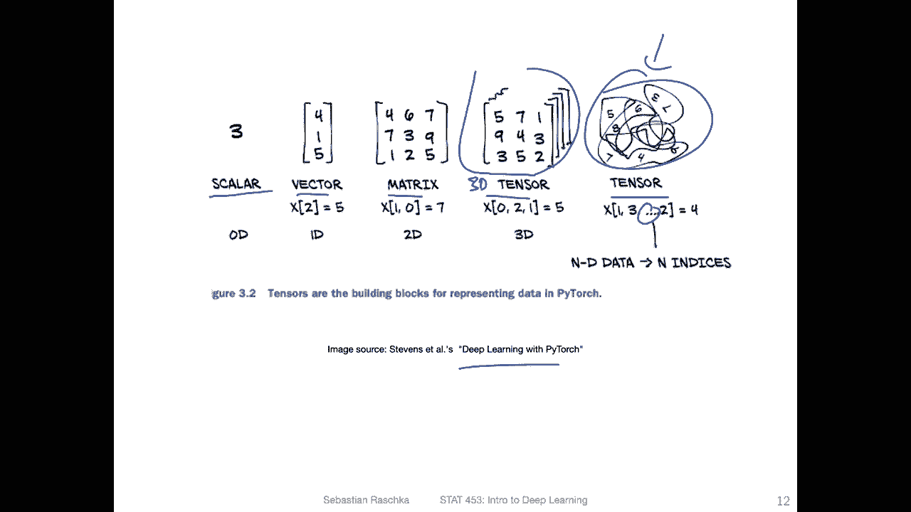
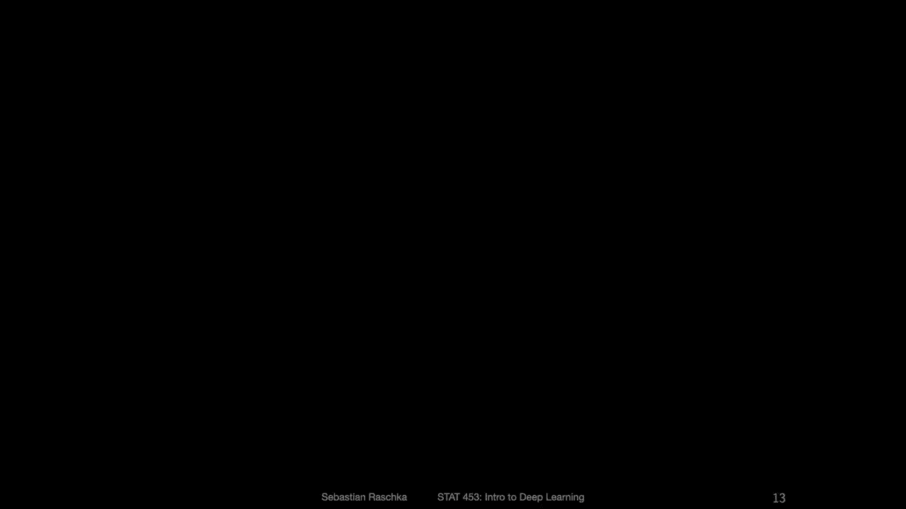
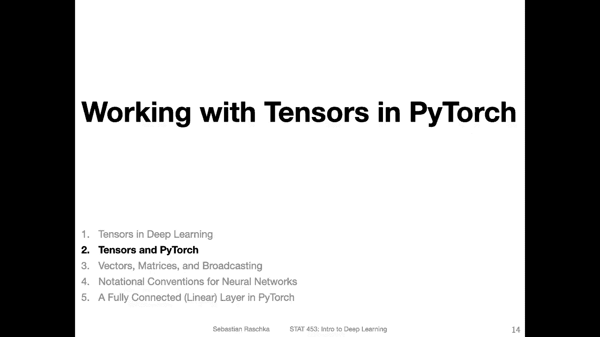

# 深度学习基础课程 P27：L4.1 - 深度学习中的张量 🧮

在本节课中，我们将要学习深度学习中的一个核心概念——张量。我们将从数学定义出发，了解其在深度学习中的具体应用，并学习如何在代码中表示和操作张量。

## 概述

张量是深度学习中最基本的数据结构。理解张量的概念、维度和表示方法，是掌握后续模型构建和数据处理的基础。本节将系统介绍标量、向量、矩阵与张量的关系，以及它们在深度学习框架中的具体实现。

## 张量的定义与等级

首先，我们来定义“张量”这个术语，并了解它在深度学习语境下的使用方式。

张量是向量、矩阵和标量等概念的泛化。例如，标量可以被视为一个零阶张量。标量的一个例子是一个实数，例如一个整数。在深度学习的上下文中，我们通常处理的是实数，尽管在类别标签中可能会使用整数。

一个标量就是一个单独的值，例如 `1.23`。

向量是一个一阶张量，你可以看到我们为其增加了一个维度。向量通常在线性代数中被视为包含 n 个值的数据容器。然而，在机器学习和深度学习的语境中，我们通常将向量视为 `n × 1` 维的。本质上，你可以将其看作一个非常“瘦”的矩阵，即一个只有一列的矩阵。这主要是为了方便某些计算。

通常，默认情况下，我将向量表示为列向量。但当我写转置时，我们有时也会使用行向量。行向量本质上就是列向量的转置，是一个 `1 × n` 维的向量。

矩阵是一个 `n × m` 维的矩阵，其中 `m` 是行数，`n` 是列数。如果 `n` 为 1，那么我们就只有第一列，这便是一个列向量。

以上内容主要是为张量的概念、向量、矩阵和标量及其关系建立基础的符号表示。

## 深度学习中的设计矩阵

在深度学习和机器学习的上下文中，我们通常为数据使用所谓的“设计矩阵”。这是一个常见的惯例。

如果我们使用字母 `X`，那么我们通常指的是一个设计矩阵，它是一个 `n × m` 维的矩阵。在之前的幻灯片中，我写的是 `m × n` 维。这只是在一般线性代数教材中的写法。这里的字母 `m` 和 `n` 并不重要。但在机器学习和深度学习领域，大多数人遵循一个惯例：`n` 表示训练样本的数量，`m` 表示特征的数量。这就是为什么我将其写作 `n × m`。但这也不是绝对重要的，只是一个惯例。

就像我在第一节课中已经谈到的，我们将使用下标表示特征索引，使用上标表示训练数据点索引或训练样本索引。

如果我们有 `n` 个训练样本，那么我们的索引将从 1 到 `n`。对于特征，我们的索引将从 1 到 `m`。例如，在鸢尾花数据集中，我们有 150 个训练样本和 4 个特征。

## 高阶张量

在上一节中，我们看到了零阶张量，称之为标量。对于一阶张量，我们称之为向量。对于二阶张量，我们称之为矩阵。那么，对于三阶张量，我们该如何称呼呢？遗憾的是，并没有专门的词。通常，当我们指代一个三阶张量时，我们使用“3D 张量”这个词，有时甚至直接称为“张量”。

那么，什么是 3D 张量呢？你可以将其想象成一叠矩阵。如果这里的每个方框代表一个矩阵（一个二阶张量），那么在深度学习的上下文中，一个 3D 张量就像是多个矩阵堆叠在一起。例如，这里可能堆叠了 `p` 个矩阵，每个矩阵是 `n × m` 维的。

请注意，这里的 `m` 和 `n` 是任意的，它们并不特指特征或训练样本。这些只是常用的字母，不要将它们与训练样本或特征数量混淆。它们只是通用的术语或字母。

在实践中，我们确实会在深度学习中遇到这些 3D 张量，例如当我们处理图像数据时。你可以将单张图像（如彩色图像）看作一个 3D 张量。我们有三个颜色通道：红色、绿色和蓝色。每个颜色通道由像素值组成，例如可以是一个 `100 × 100` 的矩阵，包含每个颜色通道的像素值。组合起来，它们基本上就是一个 3D 张量。这就是我们在深度学习中处理图像数据时会遇到 3D 张量的情况。

然而，在实践中，我们并不止步于 3D 张量。实际上，我们在深度学习中会使用 4D 张量，因为我们有一个由多个这样的 3D 图像组成的训练集。你可以将这里的 4D 张量想象成多个 3D 张量的堆叠。

例如，右侧是 CIFAR-10 数据集的一个例子。其中每一个都是一个 RGB 3D 张量。关于维度，通常在深度学习中，我们将这些 4D 张量的维度表示为 `(n, c, h, w)`，其中：
*   `n` 是训练样本的数量。
*   `c` 是颜色通道的数量，例如 RGB 图像中为 3。
*   `h` 是图像的高度。
*   `w` 是图像的宽度。

这样，最后的三个维度 `(c, h, w)` 基本上就是我们的特征 `m`。在这种情况下，我们有 `c × h × w` 个特征，而 `n` 仍然是我们的训练样本数量。如果我们不使用深度学习，我们会将其重塑为一个 `n × m` 维的设计矩阵，其中 `m` 实际上是 `c × h × w`。

不过，我们目前还没有处理彩色图像。这将在我们讨论卷积网络时遇到，我计划在探索更简单的彩色图像模型时也会涉及这种重塑操作，但现在不必担心。

## 框架中的张量实现

关于张量，你可能听说过 TensorFlow 这个工具。TensorFlow 的名字中就包含了“张量”。在这些工具（如 TensorFlow、NumPy 和 PyTorch）的上下文中，张量实际上指的是多维数组的概念。

你可以将多维数组看作一种用于存储或表示张量的数据结构或计算数据结构。在数学中，我们称之为张量，但在实际编码中，这些本质上就是多维数组。

在 TensorFlow 中，这些多维数组被称为 `Tensor`。在 NumPy 中，它们被称为 `ndarray`（n 维数组）。在 PyTorch 中，它们也被称为 `Tensor`。但它们本质上都是同一个东西。

以下是一个简单的例子。这里我导入 PyTorch，创建一个张量，这个张量是一个 `2 × 3` 的矩阵（两行三列）。然后，我使用 `t.shape` 来查看其形状。在 NumPy 中也有 `t.shape`，你可能知道。这会返回多维数组或张量的维度。你可以看到这里的 `2` 和 `3` 就是其维度。实际上，它是每个维度中值的数量。这将是一个二维数组，因为有两个维度：行维度和列维度。因此，这将是第一维和第二维。

形状中的索引数量就是维度的数量。方便的是，你也可以调用 `ndim`，它代表维度的数量，同样会返回 `2`。所以，`ndim` 本质上等同于在 Python 中调用 `len(t.shape)`，只是一个快捷方式。

我只是想简要强调一下，在 PyTorch、TensorFlow 和 NumPy 的上下文中，张量与多维数组是同一个概念。

## 核心概念总结

这里有一张来自《Deep Learning with PyTorch》一书的很好的总结图，将所有术语一目了然地展示出来：标量、向量、矩阵、张量（这里是 3D 张量），以及更高维的张量（n 维张量）。

在这种情况下，你实际上不知道有多少个维度，可能是任意的。这也只是开个玩笑，表示这是我们无法在脑海中可视化的东西，因为作为人类，我们最多只能真正思考三个维度，到了第四个维度，一切就变得难以想象了。

以上只是对我们刚才在前几张幻灯片中讨论内容的一个简短总结。

在下一个视频中，我想简要地更多地讨论张量和 PyTorch。如果这次内容有点简短，我将在下一个视频中详细讨论。

## 总结

本节课中，我们一起学习了深度学习中的核心数据结构——张量。我们从数学基础出发，明确了标量、向量、矩阵与张量之间的关系。我们了解到，在深度学习的实际应用中，数据通常以设计矩阵或更高维的张量形式组织，例如处理图像时的 3D 张量（通道、高度、宽度）或包含批量数据的 4D 张量。最后，我们认识到在主流深度学习框架中，张量在代码层面被实现为多维数组，并掌握了查看其形状和维度的基本方法。理解张量是理解后续所有数据流动和模型计算的基础。