# 课程 P28：L4.2 - PyTorch 中的张量 🧮

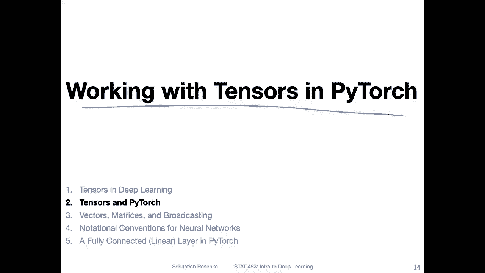

在本节课中，我们将要学习如何在 PyTorch 中操作张量。如果你熟悉 NumPy，你会发现使用 PyTorch 的张量非常简单，因为两者的操作几乎完全相同。

## 张量简介

正如之前提到的，在计算语境中，张量和多维数组是同义词。在 NumPy 中，我们使用 `numpy.array` 来构建多维数组。而在 PyTorch 中，我们使用 `torch.tensor`。

需要注意的是，PyTorch 中还有两个相关的调用：`torch.Tensor`（大写 T）和 `torch.tensor`（小写 t）。`torch.tensor` 是一个函数，它在内部调用 `torch.Tensor`，但会进行额外的输入检查以确保数据格式正确。因此，在实践中，推荐使用 `torch.tensor` 函数。

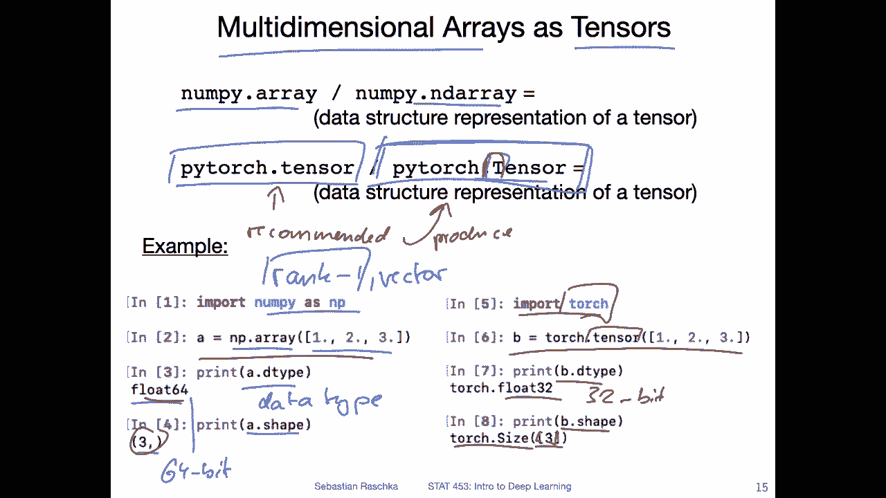

## 创建张量

以下是创建一维向量（即秩为1的张量）的示例。

在 NumPy 中，我们这样创建：

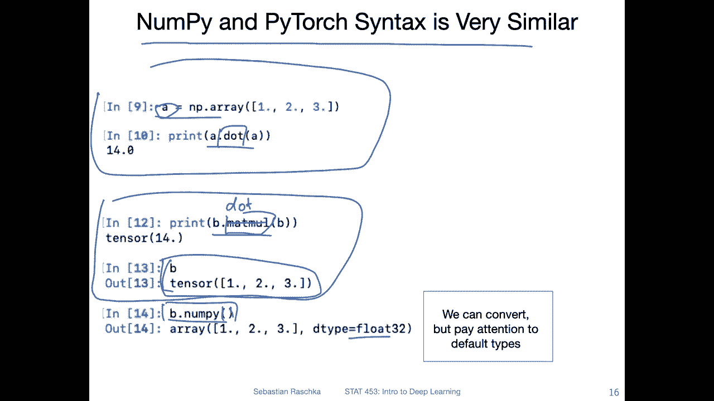

```python
import numpy as np
a = np.array([1., 2., 3.])
print(a.dtype)  # 输出：float64
print(a.shape)  # 输出：(3,)
```

在 PyTorch 中，我们这样创建：

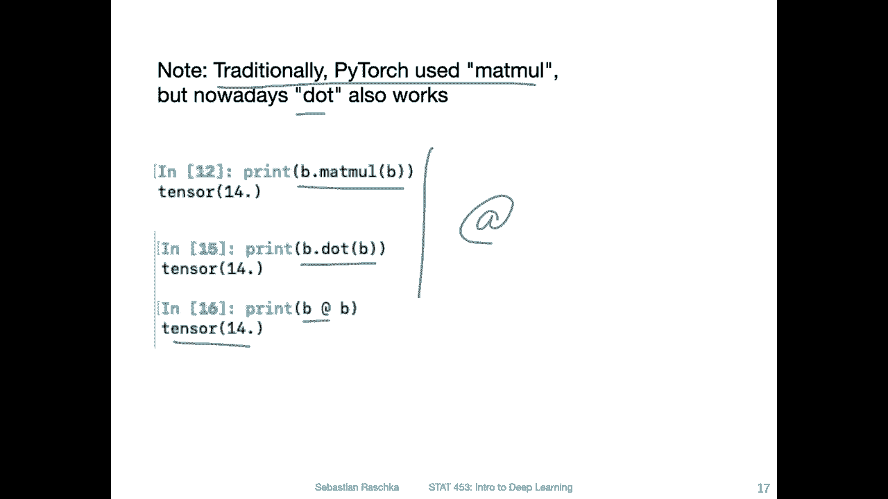

```python
import torch
b = torch.tensor([1., 2., 3.])
print(b.dtype)  # 输出：torch.float32
print(b.shape)  # 输出：torch.Size([3])
```

可以看到，NumPy 默认创建 64 位浮点数（float64），而 PyTorch 默认创建 32 位浮点数（float32）。在深度学习中，32 位精度通常已经足够，并且占用更少的内存。

## 基本运算

PyTorch 和 NumPy 的运算方式非常相似。例如，计算点积：

在 NumPy 中：
```python
result_np = np.dot(a, a)
```

在 PyTorch 中，有几种等效方式：
```python
result_torch1 = torch.matmul(b, b)
result_torch2 = b @ b  # 使用 @ 运算符
result_torch3 = torch.dot(b, b)  # 对于一维张量
```

此外，你可以将 PyTorch 张量转换为 NumPy 数组，这在某些需要与 Matplotlib 等库交互时很有用：
```python
b_numpy = b.numpy()
```

## 数据类型详解

理解不同的数据类型对于高效计算很重要。以下是常见的数据类型及其含义：

*   **整数类型**：
    *   `uint8`：无符号 8 位整数（0 到 255）。
    *   `int16`, `int32`, `int64`：有符号 16、32、64 位整数。
*   **浮点数类型**：
    *   `float16`（半精度）：16 位浮点数。
    *   `float32`（单精度）：32 位浮点数。
    *   `float64`（双精度）：64 位浮点数。

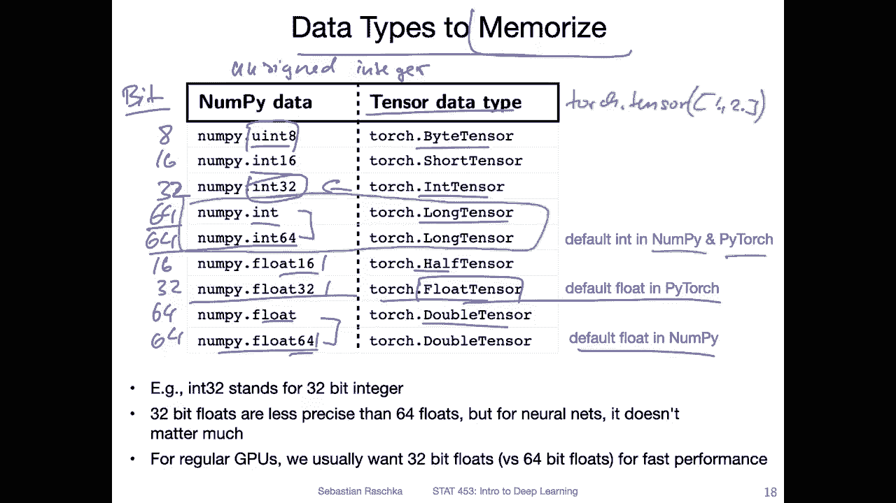

在深度学习中，`float32` 是默认和推荐的选择，因为它在 GPU 上运行更快，且精度足够。`float16` 有时用于混合精度训练以节省内存。

在 PyTorch 中，这些类型有特定的名称：
*   `torch.uint8` 对应 `uint8`。
*   `torch.int32` 或 `torch.int` 对应 `int32`。
*   `torch.int64` 或 `torch.long` 对应 `int64`。
*   `torch.float32` 或 `torch.float` 对应 `float32`。
*   `torch.float64` 或 `torch.double` 对应 `float64`。
*   `torch.float16` 或 `torch.half` 对应 `float16`。

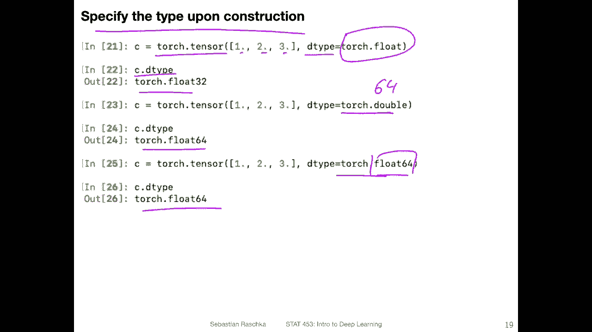

## 指定与转换数据类型

你可以在创建张量时指定数据类型：

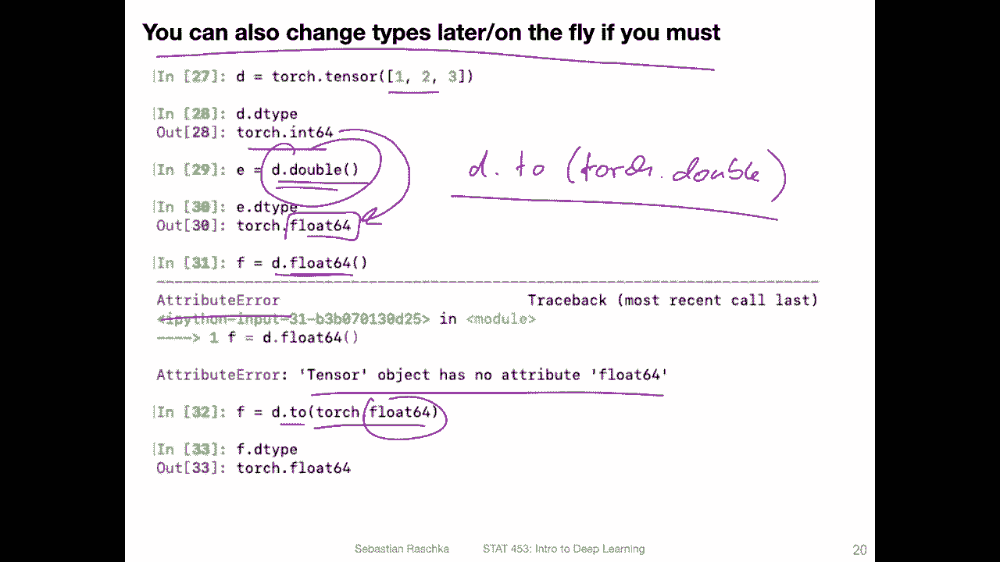

```python
c = torch.tensor([1., 2., 3.], dtype=torch.float64)  # 创建双精度张量
```

也可以在创建后转换数据类型：

```python
d = torch.tensor([1, 2, 3])  # 默认为 torch.int64
e = d.double()               # 转换为 torch.float64
# 或者使用更通用的方法
f = d.to(torch.float64)
```

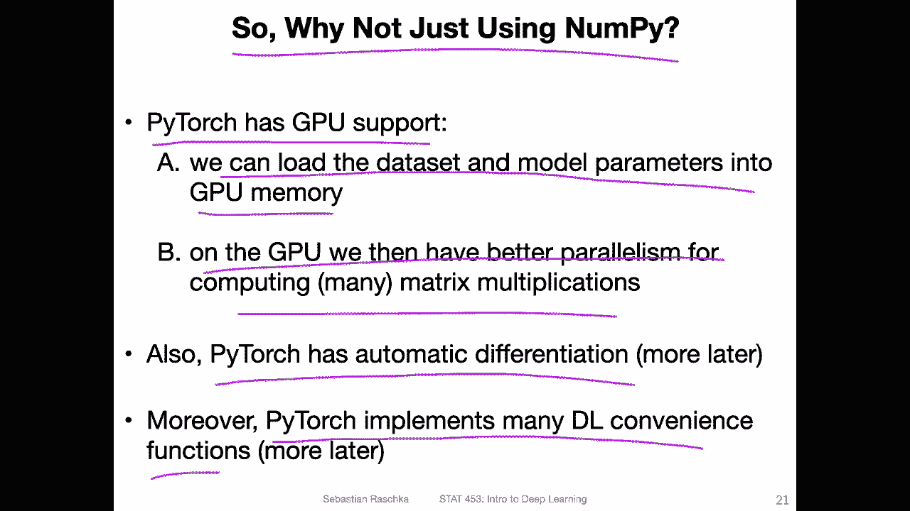

## 为什么使用 PyTorch？

既然 PyTorch 和 NumPy 如此相似，为什么我们还需要 PyTorch？主要有以下几个原因：

1.  **GPU 加速**：PyTorch 可以轻松地将计算转移到 GPU 上，利用其并行计算能力，使大型矩阵运算速度提升成百上千倍。
2.  **自动微分**：PyTorch 内置了自动梯度计算功能，这对于训练神经网络、计算损失函数的梯度至关重要。
3.  **深度学习工具包**：PyTorch 提供了大量预构建的神经网络层、损失函数和优化器，使得构建和训练深度学习模型更加高效和便捷。

## 使用 GPU

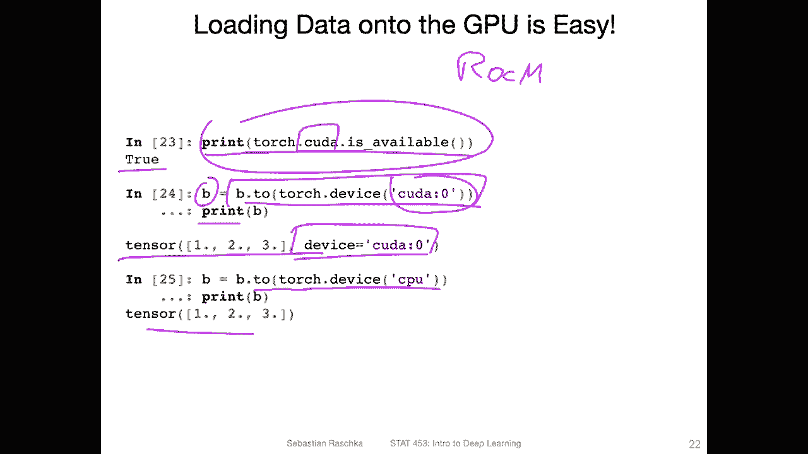

要检查你的 PyTorch 是否支持 GPU 并利用它，可以这样做：

```python
# 检查 GPU 是否可用
print(torch.cuda.is_available())

# 如果可用，将张量移动到 GPU
if torch.cuda.is_available():
    device = torch.device("cuda:0")  # 使用第一个 GPU
    b_gpu = b.to(device)
    print(b_gpu)

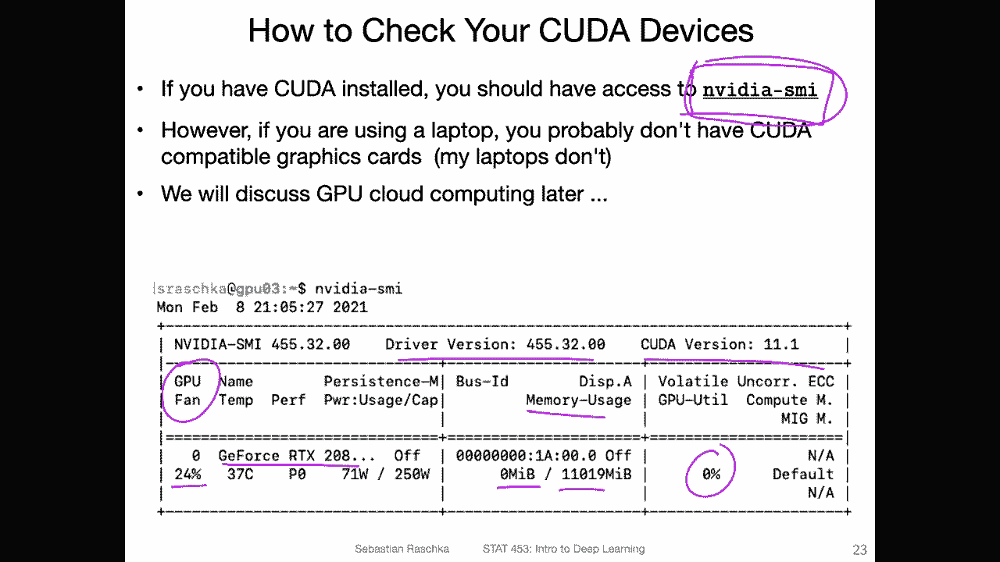

# 将张量移回 CPU
b_cpu = b_gpu.to("cpu")
```

你可以通过在终端运行 `nvidia-smi` 命令来查看 GPU 的状态（仅限 NVIDIA GPU）。

## 安装 PyTorch

对于大多数学习和开发工作，在个人电脑上安装 CPU 版本的 PyTorch 就足够了。建议访问 [pytorch.org](https://pytorch.org)，根据你的操作系统、包管理器和需求（选择 “CUDA=None” 以安装 CPU 版本）获取安装命令。通常，使用 Conda 或 Pip 安装即可。

例如，一个常见的 CPU 版本安装命令是：
```
conda install pytorch torchvision torchaudio cpuonly -c pytorch
```

## 总结

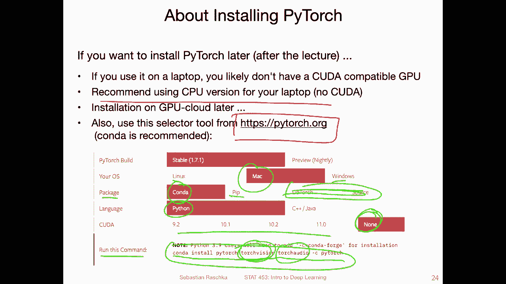

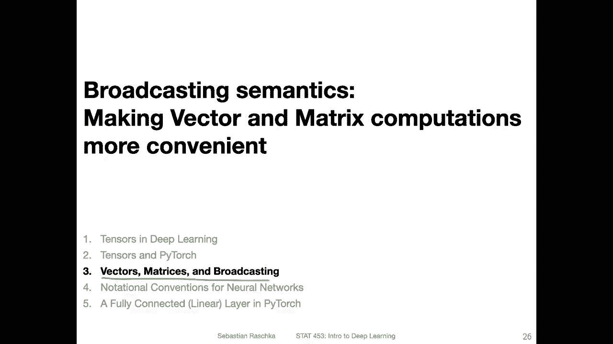

本节课中，我们一起学习了 PyTorch 张量的基础知识。我们了解了如何创建和操作张量，探讨了不同的数据类型及其在深度学习中的意义，比较了 PyTorch 与 NumPy 的异同，并介绍了使用 GPU 加速计算以及安装 PyTorch 的基本步骤。掌握这些内容是进行后续深度学习实践的重要基础。