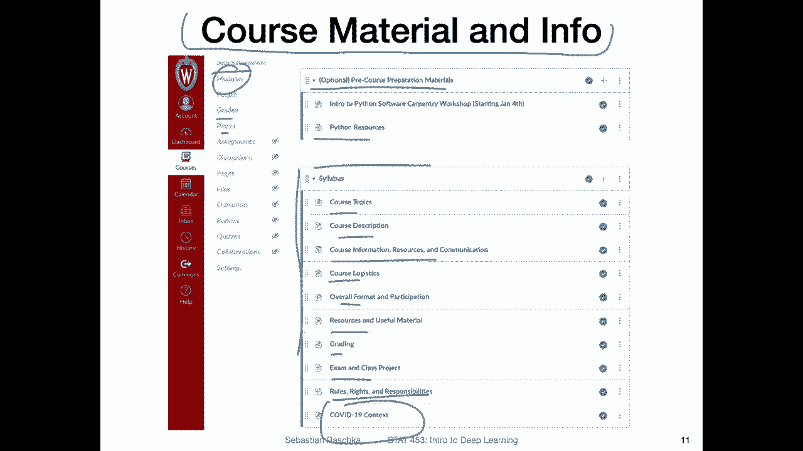
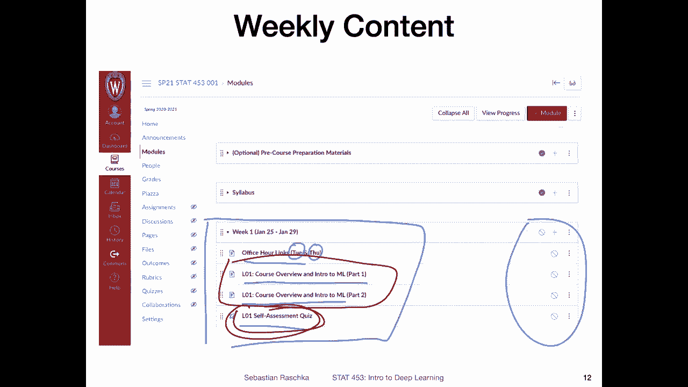
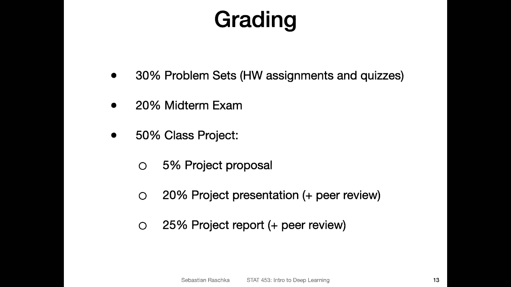

# 课程 P3：L1.1.2 - 课程组织与概述 📚

在本节课中，我们将详细介绍本学期的课程组织方式、使用的平台、评分构成以及沟通渠道。我们将使用 Canvas 作为核心平台，以简化信息获取流程。

## 🖥️ 课程平台与材料组织

我们将主要使用 Canvas 平台。这能让我和你们的工作都更轻松，因为所有内容都会集中在一个地方。公告、成绩以及 Piazza 论坛等信息都会在此发布。

我们也会使用其他技术，如 GitHub。但我会在 Canvas 上发布相关链接。因此，你们无需自己去不同地方搜索资料，所有内容都会集中在 Canvas 的模块中。



以下是课程材料的组织示例：

```text
Canvas 课程页面
├── 公告
├── 成绩
├── 模块（每周内容）
└── Piazza（讨论区）
```

## 🐍 关于 Python 的先修要求

本课程要求你曾修读过一门编程课程，但不一定是 Python。然而，我们将在课程中使用 Python。你无需成为 Python 专家，我们只会使用其非常基础的功能。但提前了解 Python 的基本工作原理对你将大有裨益。

我在寒假期间分享了一些可选的预备材料，供有编程背景但未使用过 Python 的同学学习。这些资源学习起来并不费力，只涉及基础知识。我们不会在开学前几周立即使用 Python，预计从第三周开始。因此，你没有压力必须今天完成学习，但如果你毫无 Python 经验，最好在接下来几天浏览这些资源。





## 📄 教学大纲与课程信息

几天前，我已经发布了大量关于教学大纲的信息。在此我不再赘述所有细节，你们自行阅读发布的内容会更高效。内容主要包括：本课程将涵盖的主题（你可能已有所了解）、课程信息的主要位置（主要在 Canvas 上）、可能对你有帮助的可选教材资源，以及本课程的沟通方式。我将在接下来的几张幻灯片中进一步说明。

## 📅 课程安排与内容发布

关于课程的后勤安排和期望：内容方面，我将在每周二和周四上传视频。选择这个时间是因为这符合我以往线下授课的节奏，也便于我安排工作：周一我开始录制周二的视频，周二处理邮件和工作，周三录制周四的课程，依此类推。

每周的典型安排如下所示（虽然我录制时尚未上传，但你们观看此视频时可能已经上传）：

*   **办公时间**：我们将通过 Zoom 进行办公时间。我和助教都会在晚上安排时间（例如，我可能在周二晚上6-7点，助教在7-8点），以方便不同时区的同学参与。
*   **内容发布**：周二和周四，我会上传课程视频到 Canvas 的特定页面，并嵌入所有视频。同时，我也会发布或链接一些额外的阅读材料，例如与讲座相关的有趣论文。
*   **每周自测测验**：我计划在每周结束时发布一个自测测验。该测验包含3到5个简单的选择题，旨在帮助你跟上进度，并计入少量分数。测验会在周末发布，但截止日期是一周后，这样你就有大约7天的时间在观看视频后完成它。

## 📊 课程评分构成

本学期的评分构成如下：

*   **作业与测验（30%）**：包括家庭作业和每周的自测测验。家庭作业大约每两周发布一次，比测验更长，涉及自由回答或少量编码。预计本学期有5到7次作业。
*   **期中考试（20%）**：将在 Canvas 上进行线上考试。具体日期已发布在教学大纲中，我稍后会再次通知。
*   **课程项目（50%）**：这是课程中最有趣的部分。你们需要组建3人小组，提出一个与深度学习相关的项目主题。我将提供数据集、资源网站、项目想法以及往届示例。项目提案是一份约两页的报告，仅占总成绩的5%，主要用于获取反馈以确保项目方向可行。学期末，需要提交项目展示视频（8-10分钟）和项目报告（8页，会议论文风格）。此外，本学期将引入**同行评审**环节，每位同学将评审其他三位同学的报告和展示并提供反馈。

## 💬 课程沟通方式

本课程的沟通主要通过以下两种方式进行：

1.  **Zoom 办公时间**：用于面对面的实时答疑。
2.  **Canvas/Piazza 论坛**：用于异步沟通。Piazza 是一个集成在 Canvas 中的在线论坛，仅本课程学生可访问。你可以在上面公开（显示姓名）或匿名提问。我也鼓励公开提问，例如寻找组员。所有与课程相关的问题都可以在此提出。与电子邮件相比，我更喜欢 Piazza，因为它更集中，便于我跟踪和回答所有课程问题，不易遗漏。你也可以通过 Piazza 的私信功能向我发送私人问题。

**强烈建议**你在 Canvas 中启用通知功能。这样，当有新内容、新截止日期等信息时，你会自动收到邮件提醒，无需手动刷新页面。

## ✨ 总结

本节课我们一起学习了本学期的课程组织框架。我们明确了将使用 **Canvas** 作为核心信息枢纽，了解了 **Python** 的先修要求，熟悉了以周为单位的**内容发布与测验节奏**，掌握了**评分构成**（重点是占比较大的课程项目），并知道了主要通过 **Zoom 办公时间** 和 **Piazza 论坛** 进行沟通。请务必在 Canvas 上设置好通知，以便及时获取课程更新。如有任何问题，欢迎在本周的办公时间面对面交流，或在 Piazza 上发帖提问。