# 课程 P30：L4.4 - 神经网络的符号约定 🧮

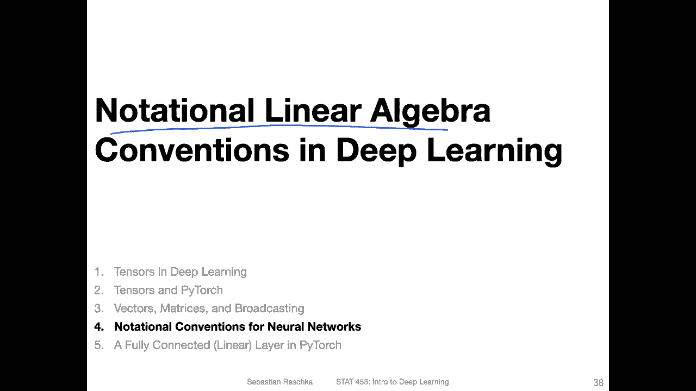

在本节课中，我们将学习深度学习中关于线性代数的符号约定。我们将从感知机的基本计算开始，逐步扩展到具有多个输入和多个输出的神经网络层，并解释如何用矩阵和向量简洁地表示这些计算。

---

## 从感知机到矩阵计算

上一节我们回顾了感知机的基本结构。本节中我们来看看如何用线性代数表示其计算过程。

在感知机中，对一个输入特征向量进行推理（即预测其标签）的过程如下：首先计算净输入 `z = x^T W + b`，其中 `x` 是输入特征向量，`W` 是权重向量，`b` 是偏置标量。然后将 `z` 输入到激活函数（如阈值函数）中得到预测结果。

以下是单个数据点的计算过程：

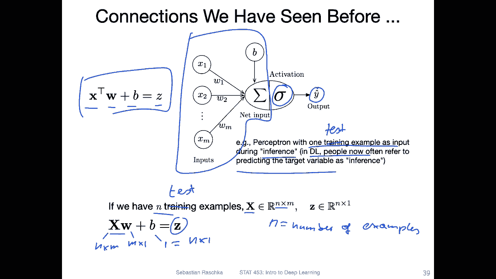

```python
# 假设 x 是 M 维特征向量，W 是 M 维权重向量，b 是标量偏置
z = np.dot(x.T, W) + b
```

---

## 处理多个数据点

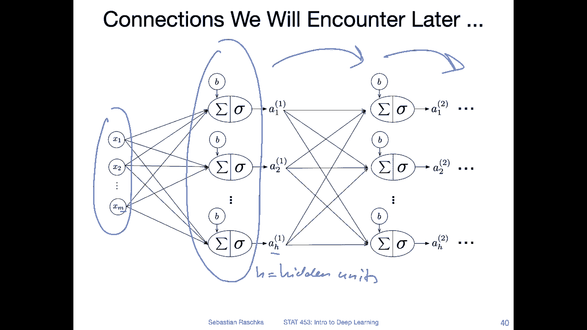

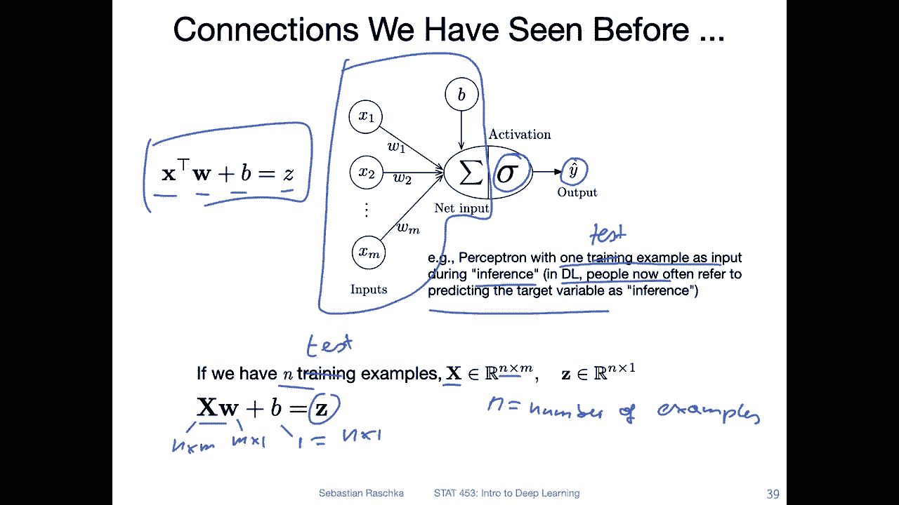

我们可以将上述计算扩展到同时处理多个数据点（例如 `n` 个训练或测试样本）。

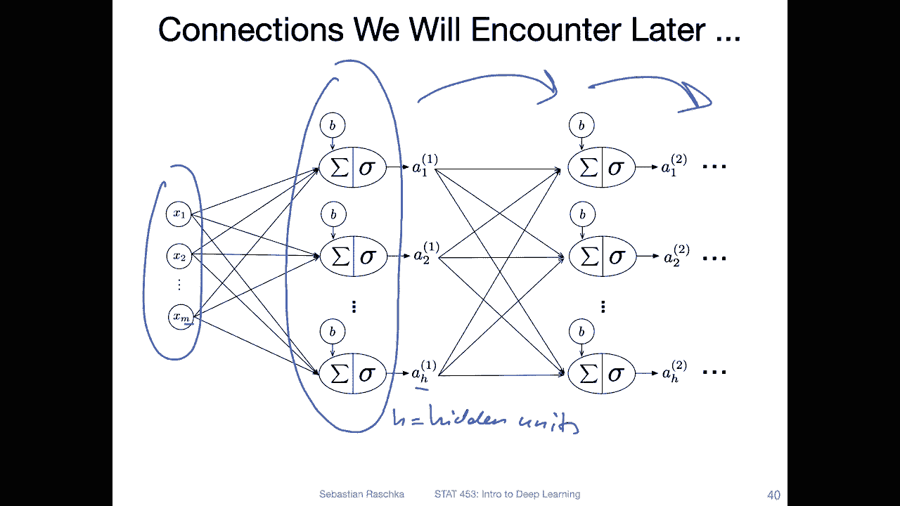

我们使用一个 `n × M` 维的设计矩阵 `X` 来表示数据，其中 `n` 是样本数量，`M` 是特征数量。此时的计算变为：

```python
# X 是 n × M 的设计矩阵
# W 是 M × 1 的权重列向量
# b 是标量偏置（通过广播机制加到每个样本上）
Z = np.dot(X, W) + b  # 结果 Z 是 n × 1 的向量
```

公式表示为：
**Z = X W + b**
其中 `X ∈ R^(n×M)`, `W ∈ R^(M×1)`, `b ∈ R`, `Z ∈ R^(n×1)`。

这样，向量 `Z` 中的每个值就对应一个输入样本的净输入。

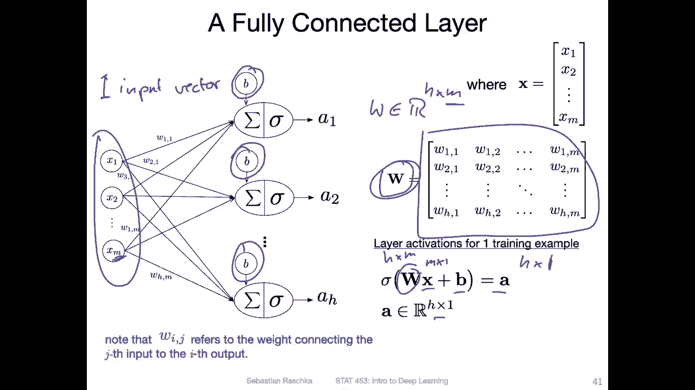

---

## 神经网络中的多个输出

在深度学习中，神经网络通常包含具有多个神经元的隐藏层。这意味着一个输入可以产生多个输出。

假设我们有一个输入特征向量（单个数据点），但隐藏层有 `H` 个神经元（即 `H` 个输出）。此时，我们需要一个权重矩阵 `W` 来处理这种多输出的情况。

以下是处理单个数据点但产生多个输出的计算：

```python
# x 是 M × 1 的输入向量
# W 是 H × M 的权重矩阵（H 个神经元，每个神经元接收 M 个输入）
# b 是 H × 1 的偏置向量（每个神经元一个偏置）
h = np.dot(W, x) + b  # 结果 h 是 H × 1 的向量
```

公式表示为：
**h = W x + b**
其中 `x ∈ R^(M×1)`, `W ∈ R^(H×M)`, `b ∈ R^(H×1)`, `h ∈ R^(H×1)`。

---

## 结合多个数据点与多个输出

现在，我们将前两个概念结合起来：同时处理 `n` 个数据点，并且每个数据点产生 `H` 个输出（即隐藏层有 `H` 个神经元）。

我们有一个 `n × M` 的设计矩阵 `X` 和一个 `H × M` 的权重矩阵 `W`。为了进行矩阵乘法并使结果维度便于作为下一层的输入（保持样本数 `n` 作为第一维），我们通常按如下方式计算：

```python
# X 是 n × M 的设计矩阵
# W 是 H × M 的权重矩阵
# b 是 H × 1 的偏置向量（通过广播机制加到每个样本上）
H = np.dot(X, W.T) + b.T  # 或者 H = X W^T + b^T
# 结果 H 是 n × H 的矩阵，每一行是一个样本的 H 维隐藏层表示
```

公式表示为：
**H = X W^T + b^T**
其中 `X ∈ R^(n×M)`, `W ∈ R^(H×M)`, `b ∈ R^(H×1)`, `H ∈ R^(n×H)`。

这种表示方式使得每一层输出的第一维始终是样本数量 `n`，这在组织数据流时非常直观和方便。

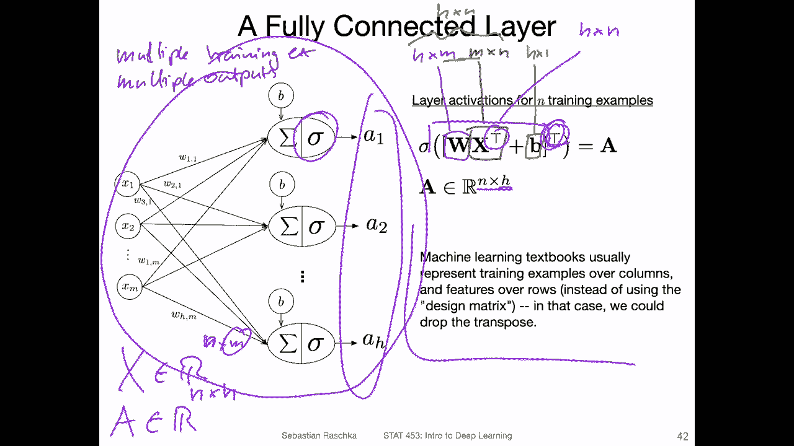

> **关于符号约定的说明**：在一些较早的教材中，可能会将设计矩阵表示为 `M × n`（即特征为行，样本为列）。在这种情况下，公式中就不需要转置操作（即 `H = W X + b`）。现代深度学习框架和教材更倾向于使用 `n × M` 的表示，虽然在线性代数乘法中需要引入转置，但更符合“每一行是一个样本”的直观理解。

---

## 为什么使用 Wx 而非 xW 的表示

你可能会注意到，在上述对单个样本的计算中，我们使用了 **h = W x + b** 的形式，即将权重矩阵 `W` 放在输入向量 `x` 之前。这与一些线性代数中的传统表示一致。

这种表示（变换矩阵在前，向量在后）在几何视角下有时更直观。我们可以将 `W` 视为一个线性变换矩阵。例如，一个单位矩阵 `I` 对向量 `x` 进行变换时，不会改变 `x`。

```python
# 单位矩阵不改变输入向量
I = np.eye(2)  # 2x2 单位矩阵
x = np.array([x1, x2])
transformed_x = np.dot(I, x)  # 结果仍是 [x1, x2]
```

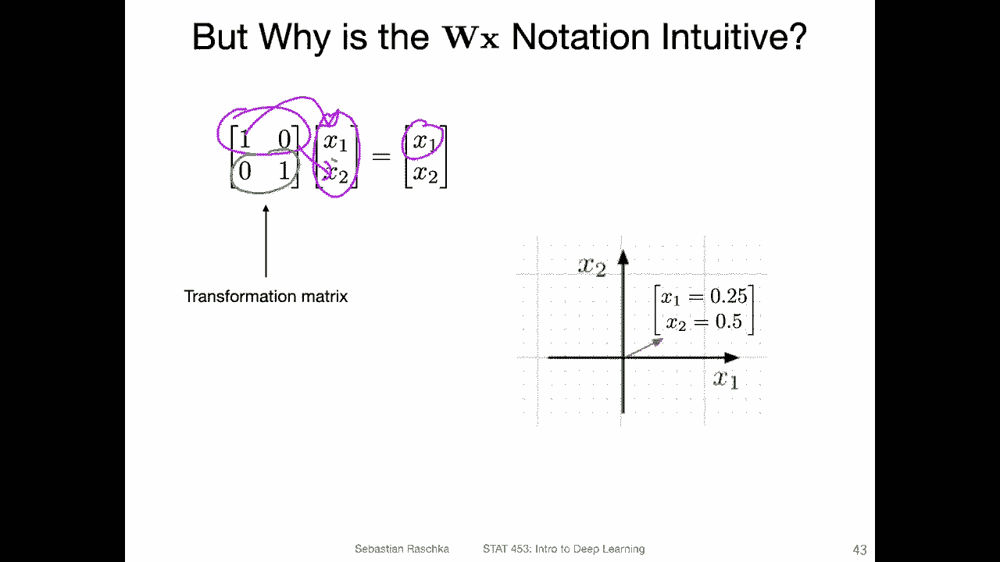

更一般地，矩阵 `W` 中的元素可以理解为对输入空间进行**缩放**和**平移**（如果包含仿射变换）的操作。这种视角有助于理解神经网络层如何对输入特征进行变换和组合。

然而，值得注意的是，在实际的深度学习框架（如 PyTorch）中，全连接层的实现通常采用 **output = input @ W^T + b** 的形式，这与我们上面为了保持维度一致而使用的 `X W^T` 是等价的。框架会帮我们处理这些细节。

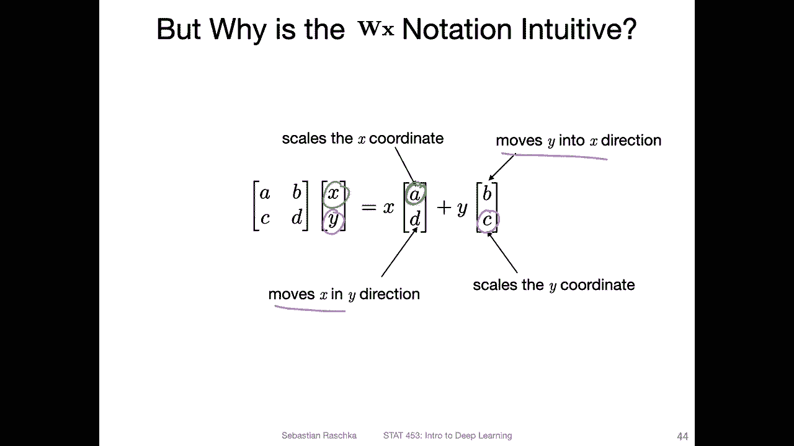

---

## 总结

本节课中我们一起学习了神经网络中的核心符号约定：

1.  **单个数据点**：使用特征向量 `x` 和权重向量 `W` 进行计算。
2.  **多个数据点**：使用设计矩阵 `X`，计算变为矩阵乘法，高效处理批量数据。
3.  **多个输出（神经元）**：使用权重矩阵 `W`，为每个神经元定义一组权重。
4.  **结合批量与多输出**：使用 `H = X W^T + b^T` 公式，得到维度为 `(n_samples, n_neurons)` 的输出，便于在网络中传递。
5.  **符号的直观性**：`Wx` 的表示源于线性变换的几何视角，而现代框架的实现细节可能略有不同。

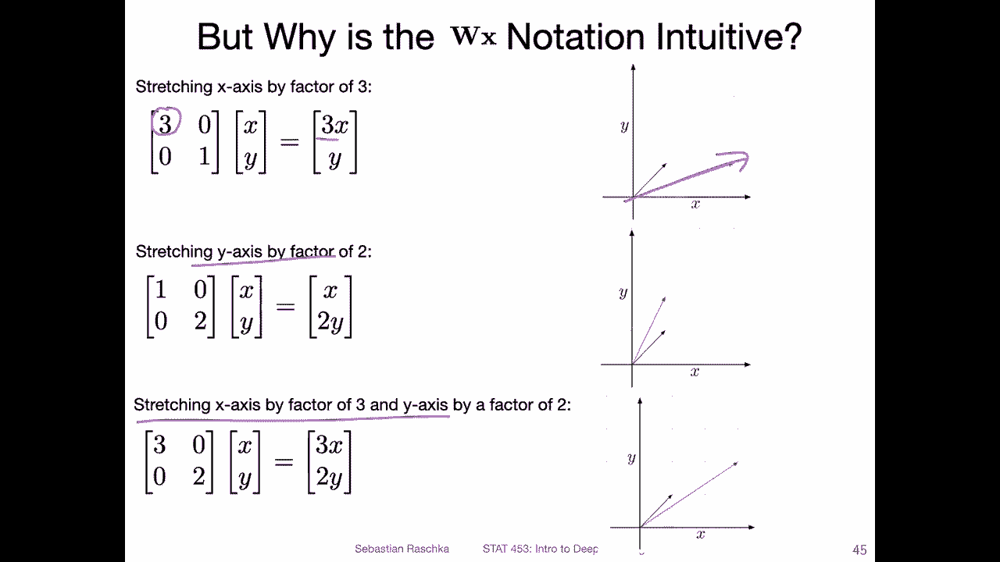

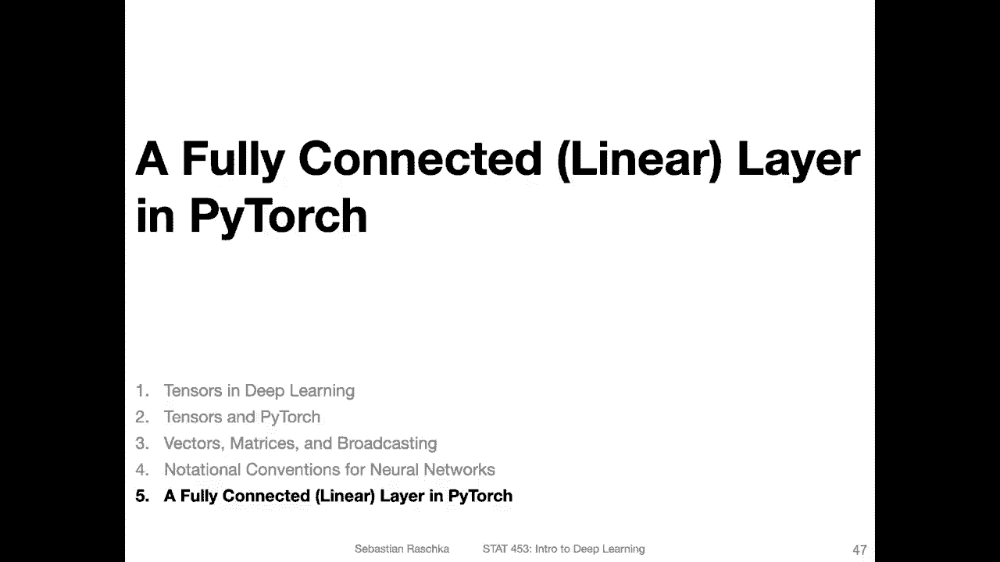

理解这些符号约定是阅读深度学习文献、理解模型架构和进行代码实现的重要基础。在接下来的课程中，我们将看到这些约定如何在 PyTorch 等框架中具体应用。