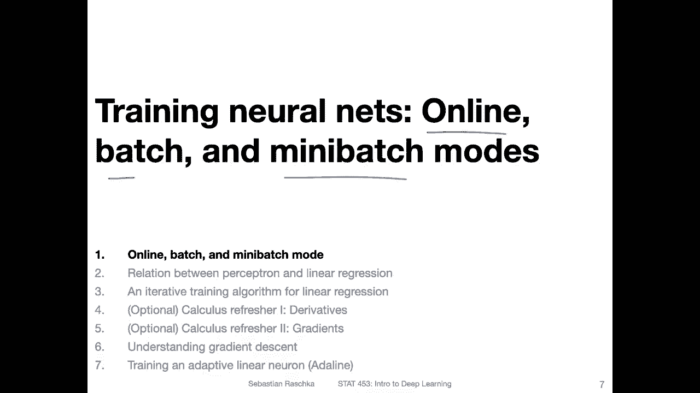
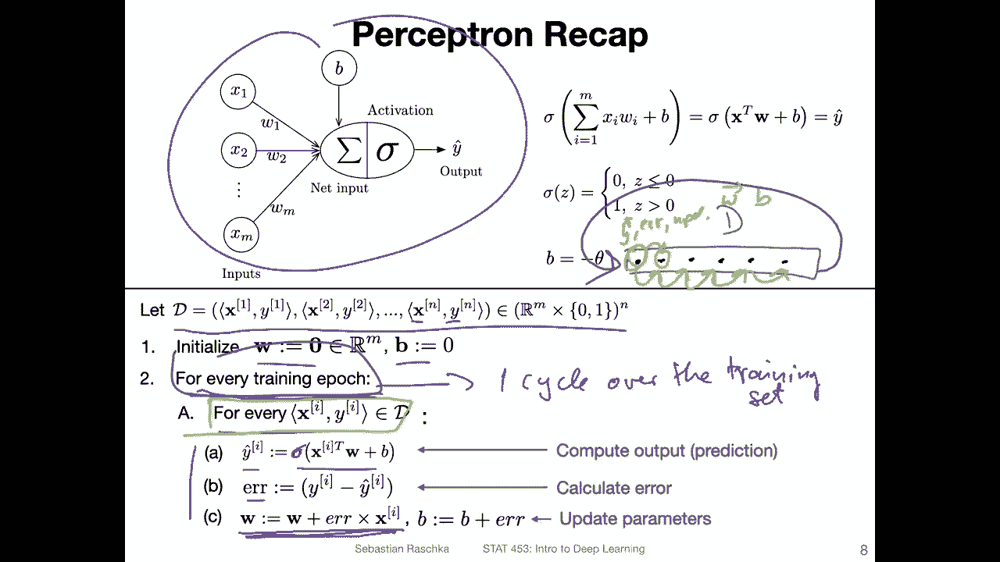
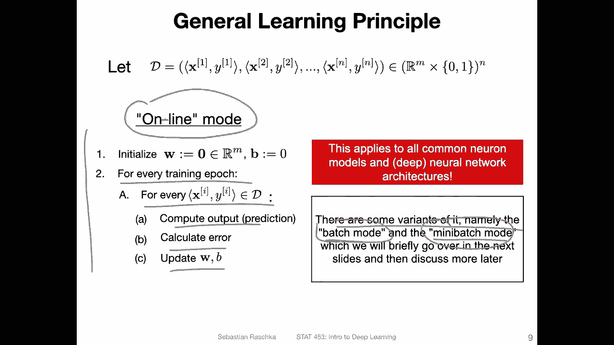
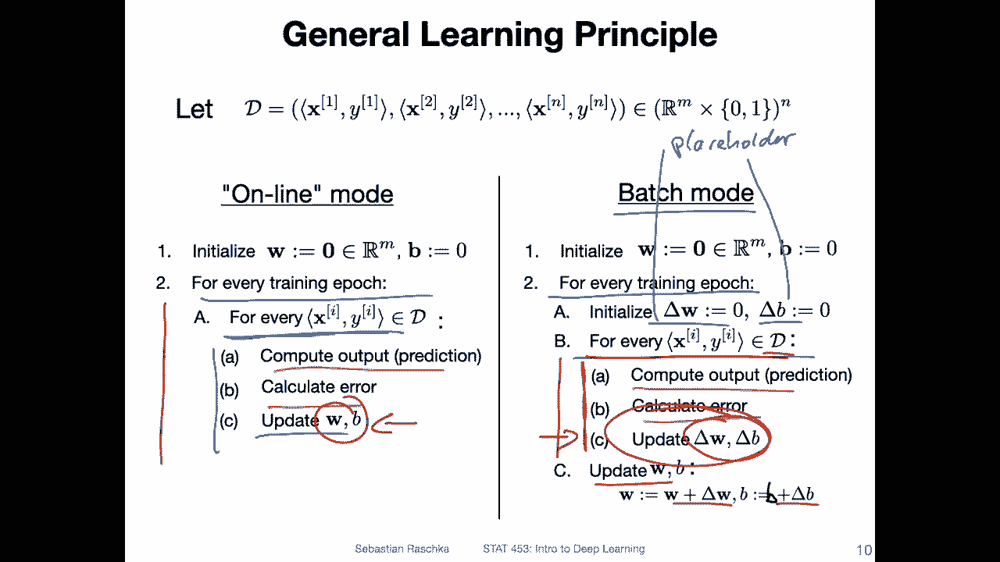
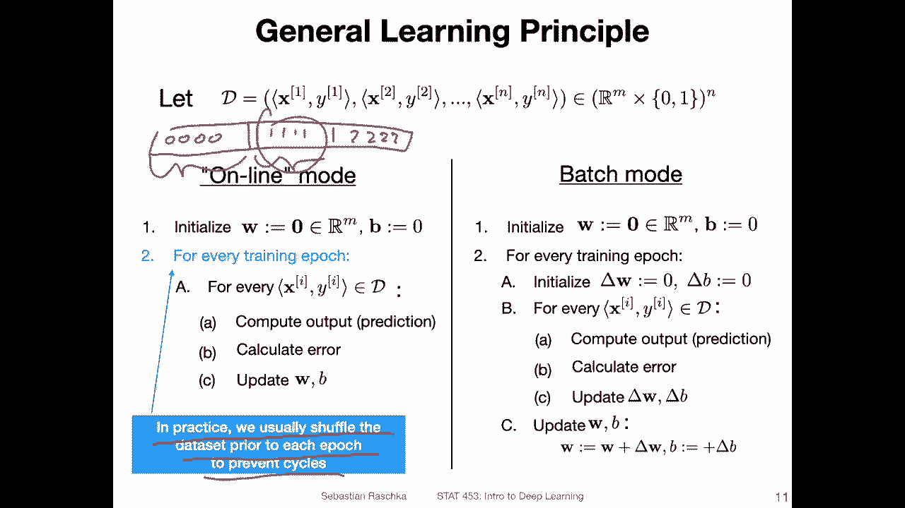
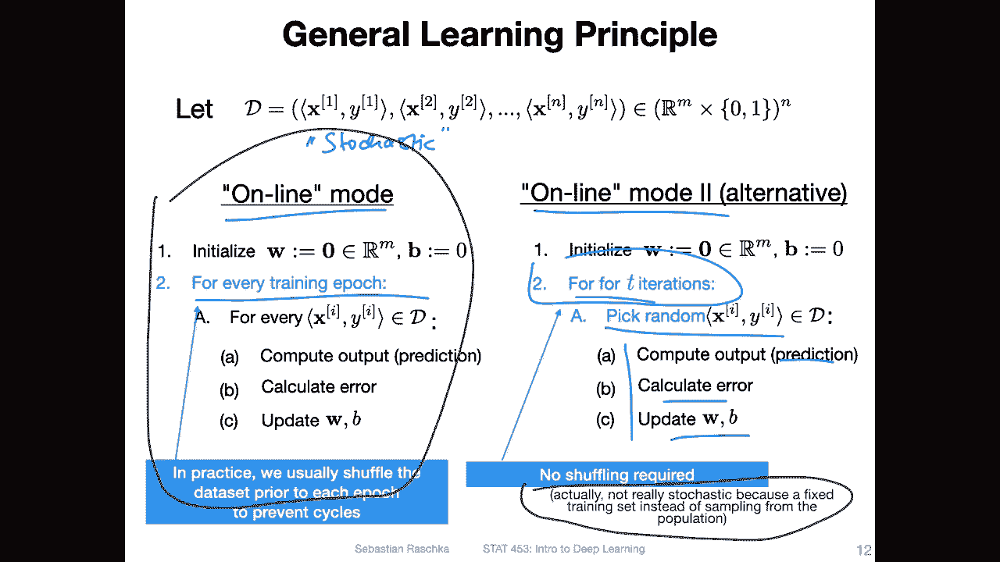
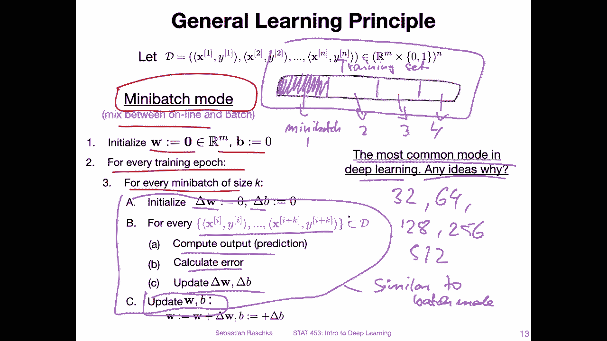
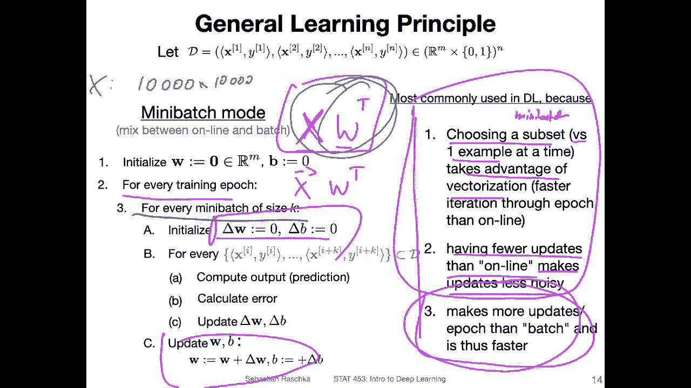
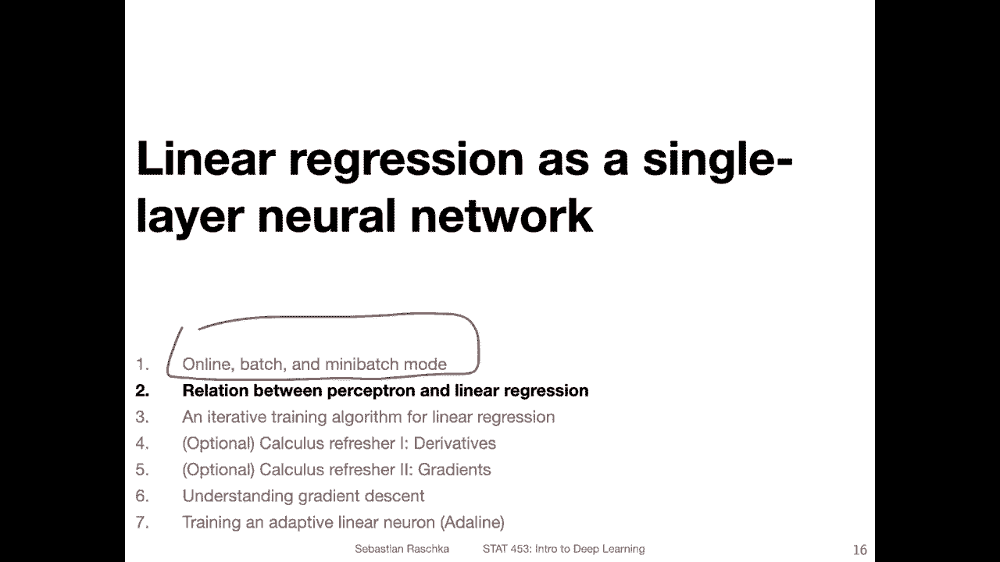

# 课程 P33：L5.1 - 在线、批处理和小批量模式 🧠



在本节课中，我们将学习训练神经网络模型的三种不同方式：在线模式、批处理模式和小批量模式。我们将探讨它们如何利用数据、如何更新模型，以及各自的优缺点。这些概念适用于任何类型的神经网络。

---

## 感知机模型回顾 🔄

上一节我们介绍了神经网络训练的基本概念，本节中我们来看看具体的训练模式。首先，让我们简要回顾一下感知机模型。


上图左侧是感知机的示意图，我们计算净输入，然后更新权重。假设我们有一个数据集 **D**，包含 **n** 个带标签的训练样本。每个样本都有一个特征向量 **x** 和一个类别标签 **y**。

训练开始时，我们初始化感知机的参数。例如，可以将所有权重设置为零，偏置单元也设为零。



```python
# 参数初始化示例
weights = [0, 0, ..., 0]
bias = 0
```

然后，我们进入训练循环。一个**训练周期**指的是完整遍历一次训练集的过程。在实践中，训练周期的数量可以是任意的，取决于数据集和问题的复杂度。在深度学习中，训练成百上千个周期也很常见。

在每个训练周期内，我们逐个遍历每个训练样本。这包含两个循环：外层循环遍历训练周期，内层循环遍历数据集中的每个数据点。

以下是训练过程的伪代码描述：

```
对于 每个训练周期：
    对于 数据集中的每个数据点 (x_i, y_i)：
        计算预测值 y_hat = activation(w * x_i + b)
        计算误差 error = y_i - y_hat
        根据误差更新权重 w 和偏置 b
```



关键点在于，**更新发生在处理完每个数据点之后**。处理第一个样本后，我们更新权重和偏置，然后继续处理第二个样本，并再次更新。这种模式被称为**在线模式**。

---

## 在线模式 🚀

在线模式，有时也称为随机模式，其核心特点是模型在**处理完每个单独的训练样本后立即更新**。


以下是其步骤总结：
1.  遍历每个训练周期。
2.  遍历数据集中的每个数据点。
3.  对每个数据点，计算输出、误差。
4.  立即更新权重和偏置。

这种方法的优点是模型可以快速适应新数据。例如，在Web应用程序中，每获得一个新用户的数据，就可以立即更新模型，而无需等待收集一批用户数据。

在实践中，为了防止算法因数据顺序而陷入循环或振荡，通常在**每个训练周期开始前打乱数据集顺序**。例如，在鸢尾花数据集中，如果数据按类别排序，模型会先集中学习一个类别，再学习下一个，这不利于学习。打乱数据可以带来更好的多样性和学习效果。



---

## 批处理模式 📦

接下来，我们看看批处理模式。它与在线模式的主要区别在于**更新的时机**。




在批处理模式中：
*   我们仍然遍历训练周期。
*   在每个周期内，我们遍历所有数据点，计算每个点的预测和误差。
*   **但是，我们不会在每个点后立即更新模型参数。**
*   相反，我们初始化一些“占位符”（例如 `delta_w` 和 `delta_b`）来累积每个数据点计算出的更新信息。
*   在遍历完**整个数据集**后，我们才使用累积的信息一次性更新权重和偏置。

**对比与优缺点：**
*   **在线模式**：更新频繁，学习可能更快，但每次更新只基于一个样本，因此**噪声较大，不稳定**。
*   **批处理模式**：每个周期只更新一次，这次更新基于整个数据集的信息，因此**更稳健、更准确**。但缺点是学习速度较慢，因为必须遍历完所有数据才能进行一次更新。

在深度学习中，这两种模式都不太常用，原因我们将在介绍小批量模式后揭晓。

---

## 小批量模式 ⚖️



现在，让我们进入深度学习中最常用的训练模式——小批量模式。它是**在线模式和批处理模式的折中方案**。


在小批量模式中：
1.  我们初始化参数，并遍历训练周期。
2.  在每个周期内，我们不再逐个遍历数据点，而是将数据集划分为若干个较小的**小批量**。
3.  每个小批量是数据集的一个子集，常见的大小有32、64、128、256等，这是一个可以调整的超参数。
4.  对于**每个小批量**，我们执行类似批处理模式的操作：
    *   初始化更新占位符。
    *   遍历该小批量内的每个数据点，计算预测和误差，并累积更新信息。
    *   处理完该小批量所有数据后，用累积的信息更新模型参数。

**为什么小批量模式成为深度学习的主流？**

以下是几个关键原因：



1.  **向量化计算效率**：通过将一个小批量的数据组成矩阵（例如，将 `m` 个样本的特征堆叠成 `m x n` 的矩阵），我们可以利用线性代数库进行高效的矩阵运算，这比在循环中逐个处理样本要快得多。
    ```python
    # 小批量向量化计算示例 (伪代码)
    # X_batch 形状: (batch_size, n_features)
    # W 形状: (n_features, )
    predictions = activation(np.dot(X_batch, W) + b)
    ```

2.  **平衡噪声与稳定性**：相比在线模式（噪声过大），小批量模式通过一次使用多个样本进行更新，减少了更新的方差，使训练过程更稳定。同时，相比批处理模式（噪声过小），它保留了一定的噪声，这有助于模型跳出局部最优解。

3.  **内存与可行性**：现代深度学习数据集非常庞大（数百万样本）。使用全批处理模式意味着需要将整个数据集加载到内存中进行一次矩阵运算，这在计算资源和内存上通常是不可行的。小批量模式则解决了这个问题。

4.  **更新频率更高**：相比每个周期只更新一次的批处理模式，小批量模式在一个周期内会进行多次更新（次数等于小批量的数量），这通常能加速学习过程。

---

## 总结 📝

本节课中，我们一起学习了神经网络的三种训练模式：

*   **在线模式**：逐个样本处理并立即更新。更新快，但噪声大。
*   **批处理模式**：遍历整个数据集后一次性更新。更新稳健，但速度慢，且对大数据集不友好。
*   **小批量模式**：将数据分成小批量，对每个小批量进行类似批处理的更新。它**结合了计算效率、适度的噪声控制以及对大规模数据的可行性**，因此成为深度学习中训练模型的标准方法。



理解这些数据利用方式，为我们接下来学习**梯度下降**和**随机梯度下降**等优化算法奠定了重要基础。在后续课程中，我们将主要使用小批量模式来训练复杂的神经网络。

---



