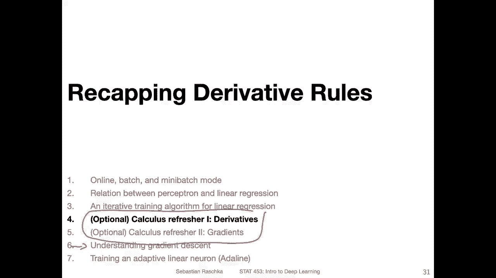
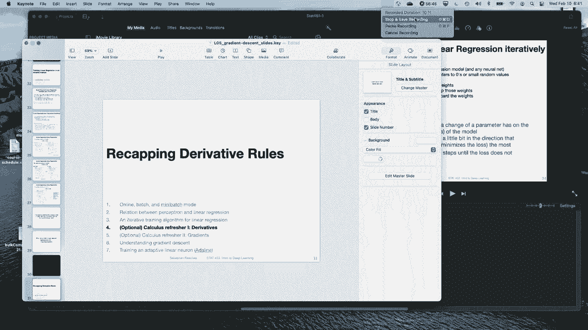

# 课程 P35：L5.3 - 线性回归的迭代训练算法 📊

在本节课中，我们将学习如何使用迭代算法来训练线性回归模型。我们将从一种非常朴素的方法开始，然后介绍一种更高效的方法——随机梯度下降，并解释其背后的原理。

---

## 🧠 迭代训练算法概述

上一节我们介绍了线性回归模型的基本概念。本节中，我们来看看如何通过迭代算法来训练这个模型。

一种训练最小二乘线性回归模型的迭代方法是使用暴力搜索。这是一种非常朴素的方法，适用于线性回归或任何类型的神经网络。

以下是该方法的步骤：

1.  将参数（权重和偏置）初始化为全零或小的随机数。
2.  进行 K 轮循环。
3.  在每一轮中，随机选择一组新的权重。
4.  计算线性回归模型的预测值。
5.  如果新权重使模型性能更好，则保留这组权重。
6.  如果新权重使模型性能更差，则丢弃它们。

这种方法理论上可以保证找到最优解，因为只要尝试足够多次，总有机会找到最优的权重组合。然而，这种方法效率极低，速度非常慢，因此不推荐在实践中使用。

---

## 🚀 更优的迭代方法：梯度分析

幸运的是，存在一种更好的迭代方法来拟合线性回归模型。我们可以分析改变参数对模型预测性能的影响。

具体方法是观察平方误差损失函数，当我们以特定方式改变权重和偏置时，误差如何变化。然后，我们可以朝着能提升性能的方向，对权重和偏置进行微小的调整。

如果我们理解了权重与损失之间的关系，就可以调整权重以使损失下降，从而减小误差。我们可以多次重复这个小步骤，直到损失不再进一步降低。

事实证明，这实际上就是我们之前讨论过的在线学习模式，只是写法略有不同。

---

## 🔄 随机梯度下降

对于线性回归，有一个称为**随机梯度下降**的算法。它是感知器学习规则在凸损失函数上的类比（我们也可以在后续课程中将其用于神经网络的非凸损失函数）。

这里我们聚焦于线性回归模型，并在本课末尾简要提及自适应线性神经元。

以下是随机梯度下降与感知器学习规则的异同比较：

*   **相同点**：
    *   权重初始化方式相同。
    *   都迭代训练周期。
    *   都在数据集中迭代遍历训练样本。
    *   计算预测值的方式相同（都是计算净输入 `z`）。区别在于，感知器使用**阈值函数**，而线性回归使用**恒等函数**。

*   **不同点**：
    *   误差计算：感知器是预测类别与实际类别的差值；线性回归是预测值与实际连续值的差值，但形式相似。
    *   权重更新：感知器规则是 `w := w + Δw`，其中 `Δw = η * (y - ŷ) * x`。随机梯度下降的更新规则基于损失函数的**梯度**。

随机梯度下降的权重更新公式为：
`w := w - η * ∇L(w)`
其中 `η` 是**学习率**，`∇L(w)` 是损失函数 `L` 关于权重 `w` 的梯度。我们通过减去梯度（即负梯度方向）来更新参数。

这种方式与感知器规则相似，但梯度是基于微积分计算得出的。对于像阈值函数这样的非光滑函数，我们无法计算导数，因此感知器规则并非直接源于梯度。

---

## 📝 循环实现与向量化实现

上一张幻灯片展示了线性回归在线学习模式的向量化实现，其中 `x` 是特征向量，梯度也是向量。

我们也可以使用循环来展开这个过程，这样就不需要直接处理梯度，而是讨论**偏导数**。

假设输入数据的维度为 `M`，即有 `M` 个特征。那么权重的数量也等于 `M`。我们可以对每个权重单独计算损失函数关于该权重的偏导数，然后以类似的方式进行更新。

以下是循环版本的简化表示：
`for j in range(M): w_j := w_j - η * (∂L/∂w_j)`

这种基于偏导数的循环版本在概念上可能更容易理解。然而，正如上一讲所解释的，向量化实现速度更快，这就是我们通常使用梯度和基于向量的实现的原因。

---

## 🧮 学习规则的由来

我展示了随机梯度下降的学习规则，但并未说明这个规则从何而来。为了理解其推导过程，需要一些微积分知识。

如果你对此有些生疏，可以参考本课后的两个补充视频来复习微积分概念。当然，你也可以直接跳到下一个视频，我会在那里解释这个学习规则的来源。

---

## ✅ 总结

本节课中，我们一起学习了线性回归的迭代训练算法。我们从低效的暴力搜索方法入手，进而介绍了通过分析梯度来高效调整参数的原理。我们重点讲解了**随机梯度下降**算法，比较了它与感知器学习规则的异同，并区分了其向量化实现与循环实现。最后，我们指出了理解该算法需要微积分基础，为后续的推导学习做好了铺垫。