# 课程 P37：L5.5- (选修)微积分复习 2- 梯度 📚

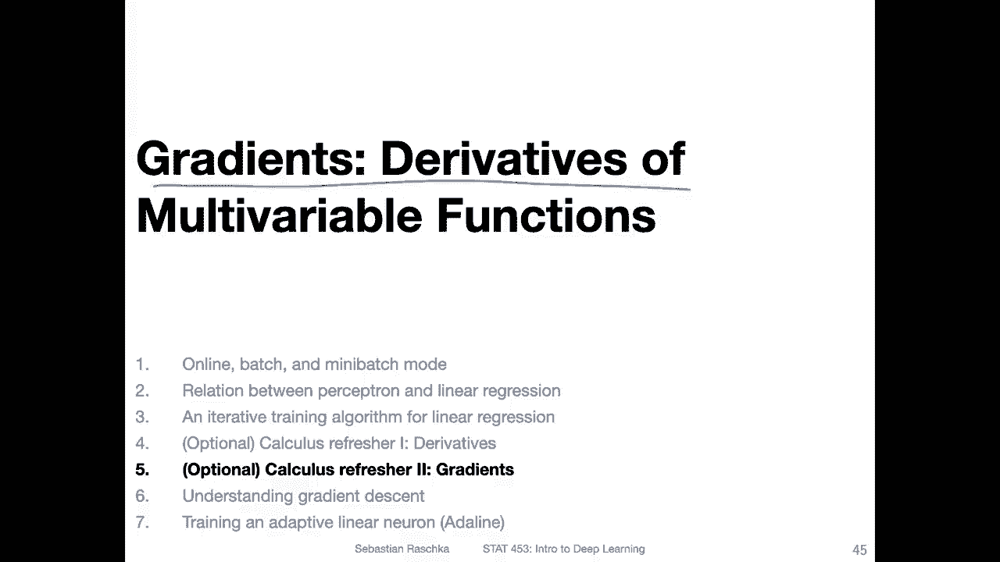

在本节课中，我们将要学习多变量函数的导数，即梯度。我们将从梯度的基本概念开始，逐步深入到链式法则在多元函数中的应用，并简要介绍雅可比矩阵。理解这些概念对于后续学习机器学习和深度学习中的优化算法至关重要。

## 🧭 梯度的概念

上一节我们介绍了单变量函数的导数。本节中，我们来看看当函数有多个输入变量时，导数该如何定义。

我们关注的是具有多个输入但只有一个输出的函数。例如，在线性回归中，一个训练样本可以有多个特征（如花萼长度、宽度等），但输出只有一个连续值或类别标签。

对于一个多变量函数，其导数是一个向量，称为梯度，用符号 **∇**（读作“Nabla”）表示。梯度中的每一个元素都是一个**偏导数**。

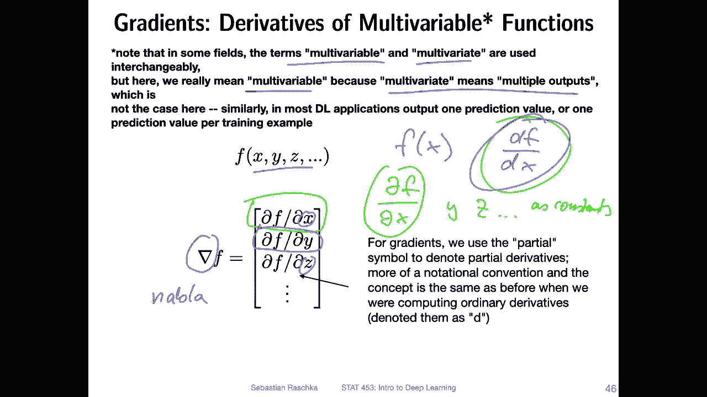

**偏导数**的计算与全导数类似，但有一个关键区别：在计算函数对某个特定变量的偏导数时，我们将其他所有输入变量都视为**常数**。计算规则与普通导数相同。

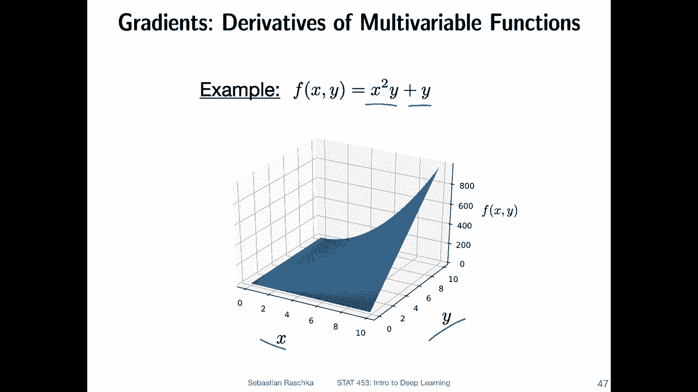

以下是计算梯度的通用公式：
```
∇f(x, y, z) = [ ∂f/∂x, ∂f/∂y, ∂f/∂z ]
```

## 📝 梯度计算示例

让我们通过一个具体的例子来理解如何计算梯度。

考虑函数 **f(x, y) = x²y + y**。这个函数有两个输入变量 x 和 y。

要计算其梯度，我们需要分别计算两个偏导数。

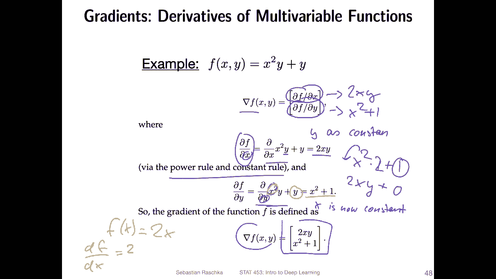

首先，计算 **f** 对 **x** 的偏导数。此时，我们将 **y** 视为常数。
```
∂f/∂x = ∂(x²y)/∂x + ∂(y)/∂x
      = 2x * y + 0
      = 2xy
```

接着，计算 **f** 对 **y** 的偏导数。此时，我们将 **x** 视为常数。
```
∂f/∂y = ∂(x²y)/∂y + ∂(y)/∂y
      = x² * 1 + 1
      = x² + 1
```

因此，函数 **f(x, y)** 的梯度为：
```
∇f = [ 2xy, x² + 1 ]
```

## 🔗 多元链式法则

现在，我们考虑一种更复杂的情况：复合函数。假设有一个函数 **f**，它本身是两个函数 **g** 和 **h** 的输出，而 **g** 和 **h** 又都依赖于同一个变量 **x**。

函数结构如下：**f(g(x), h(x))**。

为了计算 **f** 对最终输入 **x** 的导数，我们需要使用多元链式法则。其核心思想是，**x** 的变化会同时通过 **g** 和 **h** 两条路径影响 **f**，因此总导数是这两条路径贡献之和。

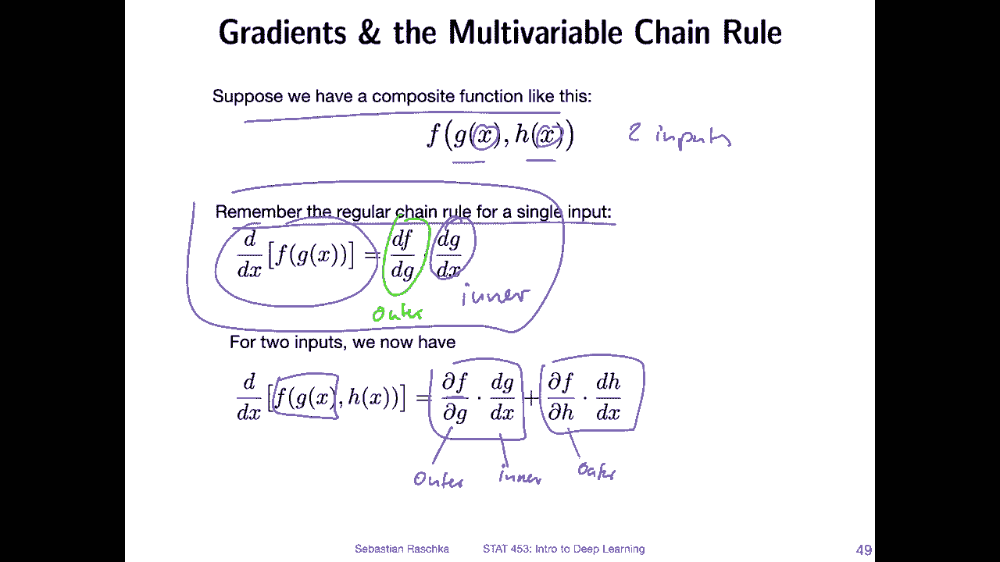

多元链式法则的公式如下：
```
df/dx = (∂f/∂g) * (dg/dx) + (∂f/∂h) * (dh/dx)
```

## 🧮 多元链式法则应用示例

让我们通过一个例子来应用这个法则。

假设函数定义为：**f(g, h) = g²h + h**。
其中，**g(x) = 3x**，**h(x) = x²**。

我们的目标是计算 **df/dx**。

根据链式法则，我们需要计算四个部分：

1.  **∂f/∂g**：将 **h** 视为常数，对 **g** 求偏导。
    ```
    ∂f/∂g = ∂(g²h)/∂g + ∂(h)/∂g = 2gh + 0 = 2gh
    ```
2.  **dg/dx**：**g(x) = 3x** 对 **x** 的导数。
    ```
    dg/dx = 3
    ```
3.  **∂f/∂h**：将 **g** 视为常数，对 **h** 求偏导。
    ```
    ∂f/∂h = ∂(g²h)/∂h + ∂(h)/∂h = g² * 1 + 1 = g² + 1
    ```
4.  **dh/dx**：**h(x) = x²** 对 **x** 的导数。
    ```
    dh/dx = 2x
    ```

现在，将它们组合起来：
```
df/dx = (∂f/∂g)*(dg/dx) + (∂f/∂h)*(dh/dx)
      = (2gh) * 3 + (g² + 1) * 2x
```

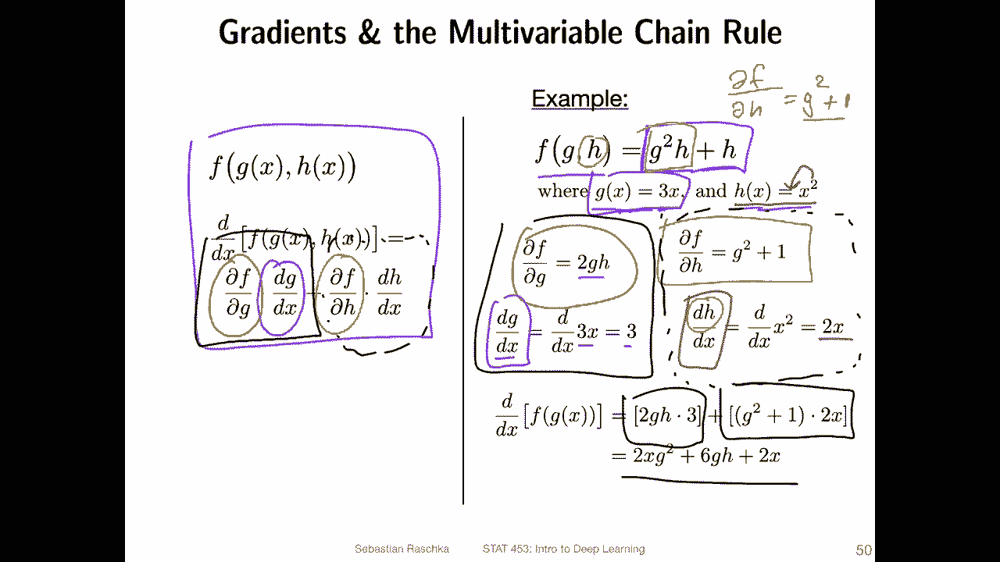

最后，将 **g = 3x** 和 **h = x²** 代入并简化：
```
df/dx = 2*(3x)*(x²)*3 + ((3x)² + 1)*2x
      = 18x³ + (9x² + 1)*2x
      = 18x³ + 18x³ + 2x
      = 36x³ + 2x
```

## 📐 向量表示法

上述链式法则可以用更紧凑的向量形式表示。定义向量 **v = [g, h]ᵀ**。

那么，导数可以写成梯度向量与内函数导数向量的点积：
```
df/dx = ∇f · dv/dx = [ ∂f/∂g, ∂f/∂h ] · [ dg/dx, dh/dx ]ᵀ
```
这等价于我们之前展开的计算：`(∂f/∂g)*(dg/dx) + (∂f/∂h)*(dh/dx)`。向量表示法在书写复杂表达式时更加简洁。

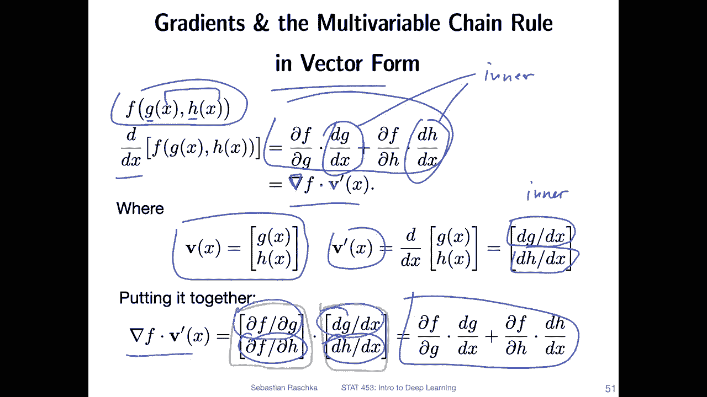

## 🧩 雅可比矩阵简介

当函数的输出本身也是一个向量时（即多输入、多输出），梯度的概念就扩展为**雅可比矩阵**。

假设有一个函数向量 **F = [f₁, f₂, ..., fₘ]ᵀ**，每个 **fᵢ** 都依赖于输入向量 **X = [x₁, x₂, ..., xₙ]**。

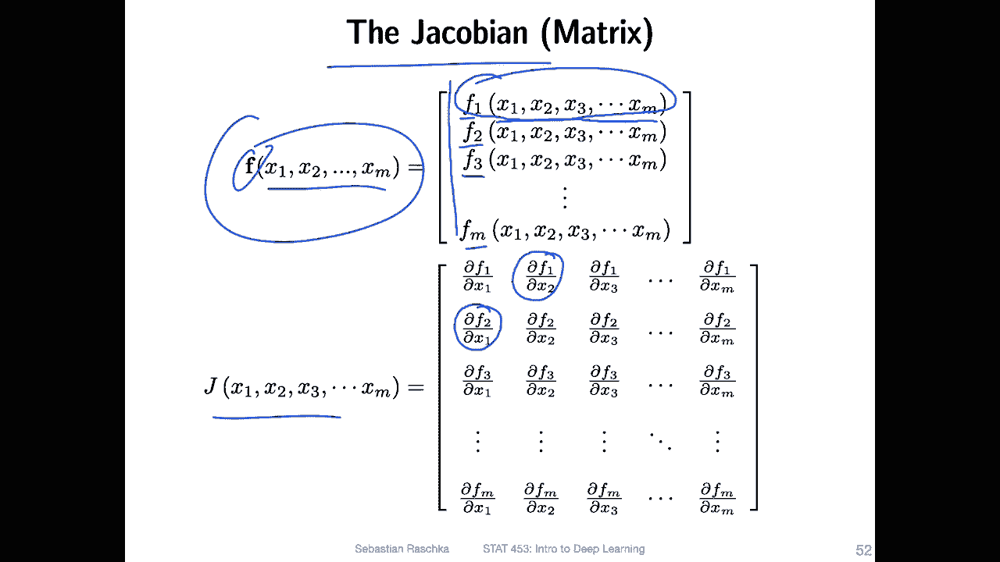

雅可比矩阵 **J** 是一个 **m × n** 的矩阵，包含了所有输出对所有输入的偏导数：
```
J = [ ∂f₁/∂x₁  ∂f₁/∂x₂ ... ∂f₁/∂xₙ
      ∂f₂/∂x₁  ∂f₂/∂x₂ ... ∂f₂/∂xₙ
      ...
      ∂fₘ/∂x₁  ∂fₘ/∂x₂ ... ∂fₘ/∂xₙ ]
```
雅可比矩阵的每一行，其实就是单个输出函数 **fᵢ** 的梯度向量。

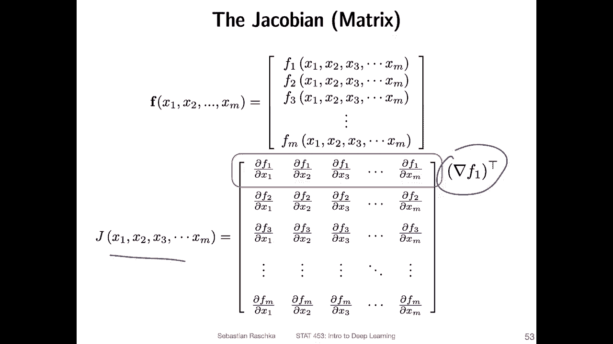

## ⏭️ 关于二阶导数

在机器学习和深度学习的当前实践中，我们主要使用一阶导数（梯度）进行优化，例如梯度下降法。虽然二阶导数（如海森矩阵）在理论上能提供更优的优化信息，但其计算成本非常高，且在实际应用中并未展现出相对于一阶方法的明显优势。因此，本课程将不深入探讨二阶优化方法。

---

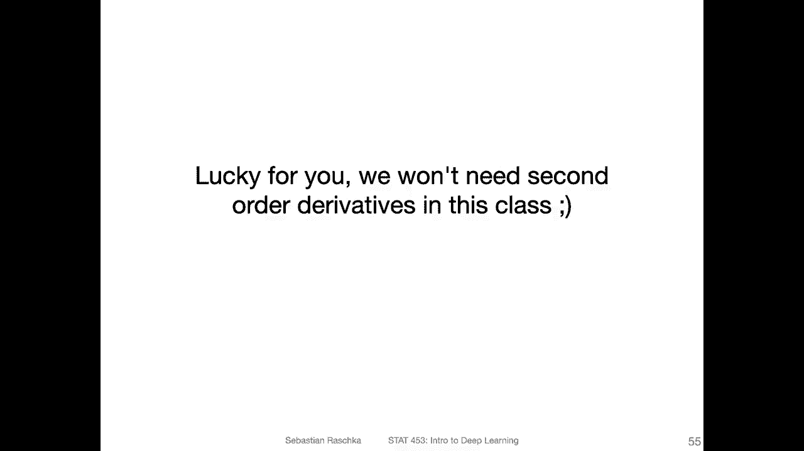

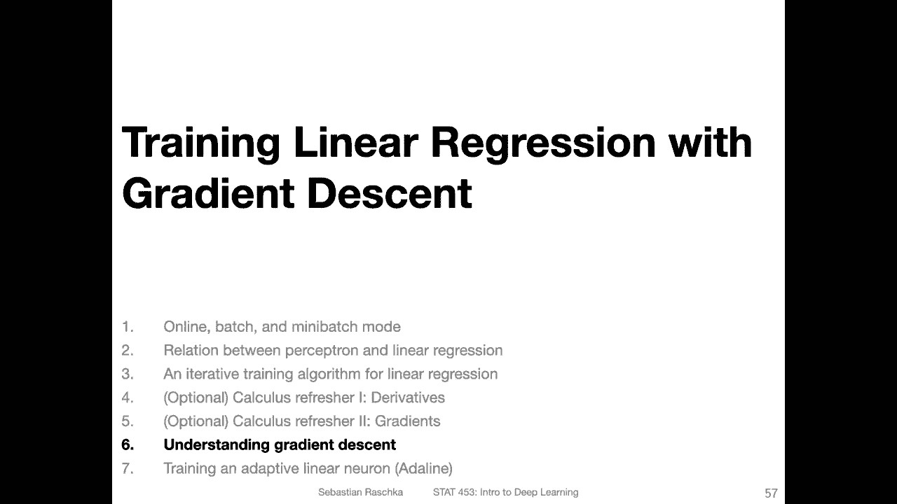

本节课中我们一起学习了多变量函数微积分的核心概念。我们定义了**梯度**，它是由**偏导数**组成的向量。我们探讨了**多元链式法则**，用于计算复合函数的导数，并学会了用向量形式简洁地表示它。最后，我们简要介绍了**雅可比矩阵**，它是梯度向量的高阶推广。掌握这些知识，将为理解神经网络中的反向传播算法奠定坚实的基础。