# 课程 P38：L5.6 - 理解梯度下降 🧠

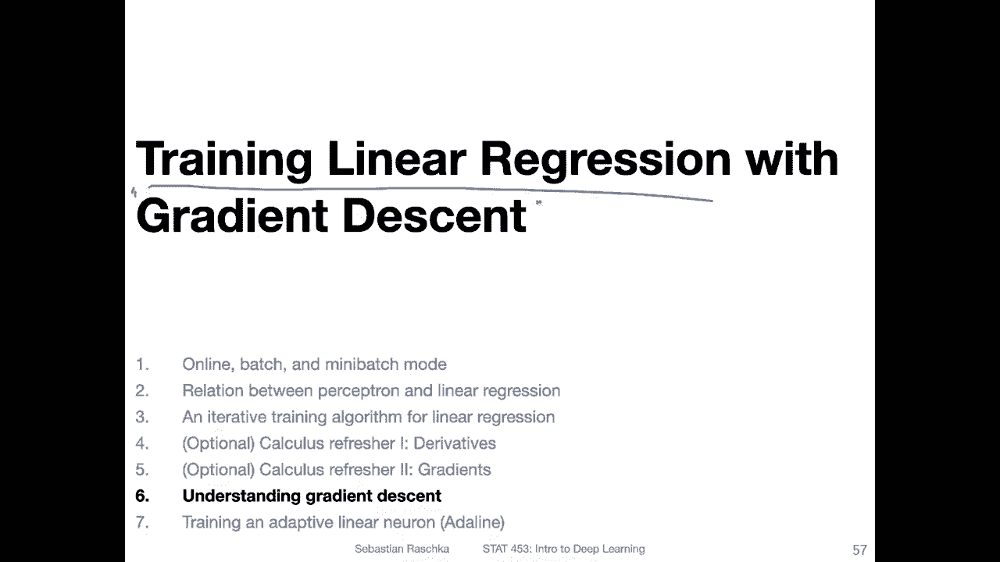

在本节课中，我们将学习如何使用梯度下降法来训练一个线性回归模型。我们将从理解损失函数和梯度的概念开始，逐步推导出权重更新的公式，并讨论学习率、批量大小以及数据标准化等关键因素对训练过程的影响。

---

## 线性回归与损失函数

上一节我们介绍了函数导数和梯度的概念。本节中，我们来看看如何将这些概念应用于线性回归模型的训练。

考虑一个简单的线性回归模型，其激活函数是恒等函数。模型的预测输出为：

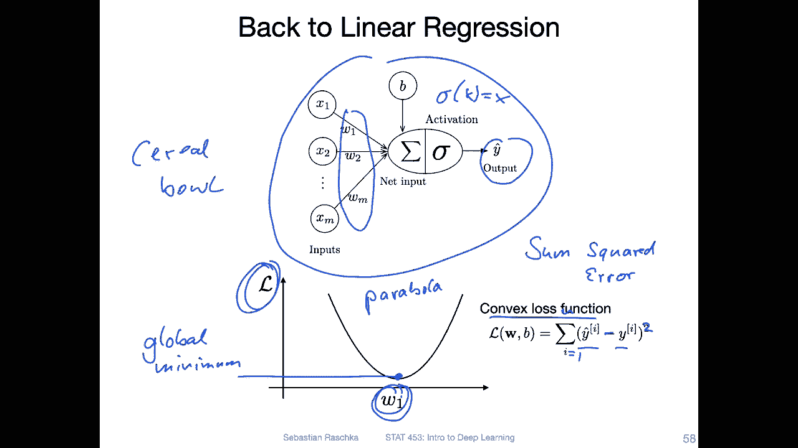

**公式：** `y_hat = w^T * x + b`

为了找到最优的权重 `w` 和偏置 `b`，我们需要最小化模型的预测误差。在线性回归中，通常使用最小二乘法，对应的损失函数是平方误差损失：

**公式：** `L = Σ (y_hat_i - y_i)^2`

这个损失函数是凸函数，其图像呈碗状（或抛物线状）。我们的目标是找到使损失函数值最小的权重，即这个“碗”的底部。

---

## 梯度下降的核心思想

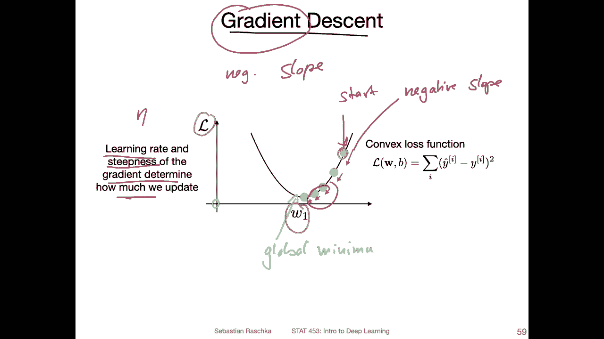

理解了损失函数的形状后，我们来看看如何使用梯度下降法找到这个最小值点。

梯度下降法的核心是利用函数的梯度（或导数）来指导参数的更新方向。在损失函数的图像上，梯度指向函数值增长最快的方向。因此，**负梯度**方向就是函数值下降最快的方向。

我们从某个初始权重（例如全零或小的随机数）开始。计算该点处损失函数关于权重的梯度，然后沿着负梯度方向更新权重：

**公式：** `w_new = w_old - η * ∇L(w_old)`

其中，`η` 是**学习率**，它控制着每次更新的步长。`∇L(w)` 是损失函数在 `w` 处的梯度。

---

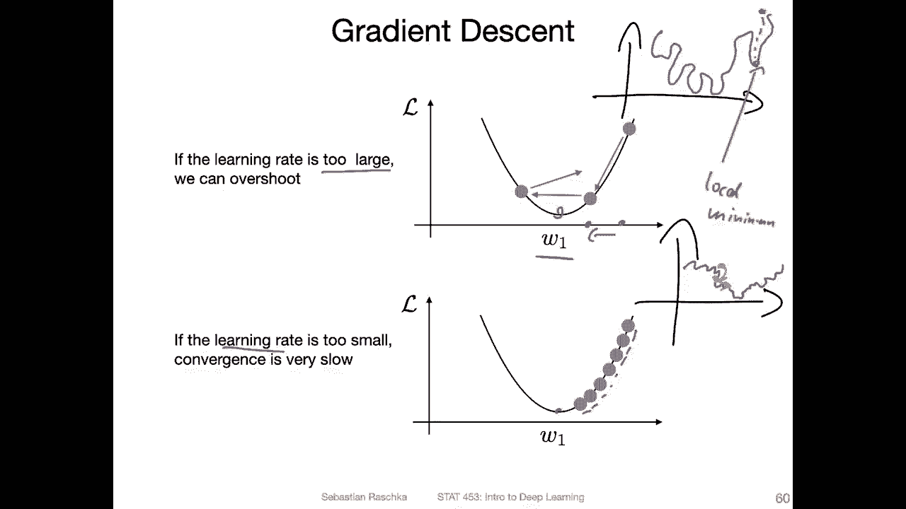

## 学习率的选择

学习率 `η` 是一个超参数，其选择至关重要。

以下是学习率选择不当可能带来的问题：

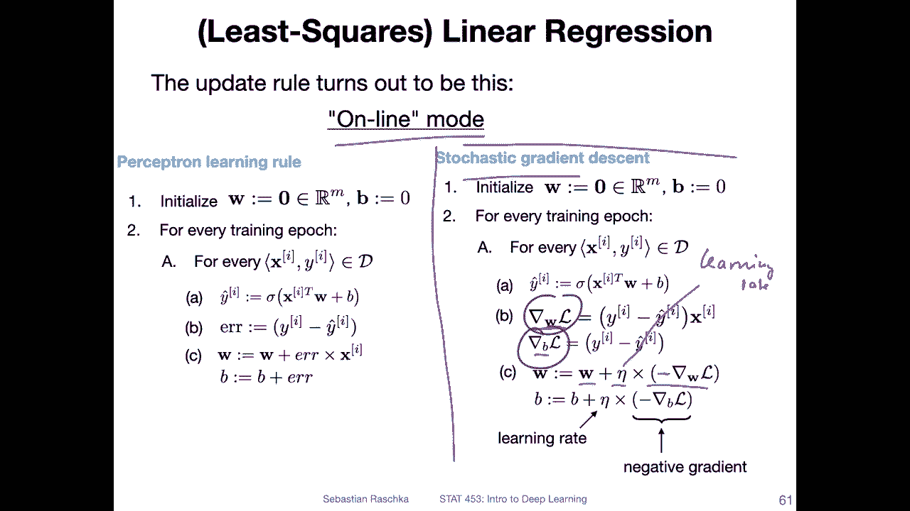

*   **学习率过大**：更新步长太大，可能导致在最小值点附近震荡甚至发散，无法收敛。
*   **学习率过小**：更新步长太小，收敛速度非常慢，需要很多次迭代才能到达最小值点。

在实践中，需要尝试不同的学习率，以找到一个能使模型有效且稳定收敛的值。

---

## 权重更新公式推导

现在，我们来具体推导线性回归中权重的更新公式。我们考虑损失函数对单个权重 `w_j` 的偏导数。

损失函数为：
`L = 1/(2n) * Σ (y_hat_i - y_i)^2`

其中 `y_hat_i = Σ (w_k * x_ik) + b`。为了简化，我们暂时忽略偏置 `b`，或将其视为一个特殊的权重。

根据链式法则，损失函数 `L` 对权重 `w_j` 的偏导数为：
`∂L/∂w_j = 1/n * Σ ( (y_hat_i - y_i) * x_ij )`

因此，权重 `w_j` 的更新规则为：
**公式：** `w_j := w_j - η * [ 1/n * Σ ( (y_hat_i - y_i) * x_ij ) ]`

对于偏置 `b`，其更新规则类似，只是对应的特征值 `x_ij` 为 1。

---

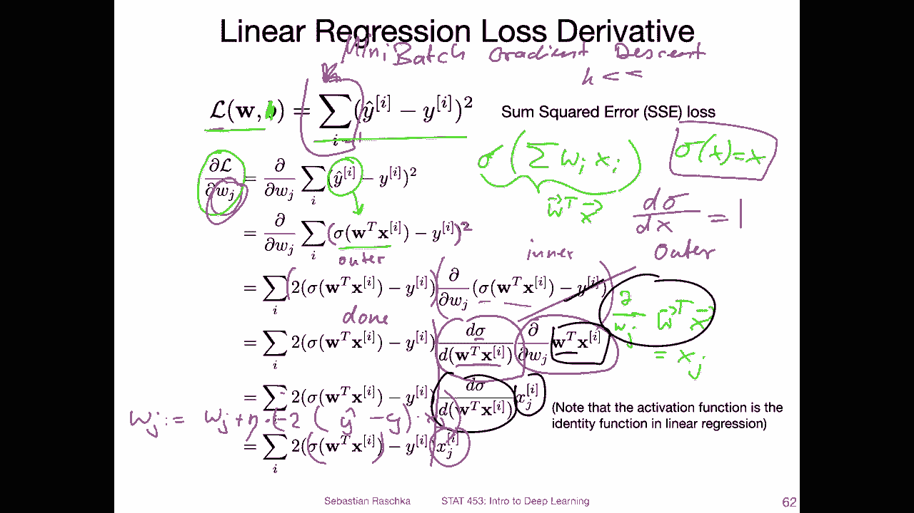

## 批量梯度下降 vs 随机/小批量梯度下降

根据计算梯度时使用的数据量不同，梯度下降主要有三种模式：

*   **批量梯度下降**：使用整个训练集的数据计算梯度。每次更新方向准确，但计算开销大，对于大数据集不实用。
*   **随机梯度下降**：每次仅使用一个训练样本计算梯度并更新权重。更新频繁且带有噪声，有助于跳出局部极小值，但收敛路径不稳定。
*   **小批量梯度下降**：折中方案。每次使用一小批（mini-batch）数据计算梯度。这是深度学习中最常用的方法，在计算效率和收敛稳定性之间取得了平衡。

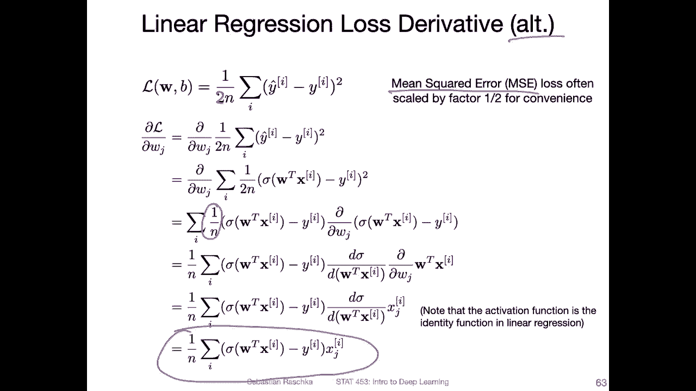

对于凸优化问题（如线性回归），批量梯度下降可以沿直线路径收敛到全局最优。而对于非凸问题（如深度神经网络），SGD 或 Mini-batch GD 的噪声特性反而有助于逃离局部最优解。

---

## 数据标准化的重要性

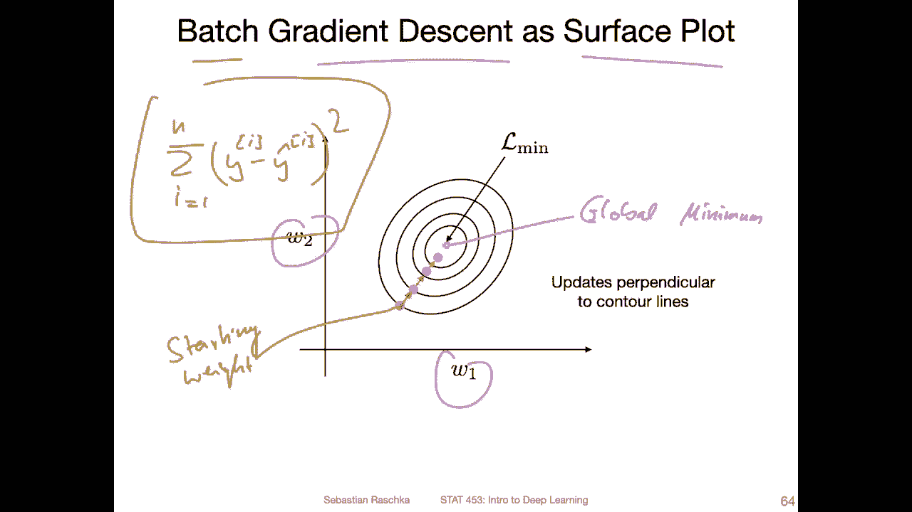

在训练开始前，对输入特征进行标准化（或归一化）是一个重要的步骤。

如果特征尺度差异很大（例如，一个特征是年龄（0-100），另一个特征是收入（0-1000000）），损失函数的等高线会变得又长又窄（椭圆形）。这会导致梯度下降的路径变得曲折，需要很多次迭代才能收敛，或者需要非常小心地调整学习率。

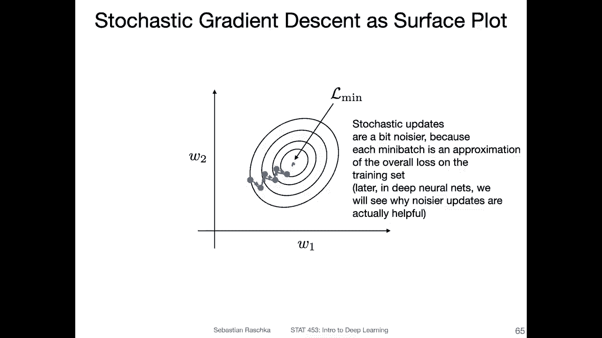

将特征标准化到相近的尺度（例如均值为0，方差为1），可以使损失函数的等高线更接近圆形，从而让梯度下降更高效、更稳定地收敛。

---

## 总结与延伸

本节课中，我们一起学习了梯度下降法的基本原理及其在线性回归中的应用。

我们掌握了以下核心内容：
1.  梯度下降通过计算损失函数的**负梯度**来迭代更新模型参数，以最小化损失。
2.  更新公式为：**`w := w - η * ∇L(w)`**。
3.  **学习率 `η`** 控制更新步长，需要仔细调优。
4.  根据数据使用量，梯度下降分为**批量**、**随机**和**小批量**三种模式，各有适用场景。
5.  对输入特征进行**标准化**能显著改善训练过程的效率和稳定性。

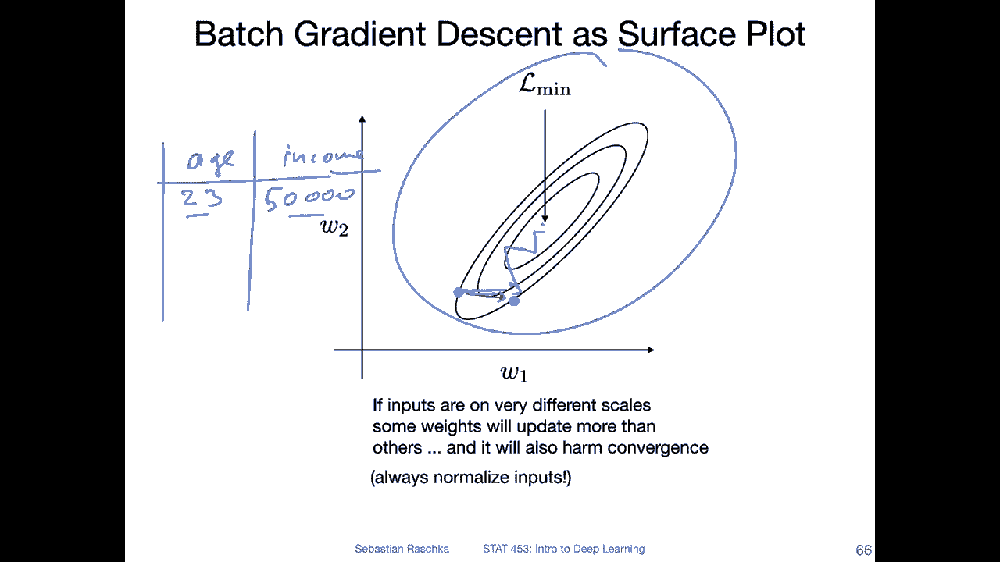

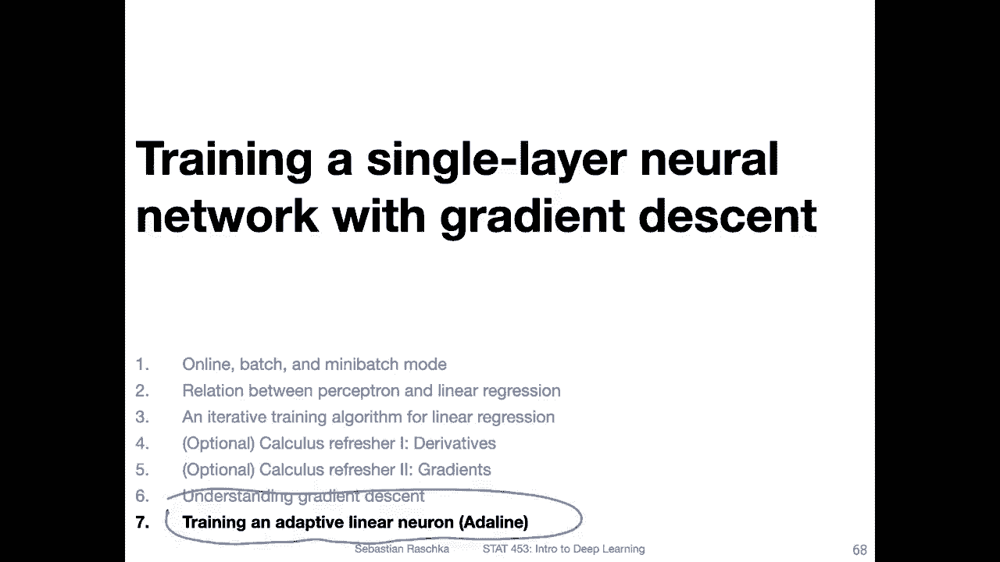

这些概念是训练几乎所有机器学习模型，尤其是复杂深度神经网络的基础。在后续课程中，我们将看到如何将这些完全相同的原理应用到具有多层结构和非线性激活函数的深度网络中。