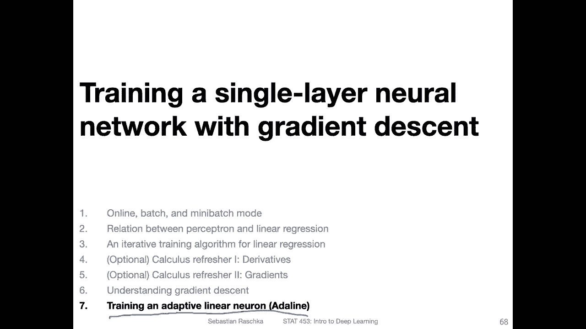
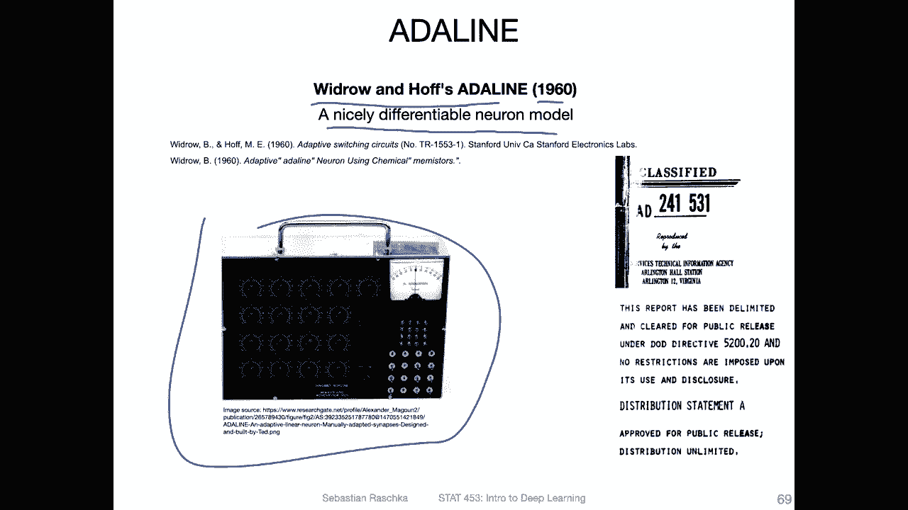
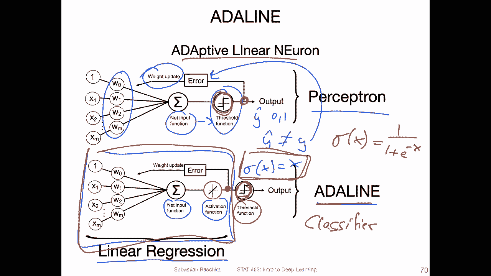
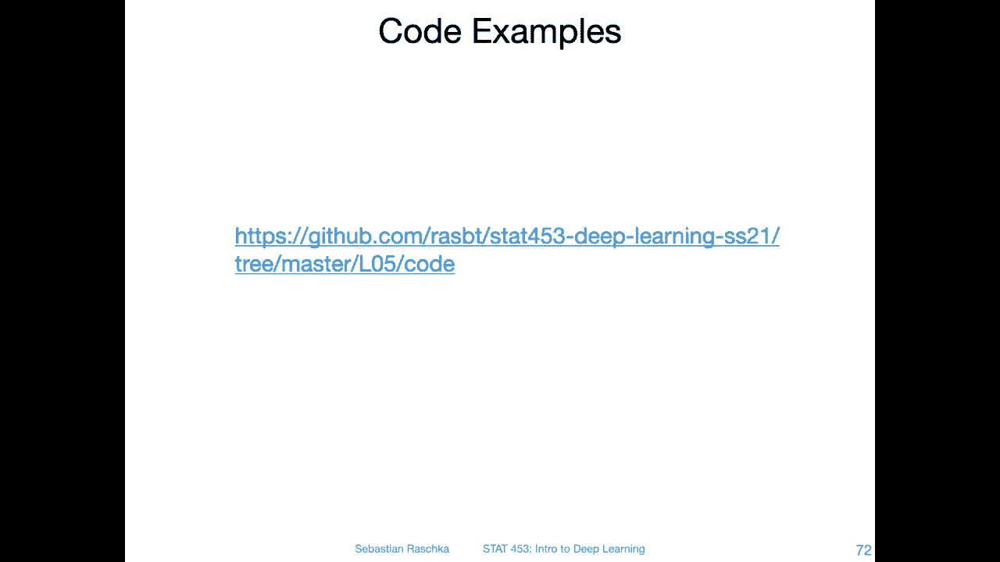

# 课程 P39：L5.7 - 训练自适应线性神经元 (Adaline) 🧠

## 概述

在本节课中，我们将学习如何用代码实现并训练一个自适应线性神经元模型。我们将回顾其与感知机的区别，理解其数学原理，并通过一个简单的例子来直观地展示其工作过程。

---

## 回顾 Adaline 模型

上一节我们介绍了神经网络的历史背景。现在，我们来看看 Adaline 模型的具体细节。

Adaline 是由 Widrow 和 Hoff 在 1960 年代左右提出的一个模型。最初它是一个物理设备，但如今我们可以在软件中轻松实现。与之前讨论的感知机不同，Adaline 是一个可微分的神经元模型。感知机由于使用了阶跃函数而不可微，而 Adaline 的改进使其即使在数据非线性可分的情况下也能收敛。

为了更清晰地比较，以下是感知机与 Adaline 的核心区别：

*   **感知机流程**：
    1.  计算净输入：`z = w^T x`。
    2.  将净输入通过一个**阶跃函数**，得到预测的类别标签（0 或 1）。
    3.  比较预测标签与实际标签。
    4.  如果预测错误，则根据误差更新权重。

*   **Adaline 流程**：
    1.  计算净输入：`z = w^T x`。
    2.  使用一个**恒等函数**作为激活函数，因此输出 `a = z`（一个连续值）。
    3.  将连续输出 `a` 与真实标签（也是连续值，在分类中常为 0 或 1）比较，**在阶跃函数之前**计算误差。
    4.  利用这个误差和梯度下降法来更新权重。
    5.  在预测时，将最终的连续输出 `a` 通过一个阶跃函数转换为类别标签。

关键区别在于**误差计算的位置**。感知机在阶跃函数后计算误差，而 Adaline 在阶跃函数前计算误差。这使得 Adaline 能够利用可微分的特性，使用梯度下降等优化算法来学习权重。

这里引入“激活函数”的概念是为了通用性。目前我们使用恒等函数，但在后续构建多层神经网络以解决复杂问题时，我们将使用**非线性激活函数**（如 Sigmoid 函数）。如果多层网络只使用线性激活函数，那么整个网络仍然等价于一个线性模型，无法获得更强的表达能力。

---

## 模型工作原理图解

理解了基本流程后，我们通过一个图示来直观感受 Adaline 是如何拟合数据的。

假设我们有一个简单的二分类问题，只使用一个特征值。我们可以将类别标签（0 或 1）绘制在 y 轴上，特征值绘制在 x 轴上。

Adaline 作为一个线性模型，其学习过程类似于线性回归：它会尝试找到一条最佳拟合直线，使得连续输出值尽可能接近真实的类别标签值（这里被视作连续的 0 和 1）。

在模型训练完成后，为了进行分类预测，我们需要一个决策阈值。例如，我们可以设定阈值为 0.5：
*   如果模型的连续输出 `a` **大于** 0.5，则预测类别为 1。
*   如果模型的连续输出 `a` **小于或等于** 0.5，则预测类别为 0。

这样，我们就将回归问题得到的连续预测值，转换为了分类任务所需的离散类别标签。

---

## 总结

本节课我们一起学习了自适应线性神经元模型。我们回顾了 Adaline 的历史，并重点比较了它与感知机在误差计算和可微分性上的核心区别。我们了解到，Adaline 通过在阶跃函数前计算误差，使得能够应用基于梯度的优化方法。最后，我们通过一个简单的图示，理解了 Adaline 如何拟合数据并通过阈值函数完成分类决策。

在接下来的视频中，我们将通过具体的 Python 代码示例，亲手实现并训练一个 Adaline 模型，将理论付诸实践。