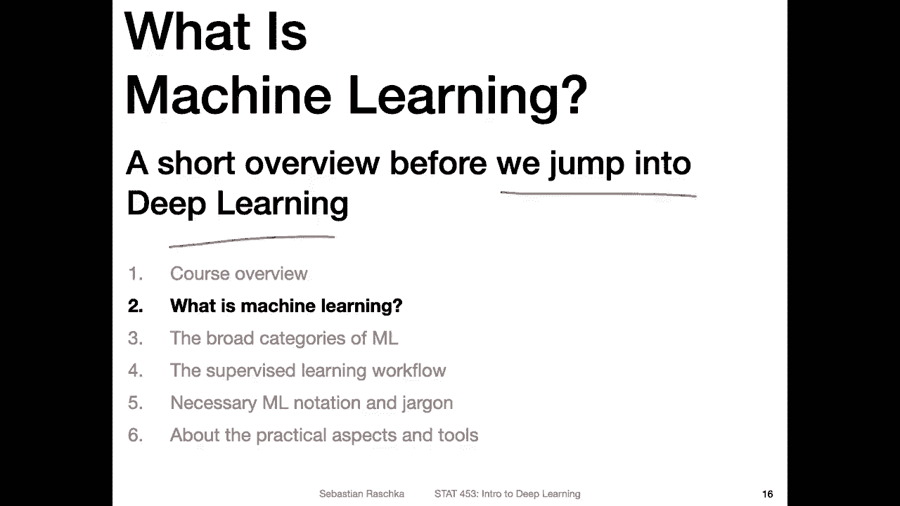
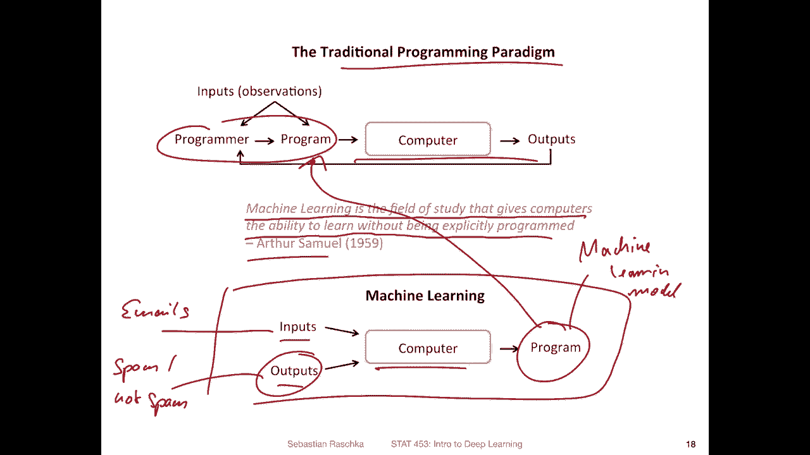
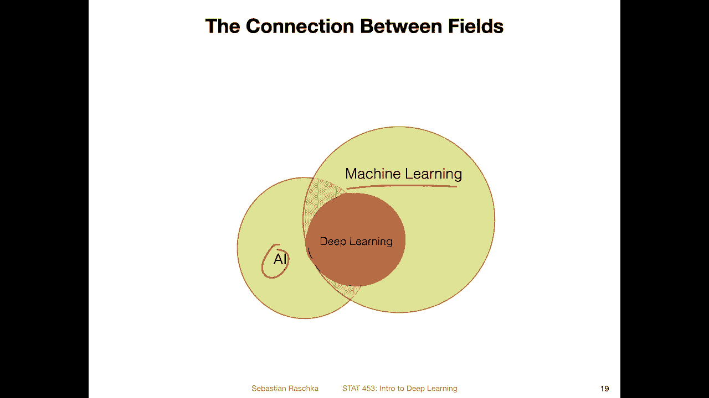
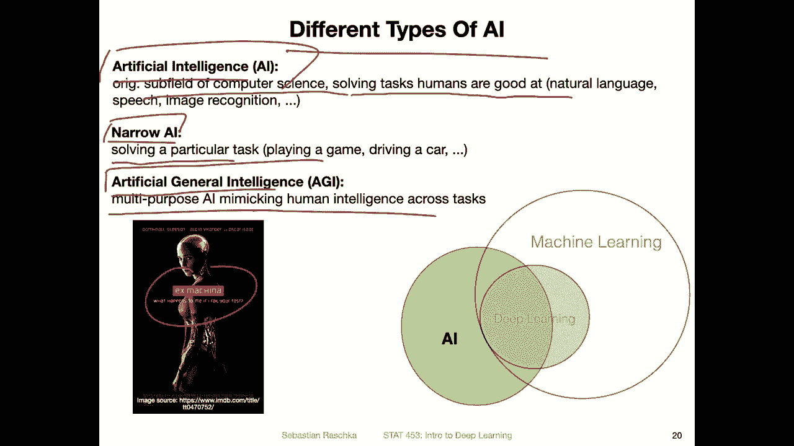
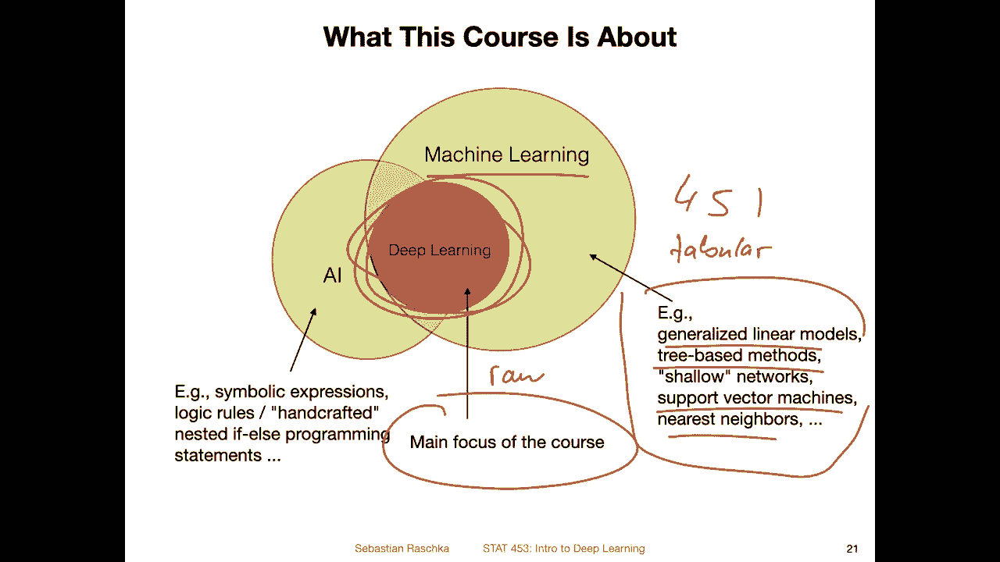
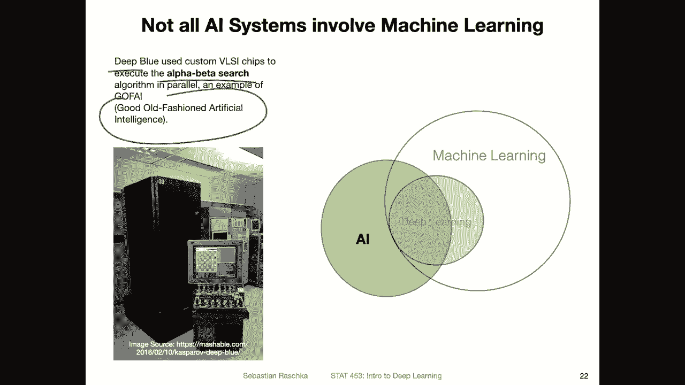
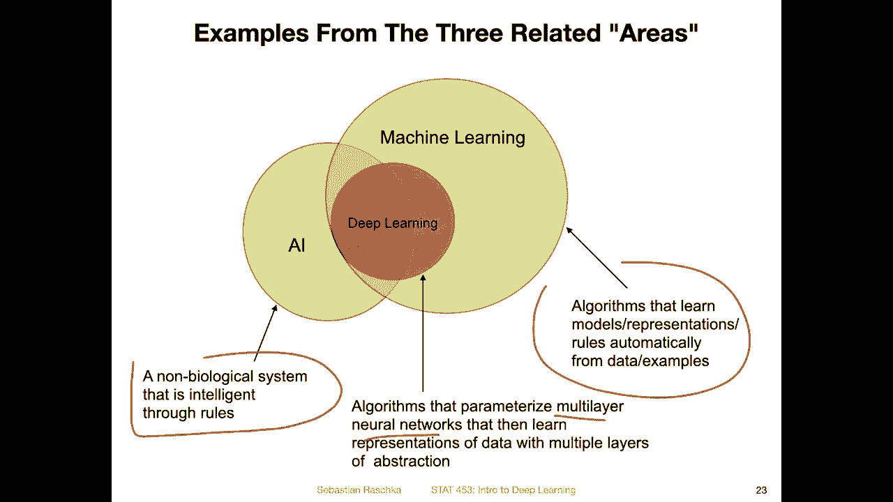
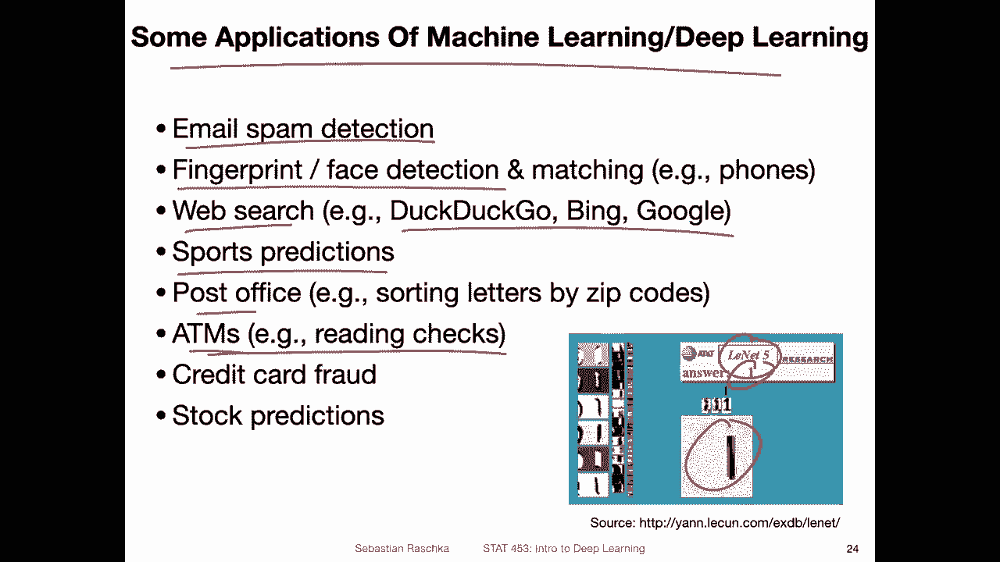
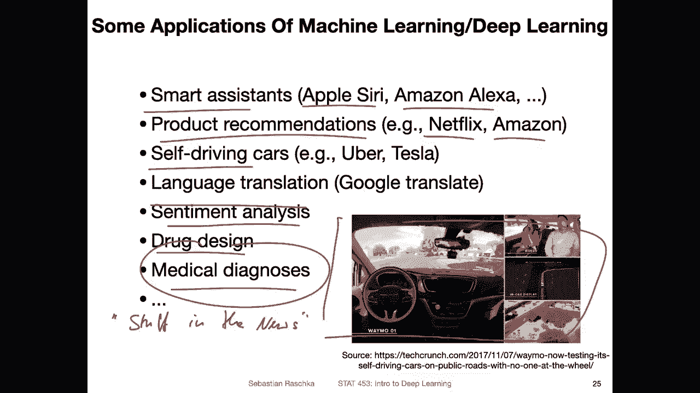
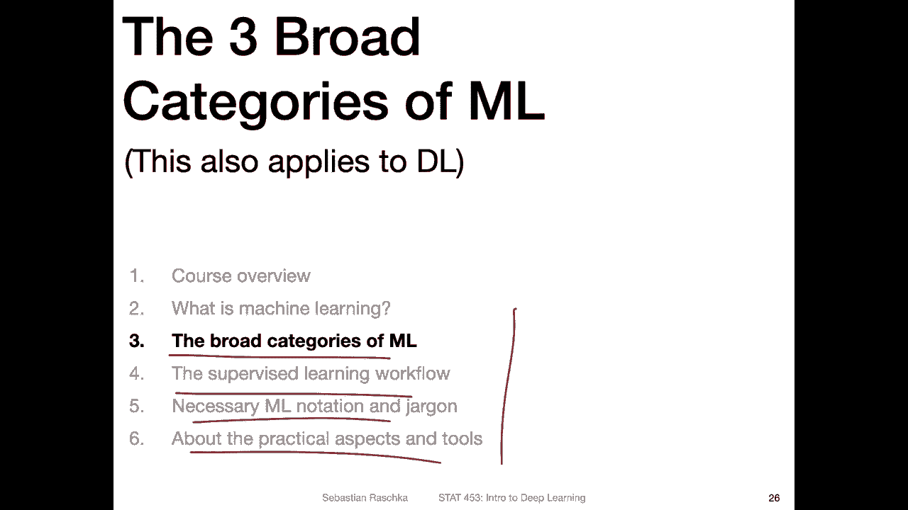

# 课程 P4：L1.2 - 什么是机器学习？ 🧠

在本节课中，我们将要学习机器学习的基本概念，了解它与传统编程的区别，并初步认识其与人工智能、深度学习的关系。

---

## 概述

机器学习是人工智能的一个重要分支，它赋予计算机从数据中自动学习并做出决策的能力，而无需进行明确的编程。本节将介绍机器学习的核心思想，并通过实例说明其工作原理。

---

## 传统编程范式

在深入机器学习之前，我们先回顾传统的编程范式。传统编程的目的是开发软件，使常见任务变得更加便捷。例如，电子邮件取代了传统邮件，使通信更加方便。

假设我们想设计一个垃圾邮件过滤器。作为程序员，我们需要设计这个过滤器程序。程序接收输入（电子邮件），并产生输出（标签），即判断邮件是否为垃圾邮件，或将其放入正确的文件夹（收件箱或垃圾箱）。

设计这样的过滤器可能非常繁琐。我们需要查看大量邮件样本，对比垃圾邮件和非垃圾邮件，然后制定规则。例如，如果邮件主题包含“赢钱”等词语，则将其归类为垃圾邮件。我们需要不断测试和添加规则，这个过程工作量巨大。

---

## 机器学习范式

与传统编程不同，机器学习提供了一种更高效的解决方案。在机器学习范式中，我们不再手动编写规则，而是向算法提供输入和对应的输出（标签）。

我们提供一个已标记的数据集，其中包含电子邮件及其对应的“垃圾邮件”或“非垃圾邮件”标签。人类需要先标记这些数据，以向计算机展示我们期望的结果。然后，计算机可以自动从这些示例中学习规则，生成一个能够进行分类的模型。

这个机器学习模型实际上取代了程序员手动开发程序的过程。我们可以直接将模型交给计算机，使其能在新数据上产生新的输出。因此，机器学习在某种程度上是从示例中自动学习。

正如 Arthur Samuel 的著名定义：**机器学习是赋予计算机无需明确编程即可学习能力的研究领域**。这意味着我们提供示例，算法基于数据自动学习，而无需人类思考具体规则。

---

## 机器学习与人工智能、深度学习的关系

你可能会问，机器学习与深度学习和人工智能有何关系？如今，深度学习和人工智能经常被互换使用，但它们之间存在区别。

机器学习是最大的领域，它包含了深度学习。深度学习严格来说是机器学习的一个子领域，专注于深度神经网络。人工智能则与两者都有交集。

需要指出的是，并非所有人工智能方法都使用机器学习。例如，早期的一些AI系统是基于硬编码规则的。

---

### 人工智能的类型

人工智能通常可以分为两类：
*   **狭义人工智能**：专注于解决特定任务，例如图像分类、玩游戏或驾驶汽车。它一次只能完成一项任务。
*   **通用人工智能**：多用途的人工智能，能够模仿人类在多种任务上的智能。这是许多人的远期目标，但目前尚未实现。

---

### 不依赖机器学习的AI

人工智能不一定总是涉及机器学习。回顾之前手动设计垃圾邮件过滤器的例子：如果我添加足够多的 `if-else` 规则，这个系统也能变得“智能”。这就是所谓的“传统人工智能”，它不依赖于机器学习。

如今，大多数人工智能系统确实使用了机器学习，并且越来越多地使用深度学习，因为深度学习在处理自然语言和计算机视觉任务上通常表现优异。

---

### 传统机器学习与深度学习

传统的非深度学习机器学习方法包括广义线性模型（如线性/逻辑回归）、基于树的方法（如随机森林或梯度提升）、支持向量机和K近邻算法等。这些方法在表格数据上仍然非常强大和有用。

深度学习则专注于深度神经网络，它更擅长从原始数据（如图像、语音）中学习。两者并非孰优孰劣，而是适用场景不同。

---

## 机器学习的应用实例

机器学习和深度学习在实践中有着广泛的应用：
*   **垃圾邮件检测**：如前所述。
*   **指纹与人脸识别**：用于智能手机解锁。
*   **网络搜索**：谷歌、必应等搜索引擎的核心技术。
*   **手写识别**：用于邮政系统分拣信件、ATM机读取支票。这是深度学习的早期成功应用之一（如20世纪90年代的LeNet卷积神经网络）。
*   **智能助手**：如苹果Siri、亚马逊Alexa。
*   **产品推荐**：如Netflix、亚马逊的推荐系统。
*   **自动驾驶汽车**：结合了强化学习、图像监督学习等多种技术。
*   **语言翻译、情感分析、药物设计、医疗诊断**等。

---

## 总结

本节课我们一起学习了机器学习的基本概念。我们了解到，机器学习是通过提供数据和期望输出来让计算机自动学习规则的方法，这与需要手动编写规则的传统编程范式形成对比。我们还梳理了机器学习、深度学习和人工智能之间的关系，并列举了机器学习在现实世界中的多种应用。

在接下来的课程中，我们将更深入地探讨机器学习的子类别、工作流程和相关工具。