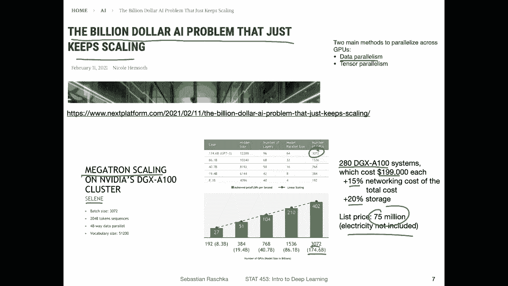
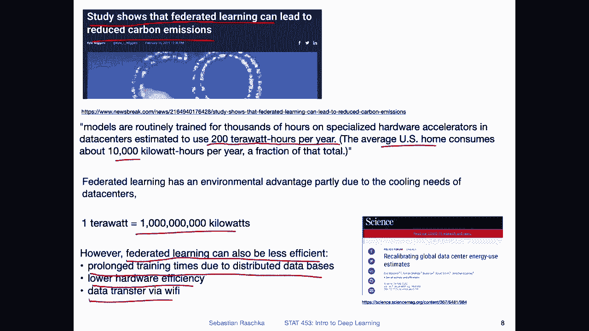
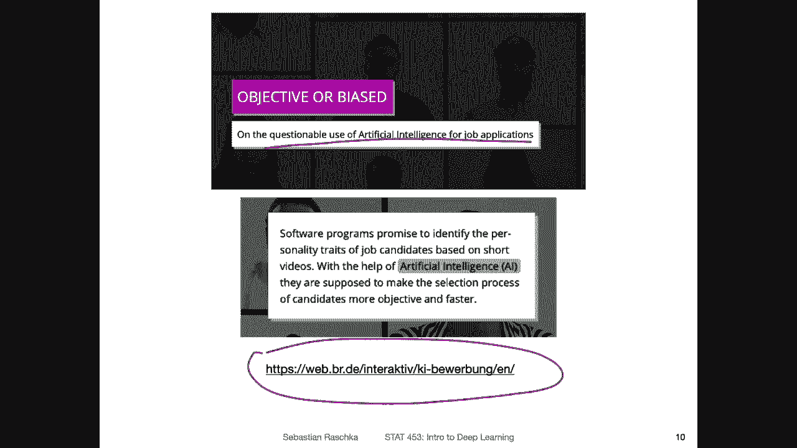
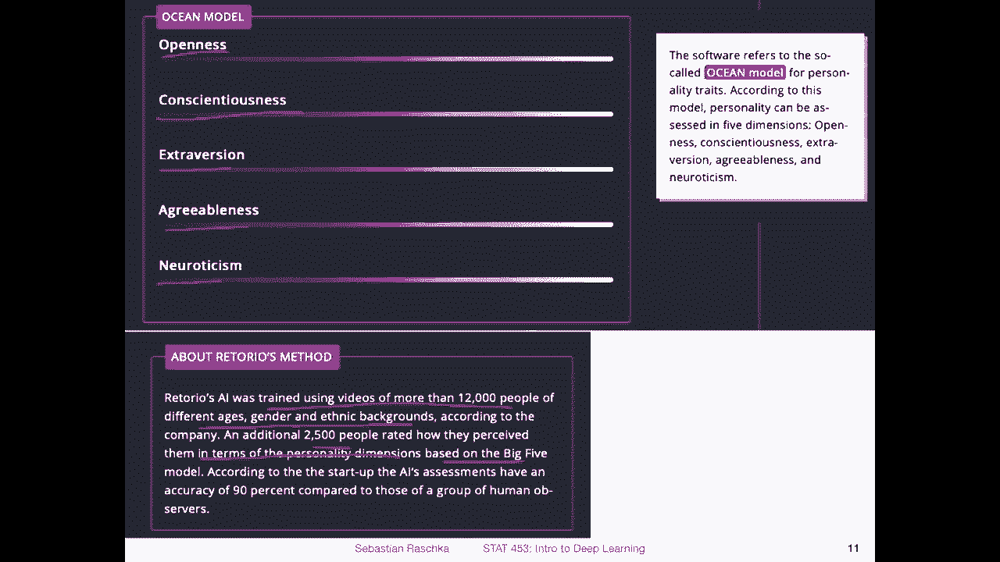
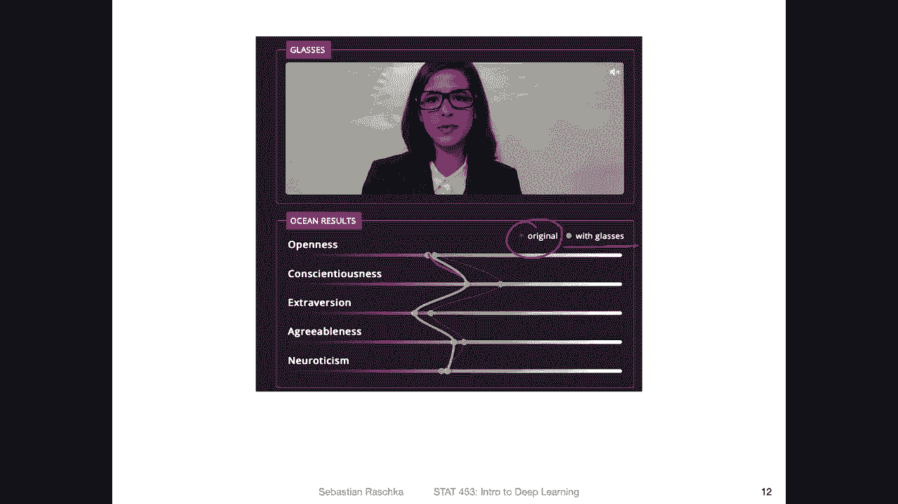
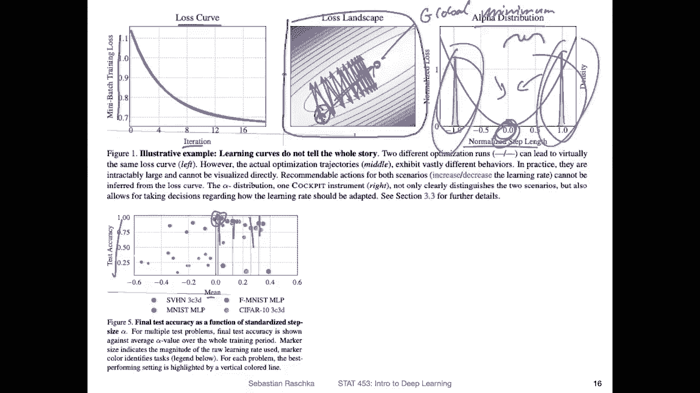

# 深度学习新闻 #4，2021年2月20日 📰

在本节课中，我们将回顾2021年2月20日这一周内深度学习领域的重要新闻。内容涵盖新的PyTorch工具、大规模数据集、模型训练成本、环境友好型AI、伦理问题以及实用的模型调试工具。

---

## 🧠 自由连接神经网络：Free-Wired

上一节我们介绍了本周的概述，本节中我们来看看一个有趣的PyTorch扩展库。

Free-Wired是一个用于创建可在CUDA GPU上运行的、经过优化的自由连接神经网络的PyTorch扩展库。在传统的全连接层中，一层的每个单元都与下一层的所有单元相连。而自由连接网络允许我们任意地连接这些节点。

例如，考虑一个输入单元，它可能只连接到下一层的一个特定单元，而不是所有单元。这种连接方式比卷积网络中的残差连接或Transformer中的连接更为任意。这个工具为尝试各种非常规的神经网络架构提供了可能。

**核心概念**：自由连接网络允许任意定义层与层之间的连接，而非标准的全连接模式。

### 潜在应用场景
以下是自由连接网络的一个潜在应用方向。

*   **随机连接网络**：一篇名为《Exploring Randomly Wired Neural Networks for Image Recognition》的论文提出，使用随机连接的网络在ImageNet数据集上的表现（77.1%准确率）甚至优于精心设计的ResNet架构。虽然这类方法因实现复杂和可解释性差而未成为主流，但Free-Wired这样的工具可能降低其探索门槛。

---

## 🖼️ 新计算机视觉数据集：Things

从新的网络架构转向新的数据，本周研究人员发布了一个名为“Things”的新数据集。

该数据集包含来自565个类别的150万张图像。其新颖之处在于，它专注于对人类重要的物体类别。研究人员提供了在该数据集上预训练的卷积网络代码以及数据加载示例。

### 数据集特点
以下是该数据集的一些关键统计信息和特点。

*   **类别构成**：60%的标签属于人造物（如汽车），40%属于自然物（如树木）。
*   **数据不平衡**：每个类别的图像数量不同，这给评估带来了挑战，可能需要使用**平衡准确率**而非常规准确率。
*   **图像多样性**：图像具有不同的长宽比和分辨率，在使用有固定输入尺寸要求的架构时需要注意。

### 数据收集方法
该数据集的收集方法也颇具启发性。

1.  **标签筛选**：研究人员从大型文本语料库中筛选出高频且具体的名词。他们使用了“具体性”评分，即人类评估者对一个名词所指代事物的可视化难易程度进行打分（例如，“草莓”得分高，“希望”得分低）。
2.  **图像获取**：基于筛选出的类别标签，从ImageNet、Flickr和Bing下载对应图像。
3.  **数据清洗**：
    *   使用**主成分分析（PCA）** 和因子载荷的相关性来去除重复图像。
    *   对每个类别随机采样100张图像进行人工检查，剔除错误标签超过4%的类别。
4.  **最终整合**：合并来自不同来源的图像，再次去重，并修剪数据集使每个类别的图像数大致在7到5000张之间。最终数据集中，94%的图像来自ImageNet。

---

## 💸 模型训练的成本与环境影响

从大规模数据集，我们自然过渡到训练大规模模型所面临的巨大成本问题。

当前，训练大型AI模型的成本正变得极其高昂。例如，训练一个拥有2000亿参数的模型，可能需要价值约7500万美元的硬件系统（如280台DGX A100）。若在AWS上租用同等算力三年，成本也可能高达约8000万美元（不含电费）。

### 并行计算技术
为了应对巨大的计算需求，主要有两种并行化技术：

*   **数据并行**：将大批量数据拆分到多个GPU上，每个GPU计算一部分梯度，然后汇总平均以更新模型。但随着GPU数量增加，其收益会递减。
*   **张量并行**：将矩阵乘法等运算高效地分布到多个GPU上。这对GPU间的连接速度有很高要求，实现起来更为复杂。

### 联邦学习与能效
高昂的成本也引发了对其环境影响的关注。一项研究表明，**联邦学习**可能有助于减少碳排放。

联邦学习意味着在多个设备（如手机、不同数据中心）上进行计算，然后汇总结果。其潜在优势在于，分散的设备可能不需要像大型数据中心那样耗费巨资进行集中冷却。然而，联邦学习也可能因训练时间延长、数据传输能耗以及设备本身能效差异而变得低效。

### 专用AI芯片
另一个趋势是开发更高效的专用AI芯片。例如，一家名为“NeuReality”的初创公司声称其芯片在**每美元性能**上比竞争对手高出15倍。这虽然不意味着绝对速度更快，但强调了在成本和能效方面的优化。

---

## ⚖️ AI伦理：有问题的应用案例

在关注技术效率的同时，我们也必须审视其应用伦理。本周有一个关于AI在招聘中应用的争议性案例。

研究人员开发了一个AI系统，用于在视频面试中评估求职者。该系统在超过12000人的视频数据上训练，并由2500人对视频中人物的开放性、尽责性、外向性等性格维度进行评分，AI学习这些评分。

然而，测试发现了严重问题：
*   **佩戴眼镜**：同一位演员在佩戴眼镜时，AI对其多项性格特质的评分显著降低。
*   **背景书架**：同一位演员在有书架背景和无书架背景时，AI给出的评分存在巨大差异。

这些因素与求职者的能力毫无关系，此类偏差会导致非常不公平的结果。这凸显了AI系统，特别是基于深度学习的“黑箱”模型，在敏感领域应用时可能存在的风险。

### 问题根源与思考
为什么会出现这种问题？一个核心评论指出：“人脸识别机器学习的根本问题在于，我们永远无法确切知道机器对图像中的哪种模式做出了反应。”

虽然可以通过数据增强（如随机更换虚拟背景）来缓解部分问题，但开发此类系统时必须进行严格的偏差测试，确保公平性。在某些领域，或许应谨慎考虑是否要使用AI。

---

## 🔧 模型调试工具：Cockpit

最后，从发现问题的角度，我们转向一个帮助理解和调试模型训练过程的工具。

Cockpit是一个针对PyTorch的实用调试工具，旨在帮助工程师更深入地了解深度学习模型的内部工作状态，而不仅仅是“盲目飞行”。

### 学习率调试示例
该工具的一个应用是辅助学习率调优。通常，学习率需要手动尝试调整。

*   **学习率过小（橙色曲线）**：参数更新幅度很小，训练可能停滞。
*   **学习率过大（蓝色曲线）**：参数更新幅度过大，可能在最优点附近震荡甚至发散。

Cockpit提供了如“归一化步长”等指标进行可视化。理论上，最优的更新方向应直接指向损失最低点（对应步长为0）。有趣的是，实验发现，在**测试集上泛化性能最好**的模型，其平均归一化步长略大于0。这为学习率调优提供了一个潜在的参考区间。

---

## 📝 总结

本节课中我们一起学习了2021年2月20日当周的深度学习动态。我们介绍了一个用于构建自由连接神经网络的PyTorch工具，探讨了一个以人类为中心的新图像数据集，分析了训练大模型的高昂成本与环境影响，审视了一个AI在招聘中产生伦理偏差的案例，最后了解了一个用于调试模型训练过程的实用工具。这些内容涵盖了技术前沿、资源挑战、伦理责任和开发实践，展现了深度学习领域广阔而多维的发展图景。