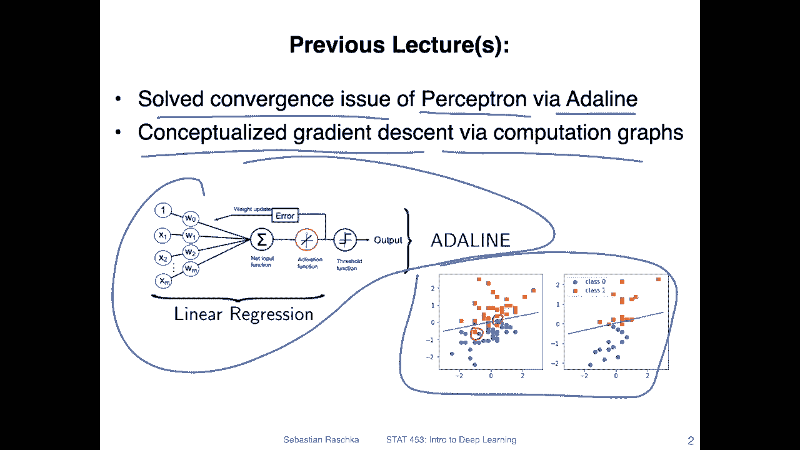
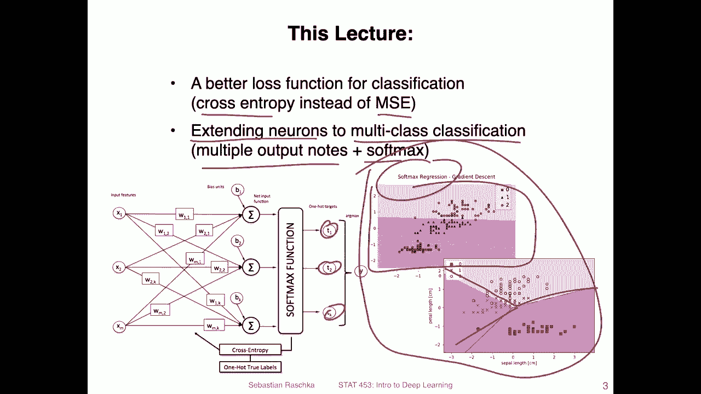
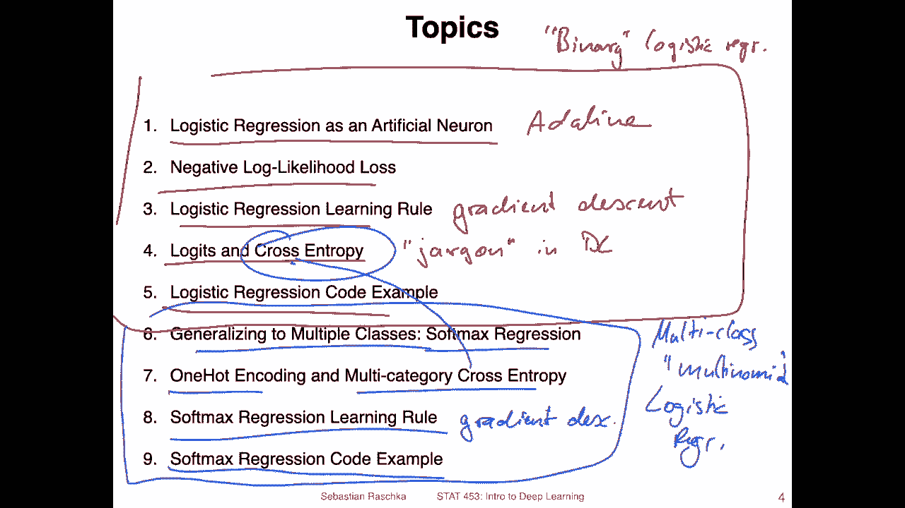

# 课程 P50：L8.0 - 逻辑回归 🧠

## 概述

在本节课中，我们将学习逻辑回归，并将其视为一个单层神经网络。这有助于理解神经网络中前向传播与反向传播的基本概念。我们还将把逻辑回归从二分类问题推广到多分类问题，为后续理解多层感知机打下基础。

---

## 1. 逻辑回归作为人工神经元

上一节我们介绍了感知机和自适应线性神经元（Adaline）。本节中，我们来看看逻辑回归如何作为一个人工神经元。

逻辑回归可以看作是Adaline的改进版本。它使用不同的激活函数和损失函数，以更好地处理分类问题。

以下是逻辑回归神经元的基本结构：

```python
# 逻辑回归神经元的前向传播
z = w1*x1 + w2*x2 + ... + wn*xn + b
a = sigmoid(z)
```

其中，`sigmoid` 函数将线性输出 `z` 映射到 (0, 1) 区间，可以解释为概率。

---

## 2. 逻辑回归的损失函数

上一节我们了解了模型结构，本节中我们来看看逻辑回归使用的损失函数。

逻辑回归使用**负对数似然**作为损失函数，这比Adaline中使用的均方误差更适合分类任务。

对于一个样本，其损失公式如下：

**`L = -[y * log(a) + (1-y) * log(1-a)]`**

其中：
*   `y` 是真实标签（0或1）。
*   `a` 是模型预测为正类的概率（即 `sigmoid(z)` 的输出）。

模型的目标是最小化所有训练样本的平均损失。

---

## 3. 使用梯度下降训练逻辑回归

定义了损失函数后，我们需要一种方法来优化模型参数。本节将介绍如何使用梯度下降法训练逻辑回归模型。

梯度下降通过计算损失函数相对于每个参数（权重 `w` 和偏置 `b`）的梯度，并沿梯度反方向更新参数，以最小化损失。

以下是参数更新的核心公式：

**`w := w - learning_rate * dL/dw`**
**`b := b - learning_rate * dL/db`**

其中 `dL/dw` 和 `dL/db` 需要通过反向传播计算得出。

---



## 4. 逻辑与交叉熵：术语解析

在深入多分类之前，我们先厘清两个在深度学习中常见的术语：**逻辑值（Logits）**和**交叉熵（Cross-Entropy）**。

*   **逻辑值（Logits）**：指的是神经元在激活函数之前的原始线性输出 `z`。
*   **交叉熵（Cross-Entropy）**：二分类逻辑回归中使用的负对数似然损失，就是**二元交叉熵损失**的一种特例。

理解这些术语有助于阅读更广泛的深度学习文献。

---

## 5. 逻辑回归代码示例

理论需要实践来巩固。以下是使用逻辑回归进行二分类的一个简单代码框架：

```python
import numpy as np

def sigmoid(z):
    return 1 / (1 + np.exp(-z))

def compute_loss(y_true, y_pred):
    # 二元交叉熵损失
    return -np.mean(y_true * np.log(y_pred) + (1 - y_true) * np.log(1 - y_pred))

# 训练循环（简化版）
for epoch in range(num_epochs):
    # 前向传播
    z = np.dot(X, w) + b
    a = sigmoid(z)

    # 计算损失
    loss = compute_loss(y, a)

    # 反向传播计算梯度 (此处省略梯度计算细节)
    # dw = ...
    # db = ...

    # 更新参数
    w -= learning_rate * dw
    b -= learning_rate * db
```

---

## 6. 从二分类到多分类：模型扩展



现实世界的数据往往包含多于两个类别。本节开始，我们将逻辑回归扩展为**多项逻辑回归**，也称为 **Softmax 回归**。

Softmax回归模型具有多个输出神经元，每个神经元对应一个类别。

---

## 7. 独热编码：类别数据表示

为了处理多分类标签，我们需要一种数值化的表示方法。这里我们引入**独热编码**。

独热编码将类别标签转换为一个向量，该向量长度等于类别总数，其中真实类别对应的位置为1，其余位置为0。

例如，三个类别（猫、狗、鸟）的标签“狗”可以编码为 `[0, 1, 0]`。

---

## 8. 多类别交叉熵损失

对于多分类问题，我们需要将二元交叉熵推广为**多类别交叉熵损失**。

其公式为：

**`L = - Σ (y_i * log(a_i))`**

其中求和遍历所有类别。`y_i` 是独热编码标签的第 `i` 个元素，`a_i` 是模型预测为第 `i` 个类别的概率（由Softmax函数产生）。

---

## 9. Softmax回归的学习规则

与二分类逻辑回归类似，我们使用梯度下降来训练Softmax回归模型。核心思想不变：计算损失对参数的梯度并更新参数。

参数更新公式在形式上与之前相同，但梯度 `dL/dw` 和 `dL/db` 的计算会因Softmax函数和多类别交叉熵而有所不同。

---

## 10. Softmax回归代码示例

最后，我们来看一个Softmax回归的简化代码示例，以整合所有概念：

```python
def softmax(z):
    # z 是一个向量
    exp_z = np.exp(z - np.max(z)) # 防止数值溢出
    return exp_z / np.sum(exp_z, axis=0)

def compute_loss_multi(y_true_one_hot, y_pred_probs):
    # 多类别交叉熵损失
    return -np.mean(np.sum(y_true_one_hot * np.log(y_pred_probs), axis=1))

# 假设有3个类别
num_classes = 3
# 权重矩阵形状: (特征数, 类别数)
W = np.random.randn(num_features, num_classes)
b = np.zeros(num_classes)

# 训练循环中...
# 前向传播
z = np.dot(X, W) + b # X: (样本数, 特征数)
a = softmax(z.T).T   # a: (样本数, 类别数)，每个样本的类别概率分布

# 计算损失 (y需要是独热编码形式)
loss = compute_loss_multi(y_one_hot, a)

# 反向传播与参数更新（略）
```

---

## 总结

本节课中我们一起学习了：
1.  将逻辑回归视为一个单层神经网络。
2.  逻辑回归使用的负对数似然（二元交叉熵）损失函数及其优化方法。
3.  逻辑值与交叉熵等核心术语。
4.  如何将二分类逻辑回归扩展为多分类的Softmax回归。
5.  处理多分类标签的独热编码方法。
6.  多类别交叉熵损失函数。
7.  Softmax回归模型的基本训练过程。



通过本课的学习，你掌握了分类任务的基础模型。在下一讲中，我们只需在Softmax回归模型中加入一个隐藏层，就能得到多层感知机，即第一个简单的深度神经网络。