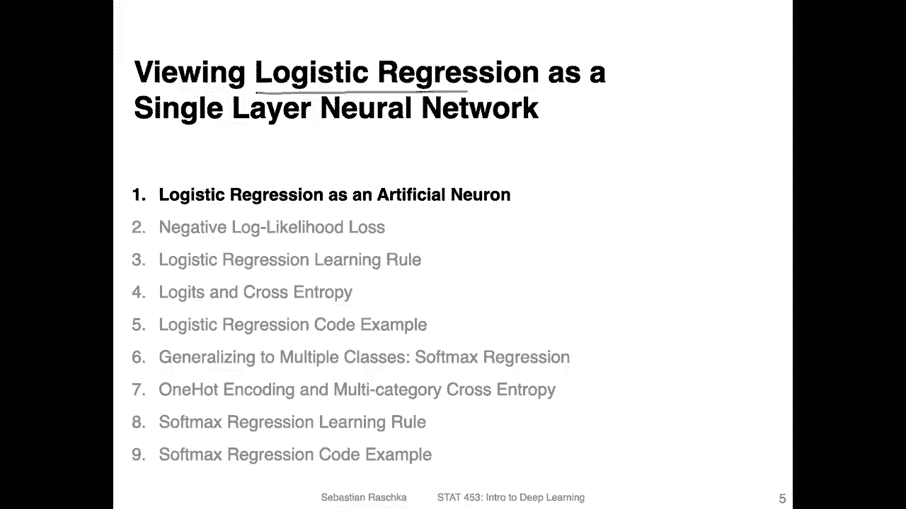
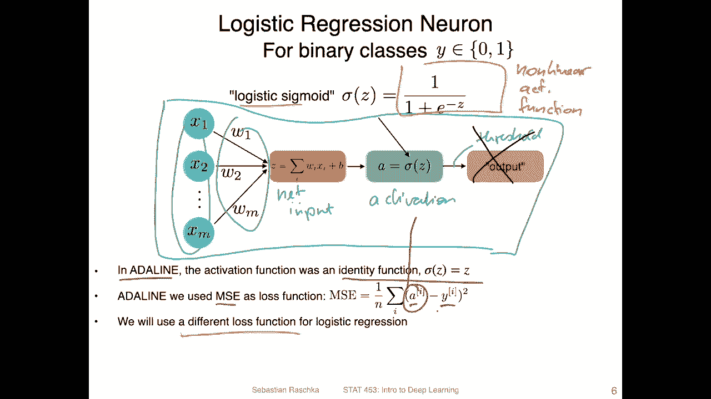
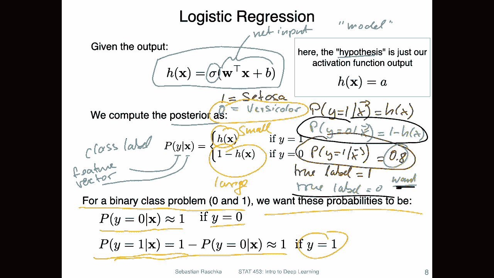

# 课程 P51：L8.1 - 逻辑回归作为单层神经网络 🧠

在本节课中，我们将学习逻辑回归，并将其视为一种单层神经网络。我们将探讨其核心组成部分，特别是与之前学习的Adaline模型的主要区别。

---

## 逻辑回归与Adaline的区别 🔄

上一节我们介绍了Adaline模型。逻辑回归与Adaline的主要区别在于激活函数和损失函数。

以下是逻辑回归与Adaline的核心区别：

1.  **激活函数不同**：Adaline使用恒等函数（Identity Function），而逻辑回归使用逻辑S型函数（Logistic Sigmoid Function）。
2.  **损失函数不同**：Adaline使用均方误差（Mean Squared Error），而逻辑回归使用不同的损失函数（将在下一节介绍）。

在Adaline中，激活函数是恒等函数，即 `a = z`。在逻辑回归中，我们使用非线性激活函数。

---

## 逻辑S型激活函数 📈

本节中我们来看看逻辑回归使用的激活函数——逻辑S型函数。

该函数有两种常见写法，在深度学习领域通常使用右侧形式：

*   `σ(z) = 1 / (1 + e^{-z})`
*   `σ(z) = e^{z} / (e^{z} + 1)`

从左侧形式推导到右侧形式，只需分子分母同时除以 `e^{z}`。

该函数的图像以0为中心。当输入 `z = 0` 时，输出为 `0.5`。函数值域在 `(0, 1)` 之间，当 `z` 趋近正无穷时，输出趋近于 `1`；当 `z` 趋近负无穷时，输出趋近于 `0`。

---

## 逻辑回归模型与概率解释 🎯

逻辑回归的模型可以总结为以下公式：

`h(x) = σ(z) = 1 / (1 + e^{-z})`

其中 `z = w^T x`（即净输入）。

我们可以将整个模型 `h(x)` 的输出解释为给定特征向量 `x` 时，类别标签 `y` 的后验概率。即：

`P(y=1 | x) = h(x)`
`P(y=0 | x) = 1 - h(x)`

以一个简化的鸢尾花二分类问题为例（假设类别1为山鸢尾，类别0为杂色鸢尾）。如果模型对某个样本预测 `P(y=1 | x) = 0.8`，这意味着模型认为该样本有80%的概率属于山鸢尾，同时有20%的概率属于杂色鸢尾。

模型训练的目标是：对于给定的真实标签，我们希望其对应的预测概率尽可能接近1。

*   如果真实标签 `y = 1`，我们希望 `P(y=1 | x)` 接近1。
*   如果真实标签 `y = 0`，我们希望 `P(y=0 | x)`（即 `1 - h(x)`）接近1。

下一节我们将学习如何通过一个合适的损失函数来实现这个目标。

---

## 总结 📝

本节课中我们一起学习了逻辑回归作为单层神经网络的基本框架。我们明确了它与Adaline模型在激活函数上的核心区别，引入了逻辑S型函数，并理解了该模型输出的概率意义。下一节，我们将深入探讨逻辑回归的损失函数。