# 逻辑回归课程 P52：L8.2 - 逻辑回归损失函数 📉

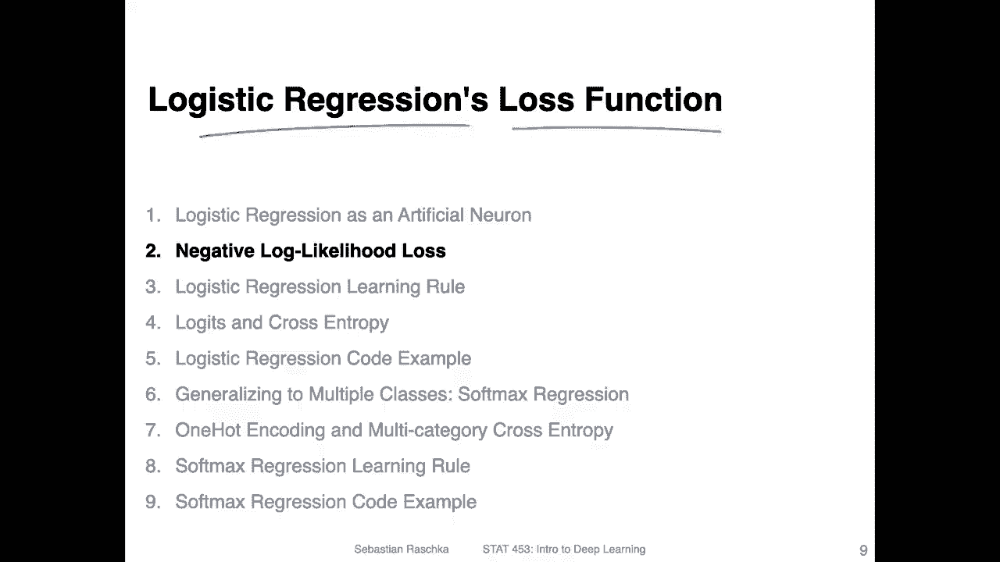

在本节课中，我们将学习如何计算逻辑回归模型的损失函数。我们将从回顾核心概念开始，逐步推导出用于模型训练的损失函数形式，并解释为何在实践中最常使用负对数似然损失。

## 核心概念回顾 🔄

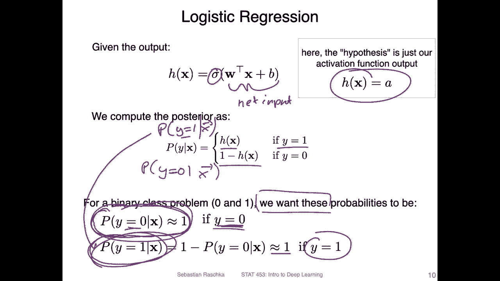

上一节我们介绍了逻辑回归模型如何计算类别成员概率。本节中，我们来看看如何基于这些概率构建损失函数。

逻辑回归的目标是最大化训练数据中正确类别的预测概率。对于单个样本，我们希望：

*   如果真实标签 `y = 0`，则类别成员概率 `P(y=0|x)` 应尽可能高（接近1）。
*   如果真实标签 `y = 1`，则类别成员概率 `P(y=1|x)` 应尽可能高（接近1）。

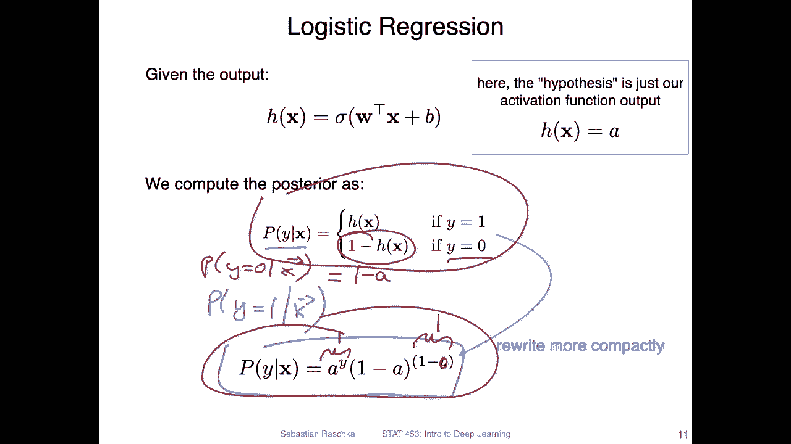

这些概率通过逻辑激活函数（Sigmoid）计算得出：
*   `P(y=1|x) = σ(z)`，其中 `z` 是净输入。
*   `P(y=0|x) = 1 - σ(z)`。

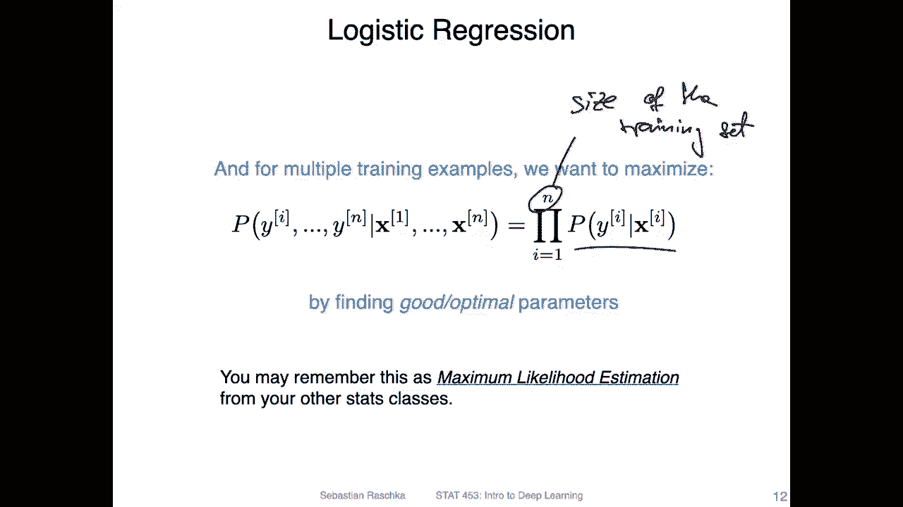

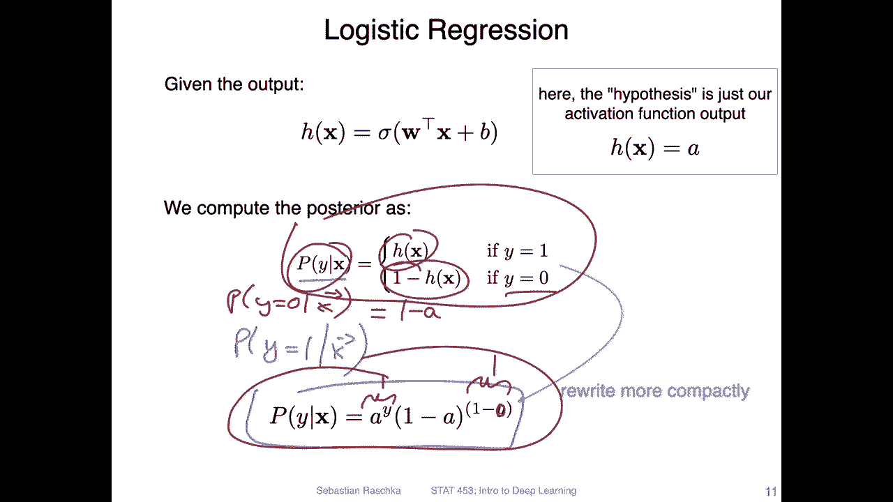

我们可以用一个紧凑的公式来统一表示上述分段函数：
`P(y|x) = (σ(z))^y * (1 - σ(z))^(1-y)`
其中 `y` 是真实标签（0或1）。通过代入验证可知，当 `y=1` 时，公式简化为 `σ(z)`；当 `y=0` 时，公式简化为 `1-σ(z)`。

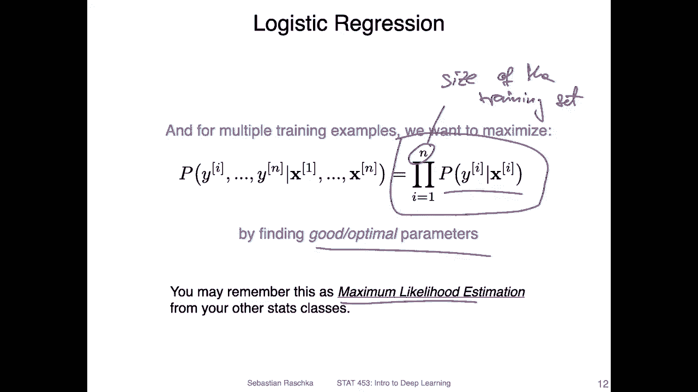

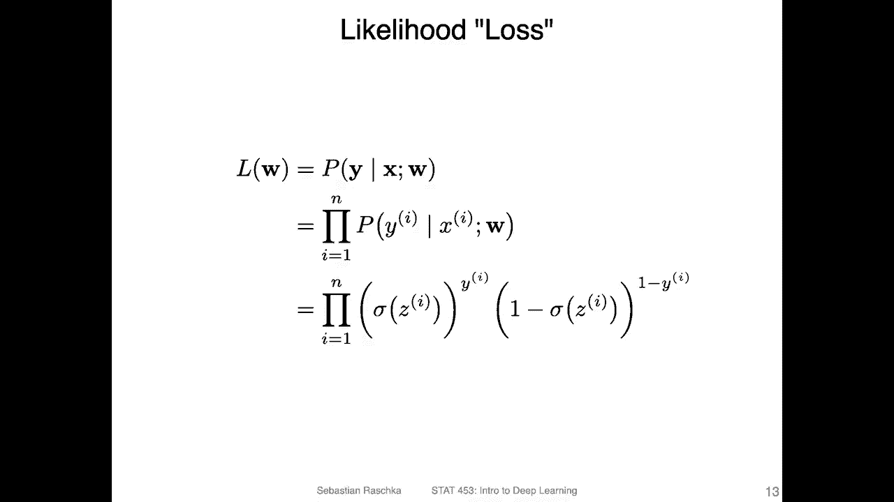

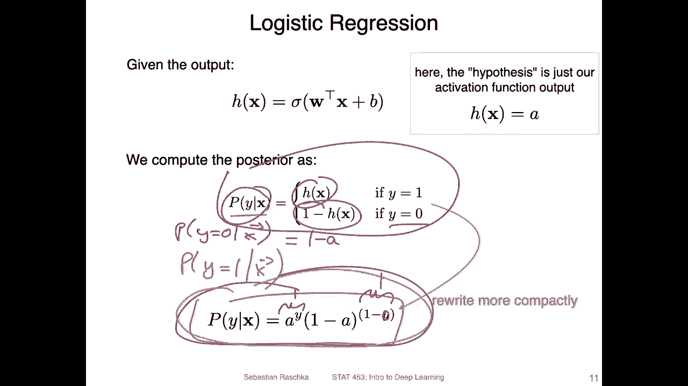

## 从最大似然估计到损失函数 🎯

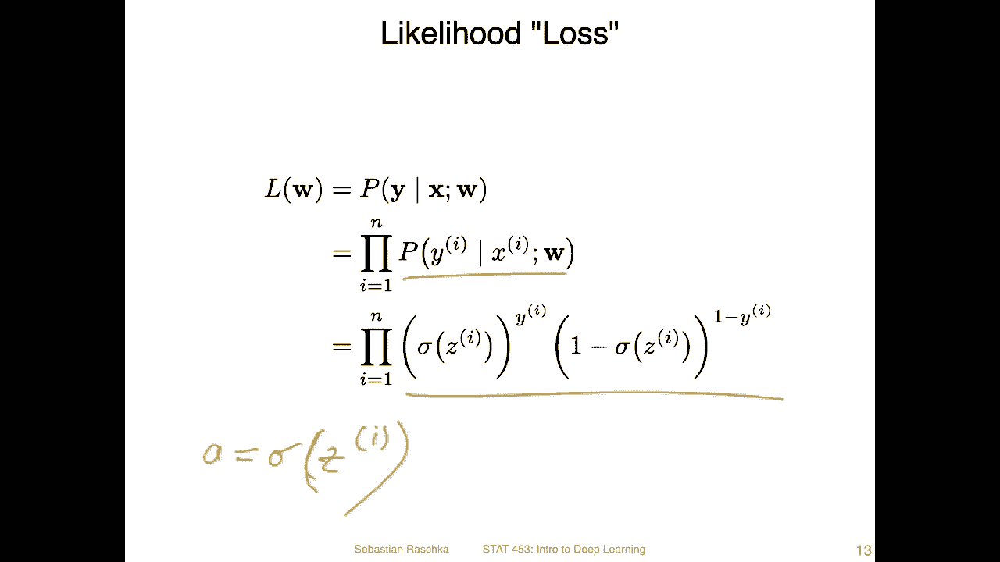

对于一个包含 `n` 个样本的训练集，我们希望找到一组模型参数，使得所有样本的联合概率（似然）最大。这被称为**最大似然估计**。

我们希望最大化的似然函数为：
`L(θ) = ∏_{i=1}^{n} P(y^{(i)} | x^{(i)})`

为了计算方便和数值稳定性，我们通常取自然对数，将对数似然函数：
`log L(θ) = ∑_{i=1}^{n} [ y^{(i)} log(σ(z^{(i)})) + (1-y^{(i)}) log(1-σ(z^{(i)})) ]`

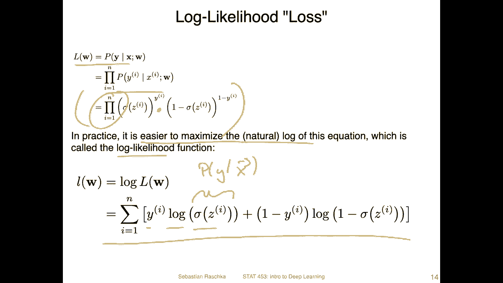

然而，大多数优化库（如PyTorch中的随机梯度下降）被设计为**最小化**一个函数，而非最大化。因此，我们通过添加一个负号，将对数似然最大化问题转化为最小化问题，得到**负对数似然损失函数**。

此外，我们通常会除以样本数量 `n`（或批次大小）进行缩放，这使得训练过程在数值上更稳定。最终，逻辑回归常用的损失函数形式为：
`J(θ) = - (1/n) ∑_{i=1}^{n} [ y^{(i)} log(a^{(i)}) + (1-y^{(i)}) log(1-a^{(i)}) ]`
其中 `a^{(i)} = σ(z^{(i)})` 是模型对第 `i` 个样本的预测输出（激活值）。

以下是逻辑回归训练与之前所学模型的对比要点：

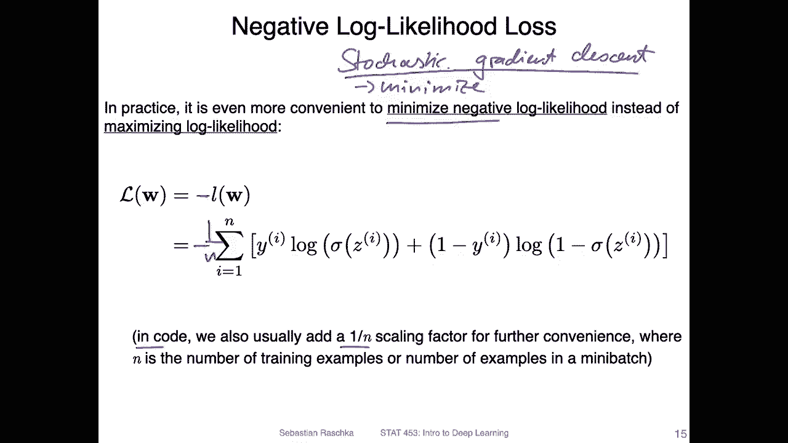

*   **与Adaline的对比**：在Adaline中，我们最小化**均方误差**。在逻辑回归中，我们本质上是最大化**似然**（或等价地最小化负对数似然）。
*   **优化技巧**：为了利用现有的随机梯度下降优化器，我们将最大化问题转化为最小化问题。
*   **数值稳定性**：使用对数似然而非原始似然，并添加缩放因子 `1/n`，都是为了提高计算的数值稳定性。

## 总结 📝

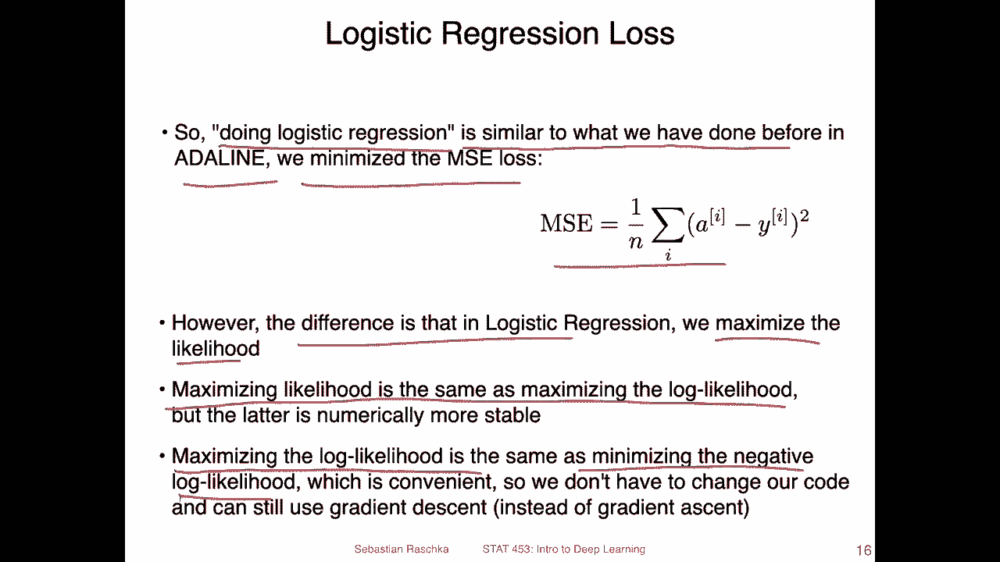

本节课中我们一起学习了逻辑回归损失函数的构建过程。我们从最大化正确类别的概率这一目标出发，引入了最大似然估计的概念。为了便于优化和计算，我们将其转化为最小化负对数似然函数的问题，这也就是逻辑回归模型最终使用的损失函数。在下一节中，我们将进一步探讨这个损失函数的具体形态和训练过程。