# 课程 P56：L8.6 - 多项 Logistic 回归 / Softmax 回归 📊

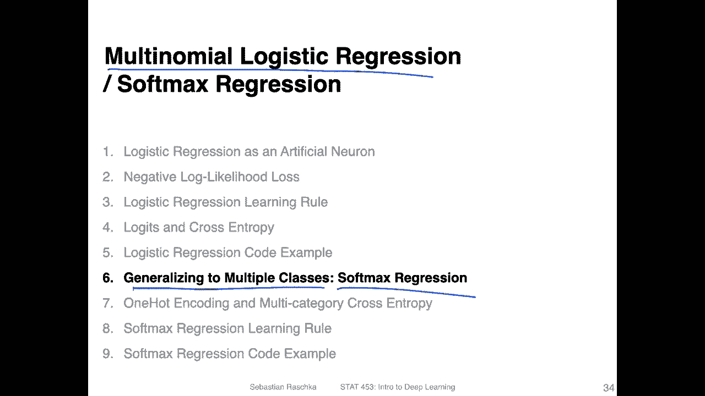

在本节课中，我们将要学习如何将二分类的逻辑回归概念推广到多分类问题。这被称为多项逻辑回归或 Softmax 回归。我们将以经典的 MNIST 手写数字数据集为例，详细介绍其原理和实现方式。

## MNIST 数据集简介

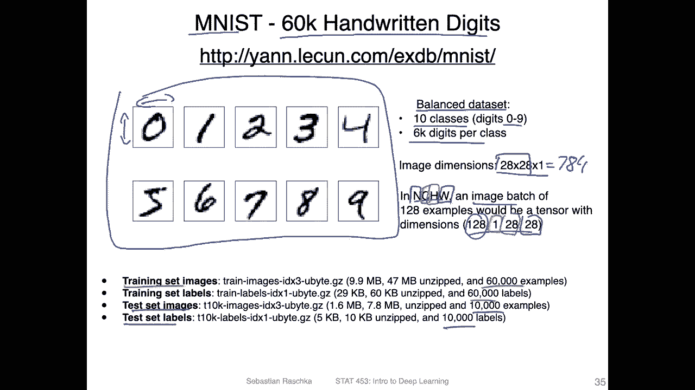

上一节我们介绍了逻辑回归的基本概念，本节中我们来看看如何将其应用于多分类任务。首先，我们需要一个合适的数据集。

MNIST 数据集是一个包含 60,000 张训练图像和 10,000 张测试图像的手写数字数据集。每个数字（0 到 9）代表一个类别，因此这是一个 10 分类问题。数据集是平衡的，意味着每个类别都有相同数量的样本（训练集中每个数字有 6,000 张图片）。

每张图片的尺寸是 28 像素 × 28 像素，并且是黑白的（只有一个颜色通道）。在 PyTorch 中，我们通常使用 `NCHW` 格式来表示一个图像批次，其中：
*   `N` 是批次大小（例如 128）。
*   `C` 是颜色通道数（对于 MNIST，`C=1`）。
*   `H` 是图像高度（28）。
*   `W` 是图像宽度（28）。

因此，每张图片在输入模型前，会被展平成一个包含 784 个特征（28*28）的长向量。特征值通常是像素强度，范围在 0 到 255 之间。为了优化梯度下降的性能，我们通常会对输入进行归一化，例如将像素值除以 255，使其范围在 0 到 1 之间，或者进一步减去 0.5 使其范围在 -0.5 到 0.5 之间。

## 从二分类到多分类的挑战

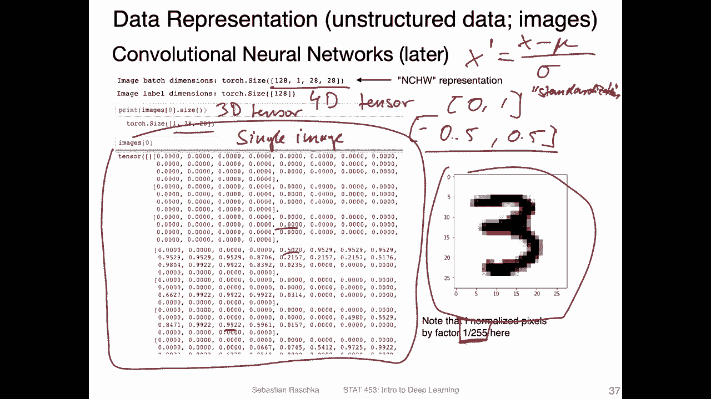

在标准的二分类逻辑回归中，模型接收一个特征向量，计算其与权重向量的点积并加上偏置，然后通过 **Sigmoid** 激活函数得到一个概率值。这个概率表示样本属于类别 1 的可能性，属于类别 0 的概率则是 `1 - P(class=1)`。

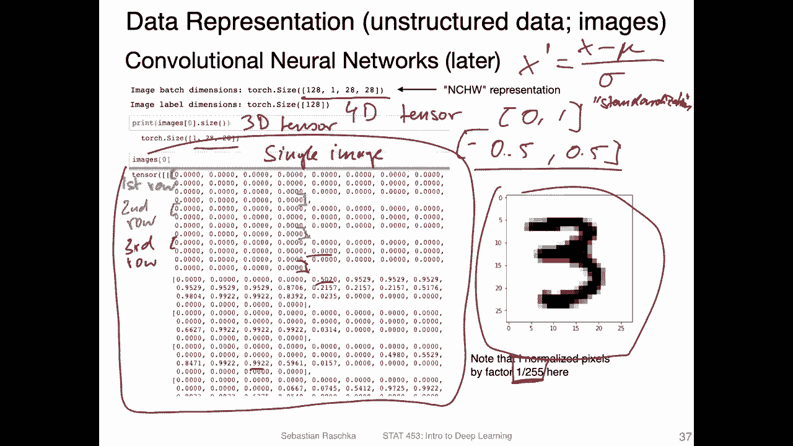

当我们面对超过两个类别时，一个直观的想法是使用多个独立的二分类逻辑回归模型，每个模型负责判断样本是否属于某一个特定类别。以下是这种方法的示意图和公式描述：

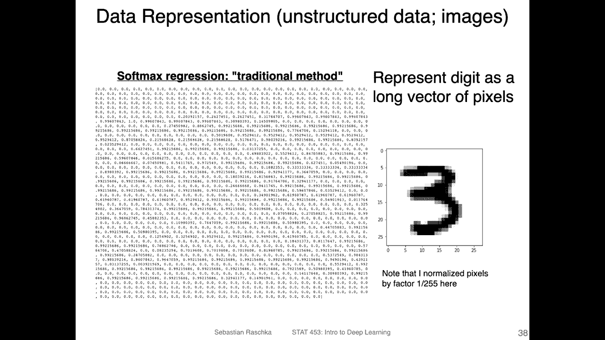

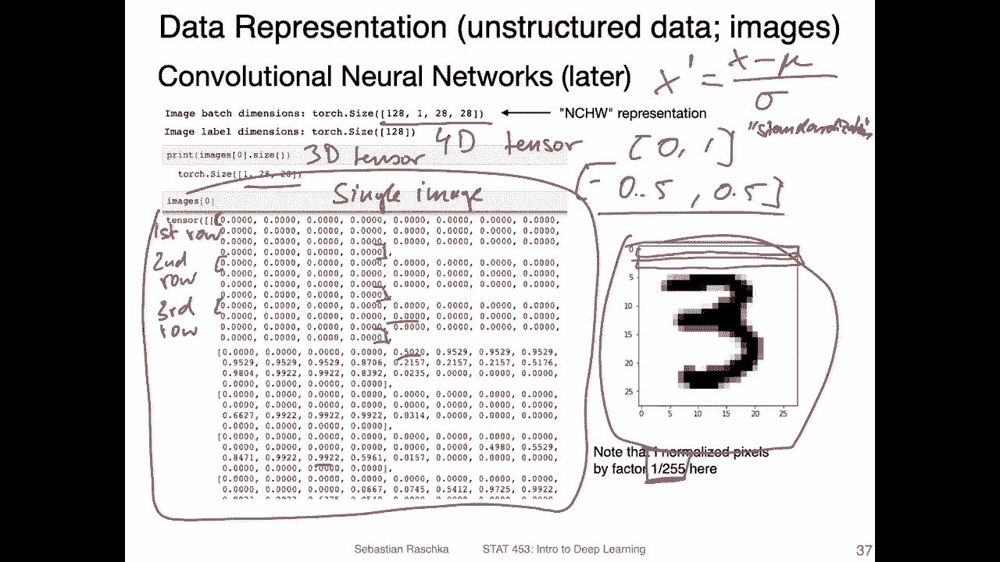

假设我们有 `M` 个输入特征和 `H` 个输出类别（例如 H=10）。我们可以为每个类别 `j` 设置一组权重 `W_j` 和一个偏置 `b_j`。
对于第 `j` 个输出节点，其净输入 `z_j` 为：
`z_j = w_j · x + b_j`
然后，我们对该净输入应用 Sigmoid 函数，得到该样本属于类别 `j` 的概率 `P_j`：
`P_j = σ(z_j) = 1 / (1 + exp(-z_j))`

然而，这种方法存在一个问题：每个模型输出的概率是独立的，所有类别的概率之和不一定等于 1。这在类别互斥（如一个数字只能是 0 或 1，不能同时是两者）的场景下不够直观。

## Softmax 回归模型

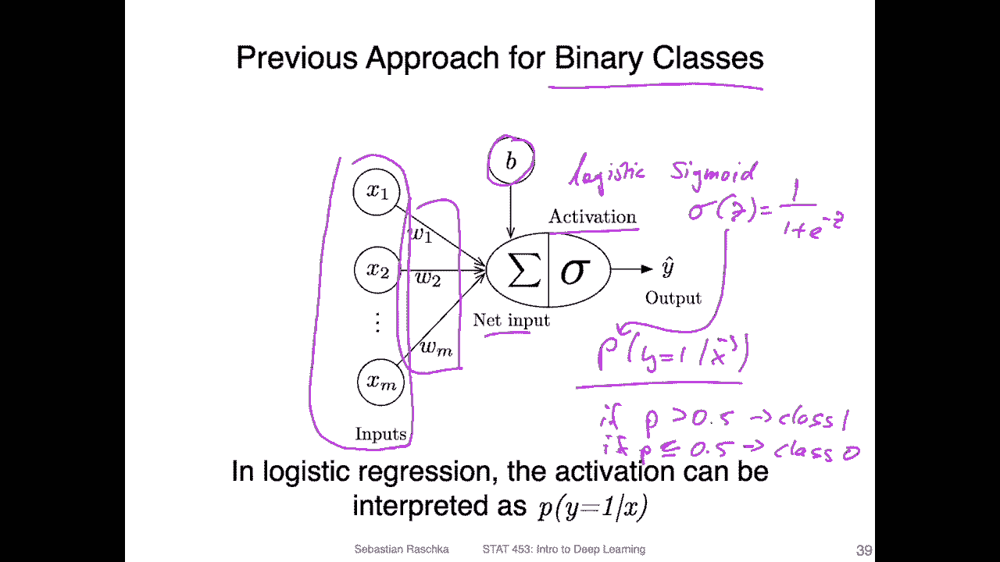

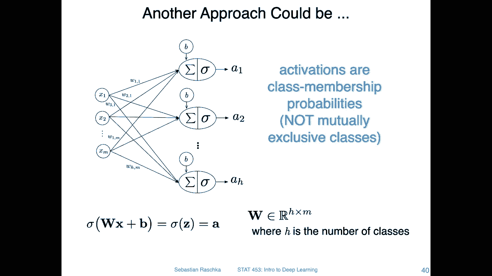

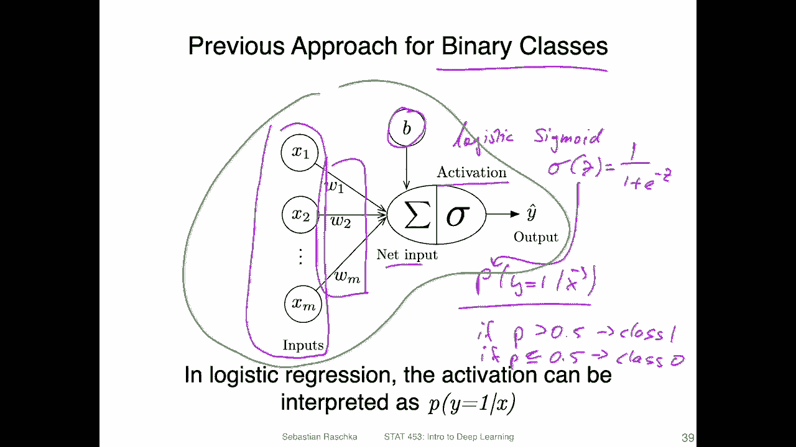

为了解决上述问题，我们引入 **Softmax 回归** 模型。它与多个独立逻辑回归模型的关键区别在于激活函数。

在 Softmax 回归中，我们移除每个输出节点上的独立 Sigmoid 函数，取而代之的是一个共享的 **Softmax** 函数。该函数作用于所有输出节点的净输入向量 `z`。

以下是 Softmax 函数的工作方式：
1.  对于每个类别 `j`，我们像之前一样计算净输入 `z_j`。
2.  然后，Softmax 函数接收所有 `z_j`（`j` 从 1 到 `H`），并计算每个类别的最终概率。

Softmax 函数的公式如下，它将任意实数值的向量“压缩”为一个概率分布向量，其中每个元素值在 (0,1) 之间，且所有元素之和为 1：
`P(class=j) = exp(z_j) / Σ_{k=1}^{H} exp(z_k)`

这样，对于一张图片，模型会输出一个长度为 `H`（类别数）的概率向量。例如，对于数字“3”，输出可能是 `[0.1, 0.05, 0.7, ..., 0.02]`，其中第三个位置（对应数字‘2’，因为索引常从0开始）的概率 0.7 最高。

为了得到最终的类别预测，我们采用 **argmax** 操作，即选择概率向量中值最大的索引作为预测类别：
`predicted_class = argmax(P)`

## 核心步骤总结

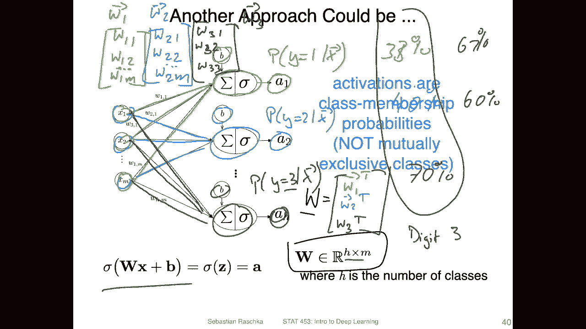

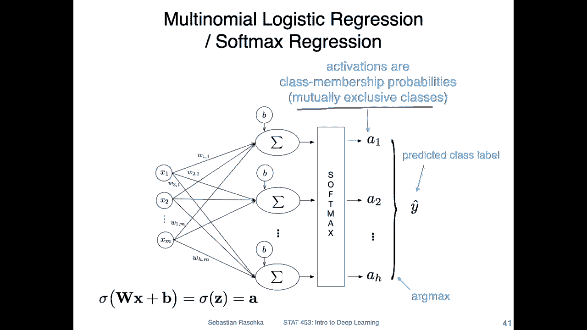

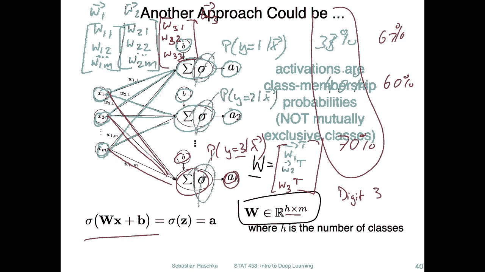

本节课中我们一起学习了如何将逻辑回归扩展到多分类问题。以下是实现 Softmax 回归的核心步骤：

1.  **数据准备**：将图像数据展平为特征向量，并进行适当的归一化处理。
2.  **模型设计**：为每个类别设置独立的权重和偏置，计算净输入。
3.  **概率转换**：使用 Softmax 函数将所有类别的净输入转换为一个总和为 1 的概率分布。
4.  **做出预测**：通过 argmax 函数从概率分布中选出最可能的类别。

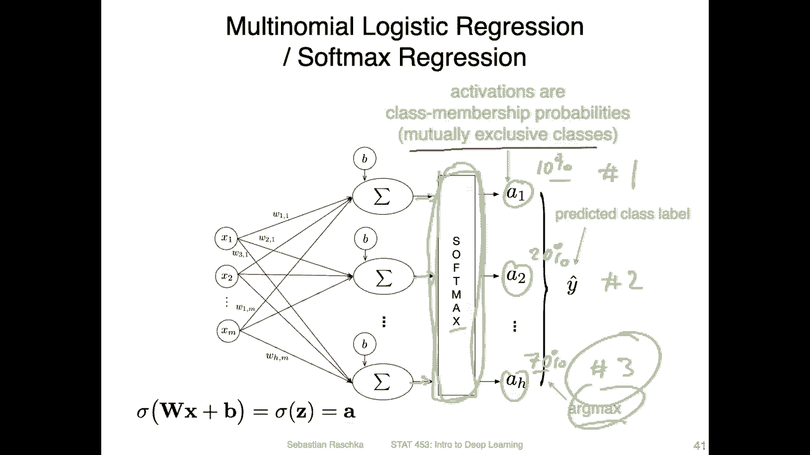

在接下来的课程中，我们将深入探讨用于训练 Softmax 模型的损失函数（通常是交叉熵损失）及其优化方法。