# 课程 P57：L8.7.1 - OneHot 编码与多类别交叉熵 🧮

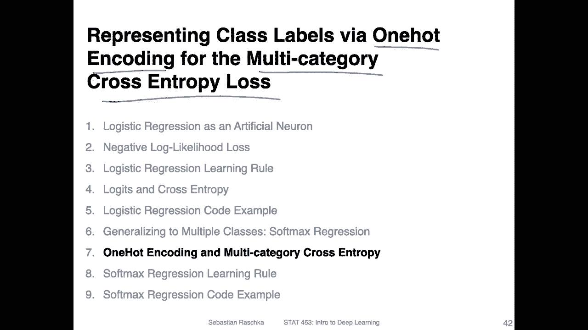

在本节课中，我们将学习 Softmax 回归模型训练所需的多类别交叉熵损失函数。为了使用这个损失函数，我们还需要了解一种表示类别标签的编码方案——OneHot 编码。

---

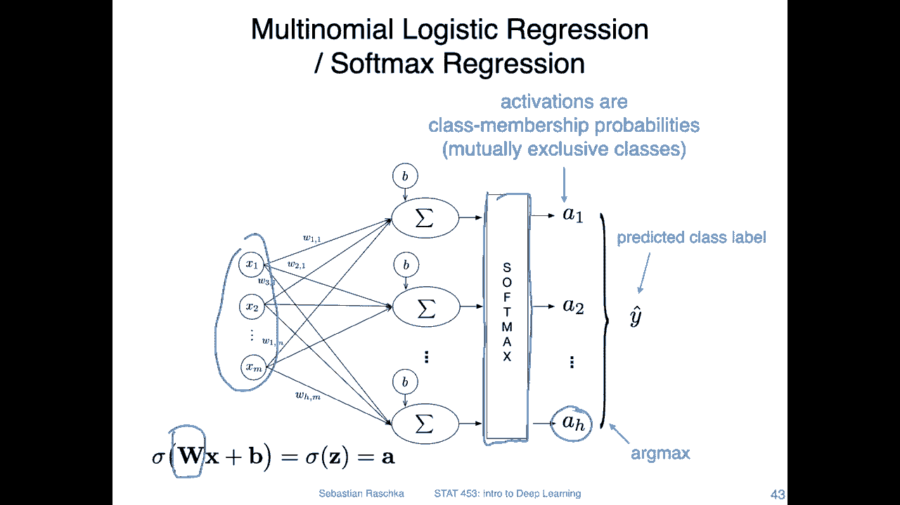

## 1. Softmax 激活函数回顾 🔄

上一节我们介绍了 Softmax 回归模型的基本结构。本节中，我们来看看用于计算类别概率的 Softmax 激活函数。

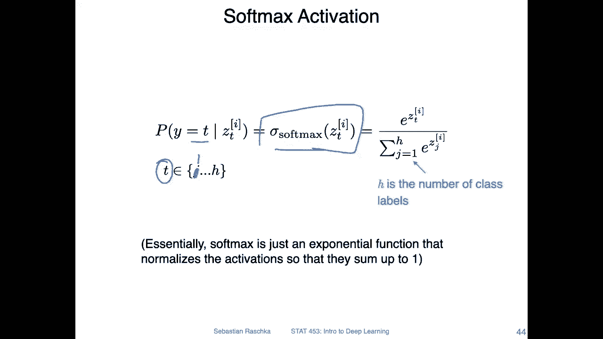

Softmax 函数本质上是一个归一化函数，可以看作是逻辑 Sigmoid 函数在多类别情况下的推广。它确保所有输出类别的概率之和为 1。

假设我们有 `H` 个类别，对于第 `t` 个类别，其概率计算公式如下：

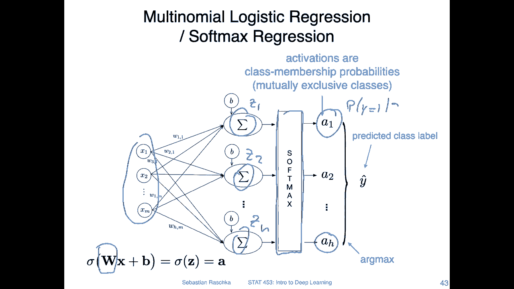

**公式：**
\[
a_t = \frac{e^{z_t}}{\sum_{j=1}^{H} e^{z_j}}
\]

其中：
*   `z_t` 是第 `t` 个类别的净输入（即线性层的输出）。
*   分母是所有类别净输入指数值的总和，起到归一化的作用。


应用 Softmax 后，每个输出 `a_t` 都是一个介于 0 和 1 之间的值，并且所有 `H` 个输出的总和为 1。

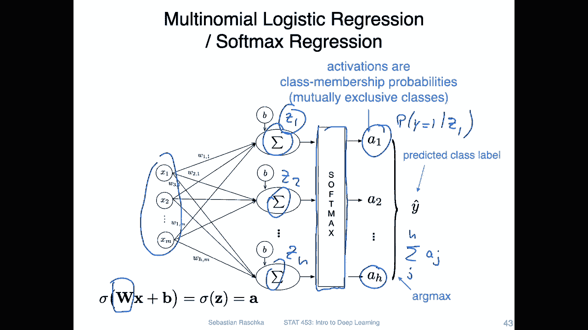

---

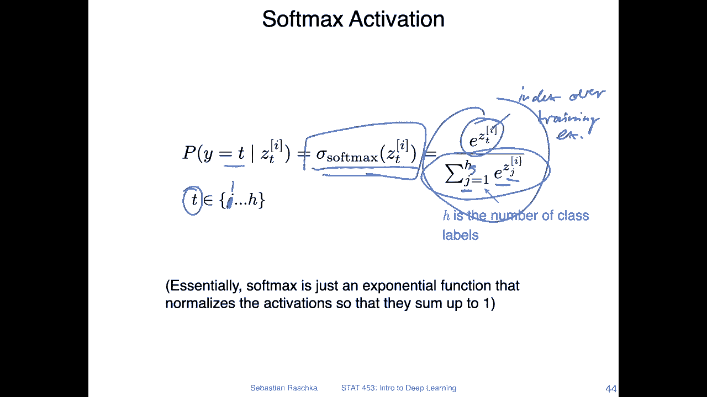

## 2. OneHot 编码 🏷️

在讨论损失函数之前，我们需要先理解如何表示类别标签。OneHot 编码是一种将分类变量转换为机器学习模型易于处理格式的常用方法。

OneHot 编码为每个可能的类别值创建一个新的二进制列（特征）。对于每个样本，只有其真实类别对应的列值为 1，其他所有列的值都为 0。

以下是一个具体的例子：

假设我们有一个包含 4 个样本的数据集，可能的类别标签是 {0, 1, 2, 3}。

原始类别标签向量：
```
[0, 1, 3, 2]
```

应用 OneHot 编码后，我们得到一个矩阵：

| 样本 | 类别_0 | 类别_1 | 类别_2 | 类别_3 |
| :--- | :----: | :----: | :----: | :----: |
| 1    | **1**  |   0    |   0    |   0    |
| 2    |   0    | **1**  |   0    |   0    |
| 3    |   0    |   0    |   0    | **1**  |
| 4    |   0    |   0    | **1**  |   0    |

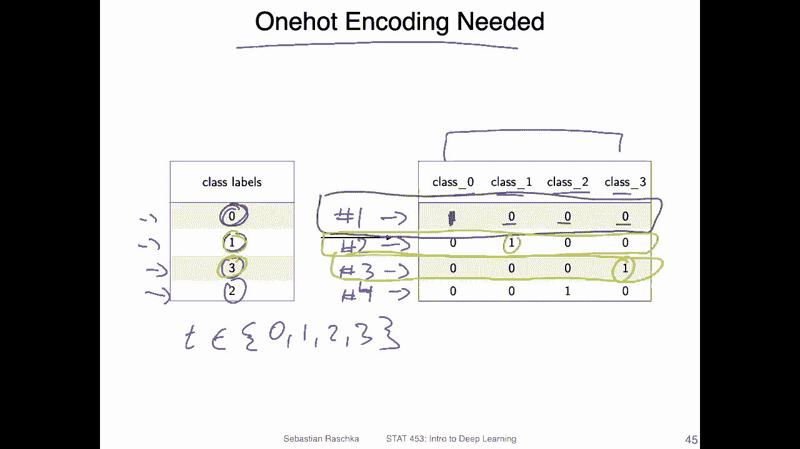

可以看到，每个样本的标签都被转换成了一个仅在其真实类别位置为 1，其余位置为 0 的向量。

---

## 3. 多类别交叉熵损失函数 ⚖️

现在，我们可以结合 Softmax 输出和 OneHot 编码的标签来定义损失函数。多类别交叉熵损失是二元交叉熵损失在多类别问题上的自然推广。

损失函数的目标是：当模型对真实类别的预测概率很高时，损失值很低；当预测概率很低时，损失值很高。

对于一个有 `H` 个类别的数据集，其损失计算公式如下：

**公式：**
\[
L = -\frac{1}{N} \sum_{i=1}^{N} \sum_{j=1}^{H} y_{ij} \cdot \log(a_{ij})
\]

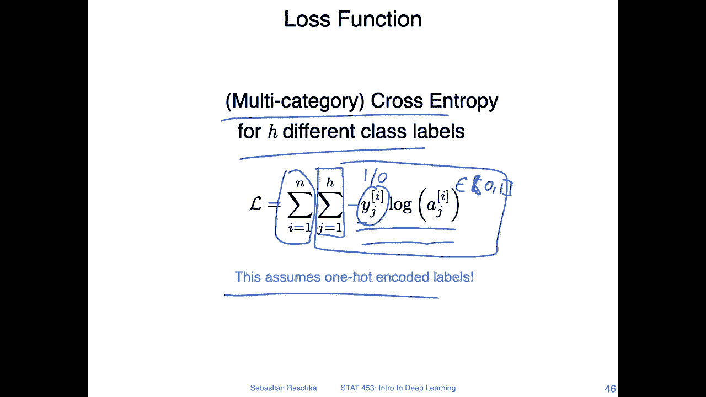

其中：
*   `N` 是样本数量。
*   `H` 是类别数量。
*   `y_{ij}` 是第 `i` 个样本在第 `j` 个类别上的 OneHot 编码值（0 或 1）。
*   `a_{ij}` 是模型预测的第 `i` 个样本属于第 `j` 个类别的概率（Softmax 输出）。

**关键点：** 由于 `y_{ij}` 是 OneHot 编码，对于每个样本 `i`，只有一个 `j` 使得 `y_{ij} = 1`（对应真实类别），其他 `j` 的 `y_{ij}` 都为 0。因此，对于每个样本，内部求和实际上只计算了**真实类别**对应的那个 `-log(a)` 项。

---

## 4. 计算示例 📝

为了更清晰地理解，让我们通过一个具体例子来计算损失。

假设我们有 4 个样本，3 个类别。经过 OneHot 编码的真实标签 `y` 和模型 Softmax 输出的预测概率 `a` 如下：

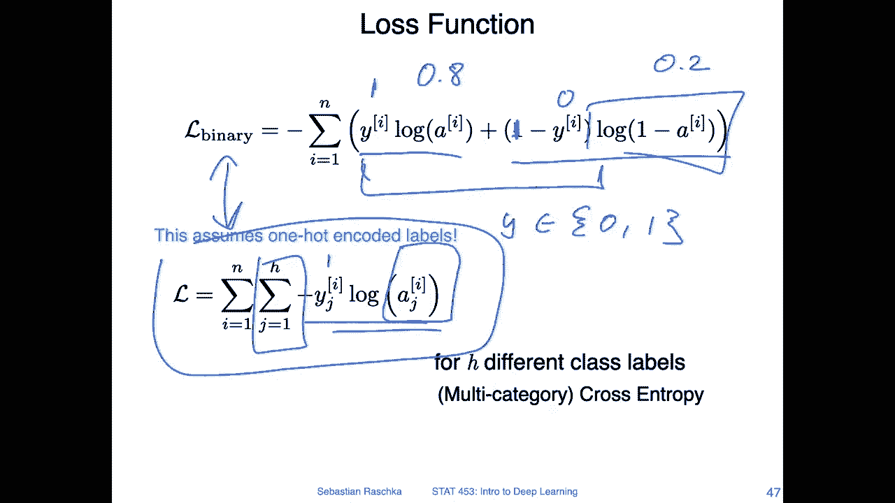

**真实标签 (y):**
```
[ [1, 0, 0],   # 样本1，真实类别为0
  [0, 1, 0],   # 样本2，真实类别为1
  [0, 0, 1],   # 样本3，真实类别为2
  [0, 0, 1] ]  # 样本4，真实类别为2
```

**预测概率 (a):**
```
[ [0.7, 0.2, 0.1],  # 样本1的预测概率分布
  [0.1, 0.8, 0.1],  # 样本2的预测概率分布
  [0.2, 0.3, 0.5],  # 样本3的预测概率分布
  [0.1, 0.1, 0.8] ] # 样本4的预测概率分布
```

现在，我们计算每个样本的损失：

*   **样本1:** 真实类别是0，对应预测概率为 0.7。
    *   损失 = `-log(0.7) ≈ 0.357`
*   **样本2:** 真实类别是1，对应预测概率为 0.8。
    *   损失 = `-log(0.8) ≈ 0.223`
*   **样本3:** 真实类别是2，对应预测概率为 0.5。
    *   损失 = `-log(0.5) ≈ 0.693`
*   **样本4:** 真实类别是2，对应预测概率为 0.8。
    *   损失 = `-log(0.8) ≈ 0.223`

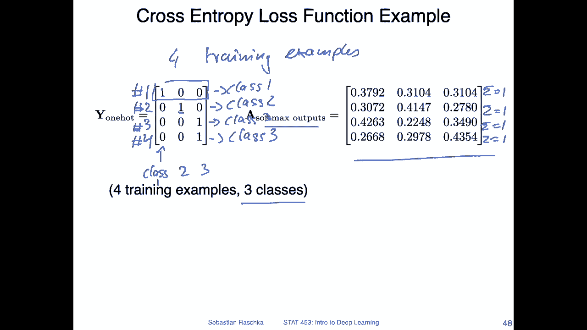

最后，计算整个批次的平均损失：
\[
L = \frac{0.357 + 0.223 + 0.693 + 0.223}{4} \approx 0.374
\]

在深度学习中，我们通常计算**平均损失**而非总和，因为这有助于在使用不同批次大小时，更稳定地设置学习率。

---

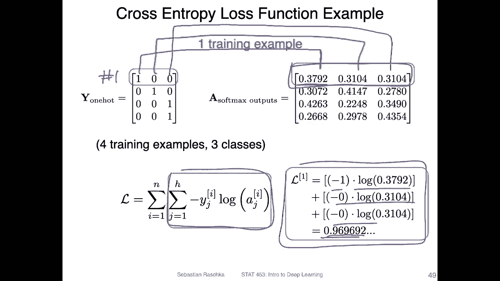

## 5. 与二元交叉熵的联系 🔗

多类别交叉熵是二元交叉熵的直接扩展。当类别数 `H=2` 时，两者是等价的。

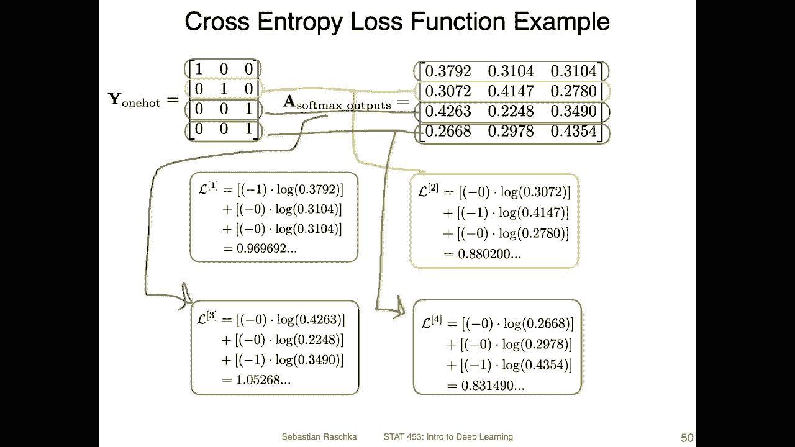

二元交叉熵公式为：
\[
L_{binary} = -[y \cdot \log(a) + (1-y) \cdot \log(1-a)]
\]

在二分类且使用 OneHot 编码（例如，类别表示为 `[1,0]` 和 `[0,1]`）的情况下，多类别交叉熵公式会退化为与上述公式相同的形式。这证明了其一致性。

---

## 总结 📚

本节课中我们一起学习了：
1.  **Softmax 函数**：用于将神经网络的净输入转换为代表类别概率的分布，确保所有概率之和为 1。
2.  **OneHot 编码**：一种将类别标签转换为二进制向量的方法，其中只有真实类别对应的位置为 1。
3.  **多类别交叉熵损失**：衡量模型预测概率分布与真实 OneHot 标签之间差异的函数。它是训练多类别分类模型（如 Softmax 回归）的核心。

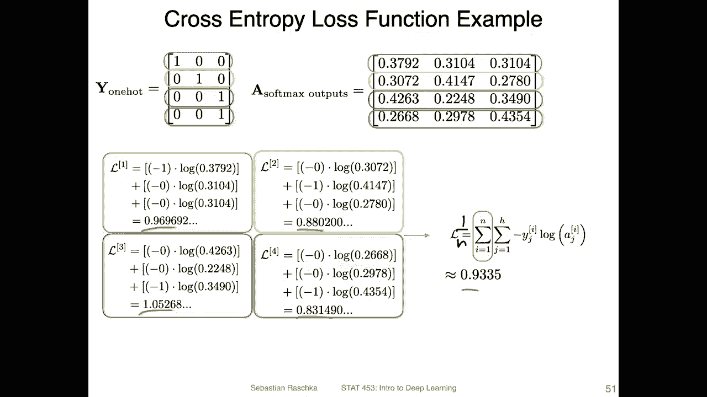

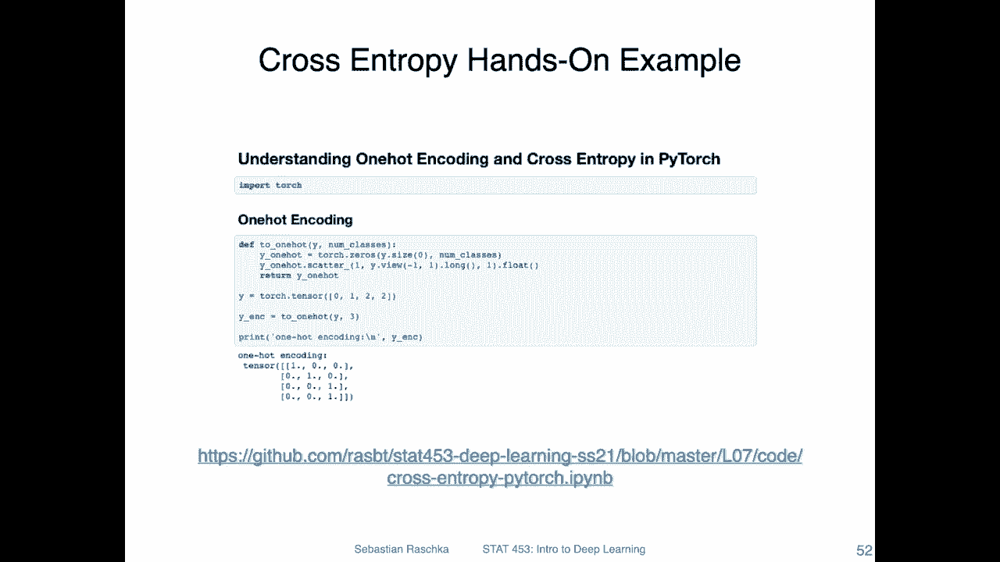

理解这些概念是构建和训练有效分类神经网络的基础。在接下来的实践中，我们将看到如何在 PyTorch 等框架中轻松实现这些计算。