# 课程 P59：L8.8 - 梯度下降的 Softmax 回归导数 🧮

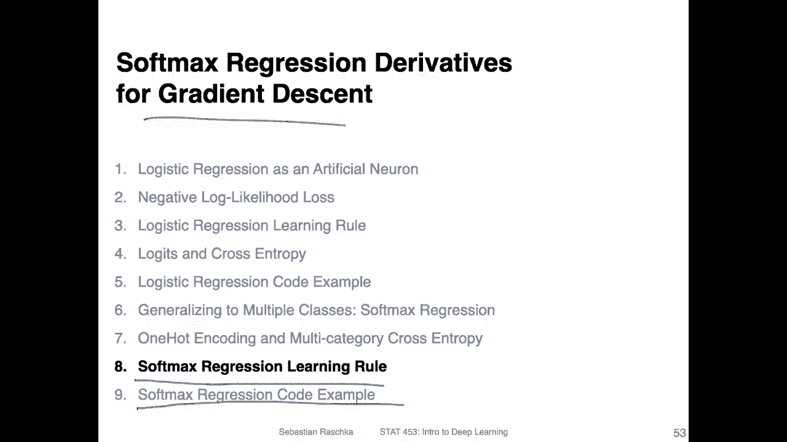

在本节课中，我们将要学习如何计算 Softmax 回归的梯度，即损失函数相对于权重和偏置单元的导数。掌握这些导数后，我们就能使用梯度下降或随机梯度下降来训练 Softmax 回归分类器。我们将首先介绍其核心概念，然后通过代码实现来验证其工作原理。

## 核心概念与计算图 📊

上一节我们介绍了 Softmax 回归的基本形式。本节中我们来看看其梯度计算的核心概念。Softmax 回归的学习规则与之前讨论的 Adaline 和逻辑回归分类器在概念上是相同的，因为它仍然是一个单层神经网络。

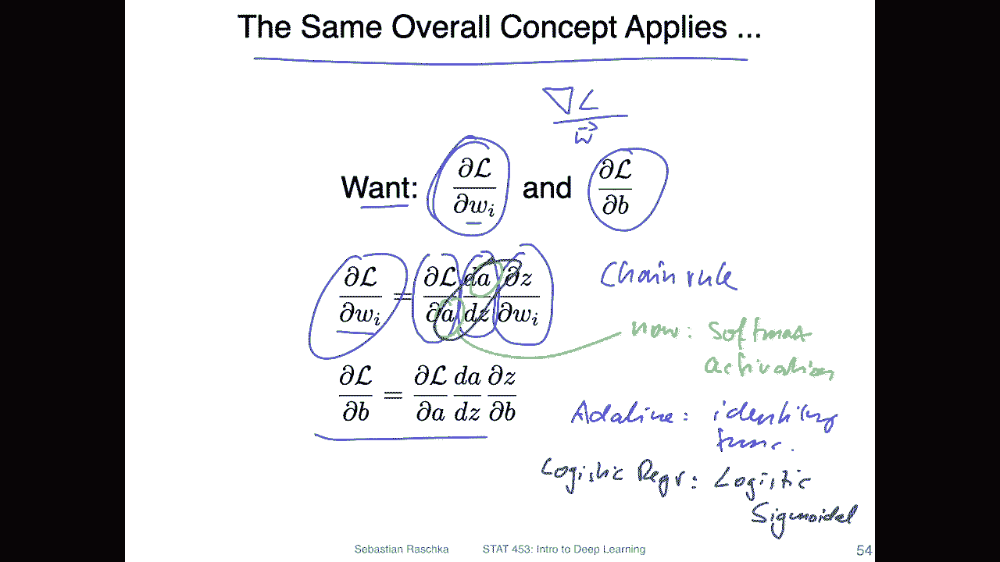

我们首先需要的是损失函数相对于某个权重 \( w_{ij} \) 的偏导数，或者更一般地，损失函数相对于整个权重向量的梯度。我们同样需要计算损失函数相对于偏置单元的偏导数。有了这些偏导数，我们就可以使用随机梯度下降来更新权重，这与我们在 Adaline、线性回归和逻辑回归中的做法一致。

我们可以使用链式法则将这个导数分解为几个部分：损失相对于激活函数的导数、激活函数相对于净输入的导数，以及净输入相对于权重 \( w_{ij} \) 的导数。与常规逻辑回归的唯一区别在于，我们现在使用的是 **Softmax 激活函数**。在 Adaline 中，激活函数是恒等函数；在常规逻辑回归中，激活函数是 Sigmoid 函数。因此，真正改变的是激活函数的形式。

为了更直观地理解，我们可以查看 Softmax 回归的计算图。请注意，这并非多层神经网络（我们将在下一讲讨论），它仍然只有一层，没有隐藏层。图中将净输入和激活函数作为中间步骤明确画出，这有助于理解。在 Softmax 激活中，每个输出单元的激活值都依赖于所有的净输入，因为存在归一化过程。

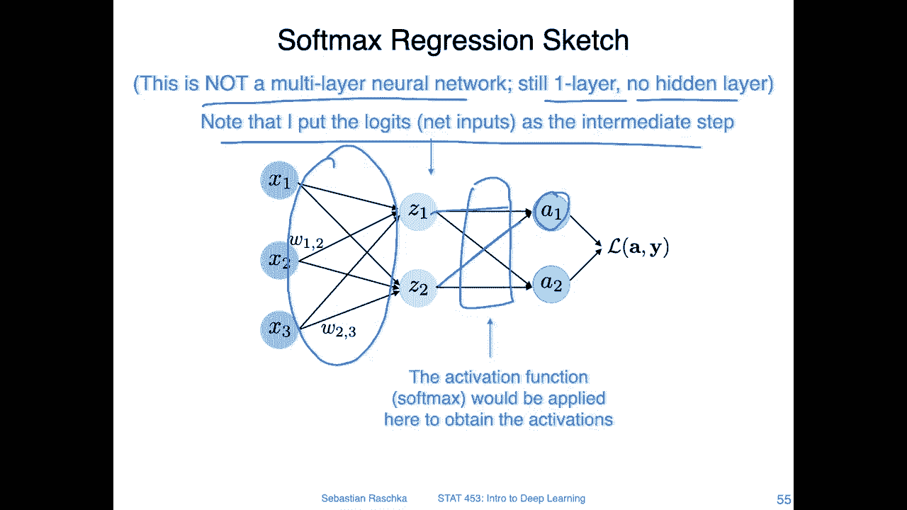

## 多元链式法则的应用 🔗

由于 Softmax 函数的特性，当我们计算损失相对于某个权重（例如 \( w_{1,2} \)）的偏导数时，情况比逻辑回归更复杂。该权重不仅通过路径 \( z_1 \rightarrow a_1 \rightarrow L \) 影响损失，还通过路径 \( z_1 \rightarrow a_2 \rightarrow L \) 影响损失，因为 \( z_1 \) 参与了所有 Softmax 单元的计算。

因此，我们必须使用**多元链式法则**。对于上方的路径（涉及 \( a_1 \)），我们将偏导数分解为：\( \frac{\partial L}{\partial a_1} \cdot \frac{\partial a_1}{\partial z_1} \cdot \frac{\partial z_1}{\partial w_{1,2}} \)。对于下方的路径（涉及 \( a_2 \)），我们分解为：\( \frac{\partial L}{\partial a_2} \cdot \frac{\partial a_2}{\partial z_1} \cdot \frac{\partial z_1}{\partial w_{1,2}} \)。然后将两部分相加。

接下来，我们将逐步推导这些项。

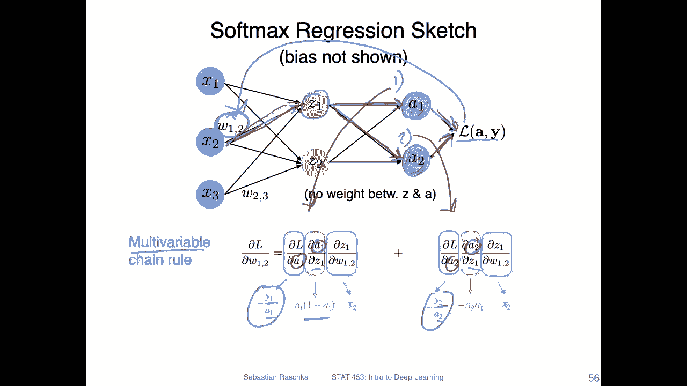

### 1. 损失函数对激活的导数 📉

首先计算 \( \frac{\partial L}{\partial a_1} \)。损失函数是多类别交叉熵（这里省略了对训练样本的求和，仅看一个样本）：
\[
L = -\sum_{j=1}^{H} y_j \log(a_j)
\]
其中 \( H \) 是类别数。当我们对 \( a_1 \) 求偏导时，求和中除了 \( j=1 \) 的项，其他项都是常数，导数为零。因此可以去掉求和符号，得到：
\[
\frac{\partial L}{\partial a_1} = -\frac{y_1}{a_1}
\]
同理，对于 \( \frac{\partial L}{\partial a_2} \)，有：
\[
\frac{\partial L}{\partial a_2} = -\frac{y_2}{a_2}
\]

### 2. Softmax 激活对净输入的导数 🧮

这部分计算稍复杂，但遵循明确的数学规则。我们需要计算 \( \frac{\partial a_1}{\partial z_1} \) 和 \( \frac{\partial a_2}{\partial z_1} \)。

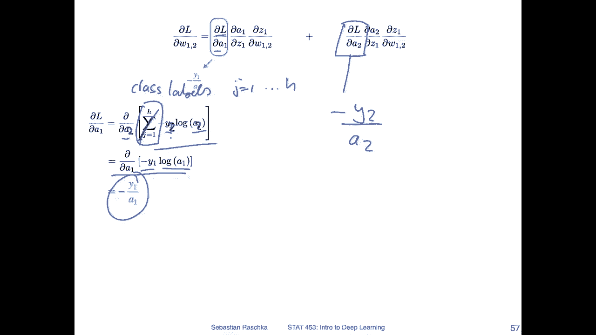

**对于 \( \frac{\partial a_1}{\partial z_1} \)**：
Softmax 函数为 \( a_1 = \frac{e^{z_1}}{\sum_{k=1}^{H} e^{z_k}} \)。这是一个商的形式，我们使用**商的求导法则**。令 \( f = e^{z_1} \)，\( g = \sum_{k=1}^{H} e^{z_k} \)。
根据法则 \( (f/g)' = (f'g - fg') / g^2 \)：
- \( f' = e^{z_1} \)
- \( g' = e^{z_1} \) （因为对 \( z_1 \) 求导时，求和项中只有 \( e^{z_1} \) 这项有导数）
代入公式并化简后，可以得到：
\[
\frac{\partial a_1}{\partial z_1} = a_1 (1 - a_1)
\]

**对于 \( \frac{\partial a_2}{\partial z_1} \)**：
此时 \( a_2 = \frac{e^{z_2}}{\sum_{k=1}^{H} e^{z_k}} \)。同样应用商的求导法则，但注意分子 \( e^{z_2} \) 相对于 \( z_1 \) 是常数，其导数为 0。化简后得到：
\[
\frac{\partial a_2}{\partial z_1} = -a_1 a_2
\]

### 3. 净输入对权重的导数 ⚖️

最后一项 \( \frac{\partial z_1}{\partial w_{1,2}} \) 非常简单。因为 \( z_1 = w_{1,1}x_1 + w_{1,2}x_2 + ... + b_1 \)，所以：
\[
\frac{\partial z_1}{\partial w_{1,2}} = x_2
\]

## 组合结果与简化公式 ✨

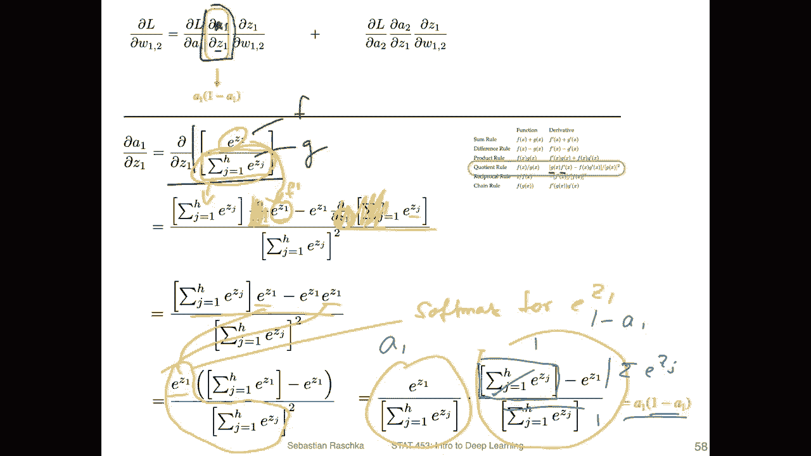

现在，我们将所有部分组合起来，计算 \( \frac{\partial L}{\partial w_{1,2}} \)：

\[
\frac{\partial L}{\partial w_{1,2}} = \left( \frac{\partial L}{\partial a_1} \cdot \frac{\partial a_1}{\partial z_1} + \frac{\partial L}{\partial a_2} \cdot \frac{\partial a_2}{\partial z_1} \right) \cdot \frac{\partial z_1}{\partial w_{1,2}}
\]

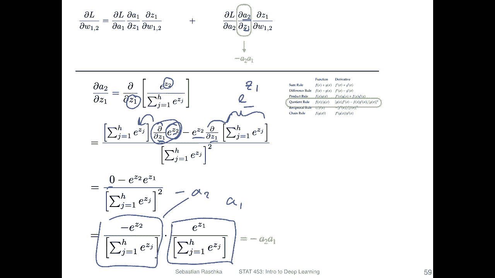

代入我们推导出的各项：
- \( \frac{\partial L}{\partial a_1} = -\frac{y_1}{a_1} \)
- \( \frac{\partial a_1}{\partial z_1} = a_1(1 - a_1) \)
- \( \frac{\partial L}{\partial a_2} = -\frac{y_2}{a_2} \)
- \( \frac{\partial a_2}{\partial z_1} = -a_1 a_2 \)
- \( \frac{\partial z_1}{\partial w_{1,2}} = x_2 \)

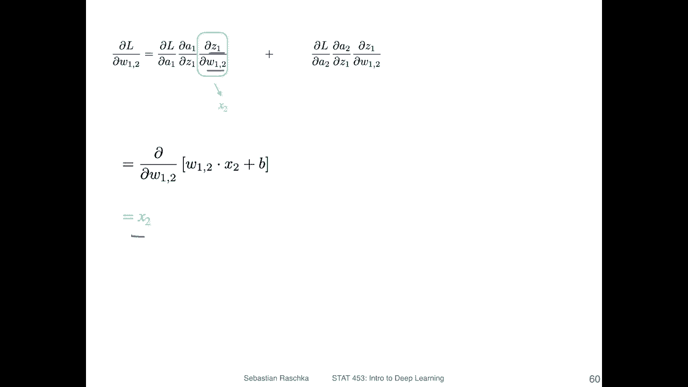

进行代数和化简（过程略），一个非常简洁的结果出现了：
\[
\frac{\partial L}{\partial w_{1,2}} = (a_1 - y_1) \cdot x_2
\]

这令人惊讶地简单！它看起来与 Adaline 和逻辑回归的学习规则完全相同，只是现在有了针对不同输出单元的索引。这表明 **Softmax 激活函数与交叉熵损失函数是完美搭配**，它们的导数形式非常简洁，易于代码实现且数值稳定。如果使用其他损失函数（如均方误差），导数就不会如此优雅地简化。

## 矩阵形式表示 🧩

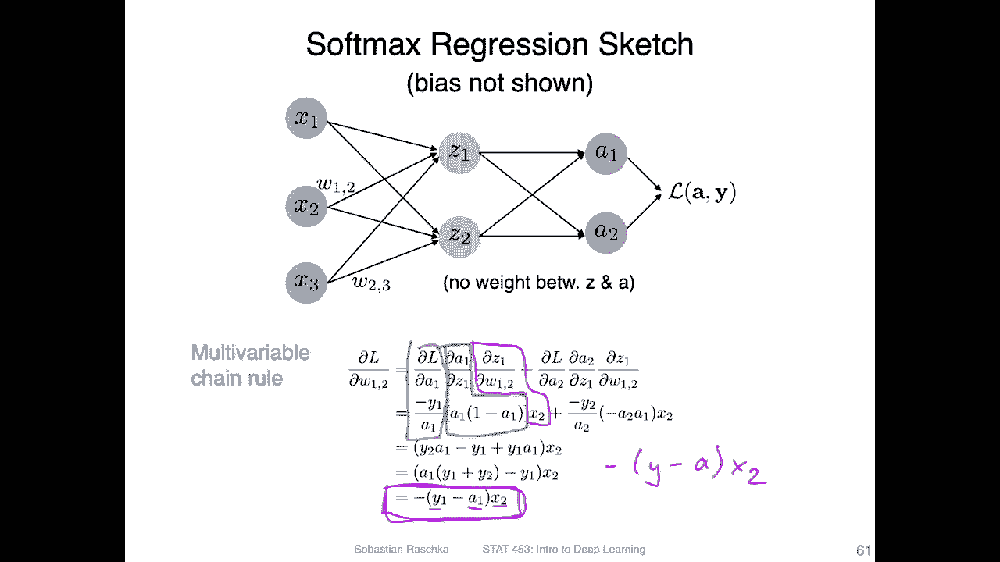

最后，我们可以用更紧凑的线性代数形式来书写这个学习规则。对于所有权重矩阵 \( \mathbf{W} \)，损失函数的梯度可以写为：
\[
\nabla_{\mathbf{W}} L = \mathbf{X}^T (\mathbf{A} - \mathbf{Y})
\]
其中：
- \( \mathbf{X} \) 是 \( n \times m \) 的设计矩阵（\( n \) 个样本，\( m \) 个特征）。
- \( \mathbf{Y} \) 是 \( n \times H \) 的 one-hot 编码真实标签矩阵（\( H \) 个类别）。
- \( \mathbf{A} \) 是 \( n \times H \) 的模型预测概率矩阵（Softmax 输出）。

这种矩阵形式高效且便于在代码中利用优化过的线性代数库。在实践中，我建议先使用简单的 Python 循环实现标量形式以确保正确性，然后再将其转换为矩阵点乘操作。能够手动推导并实现这些梯度，让我们对早期神经网络研究者的工作充满敬意。如今，我们可以借助 PyTorch 等框架的自动微分功能轻松完成。

## 总结 🎯

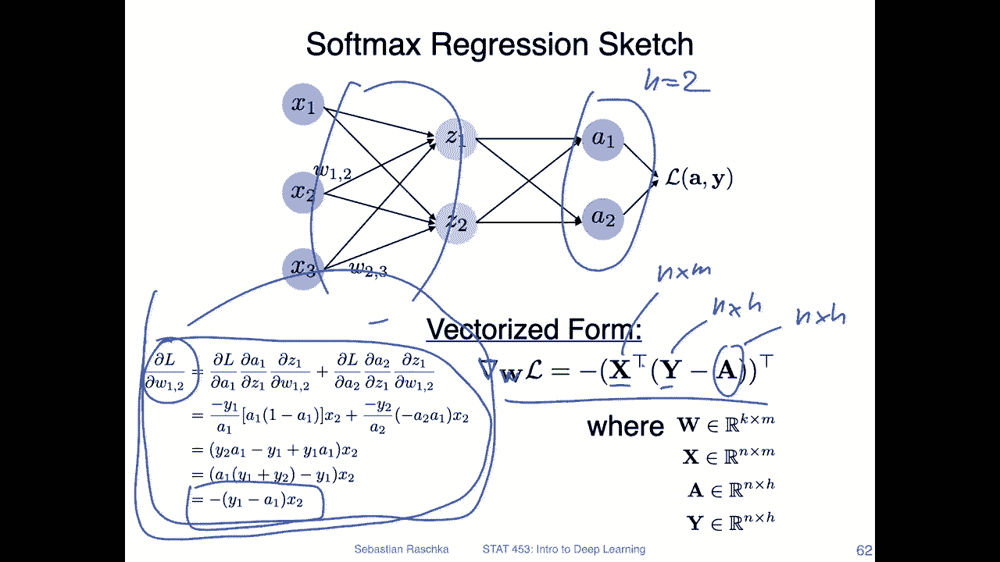

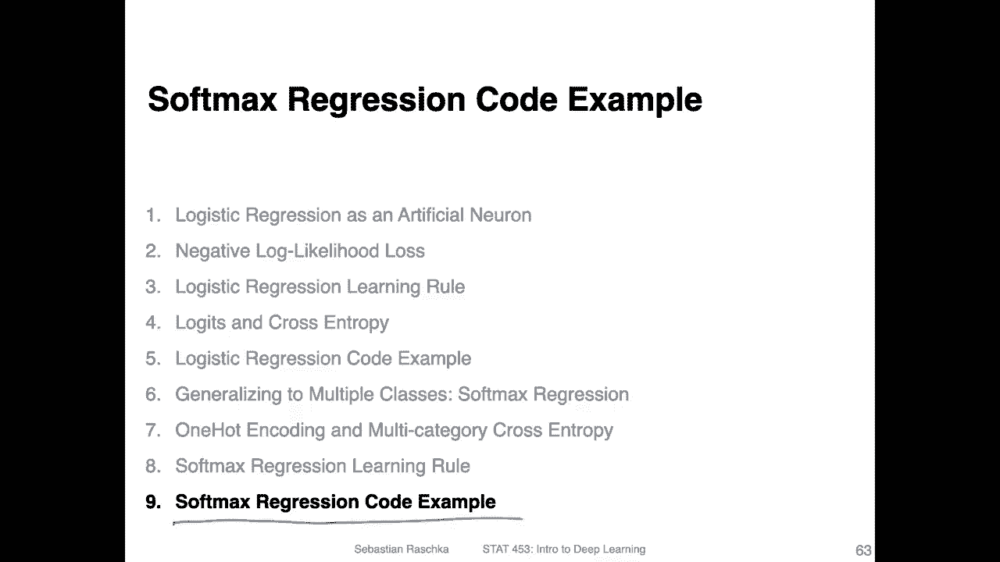

本节课中我们一起学习了 Softmax 回归的梯度计算。我们回顾了核心概念，通过计算图和多元链式法则逐步推导了损失函数相对于权重的偏导数。关键的发现是，Softmax 函数与交叉熵损失结合后，梯度公式变得异常简洁：\( \frac{\partial L}{\partial w_{ij}} = (a_i - y_i) x_j \)。最后，我们看到了该规则的矩阵表示形式 \( \nabla_{\mathbf{W}} L = \mathbf{X}^T (\mathbf{A} - \mathbf{Y}) \)。这个简洁而强大的公式是训练 Softmax 分类器乃至后续更复杂神经网络的基础。在接下来的课程中，我们将利用这个知识进行代码实现，并验证其与自动微分结果的一致性。