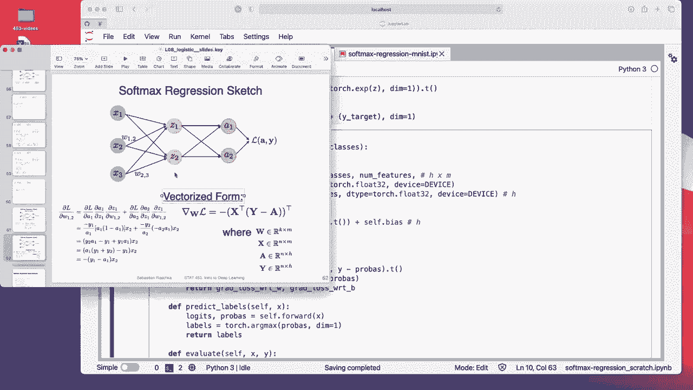
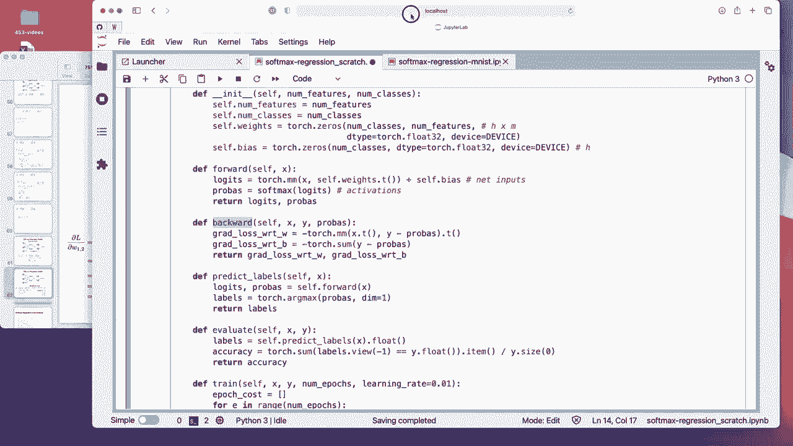
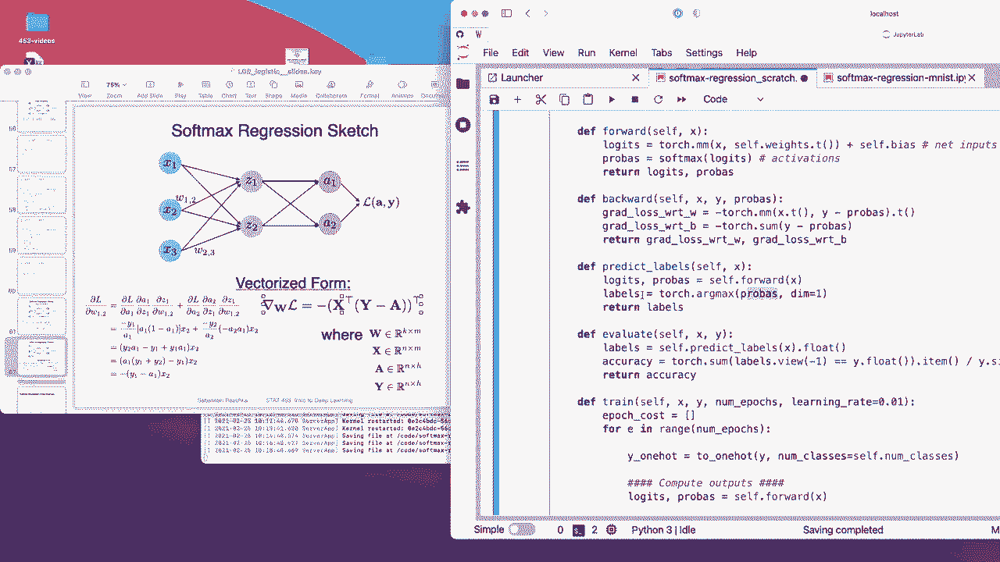
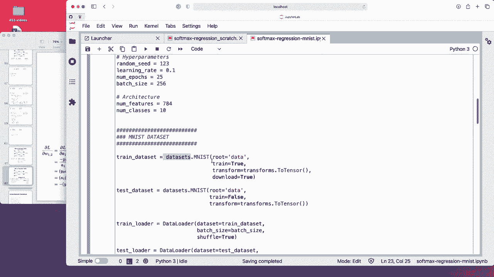
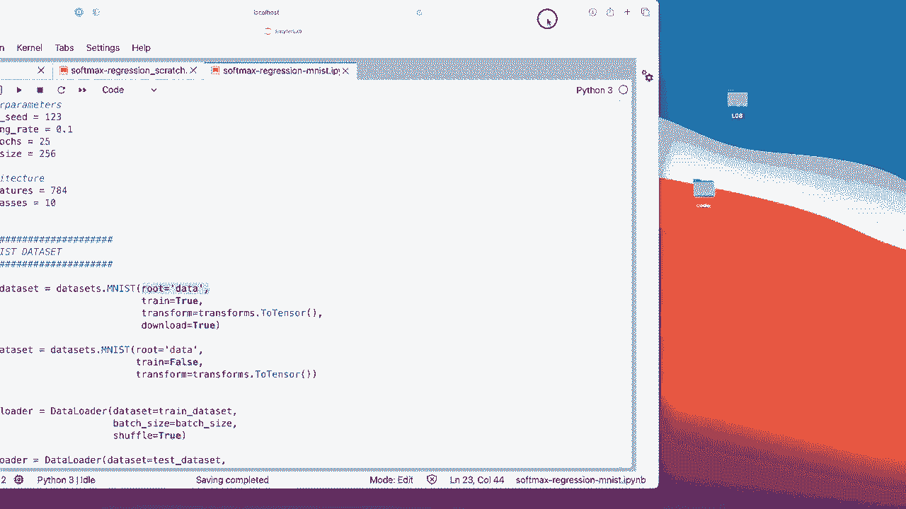
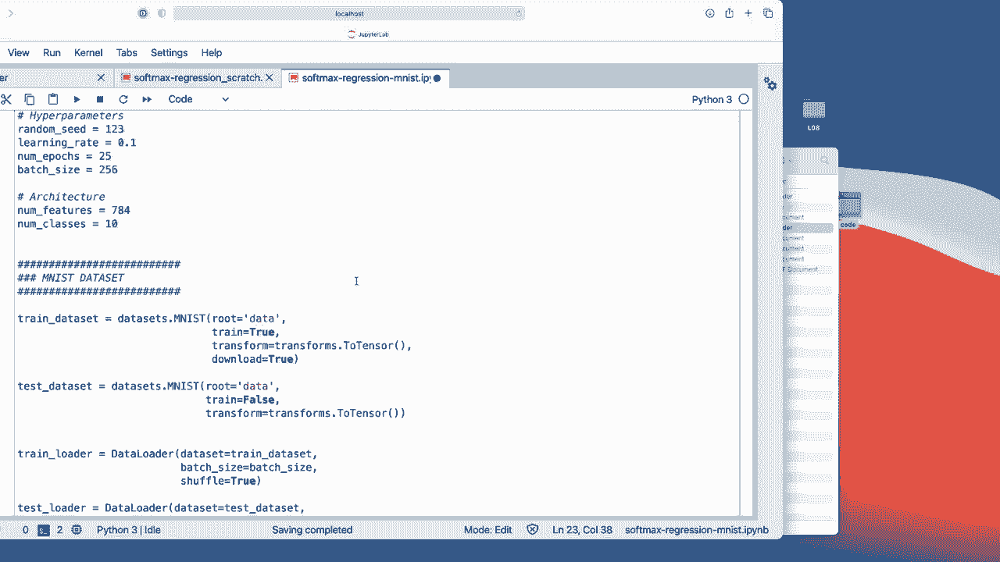
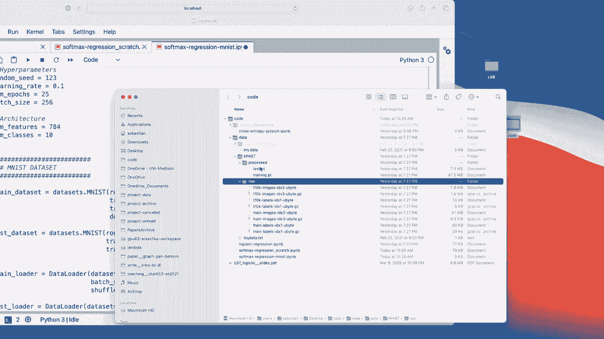
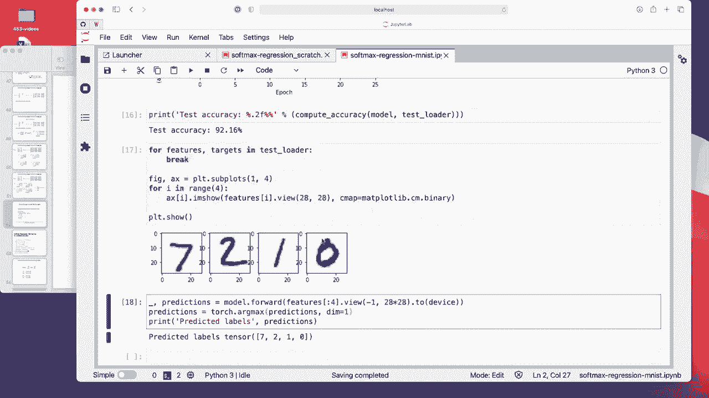

# 课程 P60：L8.9 - 使用 PyTorch 的 Softmax 回归代码示例 📚

在本节课中，我们将学习如何从零开始实现 Softmax 回归模型，并使用向量化形式展示其工作原理。我们还将使用 PyTorch 的高级 API 实现相同的模型，并最终在 MNIST 数据集上应用 Softmax 回归。

---

## 概述

本节课是本次讲座的最后一个视频，我们将通过代码示例来展示如何实现 Softmax 回归模型。我们将首先使用一个简单的 Iris 数据集进行从零开始的实现，然后使用 PyTorch 的模块化 API 实现相同的模型。最后，我们将在 MNIST 数据集上应用 Softmax 回归，作为线性分类器的基线模型。

---

## 1. 从零开始实现 Softmax 回归

上一节我们介绍了 Softmax 回归的数学原理，本节中我们来看看如何将其转化为代码。我们将使用 Iris 数据集，并手动计算梯度。

以下是实现所需的一些辅助函数：



*   `to_onehot`：将类别标签转换为独热编码格式。
*   `softmax`：实现 Softmax 函数。
*   `cross_entropy`：实现交叉熵损失函数。

请注意，在常规使用 PyTorch 时，你通常不需要自己实现这些函数，因为 PyTorch 内部已经提供了这些功能。但在这里，我们手动实现它们，以展示数学概念与代码之间的一一对应关系。

### 1.1 定义模型类



与逻辑回归类似，我们首先定义一个类。在 `__init__` 构造函数中，我们初始化权重和偏置。

```python
class SoftmaxRegression:
    def __init__(self, num_features, num_classes):
        self.num_classes = num_classes
        self.weights = torch.zeros(num_classes, num_features) # 权重矩阵：H x M
        self.bias = torch.zeros(num_classes) # 偏置向量：H 维
```



这里，`H` 是类别数量，`M` 是特征数量。权重 `self.weights` 是一个 `H x M` 的矩阵，偏置 `self.bias` 是一个 `H` 维的向量。

### 1.2 前向传播方法

`forward` 方法用于计算净输入（logits）和应用 Softmax 得到概率。

```python
def forward(self, x):
    # 计算净输入 Z = XW^T + b
    logits = torch.mm(x, self.weights.T) + self.bias
    # 应用 Softmax 得到概率（激活值）
    probas = self.softmax(logits)
    return logits, probas
```

其中，净输入 `logits` 的计算公式为：

**Z = XW^T + b**

### 1.3 反向传播方法

`backward` 方法是核心，我们在这里使用向量化形式计算梯度，而不是使用 `for` 循环。

```python
def backward(self, x, y, probas):
    # 计算权重梯度
    grad_w = -torch.mm((y - probas).T, x)
    # 计算偏置梯度
    grad_b = -torch.sum(y - probas, dim=0)
    return grad_w, grad_b
```

权重梯度 `grad_w` 的计算对应于公式：

**∇_w J = -X^T (Y - A)**

偏置梯度 `grad_b` 的计算对应于对 `(Y - A)` 按列求和。

### 1.4 预测与训练

`predict_labels` 函数通过取概率最高的索引来获得预测的类别标签。

```python
def predict_labels(self, probas):
    labels = torch.argmax(probas, dim=1)
    return labels
```

训练函数 `train` 与逻辑回归类似，主要区别在于需要将标签进行独热编码，然后调用 `forward` 和 `backward` 方法获取梯度，并使用学习率更新权重。

```python
def train(model, x_train, y_train, epochs, learning_rate, batch_size):
    # ... (数据分批等操作)
    for epoch in range(epochs):
        # 独热编码标签
        y_onehot = to_onehot(y_batch, model.num_classes)
        # 前向传播
        logits, probas = model.forward(x_batch)
        # 计算损失
        loss = cross_entropy(probas, y_onehot)
        # 反向传播
        grad_w, grad_b = model.backward(x_batch, y_onehot, probas)
        # 更新参数
        model.weights -= learning_rate * grad_w / batch_size
        model.bias -= learning_rate * grad_b / batch_size
```

训练模型后，我们可以在测试集上评估其性能，并绘制决策区域来可视化分类结果。对于这个简单的三分类 Iris 数据集，Softmax 回归分类器能够相对较好地区分三个类别。

---

## 2. 使用 PyTorch 模块 API 实现

上一节我们手动实现了所有细节，本节中我们来看看如何使用 PyTorch 的高级 API 来简化实现。`torch.nn.Module` API 使许多事情变得更加容易。

### 2.1 定义模型

我们定义一个继承自 `torch.nn.Module` 的类。在 `__init__` 中，我们使用 `nn.Linear` 层来计算净输入。

```python
import torch.nn as nn
import torch.nn.functional as F





class SoftmaxRegressionPyTorch(nn.Module):
    def __init__(self, num_features, num_classes):
        super().__init__()
        # 线性层自动处理权重和偏置的初始化
        self.linear = nn.Linear(num_features, num_classes)
        # 为了与从零实现对比，这里将权重初始化为零
        nn.init.constant_(self.linear.weight, 0)
        nn.init.constant_(self.linear.bias, 0)

    def forward(self, x):
        # 计算净输入
        logits = self.linear(x)
        # 应用 Softmax 得到概率
        probas = F.softmax(logits, dim=1)
        return logits, probas
```



`F` 是 `torch.nn.functional` 的常用别名，它提供了各种神经网络函数，如 `softmax`。



### 2.2 训练模型

使用 PyTorch 训练模型更加简洁。我们定义优化器（如 SGD）和损失函数（交叉熵损失）。

```python
model = SoftmaxRegressionPyTorch(num_features, num_classes)
optimizer = torch.optim.SGD(model.parameters(), lr=learning_rate)
# 注意：PyTorch 的交叉熵损失函数期望输入是 logits，而不是概率
criterion = nn.CrossEntropyLoss()

for epoch in range(epochs):
    # 前向传播
    logits, probas = model(x_batch)
    # 计算损失（标签无需独热编码）
    loss = criterion(logits, y_batch)
    # 反向传播
    optimizer.zero_grad()
    loss.backward()
    # 更新参数
    optimizer.step()
```

关键点在于，PyTorch 的 `nn.CrossEntropyLoss` 内部已经结合了 Softmax 和对数运算，因此它期望的输入是 `logits`（净输入），而不是经过 Softmax 后的概率。同时，它也不需要将标签进行独热编码。

使用 PyTorch API 实现的模型，其训练结果和决策区域与我们从零开始实现的模型几乎完全相同，只有微小的数值舍入误差。

---

## 3. 在 MNIST 数据集上应用 Softmax 回归

之前我们使用了简单的 Iris 数据集，本节中我们来看看如何在更复杂的 MNIST 手写数字数据集上应用 Softmax 回归。这通常是我们在深度学习中使用数据的方式。

### 3.1 使用 DataLoader 加载数据

在深度学习中，我们通常使用 `torch.utils.data.DataLoader` 来加载数据。

```python
from torchvision import datasets, transforms

# 定义数据转换：将图像转换为张量并归一化到 [0,1] 范围
transform = transforms.Compose([
    transforms.ToTensor(),
    transforms.Normalize((0.5,), (0.5,)) # 对于单通道图像，均值和标准差都是 0.5
])

# 加载训练集和测试集
train_dataset = datasets.MNIST(root='./data', train=True, download=True, transform=transform)
test_dataset = datasets.MNIST(root='./data', train=False, download=True, transform=transform)

# 创建 DataLoader
train_loader = torch.utils.data.DataLoader(train_dataset, batch_size=256, shuffle=True)
test_loader = torch.utils.data.DataLoader(test_dataset, batch_size=256, shuffle=False)
```

`DataLoader` 会自动处理数据的分批、打乱等操作。MNIST 图像是 28x28 的灰度图，有一个颜色通道。

### 3.2 调整输入维度

Softmax 回归期望的输入是一个特征向量。因此，我们需要将每张 28x28 的图像展平成一个 784 维的向量。

```python
for images, labels in train_loader:
    # 将图像从 [batch_size, 1, 28, 28] 展平为 [batch_size, 784]
    features = images.view(images.shape[0], -1)
    # ... 后续训练步骤
```

### 3.3 训练与评估

使用与之前相同的 PyTorch 模型进行训练。在 MNIST 数据集上，仅使用线性 Softmax 回归分类器，我们就可以获得大约 92% 的测试准确率。

```python
# 训练循环
for epoch in range(epochs):
    for images, labels in train_loader:
        features = images.view(images.shape[0], -1)
        logits, _ = model(features)
        loss = criterion(logits, labels)
        # ... 反向传播和优化步骤

# 评估测试集准确率
correct = 0
total = 0
with torch.no_grad():
    for images, labels in test_loader:
        features = images.view(images.shape[0], -1)
        logits, _ = model(features)
        _, predicted = torch.max(logits, 1)
        total += labels.size(0)
        correct += (predicted == labels).sum().item()
accuracy = 100 * correct / total
print(f'Test Accuracy: {accuracy:.2f}%')
```

这个结果相当不错，因为它仅使用了一个线性分类器。在处理分类任务时，始终运行逻辑回归或 Softmax 回归作为基线是一个好习惯，这有助于你了解分类问题的难度。例如，如果你训练一个复杂的卷积神经网络只得到 94% 的准确率，而线性模型已经达到 92%，那么你可能需要重新评估你的复杂模型。

---

## 总结



本节课中我们一起学习了 Softmax 回归的代码实现。我们从零开始，手动实现了前向传播、反向传播和参数更新，深入理解了其数学原理如何转化为代码。接着，我们使用 PyTorch 的高级 `nn.Module` API 简化了实现过程，展示了现代深度学习框架的便捷性。最后，我们将 Softmax 回归应用于 MNIST 数据集，使用 `DataLoader` 加载数据，并获得了不错的分类性能，这为后续更复杂的模型（如多层感知机）提供了一个有价值的性能基线。